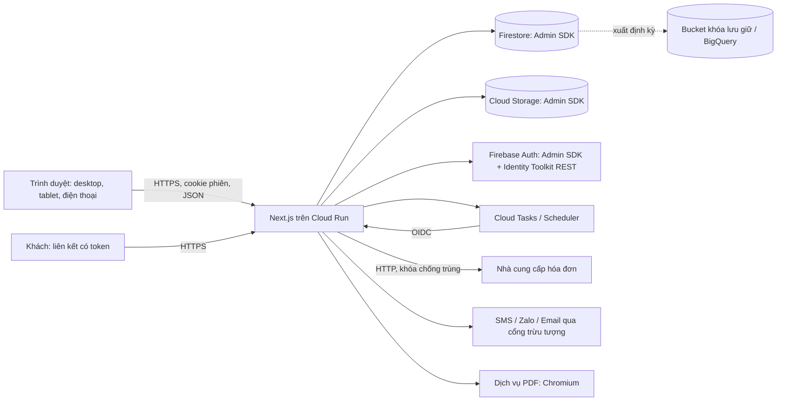

# ADR 0001: Tech stack của GMEP

- **Trạng thái:** Proposed (chờ chủ dự án xác nhận)
- **Ngày:** 31/10/2026
- **Người đề xuất:** dev (senior full-stack)
- **Liên quan:** [Review tài liệu và thiết kế](../dev/review-docs-and-design.md) · [Kế hoạch triển khai](../dev/implementation-plan.md) · `CLAUDE.md` (mục Open decisions)

## 1. Bối cảnh

GMEP là ERP vận hành cho chuỗi garage ô tô tại Việt Nam, thay Excel: tiếp nhận và lệnh sửa chữa, kho phụ tùng, khách và xe, thu tiền và kế toán quản trị, hóa đơn điện tử, báo cáo hợp nhất. Web responsive cho desktop quầy, tablet xưởng, điện thoại quản lý.

Yếu tố quyết định kỹ thuật (từ BRD, FRD, `CLAUDE.md`; số lượng là ước tính của khách, chưa xác nhận):

| Yếu tố | Giá trị |
| --- | --- |
| Quy mô | 8 chi nhánh hiện tại, 20 sau hai năm; 120 đến 200 xe/ngày, sau hai năm 500 đến 800; 80 đến 100 người dùng, sau hai năm 250 đến 300 (NFR-SCL-01) |
| Hiệu năng | Thao tác thường dưới 2 giây trên 4G; dashboard hợp nhất toàn chuỗi dưới 5 giây với dữ liệu một năm (NFR-PERF-01, 02) |
| Sẵn sàng | 99,5% trong giờ làm việc; mất tối đa 1 giờ dữ liệu, khôi phục trong 4 giờ `[Cần xác nhận]` (NFR-AVA-01, 02) |
| Toàn vẹn | Kho (giữ chỗ, bốn con số tồn), tiền (chia nhiều lần, phân bổ nhiều-nhiều), hóa đơn (không phát hành trùng) cần giao dịch an toàn (RULE-007 đến 010, FR-EIN-013) |
| Cách ly | Dữ liệu chi nhánh tách ở danh sách, tìm kiếm, báo cáo, xuất, API (NFR-ISO-01); thêm chi nhánh chỉ bằng cấu hình (NFR-SCA-01) |
| Pháp lý | Luật Bảo vệ dữ liệu cá nhân 2025 (che SĐT và địa chỉ theo vai trò, nhật ký truy cập), hóa đơn Nghị định 254/2026, kế toán Thông tư 99/2025 |
| Khác | Nhật ký thao tác bất biến (FR-SYS-003); quy tắc luật là cấu hình có hiệu lực (NFR-MNT-01); mất mạng chỉ cảnh báo và lưu nháp; in A4, A5, nhiệt; quét mã vạch bằng camera |

## 2. Quyết định đã chốt (chủ dự án, không bàn lại trong ADR này)

1. **Next.js full-stack.** Phần máy chủ của Next.js (Route Handlers và mã chạy trên server) là backend.
2. **Firebase:** Firestore làm cơ sở dữ liệu, Firebase Authentication làm xác thực, Cloud Storage làm lưu tệp.
3. **Quy tắc cứng:** không có gì ở client được gọi Firebase trực tiếp. Trình duyệt chỉ nói chuyện với API của chúng ta. Firebase client SDK không được đưa xuống trình duyệt; Firestore Security Rules và Storage Rules **từ chối mọi truy cập client** (`allow read, write: if false`); chỉ dùng Admin SDK ở server. Phiên làm việc dùng cookie phiên phía máy chủ (Firebase Admin session cookie); RBAC và cách ly chi nhánh do server thi hành (NFR-ISO-01).

ADR này (a) **đề xuất** các lựa chọn bổ sung, (b) nêu thẳng rủi ro của lựa chọn Firebase kèm biện pháp, (c) nêu những quyết định cần chủ dự án xác nhận.

## 3. Tóm tắt đề xuất

| Lớp | Đề xuất |
| --- | --- |
| Ngôn ngữ, runtime | TypeScript `strict`, Node.js LTS hiện hành tại thời điểm scaffold, `pnpm` |
| Ứng dụng | Next.js App Router, **modular monolith** theo mã phân hệ, kiến trúc phân lớp (transport, application, domain, persistence) |
| API | Route Handlers `/api/v1`, `zod` kiểm dữ liệu, sinh OpenAPI từ schema `zod`, lỗi theo RFC 9457, phân trang bằng con trỏ, `Idempotency-Key` cho ghi rủi ro |
| Lớp truy cập dữ liệu | Giao diện repository và `UnitOfWork` đặt trong từng module, bộ chuyển Firestore ở `infrastructure`; **mọi truy vấn bắt buộc có `Scope` (công ty, tập chi nhánh)** |
| Xác thực | Firebase Auth làm kho danh tính và phát token; **kiểm mật khẩu, PIN, TOTP, khóa tài khoản làm ở server**; cookie phiên `__Host-`, `HttpOnly`, `Secure`, `SameSite=Lax` |
| UI | Không dùng bộ UI có style sẵn; **port `design/assets/tokens.css` và `components.css`** (giữ tên class BEM), bọc thành component React; primitive không giao diện (Radix UI hoặc React Aria) cho hành vi truy cập; `lucide-react`; phông Be Vietnam Pro tự host |
| Dữ liệu phía client | Server Components cho lần vẽ đầu; TanStack Query cho thao tác, làm mới định kỳ; TanStack Table cho bảng; biểu đồ SVG tự dựng từ mẫu của prototype |
| i18n, định dạng | `next-intl` (một ngôn ngữ `vi`, vẫn qua tài nguyên chuỗi), `Intl` với `vi-VN`, `date-fns` múi giờ `Asia/Ho_Chi_Minh` |
| Tiền và số | VND là số nguyên; số lượng và giờ là số thập phân lưu dạng số nguyên có tỉ lệ cố định (`decimal.js` ở tầng domain); không dùng số thực |
| Tệp | Cloud Storage qua API trung gian; ảnh nén ở trình duyệt, xử lý bằng `sharp`; **không dùng signed URL phía client trừ khi chủ dự án chấp nhận ngoại lệ** (§7.3) |
| Tác vụ nền | Cloud Tasks + Cloud Scheduler gọi endpoint nội bộ có xác thực OIDC; Cloud Run Jobs cho tác vụ dài |
| In và PDF | In trình duyệt từ HTML in-first (A4, A5, nhiệt 80 mm); PDF máy chủ bằng Chromium (Playwright) trong dịch vụ riêng, dùng cùng mẫu HTML |
| Quét mã vạch | `BarcodeDetector` khi có, dự phòng `zxing-wasm`; máy quét USB hoạt động như bàn phím |
| Hóa đơn điện tử | Giao diện `EInvoiceProvider` độc lập nhà cung cấp, bộ giả lập có chèn lỗi cho test, bộ chuyển thật làm sau khi khách chọn nhà cung cấp |
| Kiểm thử | Vitest (đơn vị, tích hợp với Firebase Emulator), Playwright (e2e và a11y với axe), k6 (tải) |
| Quan sát | Log JSON (`pino`) lên Cloud Logging có mã tương quan, OpenTelemetry sang Cloud Trace, Error Reporting, Cloud Monitoring cảnh báo |
| CI/CD | GitHub Actions, triển khai Cloud Run qua Workload Identity Federation; bốn môi trường (local emulator, dev, staging, prod) tách dự án GCP |
| Hosting | Cloud Run (một container Next.js `standalone`), vùng `asia-southeast1` (Singapore) `[Cần xác nhận]`, `min-instances` ≥ 1 |
| Sao lưu | Firestore PITR 7 ngày + sao lưu theo lịch hằng ngày + xuất định kỳ sang bucket khóa lưu giữ ở dự án khác |

Mọi mục trên là **đề xuất**. Các mục phải chủ dự án xác nhận nằm ở §12.

## 4. Kiến trúc tổng quát



Trình duyệt chỉ có một đích duy nhất là `N`. Không có `firebase`, `@firebase/*`, hoặc khóa dự án Firebase nào trong bundle trình duyệt (kiểm bằng bước CI, xem §8, R-12).

## 5. Phân hệ và ranh giới trong mã

`src/modules/{rec,ins,crm,inv,pur,hrm,acc,ein,rpt,sys}` mỗi module có `domain/` (thực thể, máy trạng thái, công thức, thuần), `application/` (use case, giao dịch), `ports/` (giao diện repository và cổng ngoài), `api/` (Route Handlers mỏng). Phụ thuộc giữa module chỉ qua giao diện công khai (`index.ts`) hoặc sự kiện; kiểm bằng `dependency-cruiser` trong CI. `infrastructure/firestore`, `infrastructure/storage`, `infrastructure/auth` là bộ chuyển. Chi tiết ở kế hoạch triển khai §2.

## 6. Thiết kế quanh ràng buộc "Firebase chỉ qua server"

### 6.1 Firestore: các mối lo và cách xử lý

Đây là phần trung thực nhất của ADR: Firestore không phải cơ sở dữ liệu quan hệ. Bảng dưới nêu từng mối lo, cách xử lý đề xuất, và mức rủi ro còn lại sau khi xử lý.

| Chủ đề | Thực tế của Firestore | Đề xuất | Rủi ro còn lại |
| --- | --- | --- | --- |
| Toàn vẹn giao dịch cho kho, tiền, hóa đơn | Có giao dịch ACID nhiều tài liệu (Admin SDK dùng khóa bi quan; xung đột thì thử lại). Giới hạn thời gian giao dịch (270 giây, treo 60 giây) và số thao tác ghi trong một commit; số cụ thể phải **kiểm chứng ở tài liệu hiện hành** | Một chứng từ kho hoặc phiếu thu = một giao dịch, giới hạn số dòng mỗi chứng từ (đề xuất tối đa 100 dòng, `[Cần xác nhận]` với `ba`); không bao giờ gọi dịch vụ ngoài bên trong giao dịch; chứng từ lớn (kiểm kê hàng nghìn mã, nhập tồn đầu kỳ) tách thành nhiều chứng từ ADJ theo nhóm | Trung bình: không có ràng buộc khóa ngoại, CHECK, trigger của CSDL; mọi bất biến phải ở mã và test |
| Tài liệu nóng (hot document) | Một tài liệu chỉ nên ghi liên tục ở mức thấp (khoảng một lần mỗi giây, ngưỡng mềm, cần kiểm chứng). Ở quy mô này: số dư tồn theo (kho, phụ tùng) ít khi bị hai lệnh ghi cùng lúc; bộ đếm số chứng từ theo (chi nhánh, loại, tháng) khoảng 40 đến 100 lần mỗi ngày | **Không có tài liệu tổng cấp công ty được ghi mỗi sự kiện.** Rollup theo (chi nhánh, ngày), bộ đếm theo (chi nhánh, loại, tháng), số dư theo (kho, phụ tùng); số liệu toàn chuỗi = cộng các rollup chi nhánh khi đọc | Thấp ở mục tiêu 800 xe mỗi ngày (khoảng 40 xe mỗi chi nhánh mỗi ngày); đo trong spike |
| Sổ cái và bút toán đảo | Không có ràng buộc "chỉ thêm"; Admin SDK có thể sửa hoặc xóa mọi thứ | Sổ biến động kho, sổ quỹ, nhật ký là các collection **chỉ ghi thêm** với ID xác định (idempotent); API không cung cấp sửa hoặc xóa; chứng từ đã ghi sổ không bao giờ cập nhật, sai sót sửa bằng chứng từ đảo liên kết gốc (RULE-010); xuất định kỳ sang bucket khóa lưu giữ để có bản không sửa được | Trung bình: bất biến dựa vào kỷ luật mã và IAM; bản xuất khóa lưu giữ là bằng chứng chống sửa |
| Báo cáo hợp nhất, SUM, JOIN | Không có JOIN; có `count()`, `sum()`, `avg()` nhưng tính theo số mục chỉ mục đọc, không phù hợp quét hàng trăm nghìn dòng mỗi lần mở dashboard | **Rollup được duy trì khi ghi** (trong cùng giao dịch cho số tiền và tồn: tăng giảm bằng `increment`) kèm việc đối soát hằng đêm tính lại từ sổ và cảnh báo nếu lệch; rollup tháng dựng khi chốt ngày. Dashboard một năm toàn chuỗi đọc khoảng 20 chi nhánh × 12 tháng = 240 tài liệu. Đi sâu chứng từ (FR-RPT-011) dùng truy vấn có chỉ mục. Phase 4: xuất sang BigQuery cho báo cáo nâng cao | Cao nếu yêu cầu báo cáo tùy biến: mỗi báo cáo mới cần rollup hoặc chỉ mục mới, không phải truy vấn tùy ý |
| Giới hạn truy vấn và chỉ mục | Mọi truy vấn kết hợp lọc và sắp xếp cần chỉ mục tổ hợp, khai báo trước; `in` tối đa 30 giá trị; không `LIKE`, không tìm hậu tố, không truy vấn ad-hoc; **trình giả lập không buộc có chỉ mục nên bài test pass ở local có thể lỗi ở prod** | Bộ lọc và sắp xếp cho phép là danh sách trắng ánh xạ tới chỉ mục; tệp `firestore.indexes.json` được kiểm bằng script so khớp với truy vấn; test tích hợp chạy hằng đêm trên dự án Firestore thật (staging) | Trung bình: mỗi màn hình lọc mới là việc thiết kế chỉ mục |
| Tìm kiếm không dấu | Không có full-text; không phân biệt hoa thường hoặc dấu | Cột chuẩn hóa (`plateNorm`, `phoneNorm`, `nameNorm`, `codeSeq`) bỏ dấu tiếng Việt (chuẩn NFD, thay `đ`), truy vấn tiền tố bằng khoảng `>=` và `<=`; danh mục phụ tùng (dùng chung, ít thay đổi) giữ **chỉ mục trong bộ nhớ ở server** có làm mới theo số phiên bản; cổng `SearchPort` để thay bằng Typesense hoặc Meilisearch khi cần. Kiểu khớp từng thực thể cần `designer` chốt (DS-07) | Trung bình: tìm "chứa chuỗi" trên khối dữ liệu lớn là điểm yếu; bộ nhớ tăng theo số mã |
| Nhật ký thao tác (FR-SYS-003) | Ước tính 800 lệnh mỗi ngày × khoảng 50 thay đổi có nhật ký = khoảng 40.000 tài liệu mỗi ngày, khoảng 15 triệu mỗi năm: chi phí ghi nhỏ, truy vấn phải qua chỉ mục (chi nhánh, thực thể, thời gian) | Nhật ký ghi **trong cùng giao dịch** với thay đổi nghiệp vụ (không có thay đổi mà thiếu nhật ký); lưu id người dùng không lưu họ tên; nhật ký truy cập dữ liệu cá nhân là collection riêng; xuất hằng đêm sang bucket khóa lưu giữ, BigQuery khi cần tra cứu rộng; thời hạn lưu `[Cần xác nhận]` | Thấp đến trung bình |
| Nhập Excel (FR-SYS-007) | Không có giao dịch nhiều nghìn dòng; "không ghi một phần" không có sẵn | Nhập theo giai đoạn: tải lên, kiểm tra toàn bộ ở vùng tạm (`importBatches`), chạy thử không ghi, ghi theo mảnh có `batchId` bằng `BulkWriter`, đánh dấu lô hoàn tất ở cuối; hoàn tác bằng `batchId`. Về logic là "tất cả hoặc không" do trạng thái lô, không phải do CSDL | Trung bình: lỗi giữa chừng cần bước bù trừ được kiểm thử |
| Kiểm soát chi phí đọc | Tính tiền theo số tài liệu đọc; không có cache phía client vì không có SDK client | Phân trang nhỏ (25 đến 50), không tổng số mặc định (`count()` khi cần); bộ nhớ đệm ngắn hạn ở server cho cấu hình và danh mục; làm mới định kỳ bằng **tài liệu phiên bản chi nhánh** (một lần đọc để biết có đổi không) thay vì tải lại danh sách; ước tính thô ở §7.15 | Thấp đến trung bình, theo dõi ở staging có dữ liệu mô phỏng |
| Mô hình nhiều pháp nhân | Không có lược đồ; phải tự quy ước | Mọi tài liệu có `companyId`; chi nhánh gắn pháp nhân theo khoảng hiệu lực; có thể tách thành nhiều database Firestore (hỗ trợ nhiều database mỗi dự án) nếu cần cách ly mạnh | Thấp |
| Cấu hình có hiệu lực | Không có bảng nhiều phiên bản sẵn | Collection phiên bản (`effectiveFrom`, trạng thái, người duyệt); bộ phân giải `resolveAt(loại, phạm vi, ngày)` có cache; tài liệu đã tạo giữ bản chụp giá trị | Thấp |
| Chịu mất mạng | Không có chế độ offline vì không có SDK client | Đúng ý yêu cầu: chỉ cảnh báo và lưu nháp trên thiết bị (IndexedDB, mã hóa không bắt buộc vì nháp không chứa dữ liệu thu tiền); chặn các hành động tiền, kho, hóa đơn khi mất mạng như đã thiết kế | Thấp (phụ thuộc quyết định BA-08) |
| Vùng và pháp lý | Không có vùng đặt tại Việt Nam; vùng châu Á gần nhất là Singapore, Jakarta; không đổi vùng sau khi tạo database | Đề xuất `asia-southeast1`; chốt sau khi luật sư xác nhận (BA-11). Không có multi-region châu Á (cần kiểm chứng); độ bền dựa vào bản sao nội vùng của Firestore cộng sao lưu | Trung bình đến cao về pháp lý, không phải kỹ thuật |
| Sao lưu và khôi phục | PITR đọc lùi tối đa 7 ngày, độ chi tiết 1 phút; sao lưu theo lịch giữ tối đa 14 tuần; **khôi phục tạo database mới**, không ghi đè tại chỗ | Bật PITR và sao lưu hằng ngày; xuất hằng tuần sang bucket khóa lưu giữ ở dự án khác; **diễn tập khôi phục** hằng quý và trước go-live (thời gian khôi phục tăng theo kích thước dữ liệu, RTO 4 giờ phải đo thật); quy trình chuyển ứng dụng sang database đã khôi phục viết thành runbook | Trung bình: RTO chưa đo |
| Phát triển và test cục bộ | Firebase Emulator cho Firestore, Auth, Storage | Dùng cho test đơn vị và tích hợp. **Giới hạn đã biết:** emulator không buộc chỉ mục, không tái hiện đúng tranh chấp thực, một số tính năng Identity Platform (MFA) không có | Trung bình; bù bằng test nightly trên staging thật |

### 6.2 Nơi Firestore là lựa chọn kém và đường lui

Nói thẳng: nếu bắt đầu từ trang giấy trắng, một ERP có sổ kho, sổ quỹ và báo cáo hợp nhất sẽ được xây tự nhiên hơn trên cơ sở dữ liệu quan hệ (PostgreSQL). Firestore kém ở bốn việc, theo thứ tự đau:

1. **Báo cáo và đối chiếu tùy biến** (ví dụ FR-RPT-004 đối chiếu bốn chiều, FR-RPT-014 bộ lọc dùng chung, lợi nhuận theo chi nhánh và nguồn doanh thu): mỗi báo cáo là một thiết kế rollup hoặc chỉ mục.
2. **Bất biến nhiều thực thể** (không có khóa ngoại, CHECK, trigger): mọi quy tắc nằm ở mã.
3. **Tìm kiếm**: không có sẵn full-text, tìm hậu tố hoặc chứa chuỗi.
4. **Quản trị dữ liệu và kế toán** (kết xuất kỳ, sửa dữ liệu sai bằng SQL có kiểm soát, đối soát số dư đầu kỳ): thiếu công cụ truy vấn đặc biệt; cần xuất sang BigQuery để kế toán và dev tra cứu.

**Đường lui (escape hatch), rẻ nếu làm từ đầu:**

- Mọi truy cập dữ liệu đi qua **giao diện repository và `UnitOfWork`** do domain định nghĩa; domain và application không import `firebase-admin`. Ranh giới này được ép bằng `dependency-cruiser`.
- Thiết kế dữ liệu theo **sổ chỉ ghi thêm và rollup**, là mô hình ánh xạ trực tiếp sang PostgreSQL (bảng sổ, bảng tổng hợp, `SELECT ... FOR UPDATE` cho số dư).
- Trình duyệt chỉ nói chuyện với API nên đổi CSDL không đụng giao diện.
- Chi phí chuyển: đổi bộ chuyển repository, viết lại các truy vấn rollup, công cụ di chuyển dữ liệu một lần; ước tính 8 đến 14 người-tuần nếu làm sau Phase 1, ít hơn nếu quyết định trước hoặc ngay trong spike. **Giả định này chỉ đúng nếu kỷ luật lớp truy cập được giữ từ ngày đầu.**
- Phương án trung gian cần đánh giá trong spike (không cam kết): Firestore chế độ Enterprise (tương thích MongoDB, có truy vấn pipeline với `sum` và liên kết giữa collection); tình trạng GA, hỗ trợ Admin SDK Node.js, giá theo đơn vị đọc ghi và vùng khả dụng cần xác minh trước khi dựa vào.

**Khuyến nghị:** chấp nhận Firebase theo quyết định của chủ dự án, nhưng đặt một **spike hai tuần có tiêu chí đạt hoặc không đạt** ở Phase 0 (§9) trước khi cam kết Phase 1. Nếu không đạt, đường lui là Cloud SQL for PostgreSQL ở cùng vùng, giữ Firebase Auth và Storage nếu muốn.

### 6.3 Xác thực, phiên, RBAC khi trình duyệt không được gọi Firebase

**Nguyên tắc:** Firebase Auth là **kho danh tính và bộ phát token**; mọi bước kiểm tra thông tin đăng nhập do server thực hiện.

| Việc | Cách làm đề xuất |
| --- | --- |
| Đăng nhập mật khẩu | `POST /api/v1/auth/login`: server tra mã nhân viên hoặc email, kiểm đếm khóa (5 lần sai thì khóa 15 phút, lưu ở Firestore), gọi Identity Toolkit REST `accounts:signInWithPassword` bằng khóa API **chỉ có ở server** |
| MFA (TOTP) cho CH, QV, QL, KT, AD (D-02 đề xuất) | Tài liệu Firebase mô tả TOTP MFA theo luồng SDK phía client và yêu cầu nâng cấp lên Identity Platform; vì trình duyệt không được dùng SDK, **đề xuất tự cài TOTP ở server** (`otplib`), bí mật TOTP mã hóa bằng Cloud KMS, mã khôi phục băm; server chỉ phát cookie phiên sau khi qua bước TOTP. Có thể dùng REST của Identity Platform thay thế nếu spike xác nhận đủ tài liệu |
| PIN thiết bị xưởng (AUT-10) | Server kiểm PIN (băm, giới hạn lần thử theo thiết bị đã đăng ký) rồi phát token tùy chỉnh `createCustomToken` đổi lấy phiên; thiết bị đăng ký bằng mã do quản lý cấp |
| Cookie phiên | `createSessionCookie` (thời hạn tối đa 14 ngày) đặt thời hạn tuyệt đối 12 giờ (D-05); tên `__Host-gmep_session`, `HttpOnly`, `Secure`, `SameSite=Lax`; hết hạn do rảnh (30 phút, KT, AD, CH 15 phút) theo dõi bằng tài liệu `sessions/{id}` cập nhật `lastSeenAt` tối đa mỗi 60 giây; thu hồi bằng `revokeRefreshTokens` kèm xóa phiên |
| Chính sách mật khẩu | Từ 10 ký tự, không dùng lại 5 mật khẩu gần nhất (lưu băm lịch sử), giới hạn thử: **tự cài ở server**; không dựa vào chính sách có sẵn của Firebase |
| Quên mật khẩu, lời mời kích hoạt | Liên kết dùng một lần do server tạo (băm lưu Firestore, hạn 30 phút hoặc 72 giờ), gửi qua cổng email; đặt mật khẩu qua Admin SDK `updateUser` |
| Vai trò và chi nhánh | **Không đặt trong custom claim** (giới hạn kích thước và đổi chậm). Lưu `roleAssignments` (người dùng × vai trò × chi nhánh, nhiều bản ghi), nạp mỗi yêu cầu qua cache bộ nhớ ngắn (30 đến 60 giây, hủy khi đổi quyền) |
| Chống CSRF | `SameSite=Lax`, kiểm `Origin` ở mọi yêu cầu ghi, chỉ nhận `application/json`, tiêu đề tùy chỉnh bắt buộc |
| Cách ly chi nhánh | Hàm `resolveScope(user, action)` trả về `Scope`; **mọi hàm repository nhận `Scope` làm tham số bắt buộc** (kiểu dữ liệu không cho gọi thiếu); bản ghi ngoài phạm vi trả 404; sinh **bộ test ma trận cách ly** từ danh sách route cho mỗi API danh sách, tìm kiếm, báo cáo, xuất, tệp (UAT-06 mở rộng) |
| Che dữ liệu cá nhân | Bộ tuần tự hóa theo vai trò (`PiiPolicy` cấu hình ở SYS-04); giá trị đầy đủ chỉ trả qua endpoint "Hiện" có nhật ký truy cập |

Các điểm cần chủ dự án biết: (1) tự cài TOTP và khóa tài khoản là phần việc bảo mật nhạy cảm, cần xem xét độc lập trước go-live; (2) nếu dùng Identity Platform thì phát sinh nâng cấp Firebase Authentication with Identity Platform (kiểm chứng giá và điều kiện).

## 7. Đề xuất công nghệ bổ sung

### 7.1 Ứng dụng và API

| Mục | Đề xuất | Lý do | Phương án khác |
| --- | --- | --- | --- |
| Cấu trúc | Một ứng dụng Next.js, modular monolith theo mã phân hệ | Đội nhỏ, một đơn vị triển khai, tách module sau nếu cần | Tách backend riêng (NestJS): thêm một dịch vụ và một lớp mạng, không cần ở quy mô này |
| Hợp đồng API | Route Handlers `/api/v1`, `zod` ở biên, OpenAPI sinh từ `zod`, client sinh bằng `openapi-typescript` | FR-SYS-017 cần API ngoài có tài liệu; hợp đồng có kiểu | tRPC: không tạo OpenAPI sẵn, không phù hợp API ngoài |
| Server Actions | **Không dùng cho thao tác ghi nghiệp vụ** | Hợp đồng ẩn, khó cấp khóa cho hệ thống ngoài, khó áp idempotency và giới hạn tốc độ nhất quán | Có thể dùng cho thao tác giao diện không nghiệp vụ |
| Đọc lần đầu | Server Components gọi **lớp application trực tiếp** (không gọi HTTP nội bộ), cùng kiểm quyền và `Scope` | Nhanh, khung dựng ở server, tắt JS không trắng trang (`ui-ux-flow.md` §9.2) | |
| Lỗi | RFC 9457 (`application/problem+json`) có `code` ổn định, `message` tiếng Việt từ i18n, `traceId` | Một định dạng lỗi thống nhất | |
| Phân trang | Con trỏ (`limit`, `cursor`), sắp xếp theo danh sách trắng, không tổng số mặc định | Khớp Firestore | Offset: đắt và sai khi dữ liệu đổi |
| Khóa lạc quan | Trường `version` và `If-Match` | Ngăn ghi đè và bấm đúp, có trạng thái "xung đột phiên bản" đã thiết kế | |
| Chống trùng | `Idempotency-Key` bắt buộc cho thu tiền, phát hành hóa đơn, duyệt, tạo chứng từ kho; tài liệu khóa tạo bằng `create()` trong cùng giao dịch và lưu kết quả | Bấm hai lần hoặc timeout chỉ tạo một bản ghi (FR-EIN-013) | |
| Giới hạn tốc độ | Giới hạn theo IP và người dùng cho đăng nhập, tìm kiếm, liên kết khách; trạng thái ở Firestore hoặc bộ nhớ đệm chung; Cloud Armor nếu đặt sau bộ cân bằng tải | Cloud Run chạy nhiều phiên bản nên bộ đếm trong bộ nhớ không đủ | |
| Khả năng của hành động | Mỗi bản ghi trả `actions: { <tên>: { allowed, reasonCode } }` | Nút khóa kèm lý do (§5.6 của thiết kế) chạy từ máy chủ, không suy ra ở client | |

### 7.2 Giao diện

| Mục | Đề xuất | Lý do |
| --- | --- | --- |
| Bộ thành phần | **Không dùng MUI, Ant, Chakra** hoặc bộ có style sẵn; token là bắt buộc và không đổi (`docs/design-system.md`) | Thiết kế đã có `components.css` (79 KB) với class BEM; bộ UI ngoài buộc ghi đè ngược token và làm nặng bundle |
| Cách port | Chuyển `tokens.css`, `base.css`, `components.css` nguyên vẹn thành CSS toàn cục; mỗi component React gói đúng cấu trúc DOM và tên class của `design/foundation/` | Giữ tên class và token (yêu cầu của `STATUS.md` mục 6) |
| Hành vi truy cập | Radix UI hoặc React Aria cho dialog, popover, menu, tabs, combobox (focus trap, Esc, mũi tên) | Prototype ghi nhận thiếu roving tabindex và focus trap; WCAG 2.2 AA |
| Bảng | TanStack Table (+ `react-virtual` khi cần) | Bảng dày, cột ẩn hiện, sắp xếp phía máy chủ |
| Biểu đồ | Tự dựng thành phần SVG theo mẫu `g1-charts.js` (đường, thanh ngang, thanh xếp chồng, donut) kèm bảng số liệu thay thế sinh cùng nguồn | Bộ biểu đồ nhỏ, kiểm soát truy cập và bundle; có thể đổi sang thư viện nếu tốn công |
| Icon, phông | `lucide-react` (giữ tên icon); `@fontsource/be-vietnam-pro` hoặc tệp WOFF2 tự host | Không dùng CDN phông (riêng tư, CSP) |
| Form | `react-hook-form` + bộ giải `zod` dùng chung schema với API | Một nguồn kiểm dữ liệu, lỗi nêu cách sửa |
| Dữ liệu client | TanStack Query: thao tác ghi, làm mới định kỳ (15 đến 30 giây ở kanban và hàng chờ), trạng thái tải, lỗi, xung đột | |
| Nháp | IndexedDB (`idb`) cho nháp wizard; cảnh báo khi mất mạng (`navigator.onLine` kèm thăm dò nhẹ) | Đúng phạm vi "chỉ cảnh báo và lưu nháp" |

### 7.3 Tệp và media (cần chủ dự án xác nhận)

Quy tắc "client không gọi Firebase trực tiếp" có hệ quả thẳng: URL ký (signed URL) của Cloud Storage là một kết nối **trực tiếp** từ trình duyệt tới Storage. Có hai phương án:

| Phương án | Mô tả | Ưu | Nhược |
| --- | --- | --- | --- |
| **A (đề xuất mặc định)** | Mọi tải lên và tải xuống qua API. Ảnh nén ở trình duyệt về khoảng 1 đến 2 MB rồi tải lên một lần; video tải theo mảnh (khoảng 8 MB mỗi mảnh) qua API, server ghép vào phiên tải có thể tiếp tục của Storage; tải xuống do server kiểm quyền rồi truyền dòng | Giữ đúng quy tắc, kiểm quyền và nhật ký ở một chỗ | Cloud Run giới hạn 32 MiB mỗi yêu cầu HTTP/1; video làm tăng tải và chi phí server; cần giới hạn kích thước và thời lượng (DS-05) |
| B (ngoại lệ, cần chấp thuận) | URL ký có thời hạn ngắn, một đối tượng, một thao tác, cấp bởi server sau khi kiểm quyền | Đơn giản, nhẹ cho server | Trình duyệt kết nối trực tiếp tới `storage.googleapis.com`; vi phạm chữ nghĩa quy tắc đã chốt |

Đề xuất: bắt đầu bằng **A**; nếu đo ở spike cho thấy video làm vỡ ngân sách hiệu năng, quay lại hỏi chủ dự án về **B** cho riêng video. Chi tiết khác: ảnh xử lý bằng `sharp` (xoay theo EXIF, xóa dữ liệu vị trí, tạo hình thu nhỏ); đường dẫn `companies/{c}/branches/{b}/...`, kèm tài liệu siêu dữ liệu `files/{id}` mang `branchId` để kiểm quyền; kiểm kiểu nội dung và kích thước; quét mã độc là tùy chọn sau; bucket riêng cho XML và PDF hóa đơn, bucket riêng cho bản xuất khóa lưu giữ. Quyết định INS có vào pilot hay không (BA-19) quyết định có cần làm đường video sớm.

### 7.4 Tác vụ nền

| Việc | Cách làm |
| --- | --- |
| Hàng đợi | Cloud Tasks gọi endpoint nội bộ trên cùng dịch vụ (xác thực OIDC, kiểm mã dịch vụ), tên tác vụ xác định để chống trùng |
| Lịch | Cloud Scheduler: nhắc bảo dưỡng và đăng kiểm (FR-CRM-006 đến 008), hết hạn báo giá (FR-REC-011), chuyển cấp phê duyệt quá hạn (FR-SYS-015), đối soát rollup hằng đêm, xuất nhật ký hằng đêm, kiểm tra sao lưu |
| Tác vụ dài | Cloud Run Jobs: nhập hoặc xuất Excel lớn, dựng lại rollup, di chuyển dữ liệu |
| Outbox | Sự kiện cần phát ra ngoài (hóa đơn, tin nhắn) ghi vào collection `outbox` **cùng giao dịch** với thay đổi nghiệp vụ; tác vụ nền đọc và thực hiện; tránh mất sự kiện khi gọi ngoài thất bại |
| Thử lại | Lùi theo hàm mũ, có giới hạn; hàng chờ lỗi hiển thị cho người dùng (EIN-06) |

### 7.5 In và PDF

| Nhu cầu | Cách làm |
| --- | --- |
| In tại quầy (A4, A5, nhiệt 80 mm, 58 mm cấu hình) | HTML in-first với `@page` và `@media print`, in bằng trình duyệt; máy in nhiệt dùng trình điều khiển hệ điều hành. In trực tiếp ESC/POS từ web không khả thi nếu không có tác nhân cài trên máy: chọn sau khi biết model máy in `[Cần xác nhận]` |
| PDF lưu và gửi khách (báo giá, biên bản giao xe, phiếu) | Dịch vụ `pdf-renderer` (Cloud Run riêng, Chromium qua Playwright) dựng **cùng mẫu HTML**, có hàng đợi và bộ nhớ đệm; phù hợp báo giá nhiều trang, tiếng Việt có dấu, phông nhúng |
| Hóa đơn điện tử | XML và PDF do nhà cung cấp trả về, lưu nguyên bản; bản thể hiện của hệ thống chỉ để xem trước |
| Nhật ký in | Mỗi lần in ghi nhật ký; in lại có lý do (đã thiết kế) |

Phương án khác: `@react-pdf/renderer` hoặc `pdfmake` nhẹ hơn nhưng phải dựng mẫu lần hai (hai nguồn sự thật); bị loại vì lệch giữa in trình duyệt và PDF.

### 7.6 Quét mã vạch bằng camera

`BarcodeDetector` (Chrome Android) khi có; dự phòng `zxing-wasm` cho Safari iPad và iPhone; yêu cầu HTTPS; máy quét USB hoạt động như bàn phím nên không cần mã. Chỉ phía client, không liên quan Firebase. Kiểm thử trên thiết bị thật là yêu cầu (tablet xưởng, điện thoại thủ kho).

### 7.7 Tìm kiếm

Chi tiết ở §6.1. Cổng `SearchPort` với bộ chuyển Firestore (cột chuẩn hóa, tiền tố, chỉ mục bộ nhớ cho danh mục phụ tùng); có thể thay bằng Typesense hoặc Meilisearch trên Cloud Run khi dữ liệu và yêu cầu vượt khả năng. Không thêm công cụ tìm kiếm ngay từ Phase 0.

### 7.8 Hóa đơn điện tử: lớp tích hợp độc lập nhà cung cấp

```text
interface EInvoiceProvider {
  issue(req: IssueRequest): Promise<IssueResult>          // gửi kèm khóa chống trùng của chúng ta
  queryStatus(ref: ProviderRef | IdempotencyKey): Promise<ProviderStatus>
  getArtifacts(ref: ProviderRef): Promise<{ xml: Buffer; pdf: Buffer }>
  adjust | replace | cancel (...)
  health(): Promise<HealthStatus>
}
```

- Máy trạng thái `InvoiceRequest`: `requested` → `sending` → `issued` | `failed(data)` | `unknown(timeout)` → `queryStatus` → `issued` | `failed`. Ghi ý định và khóa chống trùng **trước** khi gọi nhà cung cấp; khi timeout chỉ được truy vấn, không gửi lại (FR-EIN-013).
- Ánh xạ trạng thái nhà cung cấp → năm trạng thái hóa đơn là bảng cấu hình; môi trường thử và chạy thật tách biệt theo pháp nhân và chi nhánh; khóa API lưu ở Secret Manager.
- Cung cấp `FakeProvider` cho test (chèn timeout, trùng, lỗi, trả lời chậm) để các kịch bản UAT-23 chạy được trước khi có nhà cung cấp thật.
- Bộ chuyển thật chỉ viết sau khi khách chọn nhà cung cấp `[Cần xác nhận]` và cấp môi trường thử.

### 7.9 i18n và định dạng

`next-intl` với một ngôn ngữ `vi` (mọi chuỗi giao diện đi qua tài nguyên, đúng quy tắc dự án); `Intl.NumberFormat('vi-VN')` cho `1.250.000 ₫`; ngày `dd/MM/yyyy`, giờ 24 giờ, tuần bắt đầu thứ Hai; dữ liệu thời gian lưu UTC kèm `businessDate` theo múi giờ chi nhánh.

### 7.10 Kiểm thử

| Loại | Công cụ | Nội dung chính |
| --- | --- | --- |
| Đơn vị (domain) | Vitest, `fast-check` | Máy trạng thái (bảng chuyển hợp lệ và không hợp lệ), công thức thuế, giá, giờ công, giá vốn bằng bảng ví dụ có chữ ký kế toán (tệp JSON kèm `signedOffBy`, ngày), bất biến kho (`onHand` bằng tổng biến động, khả dụng không âm) |
| Tích hợp | Vitest + Firebase Emulator (Firestore, Auth, Storage) | API và cơ sở dữ liệu; **ma trận cách ly chi nhánh** (UAT-06); quyền theo hành động (UAT-19, 20); đồng thời (hai lệnh cùng giữ chỗ một hàng, phát lại cùng `Idempotency-Key`); nhật ký trong cùng giao dịch |
| Hợp đồng API | Kiểm tra phản hồi theo OpenAPI | Tránh lệch giữa tài liệu và mã |
| E2E | Playwright | Hành trình chính: tiếp nhận → báo giá → duyệt một phần (liên kết khách) → lệnh → thợ → QC → thu tiền → hóa đơn → giao xe (UAT-01, 03, 17, 23); tablet và điện thoại |
| Truy cập | `@axe-core/playwright`, kiểm bàn phím | WCAG 2.2 AA trên các màn chính (thiết kế chưa có kiểm tự động) |
| Tải | k6 trên staging có dữ liệu mô phỏng 20 chi nhánh × 1 năm | NFR-PERF-01, 02 |
| Bảo mật | CodeQL, `gitleaks`, `pnpm audit`, OWASP ZAP baseline, kiểm thử thâm nhập độc lập trước go-live | NFR-SEC-02 |
| Staging thật | Chạy nightly bộ test tích hợp trên Firestore thật | Bù cho giới hạn của emulator (chỉ mục, tranh chấp) |

### 7.11 Quan sát

Log JSON có `requestId` và `traceId` (không ghi bí mật hoặc dữ liệu cá nhân đầy đủ) lên Cloud Logging; OpenTelemetry sang Cloud Trace; Error Reporting; cảnh báo Cloud Monitoring (lỗi phát hành hóa đơn, tỷ lệ lỗi, độ trễ, sao lưu thất bại, lệch rollup); kiểm tra sức khỏe `/api/health`. Sentry là tùy chọn nếu đội muốn, cần cấu hình xóa dữ liệu cá nhân và có chi phí `[Cần xác nhận]`.

### 7.12 CI/CD và môi trường

| Môi trường | Mục đích | Ghi chú |
| --- | --- | --- |
| `local` | Phát triển, test | Firebase Emulator, dữ liệu mẫu ẩn danh |
| `dev` | Tích hợp chung | Dự án GCP riêng; nhà cung cấp hóa đơn dùng bộ giả lập |
| `staging` | Giống prod; UAT; test tải; diễn tập khôi phục và nhập dữ liệu | Dự án riêng, vùng giống prod, môi trường thử của nhà cung cấp hóa đơn |
| `prod` | Chạy thật | Dự án riêng, quyền tối thiểu, khóa bí mật ở Secret Manager |

GitHub Actions: lint, kiểm kiểu, kiểm ranh giới module, test đơn vị, test tích hợp với emulator, kiểm chỉ mục Firestore, kiểm bundle không chứa `firebase`, build container, e2e Playwright trên bản dựng thử, quét bảo mật; triển khai Cloud Run qua Workload Identity Federation (không có khóa dài hạn). Hạ tầng GCP (database, bucket, hàng đợi, bí mật, IAM) khai báo bằng Terraform cỡ nhỏ; chỉ mục và quy tắc bằng `firebase-tools`. Vì Firestore không có DDL, **di chuyển phiên bản** là bộ chạy tệp `migrations/NNNN-*.ts` ghi vào `schemaMigrations`, idempotent và có thể tiếp tục; kiểm trên cơ sở dữ liệu sạch và nâng cấp từ bản trước theo yêu cầu của dự án.

### 7.13 Hosting và vùng

| Mục | Đề xuất | Ghi chú |
| --- | --- | --- |
| Chạy ứng dụng | Cloud Run, container Next.js `output: standalone`, `min-instances` ≥ 1 | Tránh khởi động lạnh làm hỏng mục tiêu dưới 2 giây; Firebase App Hosting (cũng chạy trên Cloud Run) là phương án nếu đội thích quy trình gọn hơn; chọn container để giữ quyền kiểm soát hàng đợi, tác vụ nền, dịch vụ PDF |
| Vùng | `asia-southeast1` (Singapore) cho Cloud Run, Firestore, Storage | Độ trễ từ Việt Nam thường thấp nhất trong các vùng Google hiện có (cần đo thật); chốt sau BA-11 |
| Phía trước | Bộ cân bằng tải HTTPS toàn cầu với Cloud CDN và Cloud Armor, hoặc Firebase Hosting làm CDN cho tài nguyên tĩnh | Chi phí cố định hàng tháng vài chục USD nếu có bộ cân bằng tải; cần kiểm chứng giới hạn thời gian của rewrite Firebase Hosting tới Cloud Run |
| Tên miền | Tên miền riêng của khách, chứng chỉ do Google quản lý | |
| Sở hữu | Dự án GCP thuộc tổ chức của **khách**, nhà phát triển có vai trò giới hạn | Quyền sở hữu dữ liệu là lý do mua và xây (BRD Fit-Gap); cần chủ dự án xác nhận |

### 7.14 Sao lưu và xuất dữ liệu

Như §6.1. Thêm: xuất sang BigQuery (Phase 4 hoặc sớm hơn nếu kế toán cần) bằng tệp xuất quản lý của Firestore nạp theo lô hàng ngày; bản xuất kế toán cuối kỳ (FR-ACC-012) sinh từ sổ, không từ giao diện.

### 7.15 Chi phí: ước tính thô

Mọi con số dưới đây là **bậc độ lớn** để cân nhắc quyết định, không phải báo giá; bảng giá Google thay đổi và phải tính lại bằng Pricing Calculator ở Phase 0.

Giả định: 300 người dùng, mỗi người khoảng 600 lần tải trang mỗi ngày làm việc × khoảng 40 tài liệu đọc = khoảng 7 triệu lượt đọc mỗi ngày, khoảng 150 đến 200 triệu mỗi tháng; ghi vài trăm nghìn mỗi ngày kể cả nhật ký. Với giá đọc Firestore ở mức vài chục US cent trên một triệu lượt (theo vùng), phần Firestore ở quy mô đầy đủ có khả năng cỡ vài chục đến vài trăm USD mỗi tháng; Cloud Run với `min-instances` và dịch vụ PDF cỡ vài chục đến một trăm USD; Cloud Logging, Monitoring, bộ cân bằng tải, Secret Manager, băng thông thêm tương tự. Tổng hạ tầng ở quy mô 20 chi nhánh có khả năng nằm trong khoảng vài trăm đến khoảng một nghìn USD mỗi tháng, pilot một chi nhánh thấp hơn nhiều. **Chưa gồm** phí nhà cung cấp hóa đơn (khách nêu 2 đến 5 triệu đồng theo FRD §8), SMS và Zalo, kiểm thử thâm nhập, nhân sự vận hành. Chi phí đọc tăng nhanh nếu không kiểm soát (làm mới quá dày, danh sách không phân trang), nên có ngân sách đọc theo màn hình ở §8 (R-07).

## 8. Rủi ro và giảm thiểu

Xếp theo mức độ nghiêm trọng đối với dự án. L = khả năng xảy ra, I = tác động (T thấp, V vừa, C cao).

| ID | Rủi ro | L | I | Giảm thiểu | Phát hiện sớm |
| --- | --- | --- | --- | --- | --- |
| R-01 | Firestore không đáp ứng sổ kho, sổ quỹ, báo cáo hợp nhất ở độ phức tạp thật; phải làm lại giữa chừng | V | C | Spike hai tuần có tiêu chí (§9); lớp repository và `UnitOfWork`; thiết kế sổ chỉ ghi thêm và rollup | Kết quả spike; đo trong slice kho đầu tiên |
| R-02 | Dữ liệu cá nhân nằm ngoài Việt Nam, vi phạm hoặc phải làm hồ sơ pháp lý, có thể buộc chuyển vùng | V | C | Hỏi luật sư trước khi tạo database prod (BA-11); phương án CSDL đặt trong nước qua đường lui (§6.2) | Trả lời luật sư |
| R-03 | Tự cài TOTP, khóa tài khoản, phiên: lỗi bảo mật | V | C | Dùng thư viện đã kiểm chứng; bí mật mã hóa bằng KMS; kiểm thử và xem xét bảo mật độc lập trước go-live; hoặc dùng Identity Platform nếu spike xác nhận REST đủ | Code review bảo mật, kiểm thử thâm nhập |
| R-04 | Tranh chấp ghi và sai lệch tồn (oversell, giữ chỗ lệch) | V | C | Giao dịch cho mọi thay đổi tồn; số dư theo (kho, phụ tùng); test đồng thời; `fast-check` bất biến; đối soát số dư với sổ hằng đêm | Test đồng thời trong CI; cảnh báo lệch |
| R-05 | Phát hành hóa đơn trùng hoặc mất yêu cầu | V | C | Khóa chống trùng, máy trạng thái yêu cầu, outbox, truy vấn trước khi gửi lại, `FakeProvider` chèn lỗi | UAT-23, giám sát hàng chờ lỗi |
| R-06 | Nhật ký "bất biến" thực ra sửa được bằng Admin SDK | V | V | Không có API sửa hoặc xóa; xuất hằng đêm sang bucket khóa lưu giữ; quyền IAM tối thiểu cho người; đối chiếu băm theo lô | So khớp bản xuất định kỳ |
| R-07 | Chi phí đọc vượt dự kiến, hoặc độ trễ cao | V | V | Phân trang nhỏ; bộ nhớ đệm server; tài liệu phiên bản chi nhánh cho làm mới; ngân sách đọc theo màn hình trong CI; theo dõi chi phí | Báo cáo chi phí hằng tuần ở staging |
| R-08 | Emulator không phát hiện thiếu chỉ mục hoặc tranh chấp; lỗi chỉ lộ ở prod | C | V | Nightly trên staging thật; script kiểm chỉ mục; danh sách trắng bộ lọc | Lỗi nightly |
| R-09 | Báo cáo tùy biến mới luôn cần rollup hoặc chỉ mục: backlog báo cáo phình | V | V | Thống nhất danh sách báo cáo cố định trong pilot; BigQuery ở Phase 4 cho phân tích mở | Số yêu cầu báo cáo mới |
| R-10 | Video qua API làm quá tải server hoặc chậm | V | V | Giới hạn kích thước và thời lượng; tải theo mảnh; phương án B có chấp thuận (§7.3) | Đo ở spike và ở INS |
| R-11 | RTO 4 giờ không đạt vì khôi phục tạo database mới và tăng theo kích thước | V | V | Diễn tập khôi phục sớm; runbook chuyển database; sao lưu theo mốc | Diễn tập |
| R-12 | Vô tình đưa Firebase client SDK hoặc khóa vào bundle trình duyệt | T | C | Không thêm gói `firebase`, `@firebase/*` vào `dependencies` giao diện; bước CI quét bundle; Security Rules từ chối tất cả (`firestore.rules`, `storage.rules`) có test; khóa API chỉ có ở biến môi trường server | CI |
| R-13 | Thiếu nhân lực có kinh nghiệm Firestore ở Việt Nam, đội học trên dự án thật | V | V | Spike làm tài liệu mẫu và hướng dẫn thiết kế dữ liệu; review kiến trúc theo từng module; kiểm tra thiết kế bởi người có kinh nghiệm | Tốc độ ở slice đầu |
| R-14 | Thay đổi pháp lý (thuế 1/1/2027, hóa đơn) | C | V | Cấu hình có hiệu lực, kiểm thử bằng ví dụ kế toán ký (BA-03) | Lịch pháp lý hằng quý |
| R-15 | Phụ thuộc Firebase Auth, Identity Toolkit REST (thay đổi API) | T | V | Gói toàn bộ sau cổng `IdentityProvider`; test hợp đồng | Thông báo phiên bản |

## 9. Spike Phase 0: tiêu chí đạt hoặc không đạt

Thời lượng 2 tuần, 1 đến 2 dev, trên dự án Firebase thật ở `asia-southeast1` (do chủ dự án cấp), dữ liệu mô phỏng. **Sau khi chủ dự án chấp thuận ADR.** Spike không phải mã sản phẩm, nhưng kết quả quyết định có cam kết Phase 1 hay không.

| Kịch bản | Thực hiện | Đạt khi |
| --- | --- | --- |
| S1 Kho dưới tranh chấp | 50 luồng song song giữ chỗ và xuất cho 20 phụ tùng ở một kho (cực đoan hơn tải thật nhiều lần); phát lại cùng khóa | Không bán vượt, không lệch số dư so với sổ; thử lại tự xử lý; p95 thao tác dưới 800 ms |
| S2 Rollup và hợp nhất | Dữ liệu mô phỏng 20 chi nhánh × 365 ngày; mở dashboard toàn chuỗi một năm và đi sâu về chứng từ | Dashboard dưới 3 giây tính cả mạng 4G mô phỏng (mục tiêu NFR dưới 5 giây); số khớp tổng |
| S3 Tìm kiếm | Tìm biển số, SĐT, tên, mã lệnh, mã phụ tùng với 100.000 phụ tùng và 500.000 khách và xe | p95 dưới 500 ms; chấp nhận được kiểu khớp |
| S4 Nhật ký và chi phí | 40.000 dòng nhật ký mỗi ngày; truy vấn theo thực thể | Ghi trong cùng giao dịch không làm vượt ngân sách thời gian; chi phí đo khớp ước tính trong khoảng hai lần |
| S5 Xác thực và phiên | Đăng nhập mật khẩu, TOTP tự cài, PIN, cookie phiên, thu hồi; không có SDK ở bundle | Đủ luồng AUT-01 đến 10 ở mức xương sống; bundle không chứa Firebase |
| S6 Media | Tải ảnh 2 MB và video 50 MB qua API trên 4G mô phỏng | Ảnh dưới 3 giây; video hoàn thành, có thể tiếp tục; nếu không thì ghi nhận cần phương án B |
| S7 Khôi phục | Khôi phục bản sao hoặc PITR vào database mới; chuyển ứng dụng | Quy trình chạy được; ghi thời gian thực tế |
| S8 Chỉ mục và emulator | Một bộ truy vấn thật ở emulator và ở staging | Script kiểm chỉ mục phát hiện thiếu chỉ mục |

**Không đạt** (S1, S2 hoặc S5 không đạt, hoặc chi phí sai lệch quá lớn): chuyển sang đường lui PostgreSQL (§6.2) trước khi viết mã sản phẩm. S3, S6 không đạt không loại bỏ Firestore: dùng bộ tìm kiếm riêng hoặc phương án B.

## 10. Phương án đã xem xét (ngắn)

Chủ dự án đã chọn Firebase; bảng này để lại lý do cho người đọc sau.

| Phương án | Ưu | Nhược | Ghi chú |
| --- | --- | --- | --- |
| Next.js + PostgreSQL (Cloud SQL hoặc nhà cung cấp trong nước) | Quan hệ, ràng buộc, SQL, báo cáo tự nhiên; kế toán và dev tra cứu dễ; có thể đặt trong nước | Phải quản trị CSDL; kỹ năng khác với quyết định hiện tại | Là đường lui chính (§6.2) |
| Next.js + Firestore Enterprise (tương thích MongoDB) | Gần Firestore, có truy vấn mạnh hơn | Mới, hỗ trợ SDK và giá cần kiểm chứng | Đánh giá trong spike, không cam kết |
| Backend riêng (NestJS) + Next.js giao diện | Tách trách nhiệm rõ | Hai dịch vụ, hai chuỗi triển khai | Ngoài quyết định đã chốt |
| Vercel cho Next.js | Triển khai dễ | Vùng và độ trễ, hàng đợi và tác vụ nền, quyền sở hữu hạ tầng | Không đề xuất |
| Supabase | Postgres + auth + storage trọn gói | Ngoài quyết định đã chốt | Ghi để so sánh |

## 11. Hệ quả

**Tích cực:** một ngôn ngữ cho cả hai phía; ít hạ tầng phải quản (Firestore, Auth, Storage do Google vận hành); triển khai Cloud Run đơn giản; hợp đồng API có kiểu và dùng được cho hệ thống ngoài; đường lui nếu giữ được kỷ luật lớp truy cập.

**Tiêu cực và chi phí chấp nhận:** báo cáo và đối chiếu tốn công thiết kế rollup; tự cài các phần xác thực mà Firebase không hỗ trợ ở luồng chỉ-server; không có công cụ SQL cho kế toán và vận hành (cần BigQuery); dữ liệu ở nước ngoài (cần luật sư); tệp media qua API tốn tài nguyên server; đội phải học các mẫu thiết kế Firestore; test phải chạy cả trên staging thật vì emulator không đủ.

## 12. Quyết định cần chủ dự án xác nhận

| # | Quyết định | Đề xuất | Cần trước |
| --- | --- | --- | --- |
| 1 | Chấp thuận ADR này và **chạy spike hai tuần** với tiêu chí ở §9, kèm đường lui PostgreSQL nếu không đạt | Chấp thuận | Bắt đầu Phase 0 |
| 2 | Cấp dự án GCP/Firebase **thuộc tổ chức của khách** (billing, quyền), vùng `asia-southeast1` cho spike | Dự án riêng cho `dev`, `staging`, `prod` | Spike |
| 3 | Tệp media qua API (A) hay cho phép ngoại lệ URL ký cho video (B) | A, hỏi lại nếu đo không đạt | Slice INS hoặc REC có ảnh |
| 4 | Tự cài TOTP và PIN ở server (đề xuất) hay nâng cấp Identity Platform | Tự cài, xem xét bảo mật độc lập | Slice xác thực |
| 5 | Vùng dữ liệu và việc chuyển dữ liệu ra nước ngoài: hỏi luật sư của khách; có phương án đặt trong nước hay không | Luật sư trả lời trước khi tạo database prod | Trước khi tạo database prod |
| 6 | Hosting: Cloud Run (container) hay Firebase App Hosting; có bộ cân bằng tải và Cloud Armor | Cloud Run; bộ cân bằng tải khi cần | Hết Phase 0 |
| 7 | Công cụ quan sát: chỉ dịch vụ GCP, hay thêm Sentry | Chỉ GCP trước | Hết Phase 0 |
| 8 | Cách port giao diện: giữ `components.css` và bọc React, không dùng bộ UI ngoài | Chấp thuận | Hết Phase 0 |
| 9 | Phương án PDF: Chromium dịch vụ riêng | Chấp thuận | Slice báo giá |
| 10 | Giới hạn đội và ngân sách để chốt dự toán (kế hoạch §10 dùng giả định 4 dev + 1 QA + 0,5 DevOps) | Cho biết đội thực tế | Hết Phase 0 |
| 11 | Các quyết định nghiệp vụ trong review (BA-01 đến BA-15), đặc biệt: ACC có vào Phase 1; INS có vào pilot; mốc thuế 1/1/2027 | Theo thứ tự ưu tiên của review §7 | Theo từng slice |

## 13. Mục cần kiểm chứng trước khi dựa vào

Do môi trường soạn thảo không truy cập được tài liệu Firebase trực tiếp (chỉ có kết quả tìm kiếm), các điểm sau cần kiểm tra ở tài liệu hiện hành trước khi cam kết:

1. Số liệu giới hạn Firestore: thời gian giao dịch (đã thấy 270 giây, treo 60 giây), số thao tác ghi tối đa mỗi commit, ngưỡng ghi liên tục mỗi tài liệu, số chỉ mục tổ hợp tối đa mỗi database, giới hạn `in`.
2. Khả năng khôi phục PITR và sao lưu theo lịch ở `asia-southeast1`, và hành vi "khôi phục thành database mới".
3. Firestore Enterprise: GA, hỗ trợ Admin SDK Node.js, vùng, giá.
4. Identity Platform: điều kiện nâng cấp, giá, REST cho MFA; tài liệu mô tả TOTP theo SDK client.
5. Giới hạn kích thước yêu cầu của Cloud Run (đã thấy 32 MiB cho HTTP/1) và rewrite Firebase Hosting tới Cloud Run.
6. Không tìm thấy thông báo vùng Google Cloud tại Việt Nam; chủ dự án tự xác nhận tại thời điểm quyết định.
7. Bảng giá hiện hành của Firestore, Cloud Run, Cloud Tasks, Cloud Logging theo vùng.
