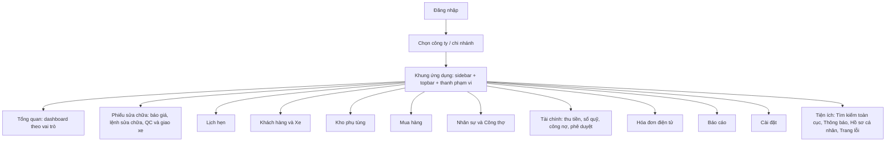

# 03. Kiến trúc thông tin và danh mục màn hình

Tài liệu gồm sơ đồ điều hướng, ma trận menu theo vai trò và danh mục toàn bộ màn hình (188 màn sản phẩm cộng 18 màn đăng ký công ty ở giai đoạn sau), mỗi màn có mã, tên, mục đích, vai trò chính, thiết bị chính và mức ưu tiên thiết kế. Người đọc: designer lập kế hoạch và phân đợt. Brief chi tiết từng màn quan trọng nhất nằm ở tài liệu 08.

Danh mục này gộp hợp lý từ danh mục nội bộ: các hộp thoại, drawer, trạng thái thuộc màn cha được liệt kê ở dòng của màn cha hoặc ghi chú "(hộp thoại)". Mã màn (ví dụ `G2-REC-04`) dùng làm tên trang/frame trong file thiết kế.

## 1. Sơ đồ điều hướng

### 1.1 Khung ứng dụng (Application Shell)

| Thành phần | Mô tả |
| --- | --- |
| Sidebar | Menu cấp 1 (11 mục, bảng mục 2); rộng 248px, thu gọn 72px (nội dung hiện tại, bạn được đề xuất khác); mục "Cài đặt" ở chân; mỗi mục có chế độ quyền dạng dòng phụ |
| Topbar | Bộ chọn phạm vi dữ liệu (chi nhánh/nhóm/tất cả), tìm toàn cục (phím tắt Ctrl+K), chuông thông báo, menu tài khoản (đổi góc nhìn vai trò, đổi công ty, hồ sơ, đăng xuất) |
| Thanh phạm vi | Dưới tiêu đề trang: chi nhánh, khoảng thời gian, "Cập nhật lúc …", nút làm mới (bắt buộc: RULE-015) |
| Page header | Tiêu đề, mô tả ngắn, hành động chính (một nút) |
| Banner hệ thống | Mất mạng, chi nhánh khóa chỉ xem, phiên sắp hết, tình trạng công ty (hạn chế/tạm ngưng) |
| Mobile | Sidebar thành drawer; thanh điều hướng dưới (mục theo quyền) + "Thêm"; tìm thu thành icon; hộp thoại thành bottom sheet |
| Thợ (tablet) | Shell rút gọn: chỉ "Việc của tôi", "Công của tôi" |
| Trang công khai | Đăng nhập, trang khách (báo giá, tiến độ, đặt lịch), đăng ký công ty: không có shell |
| Khung quản trị nền tảng | Khung riêng, không có bộ chọn chi nhánh |

## 2. Ma trận menu theo vai trò

Ký hiệu: ✓ tạo/sửa · Xem · Xem và duyệt · Của tôi · Danh mục (xem các màn cài đặt dùng chung được mở) · Hệ thống · – không có mục. Chế độ "Danh mục" của QV, CV, QĐ, TK, KT là đề xuất chưa xác nhận.

| Menu | CH | QV | QL | CV | QĐ | TH | TK | TN | KT | MH | NS | AD |
| --- | --- | --- | --- | --- | --- | --- | --- | --- | --- | --- | --- | --- |
| Tổng quan | ✓ | ✓ | ✓ | ✓ | ✓ | Của tôi | ✓ | ✓ | ✓ | – | – | Hệ thống |
| Phiếu sửa chữa | Xem | Xem | Xem và duyệt | ✓ | ✓ | Của tôi | Xem | Xem | Xem | – | – | – |
| Lịch hẹn | Xem | Xem | ✓ | ✓ | – | – | – | – | – | – | – | – |
| Khách hàng và Xe | Xem | Xem | ✓ | ✓ | Xem | Của tôi | – | Xem | Xem | – | – | – |
| Kho phụ tùng | Xem và duyệt | Xem và duyệt | ✓ | Xem | – | – | ✓ | – | Xem | Xem | – | – |
| Mua hàng | Xem | Xem | Xem và duyệt | – | – | – | ✓ | – | Xem | ✓ | – | – |
| Nhân sự và Công thợ | Xem | Xem | Xem và duyệt | Của tôi | Xem | Của tôi | – | – | Xem | – | ✓ | – |
| Tài chính | Xem | Xem | Xem và duyệt | Xem | – | – | – | ✓ | ✓ | – | – | – |
| Hóa đơn | Xem | Xem | Xem | – | – | – | – | ✓ | ✓ | – | – | – |
| Báo cáo | Xem | Xem | Xem | Của tôi | Của tôi | Của tôi | Của tôi | Của tôi | Xem | Của tôi | Của tôi | – |
| Cài đặt | Xem và duyệt | Danh mục | ✓ (chi nhánh mình) | Danh mục | Danh mục | – | Danh mục | – | Danh mục | – | – | ✓ |

Ghi chú: CV có Kho phụ tùng chỉ xem (chỉ số Khả dụng, không giá vốn). MH xem tồn chỉ Khả dụng và Đang vận chuyển, không giá vốn. TH, TN, MH, NS không có mục Cài đặt.

## 3. Danh mục màn hình

Cột "Thiết bị": chữ in đậm là thiết bị chính. Cột "Ưu": P0, P1, P2 (định nghĩa ở mục 4); "Không" = không thiết kế (ngoài phạm vi).

### 3.1 Khung ứng dụng, xác thực, lỗi, dashboard, thông báo, hồ sơ (31 màn)

| Mã | Tên | Mục đích (1 dòng) | Vai trò chính | Thiết bị | Ưu |
| --- | --- | --- | --- | --- | --- |
| G1-SHL-01 | Khung ứng dụng theo vai trò | Sidebar, topbar, bộ chọn phạm vi, thanh phạm vi, banner hệ thống | Mọi vai trò | **D** T M | P0 |
| G1-SHL-02 | Kết quả tìm kiếm toàn cục | Tìm xe (biển số), khách, lệnh, báo giá, phụ tùng, chứng từ; chỉ trong phạm vi quyền | Mọi vai trò | **D** M | P1 |
| G1-AUT-01 | Đăng nhập | Email (hoặc mã nhân viên) + mật khẩu; biến thể thiết bị xưởng; không có nút đăng ký nhân viên | Công khai | **D** T M | P0 |
| G1-AUT-02 | Nhập mã xác thực hai lớp | **Không thiết kế**: MFA ngoài phạm vi. Chỉ giữ chỗ trống trong luồng đăng nhập | – | – | Không |
| G1-AUT-03 | Thiết lập xác thực hai lớp lần đầu | **Không thiết kế** (như trên) | – | – | Không |
| G1-AUT-04 | Quên mật khẩu | Gửi liên kết đặt lại; thông báo trung lập dù tài khoản có hay không | Công khai | **D** T M | P0 |
| G1-AUT-05 | Đặt lại mật khẩu | Mật khẩu mới qua liên kết, thanh kiểm tra chính sách, thu hồi phiên cũ | Công khai (có token) | **D** T M | P0 |
| G1-AUT-06 | Kích hoạt tài khoản theo lời mời | Nhân viên "đăng ký" bằng liên kết mời: xác nhận thông tin, đặt mật khẩu, đồng ý quy định | Người được mời | **D** T M | P0 |
| G1-AUT-07 | Đổi mật khẩu bắt buộc | Khi dùng mật khẩu tạm hoặc bị quản trị đặt lại | Mọi vai trò | **D** T M | P1 |
| G1-AUT-08 | Chọn công ty và chi nhánh làm việc | Sau mật khẩu đúng: nếu có từ 2 tư cách thành viên/chi nhánh thì chọn; một thì vào thẳng | Người có nhiều công ty/chi nhánh | **D** T M | P0 |
| G1-AUT-09 | Hết phiên và khóa màn hình | Cảnh báo 60 giây, nhập lại mật khẩu, giữ nháp | Mọi vai trò | **D** T M | P1 |
| G1-AUT-10 | Thiết bị xưởng: chọn thợ và nhập PIN | Lưới thợ ca hôm nay, bàn phím PIN 6 số, nút lớn | TH, QĐ | **T** | P0 |
| G1-ERR-01 | 403 Không có quyền | Giải thích tiếng Việt, vai trò và chi nhánh hiện tại, yêu cầu cấp quyền | Mọi | **D** T M | P0 |
| G1-ERR-02 | 404 Không tìm thấy | Dùng chung cho bản ghi không có và ngoài phạm vi (không lộ sự tồn tại) | Mọi | **D** T M | P0 |
| G1-ERR-03 | Lỗi hệ thống (5xx) | Mã tham chiếu lỗi, nút thử lại, nháp đã giữ hay chưa | Mọi | **D** T M | P0 |
| G1-ERR-04 | Mất kết nối và bảo trì | Banner mất mạng + trang bảo trì; hướng dẫn phiếu giấy dự phòng | Mọi | **D** T M | P1 |
| G1-ERR-05 | Liên kết hết hạn/không hợp lệ | Liên kết đặt lại, lời mời, liên kết khách hết hạn; nêu cách lấy liên kết mới | Công khai | **M** D | P0 |
| G1-DSH-01 | Tổng quan Chủ garage | KPI toàn chuỗi, doanh thu theo thời gian và chi nhánh, việc cần tôi duyệt, cảnh báo ngoại lệ | CH | D **M** | P0 |
| G1-DSH-02 | Tổng quan Quản lý vùng | Như chủ nhưng theo nhóm chi nhánh; xếp hạng chi nhánh | QV | **D** M | P2 |
| G1-DSH-03 | Tổng quan Quản lý chi nhánh | Doanh thu ngày, xe đang tiếp nhận, việc quá hạn, tồn thấp, hàng chờ duyệt, trạng thái chốt ngày | QL | D **T** M | P0 |
| G1-DSH-04 | Tổng quan Cố vấn dịch vụ | Lịch hẹn hôm nay, xe chờ tiếp nhận, báo giá chờ khách duyệt, xe chờ bàn giao | CV | **D** T | P0 |
| G1-DSH-05 | Tổng quan Thủ kho | Yêu cầu cấp phụ tùng chờ xuất, phiếu nhập, hàng dưới định mức, chuyển kho | TK | **D** M | P0 |
| G1-DSH-06 | Tổng quan Kế toán | Doanh thu, thu chi, công nợ, hóa đơn lỗi/chưa xuất, đối soát quỹ | KT | **D** | P1 |
| G1-DSH-07 | Việc của tôi (trang chủ thợ) | Việc được giao theo ưu tiên, việc đang làm nổi bật, chờ phụ tùng, chờ khách duyệt phát sinh | TH, QĐ | **T** | P0 |
| G1-DSH-08 | Tổng quan Thu ngân | Lệnh sẵn sàng thu, quỹ ca hiện tại, phiếu thu hôm nay, trạng thái ca/ngày | TN | **D** | P0 |
| G1-DSH-09 | Tổng quan Quản đốc/QC | Hạng mục chưa phân thợ, tải việc thợ, xe chờ QC, xe bị trả lại | QĐ | **T** D | P0 |
| G1-DSH-10 | Tổng quan Quản trị hệ thống | Chỉ số vận hành: sao lưu, kết nối tích hợp, lỗi gửi, lời mời chờ; không có doanh thu hay khách | AD | **D** | P1 |
| G1-NTF-01 | Trung tâm thông báo | Danh sách "Cần xử lý" và "Thông tin"; drawer + trang đầy đủ | Mọi | **D** T M | P1 |
| G1-NTF-02 | Cài đặt thông báo cá nhân | Bảng sự kiện × kênh | Mọi | **D** M | P2 |
| G1-PRF-01 | Hồ sơ cá nhân | Họ tên, chức danh, chi nhánh và vai trò (chỉ đọc), ảnh, liên hệ | Mọi | **D** M | P1 |
| G1-PRF-02 | Bảo mật tài khoản | Đổi mật khẩu, thiết bị đang đăng nhập, lịch sử đăng nhập, PIN thiết bị xưởng | Mọi | **D** M | P1 |

### 3.2 Khách hàng và xe (CRM) (12 màn)

| Mã | Tên | Mục đích | Vai trò chính | Thiết bị | Ưu |
| --- | --- | --- | --- | --- | --- |
| G2-CRM-01 | Danh sách khách hàng | Tìm, lọc khách; SĐT che theo vai trò | CV, QL | **D** T | P0 |
| G2-CRM-02 | Tạo/sửa khách | Cá nhân/doanh nghiệp, MST khi cần hóa đơn công ty, đồng ý xử lý dữ liệu, phát hiện trùng | CV, QL | **D** T | P0 |
| G2-CRM-03 | Chi tiết khách hàng | Thông tin, xe, lịch sử sửa chữa, báo giá, công nợ, đồng ý, ghi chú | CV, QL | **D** T | P0 |
| G2-CRM-04 | Danh sách xe | Tìm theo biển số/số khung; lọc xe sắp đến hạn | CV, QL | **D** T | P0 |
| G2-CRM-05 | Tạo/sửa xe | Biển số duy nhất, số khung, hãng/dòng, số km, chủ xe | CV, QL | **D** T | P0 |
| G2-CRM-06 | Hồ sơ xe và lịch sử sửa chữa | Chủ hiện tại và lịch sử sở hữu, timeline sửa chữa mọi chi nhánh trong quyền, hạng mục từng bị từ chối, bảo hành còn hạn | CV, QL | **D** T | P0 |
| G2-CRM-07 | Chuyển chủ xe/đổi biển số (hộp thoại) | Chủ mới, ngày hiệu lực, lý do; lịch sử xe giữ nguyên | CV, QL | **D** | P1 |
| G2-CRM-08 | Phát hiện trùng và hợp nhất hồ sơ | Hai hồ sơ cạnh nhau, chọn trường giữ, xem trước kết quả | QL | **D** | P2 |
| G2-CRM-09 | Danh sách nhắc bảo dưỡng, đăng kiểm, bảo hiểm | Xe đến hạn, trạng thái liên hệ, chỉ nhắc kênh khách đồng ý | CV, QL | **D** T | P2 |
| G2-CRM-10 | Gửi tin nhắn và chiến dịch | Chọn mẫu, kênh, danh sách khách; loại khách chưa đồng ý | CV, QL | **D** | P2 |
| G2-CRM-11 | Yêu cầu của chủ dữ liệu (xem, sửa, xóa) | Xử lý yêu cầu theo luật, xóa/ẩn danh có duyệt | QL, CH | **D** | P1 |
| G2-CRM-12 | Xuất danh sách khách (hộp thoại) | Phạm vi, cột xuất (che theo quyền), lý do xuất; ghi nhật ký | Người có quyền xuất | **D** | P1 |

### 3.3 Lịch hẹn (APT) (5 màn)

| Mã | Tên | Mục đích | Vai trò chính | Thiết bị | Ưu |
| --- | --- | --- | --- | --- | --- |
| G2-APT-01 | Lịch hẹn (5 tab, ngày/tuần) | Upcoming, Trễ hẹn, Đã đến, Đã hủy, Vắng; hộp thoại hủy, dời, đánh dấu vắng | CV, QL, CH | **D** T | P1 |
| G2-APT-02 | Tạo/sửa lịch hẹn | Form (hộp thoại); sửa không đổi giờ, dùng "Dời lịch" | CV, QL | **D** T | P1 |
| G2-APT-03 | Lịch đặt trực tuyến chờ xác nhận | Lịch khách tự đặt, nhân viên xác nhận | CV, QL | **D** T | P2 |
| G2-APT-04 | Trang đặt lịch cho khách | Công khai: chọn chi nhánh, dịch vụ, khung giờ | Khách | **M** D | P2 |
| G2-APT-05 | Danh mục lý do hủy/dời và tham số lịch hẹn | Cấu hình lý do, châm chước trễ hẹn, số lần dời tối đa | QL, CH | **D** | P2 |

### 3.4 Tiếp nhận và lệnh sửa chữa (REC) (7 màn)

| Mã | Tên | Mục đích | Vai trò chính | Thiết bị | Ưu |
| --- | --- | --- | --- | --- | --- |
| G2-REC-01 | Tiếp nhận xe (nhiều bước) | Biển số, km, yêu cầu, hiện trạng, ảnh, tài sản, dịch vụ, hẹn giao; in phiếu tiếp nhận | CV | **D** T | P0 |
| G2-REC-02 | Danh sách lệnh sửa chữa | Danh sách có tab trạng thái; badge Lệnh/Thanh toán/Hóa đơn tách nhau | CV, QL | **D** T M | P0 |
| G2-REC-03 | Bảng điều phối chi nhánh (kanban) | Cột trạng thái lệnh + dải "trước lệnh" (lịch hẹn, chờ tiếp nhận, báo giá chờ duyệt) | CV, QL, QĐ | **D** T | P0 |
| G2-REC-04 | **Chi tiết lệnh sửa chữa** | Màn chuẩn số 1: ba badge song song, hạng mục, phụ tùng, tiến độ, thanh toán, hóa đơn, lịch sử | CV, QL, QĐ | **D** T M | P0 |
| G2-REC-05 | Phân thợ và tải việc | Mỗi hạng mục một thợ chính; tải việc so với giờ khả dụng | QĐ | **T** D | P0 |
| G2-REC-06 | Hủy báo giá/lệnh và hoàn kho | Hủy sau khi đã xuất phụ tùng: hoàn kho từng dòng, duyệt, đảo công | CV, QL | **D** | P1 |
| G2-REC-07 | Bảng đồng sơn theo công đoạn | Kanban công đoạn đồng sơn; công đoạn lấy từ cấu hình `[Chưa chốt quy trình]` | QĐ, CV | **T** D | P2 |

### 3.5 Kiểm tra xe số (INS) (3 màn; vào giai đoạn 1 nếu khách xác nhận)

| Mã | Tên | Mục đích | Vai trò chính | Thiết bị | Ưu |
| --- | --- | --- | --- | --- | --- |
| G2-INS-01 | Thực hiện kiểm tra xe số | Thợ đánh dấu xanh/vàng/đỏ từng hạng mục kèm ảnh/video | TH, QĐ | **T** | P1 |
| G2-INS-02 | Kết quả kiểm tra và danh sách lỗi | Cố vấn xem lỗi vàng/đỏ, "Đưa vào báo giá" | CV | **D** T | P1 |
| G2-INS-03 | Quản lý mẫu kiểm tra | Mẫu phát hành từ trụ sở cho chi nhánh | AD, quản trị trụ sở | **D** | P2 |

### 3.6 Báo giá (QUO) (9 màn)

| Mã | Tên | Mục đích | Vai trò chính | Thiết bị | Ưu |
| --- | --- | --- | --- | --- | --- |
| G2-QUO-01 | Danh sách báo giá | Có tab trạng thái báo giá | CV, QL | **D** T | P0 |
| G2-QUO-02 | Lập/sửa báo giá | Chọn gói, hạng mục, giờ chuẩn, phụ tùng kèm tồn khả dụng, giảm giá trong hạn mức | CV | **D** T | P0 |
| G2-QUO-03 | Chi tiết báo giá và phiên bản | Tổng báo giá so với tổng được duyệt, phiên bản, lịch sử | CV, QL | **D** T | P0 |
| G2-QUO-04 | Gửi báo giá cho khách (hộp thoại) | Chọn kênh, xem trước; kênh chưa cấu hình thì khóa kèm giải thích | CV | **D** T | P0 |
| G2-QUO-05 | Ghi nhận duyệt tại quầy | Toàn phần/một phần, bằng chứng duyệt | CV | **D** T | P0 |
| G2-QUO-06 | Trang khách duyệt báo giá qua liên kết | Khách duyệt từng hạng mục trên điện thoại | Khách | **M** | P0 |
| G2-QUO-07 | Hạng mục phát sinh: đề xuất và báo giá bổ sung | Thợ đề xuất kèm ảnh; cố vấn lập báo giá bổ sung; quản lý duyệt | TH, CV, QL | **D** T | P1 |
| G2-QUO-08 | Hạng mục khách từ chối/chưa làm | Danh sách để nhắc lần sau | CV, QL | **D** T | P1 |
| G2-QUO-09 | Trang khách theo dõi tiến độ xe | Khách xem trạng thái, duyệt phát sinh | Khách | **M** | P2 |

### 3.7 Thợ trên tablet (TEC) (5 màn)

| Mã | Tên | Mục đích | Vai trò chính | Thiết bị | Ưu |
| --- | --- | --- | --- | --- | --- |
| G2-TEC-01 | Việc được giao | Danh sách việc của tôi (biến thể của G1-DSH-07) | TH, QĐ | **T** | P0 |
| G2-TEC-02 | Hạng mục: Bắt đầu/Tạm dừng/Kết thúc | Ba nút lớn, tối đa 2 chạm, hoàn tác 10 giây | TH | **T** | P0 |
| G2-TEC-03 | Yêu cầu phụ tùng | Thợ yêu cầu phụ tùng có trong lệnh, thấy trạng thái yêu cầu | TH | **T** | P0 |
| G2-TEC-04 | Báo hư hỏng phát sinh | Chụp ảnh, mô tả, gửi cố vấn | TH | **T** | P1 |
| G2-TEC-05 | Công của tôi | Công và giờ của thợ theo ngày | TH | **T** M | P1 |

### 3.8 Kiểm tra chất lượng, giao xe, bảo hành, in ấn (DLV, PRT) (7 màn)

| Mã | Tên | Mục đích | Vai trò chính | Thiết bị | Ưu |
| --- | --- | --- | --- | --- | --- |
| G2-DLV-01 | Hàng chờ kiểm tra chất lượng | Danh sách lệnh chờ QC | QĐ/QC | **T** D | P0 |
| G2-DLV-02 | Thực hiện kiểm tra chất lượng | Checklist đạt/không đạt; không đạt thì trả hạng mục kèm lỗi gắn thợ | QĐ/QC | **T** | P0 |
| G2-DLV-03 | Chuẩn bị bàn giao xe | Kiểm điều kiện giao: QC đạt, thanh toán, hóa đơn | CV | **D** T | P0 |
| G2-DLV-04 | Biên bản giao xe và xác nhận khách | Khách xác nhận nhận xe | CV | **D** T | P0 |
| G2-DLV-05 | Danh sách bảo hành | Các lệnh bảo hành, chi nhánh chịu chi phí (cấu hình) | CV, QL | **D** T | P2 |
| G2-DLV-06 | Tạo lệnh bảo hành | Gắn với lệnh gốc (có thể ở chi nhánh khác) | CV, QL | **D** T | P2 |
| G2-PRT-01 | Xem trước và in chứng từ | Hộp thoại xem trước; A4, A5, phiếu nhiệt; nhật ký in | Theo quyền xem chứng từ | **D** T | P0 |

### 3.9 Kho và phụ tùng (INV) (19 màn)

| Mã | Tên | Mục đích | Vai trò chính | Thiết bị | Ưu |
| --- | --- | --- | --- | --- | --- |
| G3-INV-01 | Danh mục phụ tùng | Mã, tên, nhóm, giá niêm yết; giá vốn che theo quyền | TK | **D** M | P0 |
| G3-INV-02 | Tạo/sửa phụ tùng | Form danh mục | TK | **D** | P1 |
| G3-INV-03 | Chi tiết phụ tùng và thẻ kho | Bốn số, lịch sử biến động, định mức | TK | **D** T | P1 |
| G3-INV-04 | Tồn kho: bốn con số | Thực tế, giữ chỗ, đang vận chuyển, khả dụng; badge đủ/sắp hết/hết | TK, QL | **D** M | P0 |
| G3-INV-05 | Hàng dưới định mức và gợi ý đặt hàng | Dựa trên khả dụng, không phải tồn thực tế | TK, QL | **D** M | P1 |
| G3-INV-06 | Yêu cầu cấp phụ tùng (hàng chờ xuất) | Hàng chờ xuất theo lệnh; 6 trạng thái yêu cầu | TK | **D** T | P0 |
| G3-INV-07 | Phiếu xuất kho | Xuất theo lệnh; giữ chỗ chuyển thành xuất, ghi giá vốn | TK | **D** T | P0 |
| G3-INV-08 | Danh sách chứng từ kho | Phiếu nhập/xuất/hoàn/chuyển/điều chỉnh | TK, QL | **D** | P1 |
| G3-INV-09 | Phiếu nhập kho | Nhập từ đơn mua hoặc nhập trực tiếp có lý do; cảnh báo lệch số lượng/giá | TK | **D** T | P0 |
| G3-INV-10 | Phiếu hoàn kho/khách trả phụ tùng chưa lắp | Hoàn kho có duyệt | TK | **D** T | P1 |
| G3-INV-11 | Xuất dùng nội bộ và vật tư tiêu hao | Xuất không theo lệnh, có lý do hợp lệ và duyệt | TK, QL | **D** | P2 |
| G3-INV-12 | Danh sách phiếu chuyển kho | Có tab trạng thái phiếu chuyển | TK, QL | **D** T | P2 |
| G3-INV-13 | Tạo/gửi phiếu chuyển kho | Từ chi nhánh gửi; giá trị lớn cần duyệt | TK, QL | **D** T | P2 |
| G3-INV-14 | Nhận hàng chuyển kho và biên bản chênh lệch | Bên nhận xác nhận số lượng thực; lệch treo trên hàng đang vận chuyển | TK | **D** T | P2 |
| G3-INV-15 | Danh sách đợt kiểm kê | Các đợt kiểm kê và trạng thái | QL, TK | **D** | P2 |
| G3-INV-16 | Thực hiện kiểm kê (quét mã vạch) | Đếm bằng camera điện thoại/tablet | TK | **M** T | P2 |
| G3-INV-17 | Duyệt chênh lệch kiểm kê và phiếu điều chỉnh | Duyệt, giải trình, ngưỡng chủ/vùng duyệt | QL, CH | **D** | P2 |
| G3-INV-18 | Bán lẻ phụ tùng tại quầy | Phiếu bán lẻ riêng không cần lệnh; trừ kho, ghi thanh toán | CV, TK, TN | **D** | P1 |
| G3-INV-19 | Bảng giá phụ tùng | Giá niêm yết theo ngày hiệu lực | TK, CH | **D** | P1 |

### 3.10 Mua hàng (PUR) (10 màn)

| Mã | Tên | Mục đích | Vai trò chính | Thiết bị | Ưu |
| --- | --- | --- | --- | --- | --- |
| G3-PUR-01 | Danh sách yêu cầu mua hàng | Có tab trạng thái; "Mua gấp" | MH, TK | **D** | P2 |
| G3-PUR-02 | Tạo yêu cầu mua hàng | Từ gợi ý định mức hoặc tay | MH, TK, QL | **D** T | P2 |
| G3-PUR-03 | Chi tiết và phê duyệt yêu cầu mua | Duyệt theo hạn mức, hậu duyệt khi mua gấp | QL, CH | **D** M | P2 |
| G3-PUR-04 | Danh sách đơn mua | Trạng thái đơn, trễ giao | MH, TK | **D** | P2 |
| G3-PUR-05 | Lập/điều chỉnh đơn mua | Soạn đơn gửi nhà cung cấp | MH | **D** | P2 |
| G3-PUR-06 | Chi tiết đơn mua | Theo dõi nhận nhiều lần | MH, TK | **D** | P2 |
| G3-PUR-07 | Hóa đơn nhà cung cấp và đối chiếu ba bên | Khớp đơn – nhận hàng – hóa đơn; ghi công nợ phải trả | KT | **D** | P2 |
| G3-PUR-08 | Phiếu trả hàng cho nhà cung cấp | Trả hàng lỗi, giảm công nợ | TK, QL | **D** | P2 |
| G3-PUR-09 | Danh sách nhà cung cấp | Tìm, lọc nhà cung cấp | MH, TK | **D** | P2 |
| G3-PUR-10 | Chi tiết/sửa nhà cung cấp | Hồ sơ nhà cung cấp, giá nhập | MH, TK | **D** | P2 |

### 3.11 Nhân sự, giờ công, lịch (HRM) (11 màn)

| Mã | Tên | Mục đích | Vai trò chính | Thiết bị | Ưu |
| --- | --- | --- | --- | --- | --- |
| G3-HRM-01 | Danh sách nhân sự | Tìm, lọc nhân sự; dữ liệu nhạy cảm che | NS, QL | **D** | P2 |
| G3-HRM-02 | Hồ sơ nhân sự | Thông tin, tài khoản liên kết, chi nhánh, chứng chỉ | NS, QL | **D** | P2 |
| G3-HRM-03 | Điều chuyển nhân sự (hộp thoại) | Chuyển chi nhánh có ngày hiệu lực | NS, QL | **D** | P2 |
| G3-HRM-04 | Ca làm việc và chấm công | Lịch ca, đi muộn, trong ca | NS, QL | **D** T | P2 |
| G3-HRM-05 | Lịch làm việc và tải việc thợ | Lịch tuần, tải việc | QĐ, QL | **D** T | P2 |
| G3-HRM-06 | Quy tắc tính công và hoa hồng (cấu hình) | Cấu hình có ngày hiệu lực, không cố định công thức `[Chưa chốt]` | CH, QL | **D** | P2 |
| G3-HRM-07 | Công thợ theo lệnh và hạng mục | Dòng công, điều chỉnh có duyệt | QL | **D** T | P2 |
| G3-HRM-08 | Bảng công theo kỳ | Duyệt, khóa, xuất kỳ công | QL, NS | **D** | P2 |
| G3-HRM-09 | Hoa hồng cố vấn và thợ | Hoa hồng ghi nhận khi lệnh thu đủ | QL | **D** | P2 |
| G3-HRM-10 | Năng suất kỹ thuật viên | Bảng + biểu đồ: hiệu suất, mức sử dụng | QL, QĐ | **D** T | P2 |
| G3-HRM-11 | Chi tiết công một nhân viên trong kỳ | Dòng cấu thành bảng công, số tạm/chính thức | NS, QL, KT | **D** T | P2 |

### 3.12 Tài chính: thu tiền, sổ quỹ, công nợ, kế toán (ACC) (21 màn)

| Mã | Tên | Mục đích | Vai trò chính | Thiết bị | Ưu |
| --- | --- | --- | --- | --- | --- |
| G4-ACC-01 | Thu tiền theo lệnh | Nhiều hình thức thanh toán, trừ cọc, ghi nhận (xác nhận mức tiền) | TN | **D** T | P0 |
| G4-ACC-02 | Danh sách phiếu thu/thanh toán | Tổng tiền ròng đã trừ bút toán đảo | TN, KT | **D** | P0 |
| G4-ACC-03 | Chi tiết thanh toán và phân bổ | Quan hệ nhiều-nhiều giữa thanh toán và hóa đơn | KT | **D** | P1 |
| G4-ACC-04 | Sổ quỹ tiền mặt | Thu chi tiền mặt theo ca/ngày | TN, QL | **D** | P0 |
| G4-ACC-05 | Đề xuất chi/phiếu chi | Chi vượt hạn mức cần duyệt | KT, TN, QL | **D** | P2 |
| G4-ACC-06 | Danh sách đề xuất chi và phiếu chi | Theo dõi trạng thái chi | KT, TN | **D** | P2 |
| G4-ACC-07 | Hoàn tiền cho khách | Duyệt hoàn tiền, liên kết hóa đơn điều chỉnh | TN, KT, QL | **D** | P1 |
| G4-ACC-08 | Chốt ca | Đếm quỹ, chênh lệch so với sổ, giải trình | TN | **D** | P0 |
| G4-ACC-09 | Chốt ngày chi nhánh | Kiểm lệnh mở, chưa thu, chưa hóa đơn, chênh lệch quỹ; khóa ngày | QL | **D** T | P0 |
| G4-ACC-10 | Công nợ phải thu (tuổi nợ) | Aging, nhắc nợ | KT | **D** | P2 |
| G4-ACC-11 | Chi tiết công nợ khách và đối soát | Chi tiết theo khách doanh nghiệp, hạn mức | KT | **D** | P2 |
| G4-ACC-12 | Công nợ phải trả | Aging phải trả | KT | **D** | P2 |
| G4-ACC-13 | Chi tiết công nợ nhà cung cấp | Đối soát nhà cung cấp | KT | **D** | P2 |
| G4-ACC-14 | Giá vốn dịch vụ và lãi gộp theo lệnh | Phương pháp giá vốn lấy từ cấu hình `[Chưa chốt]` | KT | **D** | P2 |
| G4-ACC-15 | Lãi lỗ theo chi nhánh và nguồn doanh thu | So sánh chi nhánh | KT, CH | **D** M | P2 |
| G4-ACC-16 | Giao dịch ngân hàng và đối soát | Ghép giao dịch ngân hàng với thu tiền | KT | **D** | P2 |
| G4-ACC-17 | Khóa kỳ kế toán | Khóa/mở lại kỳ (mở lại cần chủ duyệt) | KT, CH | **D** | P2 |
| G4-ACC-18 | Kết xuất dữ liệu sang phần mềm kế toán | Xuất cuối kỳ | KT | **D** | P2 |
| G4-ACC-19 | Phân bổ chi phí chung toàn chuỗi | Phân bổ chi phí `[Chưa chốt]` | KT, CH | **D** | P2 |
| G4-ACC-20 | Sơ đồ tài khoản và định khoản tự động | Cấu hình | KT, CH | **D** | P2 |
| G4-ACC-21 | Khoản nhận trước của khách | Tiền cọc/nhận trước, bù vào lệnh | KT, TN | **D** | P2 |

### 3.13 Phê duyệt (APR) (4 màn)

| Mã | Tên | Mục đích | Vai trò chính | Thiết bị | Ưu |
| --- | --- | --- | --- | --- | --- |
| G4-APR-01 | Hàng chờ phê duyệt | Danh sách yêu cầu chờ tôi duyệt, theo loại và cấp | QL, QV, CH, KT | D T **M** | P0 |
| G4-APR-02 | Chi tiết yêu cầu phê duyệt (drawer) | So với hạn mức, bản ghi gốc, duyệt/từ chối/chuyển cấp | QL, QV, CH, KT | D T **M** | P0 |
| G4-APR-03 | Cấu hình hạn mức và ma trận phê duyệt | Hạn mức theo loại, cấp duyệt `[Chưa chốt giá trị]` | CH | **D** | P1 |
| G4-APR-04 | Chi tiết phê duyệt kho và mua hàng | Chuyển kho giá trị lớn, điều chỉnh tồn, mua vượt hạn mức; tự chuyển cấp | QV, CH, QL | **D** T | P2 |

### 3.14 Hóa đơn điện tử (EIN) (8 màn)

| Mã | Tên | Mục đích | Vai trò chính | Thiết bị | Ưu |
| --- | --- | --- | --- | --- | --- |
| G4-EIN-01 | Danh sách hóa đơn | Có tab trạng thái hóa đơn; chỉ báo đồng bộ nhà cung cấp | TN, KT | **D** | P0 |
| G4-EIN-02 | Phát hành hóa đơn từ lệnh (hộp thoại) | Kiểm điều kiện, chống trùng, xác nhận mức tiền | TN, KT | **D** | P0 |
| G4-EIN-03 | Chi tiết hóa đơn | Trạng thái do nhà cung cấp, XML/PDF, liên kết lệnh gốc | TN, KT | **D** | P0 |
| G4-EIN-04 | Hóa đơn điều chỉnh/thay thế/hủy | Chứng từ mới, kế toán trưởng duyệt, nêu lý do | KT | **D** | P1 |
| G4-EIN-05 | Lệnh hoàn tất chưa có hóa đơn | Đối chiếu cuối ngày | TN, KT | **D** | P0 |
| G4-EIN-06 | Hàng chờ lỗi và thử lại phát hành | Truy vấn trước khi phát hành lại | KT | **D** | P1 |
| G4-EIN-07 | Tình trạng kết nối nhà cung cấp hóa đơn | Sức khỏe tích hợp (không gắn một nhà cung cấp) | KT, AD | **D** | P1 |
| G4-EIN-08 | Cấu hình đơn vị phát hành, ký hiệu, loại hóa đơn | Đơn vị phát hành theo pháp nhân/chi nhánh | KT, AD | **D** | P1 |

### 3.15 Báo cáo (RPT) (12 màn)

| Mã | Tên | Mục đích | Vai trò chính | Thiết bị | Ưu |
| --- | --- | --- | --- | --- | --- |
| G4-RPT-01 | Trung tâm báo cáo | Danh mục báo cáo dạng thẻ | CH, QL, KT | **D** M | P1 |
| G4-RPT-02 | So sánh chi nhánh | Xếp hạng, so sánh chỉ số | CH, QV | **D** M | P2 |
| G4-RPT-03 | Báo cáo chi nhánh theo ngày và tháng | Doanh thu ngày khớp tổng phiếu thu | QL, KT | **D** M | P0 |
| G4-RPT-04 | Báo cáo lệnh sửa chữa | Bảng + biểu đồ trạng thái | QL, CV | **D** T | P1 |
| G4-RPT-05 | Đối chiếu lệnh, xuất kho, hóa đơn, thu tiền | Phát hiện thiếu chứng từ | KT, QL | **D** | P1 |
| G4-RPT-06 | Báo cáo kho | Tồn theo nhóm, vòng quay, độ chính xác | TK, KT | **D** | P2 |
| G4-RPT-07 | Báo cáo khách hàng | Khách quay lại, giá trị khách | CH, QL | **D** M | P2 |
| G4-RPT-08 | Chỉ số bổ sung | Giá trị trung bình mỗi lệnh, tỷ lệ báo giá được duyệt | CH, QL | **D** | P2 |
| G4-RPT-09 | Cảnh báo ngoại lệ | Xuất kho không chứng từ, lệch quỹ, trễ hẹn, lệnh chưa hóa đơn | CH, QL | **D** M | P2 |
| G4-RPT-10 | Danh sách chứng từ gốc | Đi sâu từ chỉ số xuống chứng từ | Theo quyền | **D** | P1 |
| G4-RPT-11 | Xuất báo cáo (hộp thoại) | Excel/PDF; ghi chi nhánh, kỳ, thời điểm | Người có quyền xuất | **D** | P1 |
| G4-RPT-12 | Hợp nhất chuỗi: kiểm tra đủ và khớp | Chi nhánh nào vào số hợp nhất; tổng chi nhánh so toàn chuỗi | CH, QV, KT | **D** M | P2 |

### 3.16 Hệ thống: người dùng, cấu hình, tích hợp, nhật ký (SYS) (24 màn)

| Mã | Tên | Mục đích | Vai trò chính | Thiết bị | Ưu |
| --- | --- | --- | --- | --- | --- |
| G4-SYS-01 | Danh sách người dùng | Tìm, lọc người dùng, trạng thái tài khoản | AD, QL, CH | **D** | P0 |
| G4-SYS-02 | Tạo/sửa người dùng và gửi lời mời | Gán vai trò + chi nhánh, gửi lời mời | AD, CH, QL | **D** | P0 |
| G4-SYS-03 | Chi tiết người dùng và phiên đăng nhập | Phiên, cấp mã tạm, mở khóa, lý do khóa thật | AD, QL | **D** | P1 |
| G4-SYS-04 | Vai trò và quyền theo hành động | Ma trận quyền, bảng quyền che dữ liệu | AD, CH | **D** | P0 |
| G4-SYS-05 | Cơ cấu tổ chức: Công ty, Chi nhánh, Kho | Cây tổ chức | AD, CH | **D** | P1 |
| G4-SYS-06 | Cấu hình chi nhánh | Thông tin chi nhánh, trạng thái (hoạt động/ngừng nhận lệnh mới/khóa) | AD, QL | **D** | P1 |
| G4-SYS-07 | Danh mục dịch vụ, giờ chuẩn, đơn giá giờ công | Ba tab; có ngày hiệu lực | AD, QL | **D** | P1 |
| G4-SYS-08 | Gói dịch vụ bảo dưỡng định kỳ | Gói bảo dưỡng theo km/thời gian | AD, QL | **D** | P2 |
| G4-SYS-09 | Hạn mức giảm giá và chương trình giảm | Hạn mức theo vai trò | CH, QL | **D** | P1 |
| G4-SYS-10 | Thuế suất theo ngày hiệu lực | Ví dụ mẫu cấu hình có hiệu lực (chi tiết tài liệu 08) | KT, CH | **D** | P1 |
| G4-SYS-11 | Chu kỳ nhắc đăng kiểm, bảo dưỡng, bảo hiểm | Bảng chu kỳ theo loại xe | AD, QL | **D** | P2 |
| G4-SYS-12 | Mẫu chứng từ, mẫu in, mẫu tin nhắn | Mẫu in A4/A5/nhiệt, tin gửi khách | AD | **D** | P1 |
| G4-SYS-13 | Quy trình theo loại dịch vụ | Công đoạn theo loại dịch vụ `[Chưa chốt đồng sơn]` | AD, QL | **D** | P2 |
| G4-SYS-14 | Mẫu checklist kiểm tra chất lượng | Checklist QC | AD, QĐ | **D** | P2 |
| G4-SYS-15 | Danh mục dùng chung và phát hành cho chi nhánh | Danh mục từ trụ sở | Quản trị trụ sở | **D** | P2 |
| G4-SYS-16 | Trung tâm tích hợp: hóa đơn điện tử | Kết nối nhà cung cấp, môi trường thử/thật tách biệt | AD, KT | **D** | P1 |
| G4-SYS-17 | Tích hợp tin nhắn: SMS, Zalo, email | Kênh chưa cấu hình hiện "Chưa kích hoạt" | AD | **D** | P2 |
| G4-SYS-18 | API và khóa tích hợp | Khóa tích hợp | AD | **D** | P2 |
| G4-SYS-19 | Nhật ký thao tác (audit log) | Ai làm gì, khi nào, trên bản ghi nào; bất biến | AD, CH, QL | **D** | P0 |
| G4-SYS-20 | Nhập dữ liệu từ Excel | Wizard: tải tệp, ánh xạ cột, xem trước, báo lỗi theo dòng, ghi lô | AD, QL | **D** | P1 |
| G4-SYS-21 | Lịch sử lô nhập và hoàn tác | Hoàn tác theo lô | AD, CH | **D** | P1 |
| G4-SYS-22 | Sao lưu và khôi phục | Trạng thái sao lưu, kết quả thử khôi phục, "Yêu cầu khôi phục" (không có nút khôi phục tại chỗ) | AD | **D** | P2 |
| G4-SYS-23 | Chính sách lưu trữ và ẩn danh dữ liệu | Thời hạn lưu `[Chưa chốt]`, ẩn danh nhân sự đã nghỉ | AD, CH | **D** | P2 |
| G4-SYS-24 | Bảo mật và phiên làm việc | Chính sách mật khẩu, khóa đăng nhập, hết phiên (tham số cấu hình) | AD, CH | **D** | P1 |

### 3.17 Đăng ký công ty và tình trạng công ty (TEN) (18 màn; làm sau pilot, không nêu giá/gói)

Chủ garage tự đăng ký công ty mới ở trang công khai; nhân viên **không** tự đăng ký. Thiết kế tinh giản cho garage một chi nhánh, một kho. **Không hiển thị giá, gói, dùng thử.** Ưu tiên P2 (làm sau), trừ TSU-14 là P0 vì thuộc luồng đăng nhập.

| Mã | Tên | Mục đích | Vai trò chính | Thiết bị | Ưu |
| --- | --- | --- | --- | --- | --- |
| TSX-01 | Đăng ký một trang | Tên garage, mã số thuế, người đại diện, email, mật khẩu, hai ô chấp nhận | Chủ garage mới | **D** M | P2 |
| TSX-02 | Kiểm tra email | Màn chờ xác thực email | Chủ garage mới | **D** M | P2 |
| TSX-03 | Xác thực và tiến trình | Liên kết xác thực một lần, trạng thái tự duyệt/chờ duyệt | Chủ garage mới | **D** M | P2 |
| TSU-14 | Đăng nhập có chọn công ty | Email + mật khẩu; sau mật khẩu đúng nếu có từ 2 công ty thì hiện danh sách chọn | Mọi người dùng | **D** T M | P0 |
| TSU-15 | Quên mật khẩu | Nêu rõ việc đặt lại áp dụng cho mọi công ty của email | Công khai | **D** M | P2 |
| TSU-16 | Đặt lại mật khẩu | Như G1-AUT-05 | Công khai | **D** M | P2 |
| TSX-10 | Xác nhận garage và bắt đầu dùng | Địa chỉ, tỉnh/thành, SĐT; tên garage và MST điền sẵn | Chủ garage | **D** M | P2 |
| TSX-11 | Thiết lập nhanh (tùy chọn) | Bước tùy chọn sau khi vào | Chủ garage | **D** M | P2 |
| TSX-20 | Thiết lập dần | Checklist việc nên làm (nhà cung cấp hóa đơn, thuế, mẫu in, nhập Excel) | Chủ garage | **D** | P2 |
| TSU-41 | Tình trạng công ty | Trạng thái tài khoản công ty (không nêu gói/giá) | CH, AD | **D** | P2 |
| TSU-50 | Thư viện banner tình trạng công ty | 3 loại banner: hạn chế tạo mới, tạm ngưng, khóa | Mọi | **D** T M | P2 |
| TSU-51 | Hộp thoại chặn tạo mới | Khi công ty bị hạn chế tạo mới | Mọi | **D** | P2 |
| TSU-53 | Tạm ngưng | Trang khi tạm ngưng: chỉ xem và tải | Mọi | **D** M | P2 |
| TSU-55 | Trung tâm xuất dữ liệu | Tải gói dữ liệu của công ty | CH | **D** | P2 |
| TSU-56 | Chấm dứt dịch vụ | Quy trình chấm dứt có xác nhận | CH | **D** | P2 |
| TSU-60 | Đăng nhập quản trị nền tảng | Khung riêng; không có khe xác thực mạnh | Nhân sự nền tảng | **D** | P2 |
| TSX-30 | Hàng đợi và hồ sơ đăng ký | Duyệt ca bị cờ, hồ sơ công ty | Nhân sự nền tảng | **D** | P2 |
| TSU-66 | Cấu hình đăng ký | Tham số đăng ký, hỗ trợ | Nhân sự nền tảng | **D** | P2 |

## 4. Định nghĩa ưu tiên và thứ tự thiết kế

Ưu tiên ở đây là **thứ tự thiết kế** do chủ dự án đề xuất, suy ra từ phạm vi pilot giai đoạn 1 và giai đoạn 2; không phải cam kết ngày phát hành.

| Mức | Định nghĩa | Số màn (xấp xỉ) |
| --- | --- | --- |
| **P0** | Đợt 1: luồng lõi từ đăng nhập → tiếp nhận → báo giá → lệnh → thợ → QC → thu tiền → hóa đơn → giao xe; khung ứng dụng; dashboard các vai trò vận hành; tồn kho bốn số và cấp/xuất phụ tùng; phê duyệt; in; người dùng và nhật ký | 65 (kể cả màn đăng nhập có chọn công ty TSU-14) |
| **P1** | Đợt 2: cần cho pilot nhưng làm sau lõi (lịch hẹn, kiểm tra xe số, CRM mở rộng, báo cáo chi nhánh, cấu hình chính, hóa đơn nâng cao, nhập Excel) | 51 |
| **P2** | Đợt sau: giai đoạn 2 trở đi (mua hàng, nhân sự/công thợ, công nợ, chuyển kho liên chi nhánh, kiểm kê, báo cáo nâng cao, đăng ký công ty) | 88 (kể cả 17 màn đăng ký công ty) |
| Không | Xác thực hai lớp (MFA), ngoài phạm vi | 2 |
| Tổng | | 206 (188 màn sản phẩm + 18 màn đăng ký công ty) |

Thứ tự thiết kế đề nghị: (1) Nền tảng thị giác: token, typography, component lõi. (2) Khung ứng dụng và bộ chọn phạm vi. (3) **G2-REC-04 Chi tiết lệnh sửa chữa**, làm màn chuẩn số 1 để kiểm chứng hệ thống thiết kế. (4) Luồng tiếp nhận → báo giá → lệnh → thợ → QC → giao xe. (5) Kho (bốn số, cấp/xuất). (6) Thu tiền, hóa đơn. (7) Dashboard. (8) Báo cáo, cài đặt.

Khuyến nghị: dựng sớm **một màn cấu hình dài có ngày hiệu lực** (G4-SYS-10) và **một màn danh sách dày dữ liệu** (G3-INV-04) ngay trong đợt 1 để kiểm chứng sức chịu tải của hệ thống thiết kế, dù các màn đó không phải P0.

## 5. Mẫu trang (template)

| Mẫu | Dùng cho | Thành phần chính |
| --- | --- | --- |
| A. Khung ứng dụng | Mọi trang sau đăng nhập | Sidebar, topbar, breadcrumb, page header, thanh phạm vi |
| B. Dashboard | Tổng quan theo vai trò | Bộ lọc kỳ + chi nhánh; hàng KPI; biểu đồ xu hướng; phân rã; "Việc cần xử lý"; bảng chi tiết; tối đa khoảng 5–6 khối ở màn đầu |
| C. Danh sách | Danh sách có tìm/lọc | Tiêu đề + nút chính; tìm kiếm + lọc + chip đang áp dụng; bảng; phân trang; chọn nhiều |
| D. Chi tiết | Chi tiết chứng từ | Header (mã, biển số, các badge song song, hành động); nội dung theo tab; cột bên liên quan/lịch sử/ghi chú; timeline |
| E. Tạo/sửa | Form | Nhóm thông tin; stepper khi quy trình dài; thanh footer dính (Lưu nháp / Tiếp tục / Hủy) |
| W | Wizard (E có stepper) | Tiếp nhận xe, chốt ca, nhập Excel, kích hoạt tài khoản |
| K | Kanban/lịch | Bảng điều phối, lịch hẹn, đồng sơn |
| P | Trang công khai cho khách | Không shell, mobile-first, chữ ≥ 16px |
| S | Màn cấu hình | Danh sách + form, phiên bản, ngày hiệu lực |
| Dlg | Hộp thoại/drawer | Xác nhận ba mức (tài liệu 05 mục 13) |

Bạn được tự đề xuất mẫu khác tốt hơn, miễn đáp ứng ràng buộc cứng.
