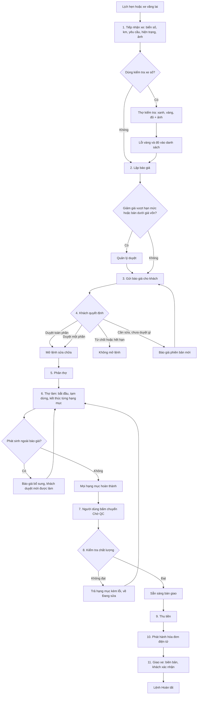
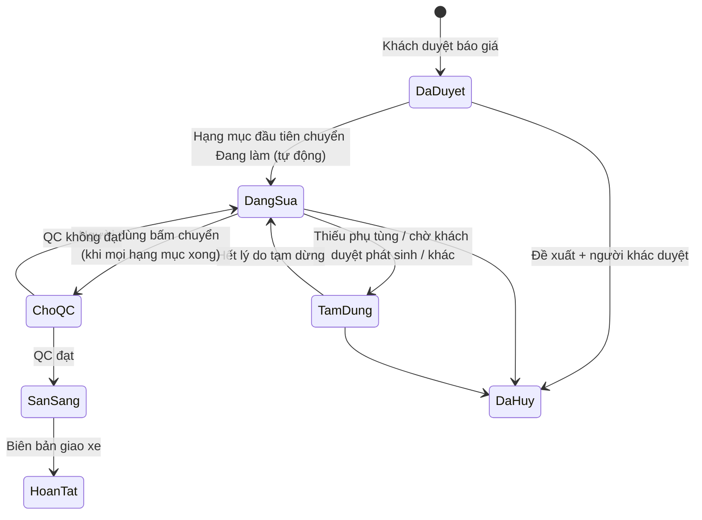
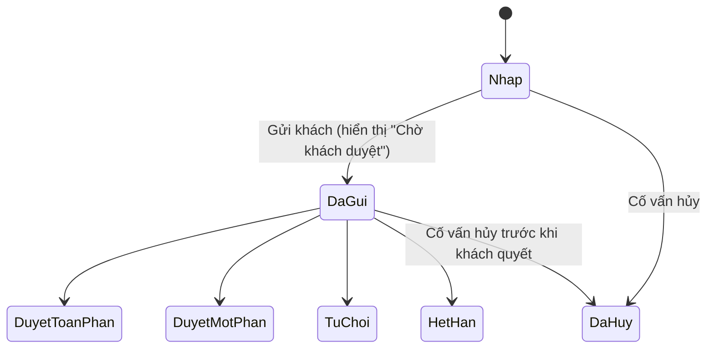
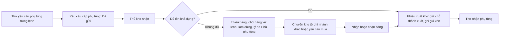
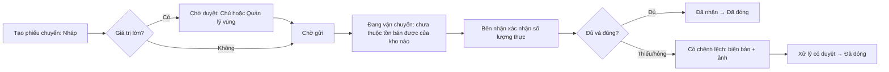
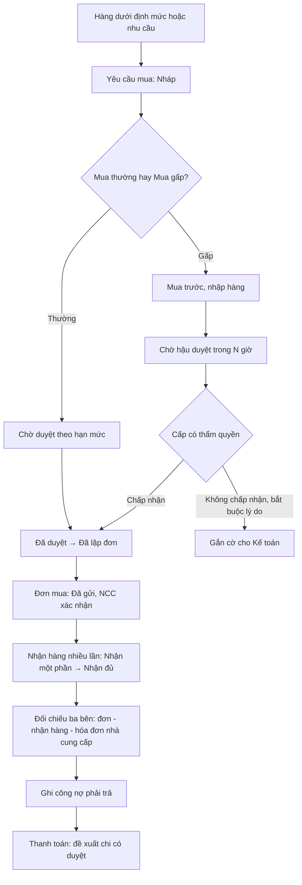
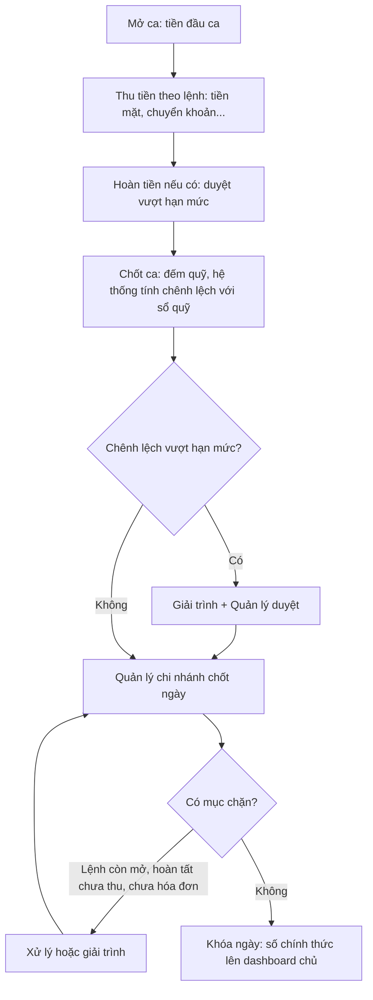
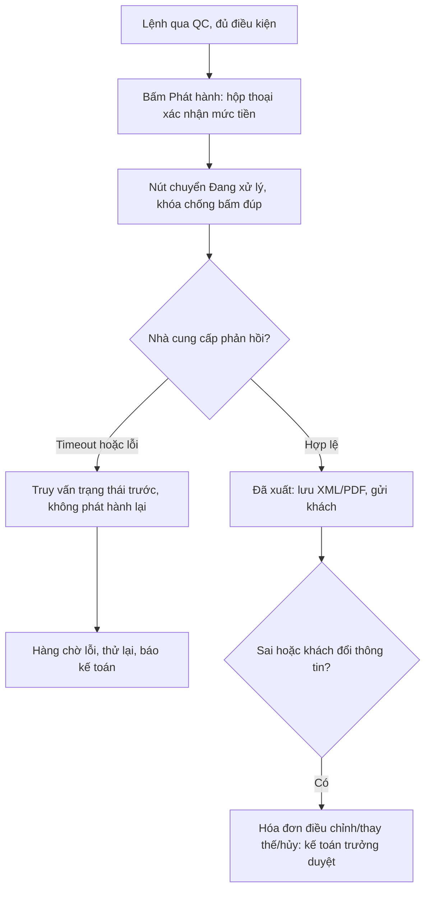
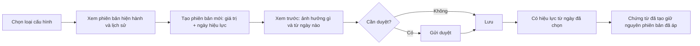

# 04. Luồng nghiệp vụ chính

Tài liệu mô tả các luồng đầu-cuối mà giao diện phải phục vụ: điểm bắt đầu, từng bước, điểm quyết định, ngoại lệ và màn hình liên quan (mã ở tài liệu 03). Người đọc: designer thiết kế luồng và prototype. Sơ đồ dùng Mermaid hoặc dạng chữ.

Quy ước: `[điều kiện]` là nhánh rẽ; mã trong ngoặc là mã màn hình.

## 1. Luồng chính: từ tiếp nhận xe đến giao xe

Lệnh sửa chữa là chứng từ gốc. Báo giá, lệnh, hạng mục, thanh toán và hóa đơn là **năm đối tượng riêng**, mỗi đối tượng có bộ trạng thái riêng (tài liệu 05 mục 1).

### 1.1 Từng bước

| Bước | Ai | Màn hình | Hệ thống làm gì | Điểm quyết định / ngoại lệ |
| --- | --- | --- | --- | --- |
| 0. Vào ca | CV | Đăng nhập → chọn công ty/chi nhánh → dashboard CV (`G1-DSH-04`) | Hiện lịch hẹn hôm nay, xe chờ tiếp nhận | Mất mạng: banner và lưu nháp |
| 1. Lịch hẹn (tùy chọn) | CV | `G2-APT-01`, `G2-APT-02` | Khách đến bấm "Đã đến" → mở tiếp nhận | Trễ hẹn, dời, vắng, hủy kèm lý do |
| 2. Tiếp nhận | CV | `G2-REC-01` (5 bước) | Tìm xe theo biển số, tự điền khách/xe, hiện lần sửa gần nhất | Xe mới → tạo xe (`G2-CRM-05`) nhúng; khách mới → `G2-CRM-02`; số km thấp hơn lần trước: cảnh báo + lý do; biển số trùng: gợi ý xe có sẵn; nhắc hạng mục từng bị từ chối |
| 3. Kiểm tra xe số (tùy chọn) | TH, CV | `G2-INS-01`, `G2-INS-02` | Lỗi vàng/đỏ thành danh sách → "Đưa vào báo giá" | Không dùng: kiểm tra sơ bộ bằng lời |
| 4. Báo giá | CV | `G2-QUO-02` | Tra bảng giá, giờ chuẩn, tồn khả dụng, tính thuế; báo giá giữ phiên bản giá lúc gửi | Giảm giá vượt hạn mức hoặc giá thấp hơn giá vốn → chờ duyệt (`G4-APR-02`) |
| 5. Gửi | CV | `G2-QUO-04` | Gửi liên kết qua Zalo/SMS (kênh chưa chốt) | Kênh chưa cấu hình: nút khóa kèm giải thích; có thể in giấy |
| 6. Khách duyệt | Khách hoặc CV | `G2-QUO-06` (liên kết), `G2-QUO-05` (tại quầy) | Lưu bằng chứng duyệt; chỉ dòng được duyệt vào lệnh | Duyệt một phần: dòng bị từ chối vào "Hạng mục khách từ chối" để nhắc lần sau; hạng mục bắt buộc an toàn khi bỏ tick: cảnh báo + lý do; từ chối toàn bộ/hết hạn: không tạo lệnh |
| 7. Mở lệnh | Hệ thống | `G2-REC-04` | Lệnh bắt đầu **từ lúc khách duyệt**, chỉ chứa dòng được duyệt; phụ tùng được giữ chỗ (đổi con số "giữ chỗ" ở kho) | Báo giá đã duyệt (toàn/một phần) **bị khóa**, không tạo phiên bản thay thế; thay đổi đi qua báo giá bổ sung |
| 8. Phân thợ | QĐ | `G2-REC-05` | Mỗi hạng mục một thợ chính | Đổi thợ giữa chừng: công chia theo giờ thực tế |
| 9. Lấy phụ tùng | TH → TK | `G2-TEC-03` → `G3-INV-06` → `G3-INV-07` | Thợ yêu cầu → thủ kho xuất theo lệnh → giữ chỗ chuyển thành xuất, ghi giá vốn | **Thiếu hàng**: lệnh Tạm dừng với lý do "Chờ phụ tùng"; thủ kho tạo chuyển kho hoặc yêu cầu mua; có hàng thì tiếp tục |
| 10. Sửa | TH | `G2-TEC-02` | Bắt đầu/Tạm dừng/Kết thúc từng hạng mục (tối đa 2 chạm); lệnh **tự chuyển** Đã duyệt → Đang sửa khi hạng mục đầu tiên "Đang làm" | Mất mạng: ba nút bị khóa kèm lý do; ghi giờ thật lên phiếu giấy; khi có mạng "Khai giờ thực" chờ quản đốc xác nhận (nhãn "Nhập bù") |
| 11. Phát sinh | TH → CV → khách | `G2-TEC-04` → `G2-QUO-07` → `G2-QUO-06`/`G2-QUO-05` | Hạng mục phát sinh chờ duyệt, **thợ không được làm khi chưa duyệt** (nút Bắt đầu khóa kèm lý do) | Khách từ chối → vào danh sách nhắc; hết hạn (mặc định 24 giờ, cấu hình) |
| 12. Chuyển Chờ QC | CV, QĐ hoặc QL | `G2-REC-04` | Khi mọi hạng mục Hoàn thành, phụ tùng đã xuất, không ở Tạm dừng: hệ thống **chỉ nhắc**; người dùng bấm chuyển | Phát sinh chưa quyết định **không** chặn bước này |
| 13. QC | QĐ/QC | `G2-DLV-01`, `G2-DLV-02` | Chấm checklist | Không đạt: chọn hạng mục "Trả lại", ghi lỗi gắn thợ; lệnh về Đang sửa. Đạt: Sẵn sàng bàn giao (chặn nếu còn phát sinh chưa có quyết định cuối) |
| 14. Thu tiền | TN | `G2-DLV-03` kiểm điều kiện → `G4-ACC-01` | Nhiều hình thức, trừ cọc, thanh toán nhiều lần | Khách doanh nghiệp công nợ: kiểm hạn mức; vượt → duyệt (`G4-APR-02`) |
| 15. Hóa đơn | TN, KT | `G4-EIN-02`, `G4-EIN-03` | Kiểm điều kiện, khóa chống trùng, gửi nhà cung cấp, nhận trạng thái, lưu XML/PDF | Lỗi/timeout → truy vấn trước, không phát hành lại; vào `G4-EIN-06` |
| 16. Giao xe | CV | `G2-DLV-04` | Biên bản khách xác nhận → lệnh Hoàn tất | Giao khi chưa QC bị chặn; thanh toán đủ hoặc công nợ hợp lệ; hóa đơn xuất hoặc "không lấy hóa đơn" theo cấu hình |
| 17. Sau giao | Hệ thống | `G2-CRM-09`, `G2-QUO-08` | Tạo nhắc bảo dưỡng/đăng kiểm; nhắc hạng mục bị từ chối lần sau | Bảo hành: `G2-DLV-05`, `G2-DLV-06` |

### 1.2 Vòng đời lệnh sửa chữa (7 trạng thái)

Đã duyệt = Đã duyệt · Đang sửa · Tạm dừng · Chờ kiểm tra (chữ ngắn "Chờ QC") · Sẵn sàng giao ("Sẵn sàng bàn giao") · Hoàn tất · Đã hủy. Không hủy từ Chờ QC. "Chờ phụ tùng" **không phải trạng thái** mà là **lý do** của Tạm dừng (hiện dạng tag).

| Chuyển | Ai/cách | Điều kiện chính |
| --- | --- | --- |
| Báo giá được duyệt → Đã duyệt | Hệ thống | Chỉ dòng được duyệt vào lệnh |
| Đã duyệt → Đang sửa | Tự động | Hạng mục có thợ chính; không ở thuộc tính chờ khách duyệt |
| Đang sửa ↔ Tạm dừng | Thợ, CV, QĐ, QL hoặc hệ thống khi thiếu phụ tùng | Bắt buộc chọn lý do (danh sách cấu hình); không kéo-thả để đổi |
| Đang sửa → Chờ QC | CV/QĐ/QL bấm | Mọi hạng mục Hoàn thành; mọi dòng phụ tùng đã xuất; phát sinh chờ duyệt không chặn |
| Chờ QC → Sẵn sàng bàn giao | QĐ/QC chấm đạt | Mọi phát sinh đã có quyết định cuối |
| Sẵn sàng bàn giao → Hoàn tất | CV | Biên bản khách xác nhận; thanh toán đủ hoặc công nợ hợp lệ; hóa đơn xuất hoặc "không lấy hóa đơn" |
| Đã duyệt/Đang sửa/Tạm dừng → Đã hủy | CV/QL đề xuất, người khác duyệt | Hoàn kho từng dòng; lệnh có hóa đơn hiệu lực phải điều chỉnh hóa đơn trước |

### 1.3 Báo giá: phiên bản và duyệt một phần

- Báo giá có nhiều phiên bản; phiên bản cũ thành "Phiên bản cũ (chỉ đọc)"; liên kết cũ hiện "Có bản mới".
- Chỉ **khi chưa có hạng mục nào được duyệt** mới tạo phiên bản mới.
- Duyệt một phần: màn hình hiện **tổng báo giá so với tổng được duyệt**; phần còn lại lưu để nhắc.
- "Đã hủy" là trạng thái thứ 7 của báo giá và **đang chờ chủ dự án xác nhận**; nếu không chấp nhận thì dùng cờ hủy trên "Hết hạn/Nháp" kèm lý do (xem tài liệu 09).
- Hạn báo giá mặc định 7 ngày (cấu hình).

Ví dụ duyệt một phần (số minh họa): báo giá 7.344.000 ₫ (đã gồm thuế), khách duyệt 4.968.000 ₫; lệnh chỉ chứa phần 4.968.000 ₫; hai hạng mục còn lại vào danh sách nhắc.

## 2. Luồng kho

### 2.1 Cấp và xuất phụ tùng theo lệnh

Yêu cầu cấp phụ tùng có **6 trạng thái**: Đã gửi · Thủ kho đã nhận · Đã xuất một phần · Đã xuất đủ · Thiếu hàng, chờ hàng về · Đã hủy. Thợ chỉ yêu cầu được phụ tùng **có trong lệnh**.

### 2.2 Nhập kho

Nhập từ đơn mua (đối chiếu số lượng/giá, cảnh báo lệch) hoặc nhập trực tiếp có lý do. Nhà cung cấp giao thiếu: phiếu nhập ghi phần đã nhận, đơn mua còn mở cho lần sau. Hàng lỗi: phiếu trả hàng nhà cung cấp.

### 2.3 Chuyển kho giữa chi nhánh (hai bước)

Hàng đang đi **chưa cộng** vào kho nhận cho đến khi bên nhận xác nhận số lượng; chỉ tăng tồn kho nhận theo số xác nhận; phần lệch **treo trên hàng đang vận chuyển** đến khi có kết quả xử lý được duyệt. Trạng thái phiếu: Nháp · Chờ duyệt · Chờ gửi · Đang vận chuyển · Có chênh lệch · Đã nhận · Đã đóng · Từ chối. Chuyển kho không bao giờ vượt ranh giới công ty (tenant).

### 2.4 Kiểm kê

Tạo đợt (`G3-INV-15`) → đếm/quét mã vạch trên điện thoại/tablet (`G3-INV-16`) → hệ thống tính chênh lệch → quản lý duyệt, vượt ngưỡng thì chủ hoặc quản lý vùng duyệt (`G3-INV-17`) → phiếu điều chỉnh có lý do; lệch lặp lại được gắn cờ. Không có màn "sửa tồn trực tiếp".

## 3. Mua hàng và phê duyệt

Trạng thái yêu cầu mua: Nháp · Chờ duyệt · Chờ hậu duyệt · Đã duyệt · Từ chối · Đã lập đơn · Đã hủy. Đơn mua: Nháp · Đã gửi · NCC xác nhận · Nhận một phần · Nhận đủ · Đã đóng · Đã hủy. Đối chiếu ba bên: Chờ hóa đơn · Khớp · Lệch giá · Lệch số lượng · Chênh lệch chờ duyệt · Đã ghi công nợ. Người lập yêu cầu **không tự duyệt**.

### 3.1 Phê duyệt nhiều cấp (mẫu chung)

| Hành động cần duyệt | Người đề xuất | Người duyệt | Điều kiện |
| --- | --- | --- | --- |
| Giảm giá vượt hạn mức | Cố vấn | Quản lý chi nhánh | Hạn mức `[Chưa chốt]` |
| Bán dưới giá vốn | Cố vấn | Người có quyền duyệt | Luôn |
| Hủy lệnh sau khi đã xuất phụ tùng | Cố vấn | Quản lý chi nhánh | Có phiếu hoàn kho |
| Điều chỉnh kho sau kiểm kê | Thủ kho | Quản lý chi nhánh; vượt ngưỡng thì chủ hoặc quản lý vùng | Ngưỡng `[Chưa chốt]` |
| Chênh lệch quỹ cuối ngày | Thu ngân | Quản lý chi nhánh | Phải có giải trình |
| Chuyển kho giá trị lớn | Quản lý chi nhánh gửi | Chủ hoặc quản lý vùng | Ngưỡng `[Chưa chốt]` |
| Hóa đơn điều chỉnh, thay thế, hủy | Kế toán | Kế toán trưởng | Ghi lý do, liên kết hóa đơn gốc |
| Mở lại ngày hoặc kỳ đã khóa | Kế toán | Chủ garage | Ghi lý do, có nhật ký |
| Khoản chi vượt hạn mức, yêu cầu mua, nhập lệch, điều chỉnh công, mở lại kỳ công | Người đề xuất | Theo ma trận | Hạn mức `[Chưa chốt]` |

Ví dụ minh họa (chưa được khách xác nhận): chi phí dưới 2 triệu đồng do quản lý chi nhánh duyệt, từ 2 đến 10 triệu do quản lý vận hành duyệt, trên 10 triệu do chủ garage duyệt.

Quy tắc phê duyệt nhiều cấp (đề xuất, chờ khách xác nhận):

1. **Người đề xuất không tự duyệt**, kể cả khi đang giữ quyền duyệt hoặc được ủy quyền.
2. Yêu cầu có thể ở **cấp 1** rồi lên **cấp 2** khi vượt hạn mức; cấp thấp bị khóa kèm lý do khi yêu cầu đã chờ cấp cao hơn.
3. **Quá hạn thì nhắc, rồi tự chuyển cấp** (ví dụ minh họa: nhắc sau 1 ngày làm việc, chuyển cấp sau thêm 2 ngày; mua gấp 2 giờ). Yêu cầu đã chuyển cấp vẫn là "Chờ duyệt" (không sang trạng thái mới).
4. Các khoản cùng loại, cùng nhà cung cấp, cùng chi nhánh trong một cửa sổ thời gian được **cộng dồn** khi so với hạn mức.
5. Hạn mức chưa được ban hành thì **chuyển lên cấp cao nhất**, không cho qua.
6. Duyệt hàng loạt chỉ cho **cùng loại** yêu cầu (tối đa 50 mỗi lần).
7. Ủy quyền duyệt (có thời hạn, phạm vi, nhật ký): **mặc định tắt**, chỉ chủ garage cấu hình.
8. Thao tác nhạy cảm yêu cầu **nhập lại mật khẩu** (theo cấu hình từng loại).
9. Kết quả từng yêu cầu: Duyệt · Từ chối (lý do bắt buộc) · Chuyển cấp (ghi chú). Quyết định chỉ có hiệu lực một lần, có hạn dùng.

## 4. Thu ngân: ca và chốt ngày

- Thu tiền: một lệnh có thể thu nhiều lần; một lần thu có thể phân bổ nhiều hóa đơn (khách doanh nghiệp); phần dư thành "khoản nhận trước".
- Chốt ca: thu ngân đếm quỹ; chênh lệch so với sổ quỹ.
- Chốt ngày: liệt kê lệnh còn mở, lệnh hoàn tất chưa thu tiền, lệnh chưa hóa đơn, chênh lệch quỹ. Mục chặn làm nút "Khóa ngày" **bị khóa kèm lý do**.
- Sau khi khóa ngày, chứng từ của ngày đó **không sửa trực tiếp**, chỉ điều chỉnh bằng chứng từ mới có lý do. Mở lại ngày/kỳ cần chủ garage duyệt, có lý do, ghi nhật ký.
- Dashboard chủ chỉ hiện số "chính thức" của ngày đã chốt; số chưa chốt hiện nhãn "Tạm".
- Chi nhánh có ngày chưa chốt: dashboard chủ cảnh báo số tạm.

## 5. Hóa đơn điện tử (phát hành chống trùng)

Trạng thái hóa đơn (lấy từ nhà cung cấp): Chưa xuất · Đã xuất · Điều chỉnh · Thay thế · Hủy. Trạng thái "đang gửi", "lỗi phát hành", "chờ truy vấn lại" **không phải trạng thái thứ 6**: hiện là chỉ báo xử lý riêng (spinner + chữ hoặc cảnh báo lỗi) cạnh huy hiệu. Lệnh gốc luôn liên kết mọi phiên bản hóa đơn. Cuối ngày có báo cáo lệnh đã hoàn tất mà chưa có hóa đơn.

## 6. Cấu hình có ngày hiệu lực

Áp dụng cho thuế suất, chu kỳ đăng kiểm, giờ chuẩn, đơn giá giờ công, bảng giá, hạn mức giảm giá, mẫu in, quy tắc công và hoa hồng, hạn mức phê duyệt.

Quy tắc: phiên bản **đã được dùng trong chứng từ không sửa được**; chỉ tạo phiên bản mới với ngày hiệu lực mới; lịch sử đầy đủ, không xóa; chứng từ đã phát hành không bị đổi khi cấu hình đổi.

## 7. Nhập dữ liệu Excel (khởi tạo)

Chọn loại dữ liệu (danh mục phụ tùng, khách/xe, tồn đầu kỳ, công nợ, nhân sự, dịch vụ/giờ chuẩn/bảng giá) → tải tệp → ánh xạ cột → **xem trước và báo lỗi theo từng dòng** → xác nhận (nguy hiểm: gõ cụm xác nhận để ghi lô) → ghi lô → xem lịch sử lô và **hoàn tác theo lô** nếu cần.

## 8. Luồng phụ khác

| Luồng | Trình tự | Màn hình |
| --- | --- | --- |
| Hủy lệnh sau khi đã xuất phụ tùng | Cố vấn đề xuất → hoàn kho từng dòng → quản lý duyệt → lệnh Đã hủy, đảo công | `G2-REC-06`, `G3-INV-10`, `G4-APR-02` |
| Hóa đơn sai/đổi thông tin | Chi tiết hóa đơn → điều chỉnh/thay thế/hủy → kế toán trưởng duyệt → gửi nhà cung cấp | `G4-EIN-03`, `G4-EIN-04` |
| Hoàn tiền | Đề xuất → duyệt nếu vượt hạn mức → phiếu chi hoàn; có hóa đơn thì điều chỉnh hóa đơn | `G4-ACC-07`, `G4-EIN-04` |
| Bảo hành chéo chi nhánh | Tra lịch sử xe → tạo lệnh bảo hành gắn lệnh gốc ở chi nhánh khác (chi nhánh chịu chi phí là cấu hình `[Chưa chốt]`) | `G2-CRM-06`, `G2-DLV-06` |
| Khách tự mang phụ tùng | Ghi phụ tùng của khách vào lệnh nhưng không vào tồn; chỉ tính công; ghi điều kiện bảo hành | `G2-REC-04` |
| Bán phụ tùng lẻ tại quầy | Phiếu bán riêng, không cần lệnh, trừ kho và ghi thanh toán | `G3-INV-18` |
| Khách doanh nghiệp vượt hạn mức công nợ | Cảnh báo khi lập lệnh; chặn bàn giao hoặc cần duyệt theo chính sách `[Chưa chốt]` | `G2-CRM-03`, `G4-ACC-11` |
| Xe đổi chủ | Quan hệ sở hữu mới có ngày hiệu lực; lịch sử cũ giữ nguyên | `G2-CRM-07` |
| Yêu cầu của chủ dữ liệu (xem, sửa, xóa) | Ghi nhận → xử lý có thời hạn → xóa/ẩn danh có duyệt | `G2-CRM-11` |
| Mất mạng tại chi nhánh | Banner, lưu nháp; thợ bị khóa ghi giờ (phiếu giấy); nhập bù khi có mạng với nhãn "Nhập bù" | `G1-ERR-04`, `G1-DSH-07` |
| Đăng nhập | Email + mật khẩu → (nếu từ 2 công ty) chọn công ty → (nếu từ 2 chi nhánh) chọn chi nhánh → dashboard theo vai trò | `G1-AUT-01`, `G1-AUT-08` |
| Quên mật khẩu | Nhập email → thông báo trung lập → liên kết trong email → đặt mật khẩu mới (thu hồi phiên cũ) | `G1-AUT-04`, `G1-AUT-05`, `G1-ERR-05` |
| Kích hoạt nhân viên mới | Quản lý/chủ/quản trị tạo người dùng và gửi lời mời (hiệu lực 72 giờ, dùng một lần) → nhân viên đặt mật khẩu, đồng ý quy định | `G4-SYS-02`, `G1-AUT-06` |
| Thợ đăng nhập tại tablet | Chọn tên trong lưới thợ ca hôm nay → nhập PIN 6 số → tự khóa sau 3 phút không dùng | `G1-AUT-10` |

## 9. Tình huống ngoại lệ phải xử lý được trên giao diện

| Tình huống | Hệ thống/UI xử lý |
| --- | --- |
| Khách chỉ duyệt một phần báo giá | Lệnh chỉ chứa phần được duyệt; phần còn lại lưu để nhắc |
| Phát hiện hư hỏng thêm khi đang sửa | Hạng mục phát sinh chờ duyệt; thợ không làm khi chưa có duyệt |
| Phụ tùng không đủ tồn | Gợi ý lấy từ chi nhánh khác hoặc đặt nhà cung cấp; lệnh Tạm dừng · Chờ phụ tùng; báo khách thời gian dự kiến |
| Khách tự mang phụ tùng | Xem mục 8 |
| Xe quay lại vì lỗi cũ/bảo hành | Lệnh bảo hành gắn lệnh gốc |
| Đổi thợ giữa chừng | Chuyển hạng mục, công chia theo giờ thực |
| Khách đổi thông tin hóa đơn sau khi xuất | Hóa đơn điều chỉnh/thay thế, liên kết hóa đơn cũ |
| Khách không nhận xe hoặc chưa trả tiền | Công nợ phải thu, nhắc theo hạn |
| Lệch tồn khi kiểm kê | Duyệt, phiếu điều chỉnh có lý do; lệch lặp lại gắn cờ |
| Hàng chuyển thiếu/hỏng khi nhận | Biên bản + ảnh; phần lệch treo |
| Số km nhập thấp hơn lần trước | Cảnh báo, yêu cầu lý do trước khi lưu |
| Bảng giá đổi sau khi gửi báo giá | Báo giá giữ phiên bản giá lúc gửi |
| Bấm phát hành hóa đơn nhiều lần/timeout | Khóa chống trùng; truy vấn trước khi phát hành lại |
| Hai người cùng sửa một bản ghi | Thông báo xung đột phiên bản, cho tải lại/so sánh |
