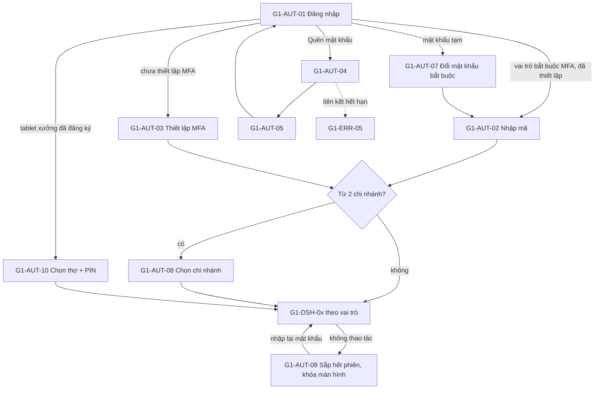

# UI/UX – Gói G1: Xác thực và Dashboard theo vai trò

Phiên bản 0.1 · 30/10/2026 · Người lập: designer · Trạng thái: prototype đã dựng đủ 31/31 màn hình, **chưa được xem trên trình duyệt thật** (môi trường làm việc không có trình duyệt; đã tự rà cú pháp, đường dẫn và tên class).

Nguồn đã đọc: `docs/design-system.md` (giá trị token, font, kích thước khung không đổi), `docs/ui-ux/00-foundation.md`, `docs/ui-ux/ba-decisions.md`, `docs/ui-ux/screen-inventory.md` §2, §5 (D-01..D-14), §6 (G-01..G-10), §7.1–7.3, §9, `designer-brief.md`.

## 1. Phạm vi và cách xem

Phạm vi: 31 màn hình của `screen-inventory.md` §2 gồm SHL 2, AUT 10, ERR 5, DSH 10, NTF 2, PRF 2. Thư mục sản phẩm `design/g1-auth-dashboard/`, mở `index.html` bằng trình duyệt (`file://`, cần bật JavaScript). Class bổ sung ở `pack.css` (tiền tố `g1-`), không sửa `design/assets/*`.

| File | Vai trò |
| --- | --- |
| `index.html` | Liệt kê 31 màn hình (mã, tên, template, vai trò, ưu tiên) và luồng đăng nhập thử |
| `pack.css` | Layout xác thực/lỗi, lưới dashboard, biểu đồ SVG, thẻ việc của thợ, PIN pad, thông báo, hồ sơ; chỉ dùng token |
| `g1-shell.js` | Dựng Application Shell chuẩn cho các trang có `data-g1-shell` (sidebar, topbar, phạm vi chi nhánh 3 cấp, chuông, menu tài khoản, dải phạm vi RULE-015, thanh dưới trên mobile, hộp thoại đăng xuất và lưu nháp). Chạy trước `app.js` để menu theo vai trò và phạm vi chi nhánh dùng lại đúng hành vi đã có |
| `g1-charts.js` | Biểu đồ SVG thuần (đường, cột/thanh nhóm hoặc xếp chồng, vạch định mức), tooltip, bảng số liệu thay thế, bộ lọc kỳ + chi nhánh, bộ xem thử trạng thái thẻ |
| `g1-auth.js` | Bộ chuyển trạng thái xem thử (`?state=...`), kiểm tra biểu mẫu, mật khẩu, đếm lùi, wizard, PIN pad, chọn chi nhánh |
| `g1-<mã>.html` | Mỗi màn hình một file (ví dụ `g1-dsh-03.html`) |

Cách xem trạng thái: trang xác thực/lỗi/thông báo/hồ sơ có thanh “Xem thử trạng thái (chỉ prototype)” và nhận `?state=<tên>` (ví dụ `g1-aut-01.html?state=locked`). Dashboard có thanh xem thử: Bình thường, Đang tải, Trống, Lỗi một số thẻ, Thiếu quyền, Dữ liệu cũ, Mất kết nối (và “Pilot 1 chi nhánh” ở DSH-01/02), cũng nhận `?state=loading|empty|error|denied|stale|offline|pilot`. Các thanh này chỉ có trong prototype, không thuộc sản phẩm.

## 2. Bảng màn hình

Template theo `screen-inventory.md` §0.2. “Đã thiết kế” = đã có file prototype với các trạng thái ghi ở cột cuối.

| Mã | Tên | File | Template | Vai trò | Ưu tiên | Trạng thái đã thiết kế |
| --- | --- | --- | --- | --- | --- | --- |
| G1-SHL-01 | Khung ứng dụng theo vai trò | `g1-shl-01.html` | A | Mọi vai trò | P1 | Banner mất kết nối, chi nhánh bị khóa (chỉ xem) kèm nút bị tắt có lý do, phiên sắp hết, nháp chưa lưu khi đăng xuất/đổi phạm vi, nhiều pháp nhân, đổi góc nhìn vai trò, sidebar thu gọn, tablet, mobile (ngăn kéo + thanh dưới) |
| G1-SHL-02 | Kết quả tìm kiếm toàn cục | `g1-shl-02.html` | C | Mọi vai trò (lọc theo quyền) | P1 | Có kết quả, không có kết quả, quá nhiều kết quả, đang tìm, lỗi, mất mạng, SĐT che theo vai trò |
| G1-AUT-01 | Đăng nhập | `g1-aut-01.html` | Độc lập | Công khai | P1 | Mặc định, sai thông tin (trung lập), khóa tạm, mất mạng, đang xử lý, lối tắt thiết bị xưởng |
| G1-AUT-02 | Xác thực hai lớp: nhập mã | `g1-aut-02.html` | Độc lập | CH, QV, QL, KT, AD | P1 | Nhập mã, mã sai/hết hạn, đồng hồ lệch, quá số lần thử, mã khôi phục, mã qua email, đang xác nhận |
| G1-AUT-03 | Thiết lập xác thực hai lớp lần đầu | `g1-aut-03.html` | W | Vai trò bắt buộc MFA | P1 | 4 bước (cài ứng dụng, quét mã, mã thử, mã khôi phục), mã thử sai, chưa xác nhận đã lưu mã, hết thời gian thiết lập |
| G1-AUT-04 | Quên mật khẩu | `g1-aut-04.html` | Độc lập | Công khai | P1 | Nhập thông tin, đã gửi (trung lập, đếm lùi gửi lại), gửi quá nhiều lần, mất mạng |
| G1-AUT-05 | Đặt lại mật khẩu | `g1-aut-05.html` | Độc lập | Công khai (có token) | P1 | Chính sách + thanh độ mạnh, trùng mật khẩu cũ, thành công, mất mạng; liên kết hết hạn chuyển ERR-05 |
| G1-AUT-06 | Kích hoạt tài khoản qua lời mời | `g1-aut-06.html` | W | Người được mời | P1 | 4 bước, vai trò cần/không cần MFA, lời mời hết hạn, đã dùng, vai trò bị thu hồi |
| G1-AUT-07 | Đổi mật khẩu bắt buộc | `g1-aut-07.html` | E | Người dùng có mật khẩu tạm | P1 | Mặc định, mật khẩu tạm sai, trùng mật khẩu cũ, mất mạng, đang lưu |
| G1-AUT-08 | Chọn chi nhánh làm việc | `g1-aut-08.html` | Độc lập (card) | Người có từ 2 chi nhánh | P1 | Quản lý nhiều chi nhánh, CH/QV (hợp nhất, nhóm), chi nhánh vừa bị khóa (chỉ xem), chưa được gán chi nhánh |
| G1-AUT-09 | Hết phiên và khóa màn hình | `g1-aut-09.html` | Dlg toàn trang | Mọi vai trò | P1 | Đếm lùi 60 giây, đã khóa, sai mật khẩu, mất mạng lúc khóa, hết phiên tuyệt đối 12 giờ, bị thu hồi quyền |
| G1-AUT-10 | Thiết bị xưởng: chọn thợ và nhập PIN | `g1-aut-10.html` | Độc lập (tablet) | TH, QĐ | P1 | Chọn thợ, PIN sai, khóa tạm sau 5 lần sai, tự khóa 3 phút, mất mạng, thiết bị chưa đăng ký |
| G1-ERR-01 | 403 Không có quyền | `g1-err-01.html` | Err | Mọi vai trò | P1 | Mặc định, quyền ở chi nhánh khác, đã gửi yêu cầu cấp quyền, mất mạng |
| G1-ERR-02 | 404 Không tìm thấy | `g1-err-02.html` | Err | Mọi vai trò | P1 | Mặc định (gộp “không có” và “không được xem”) |
| G1-ERR-03 | Lỗi hệ thống (5xx) | `g1-err-03.html` | Err | Mọi vai trò | P1 | Đã giữ nháp, không có việc đang soạn, chưa giữ được nháp, đang thử lại |
| G1-ERR-04 | Mất kết nối và bảo trì | `g1-err-04.html` | Err / banner | Mọi vai trò | P1 | Mất kết nối, bảo trì (giờ dự kiến), có mạng lại + nhập bù, xung đột đồng bộ, hộp thoại phiếu giấy dự phòng A5 |
| G1-ERR-05 | Liên kết hết hạn hoặc không hợp lệ | `g1-err-05.html` | Err / P | Công khai | P1 | Nhân viên (đặt lại mật khẩu), nhân viên (lời mời), khách hàng (gọi chi nhánh), mất mạng |
| G1-DSH-01 | Tổng quan Chủ garage | `g1-dsh-01.html` | B | CH | P1 | Chuẩn + trạng thái thẻ + pilot 1 chi nhánh |
| G1-DSH-02 | Tổng quan Quản lý vùng | `g1-dsh-02.html` | B | QV | P2 | Chuẩn + trạng thái thẻ + pilot |
| G1-DSH-03 | Tổng quan Quản lý chi nhánh | `g1-dsh-03.html` | B | QL | P1 | Chuẩn + trạng thái thẻ + cảnh báo chưa chốt ngày |
| G1-DSH-04 | Tổng quan Cố vấn dịch vụ | `g1-dsh-04.html` | B | CV | P1 | Chuẩn + trạng thái thẻ, “chưa có xe trong xưởng” |
| G1-DSH-05 | Tổng quan Thủ kho | `g1-dsh-05.html` | B | TK | P1 | Chuẩn + trạng thái thẻ, nút xuất kho bị tắt có lý do khi hết hàng |
| G1-DSH-06 | Tổng quan Kế toán | `g1-dsh-06.html` | B | KT | P1 (hóa đơn, đối soát), P2 (công nợ) | Chuẩn + trạng thái thẻ, Hiện SĐT có lý do |
| G1-DSH-07 | Việc của tôi (Thợ, tablet) | `g1-dsh-07.html` | B | TH, QĐ | P1 | Việc đang làm, chưa làm, bị khóa chờ khách duyệt phát sinh, tạm dừng chờ phụ tùng, QC trả lại, trống, mất mạng |
| G1-DSH-08 | Tổng quan Thu ngân | `g1-dsh-08.html` | B | TN | P1 (BA) | Chuẩn + trạng thái thẻ + ca chưa mở |
| G1-DSH-09 | Tổng quan Quản đốc / QC | `g1-dsh-09.html` | B | QĐ | P1 | Chuẩn + trạng thái thẻ |
| G1-DSH-10 | Tổng quan Quản trị hệ thống | `g1-dsh-10.html` | B | AD | P1 | Chuẩn + trạng thái thẻ |
| G1-NTF-01 | Trung tâm thông báo | `g1-ntf-01.html` | C / Dlg | Mọi vai trò | P1 (trong hệ thống), P2 (email, Zalo) | Có thông báo, trống, đang tải, lỗi, mất mạng, mục đã xử lý bởi người khác, liên kết ngoài quyền, ngăn kéo |
| G1-NTF-02 | Cài đặt thông báo cá nhân | `g1-ntf-02.html` | S | Mọi vai trò | P2 | Mặc định, kênh Zalo bị khóa kèm giải thích, “Luôn bật” cho việc Cần xử lý, lưu lỗi, mất mạng |
| G1-PRF-01 | Hồ sơ cá nhân | `g1-prf-01.html` | D / E | Mọi vai trò | P1 | Mặc định, lỗi nhập liệu, đã lưu, mất mạng, trường chỉ đọc kèm lý do, ảnh sai định dạng/quá lớn |
| G1-PRF-02 | Bảo mật tài khoản | `g1-prf-02.html` | D / E | Mọi vai trò | P1 | Quản lý (MFA bắt buộc, nút tắt bị khóa có lý do), thợ (MFA tùy chọn, PIN), step-up mật khẩu, mất mạng |

## 3. UI/UX flow

### 3.1 Đăng nhập (theo `screen-inventory.md` §7.1)

1. G1-AUT-01 nhập email/mã nhân viên và mật khẩu. Không có nút “Đăng ký” (D-01).
2. Tablet xưởng đã đăng ký: thay bước 1 bằng G1-AUT-10 (chọn tên thợ, nhập PIN 6 số), vào G1-DSH-07.
3. Mật khẩu tạm hoặc bị đặt lại: G1-AUT-07, sau đó tiếp bước 4.
4. Vai trò bắt buộc MFA: đã thiết lập thì G1-AUT-02, chưa thì G1-AUT-03 rồi G1-AUT-02 (dùng mã khôi phục hoặc mã email khi cần).
5. Từ 2 chi nhánh: G1-AUT-08; một chi nhánh: bỏ qua.
6. Vào dashboard theo vai trò: CH 01, QV 02, QL 03, CV 04, TK 05, KT 06, TH 07, TN 08, QĐ 09, AD 10. Người nhiều vai trò vào vai trò cao nhất và đổi “Góc nhìn vai trò” ở menu tài khoản (G1-SHL-01, D-09).
7. Trong phiên: cảnh báo 60 giây rồi G1-AUT-09, nhập lại mật khẩu thì quay về đúng nơi đang làm, nháp được giữ.

### 3.2 Quên mật khẩu và kích hoạt tài khoản

- Quên mật khẩu: G1-AUT-01 → G1-AUT-04 (thông báo luôn giống nhau) → email → G1-AUT-05 → thu hồi mọi phiên cũ → G1-AUT-01. Liên kết hết hạn: G1-ERR-05 → lấy liên kết mới. Nhân viên không có email: quản lý cấp mã tạm (ngoài gói này, G4-SYS-03) → G1-AUT-01 → G1-AUT-07.
- Kích hoạt: G4-SYS-02 gửi lời mời → G1-AUT-06 (thông tin chỉ đọc → mật khẩu → bảo mật → quy định) → nếu bắt buộc MFA thì G1-AUT-03 → G1-AUT-08 hoặc dashboard.

### 3.3 Trong phiên

Mọi màn hình có G1-SHL-01. Tìm kiếm (Ctrl K hoặc biểu tượng) → G1-SHL-02. Chuông → ngăn kéo/trang G1-NTF-01 → bản ghi liên quan (ngoài quyền thì G1-ERR-01). Menu tài khoản → G1-PRF-01, G1-PRF-02, đăng xuất. Mất mạng: banner của shell và G1-ERR-04; lỗi máy chủ G1-ERR-03.

## 4. Mô tả từng nhóm màn hình

### 4.1 Khung ứng dụng và tìm kiếm (G1-SHL)

Mục đích: một khung duy nhất cho mọi vai trò, luôn trả lời “tôi ở đâu, đang xem phạm vi nào, dữ liệu mới đến lúc nào”.

- Bố cục (template A): sidebar 248/72px, topbar 64px, breadcrumb, page header, dải phạm vi (chi nhánh, pháp nhân nếu có, kỳ, thời điểm cập nhật, nhãn số tạm/chính thức, nút làm mới). Giá trị token không đổi.
- Menu theo bảng vai trò → menu của `00-foundation.md` §7 (hiện thực trong `app.js`); mục có “Chỉ xem / Của tôi / Hệ thống” có nhãn nhỏ.
- Phạm vi chi nhánh: CH 3 cấp (tất cả, nhóm, từng chi nhánh), QV “Tất cả nhóm được giao”, QL/KT chọn trong chi nhánh được gán (chi nhánh chưa cấp quyền hiện khóa kèm lý do), CV/QĐ/TH/TK/TN tên tĩnh, AD không gắn chi nhánh. Pháp nhân là bộ lọc phụ ẩn khi chỉ có một. Đổi phạm vi khi đang soạn chứng từ hỏi lưu nháp (D-06).
- Hành động: chính là điều hướng; phụ là đổi chi nhánh/góc nhìn/thu gọn; nguy hiểm là đăng xuất khi còn nháp (hộp thoại nêu bản nháp được giữ trên máy và khuyên lưu lên hệ thống trước).
- Trạng thái trên khung: mất kết nối (nói rõ việc không làm được và giờ lưu nháp), chi nhánh bị khóa (nút tắt luôn kèm dòng lý do nhìn thấy), phiên sắp hết.
- Responsive: tablet sidebar 72px, mọi control ≥ 44px; mobile sidebar thành ngăn kéo, thanh dưới 4 mục theo quyền + “Thêm”, ô tìm kiếm thu thành biểu tượng.
- G1-SHL-02: ô tìm có chip loại với số lượng, nhóm kết quả (xe, khách, lệnh, báo giá, phụ tùng, chứng từ), tìm không phân biệt dấu và bỏ qua dấu chấm/gạch của biển số, mã chứng từ nhập thiếu gạch vẫn khớp. Dữ liệu cá nhân dùng `.pii` theo vai trò. Không có kết quả: nói rõ phạm vi (chi nhánh và quyền) và không cho thấy dữ liệu ngoài phạm vi.

### 4.2 Xác thực (G1-AUT)

Mục đích: vào hệ thống an toàn mà không làm nhân viên quầy/xưởng chậm. Layout riêng: nền `surface.page`, logo, thẻ rộng tối đa 440px (wizard 600px, tablet xưởng 720px), cùng token và component với phần còn lại.

Nguyên tắc chung:
- **Không lộ tài khoản có tồn tại hay không**: thông báo sai thông tin, khóa tạm, “đã gửi liên kết” luôn giống nhau với mọi tài khoản. Tài khoản bị vô hiệu cũng hiện đúng thông báo “Không đăng nhập được” như sai mật khẩu. Ba bộ đếm đều áp cả cho tên không tồn tại để hành vi giống nhau (BA câu 1): A theo (thiết bị + tên nhập) khóa 15 phút; B theo tên nhập trên mọi thiết bị chỉ làm chậm và báo AD (không khóa cứng, tránh bị khóa cố ý); C theo địa chỉ mạng làm chậm. Mở sớm: hoàn tất “Quên mật khẩu” hoặc QL/CH/AD mở khóa (nhập lại mật khẩu của người mở, ghi nhật ký, email cho chủ tài khoản). Ngoài màn hình, người bị vô hiệu/khóa nhận email và QL/AD thấy lý do ở G4-SYS-03.
- **Thông báo lỗi nêu cách sửa**: mỗi lỗi trường có ví dụ đúng (“Ví dụ: ha.nguyen@garage.vn hoặc NV0123”), lỗi chung nói bước tiếp theo (Quên mật khẩu, liên hệ quản lý chi nhánh).
- Label luôn hiện, dấu * giải thích “Bắt buộc nhập”, `autocomplete` đúng (username, current-password, new-password, one-time-code), hiện/ẩn mật khẩu bằng nút có nhãn, cảnh báo Caps Lock, focus vào ô đầu.
- Nút chính 1 cái/màn hình, `btn--lg` toàn chiều ngang; nút bị tắt đều có dòng lý do ngay phía trên (không chỉ tooltip).
- Mất mạng: giữ nguyên dữ liệu đã nhập, nói rõ chưa gửi được, có “Thử kết nối lại”.

Chi tiết theo màn hình:
- AUT-01: email/mã nhân viên, mật khẩu (không còn “Ghi nhớ thiết bị”, tránh trùng khái niệm với “tin cậy thiết bị” của MFA); lối tắt PIN chỉ hiện khi thiết bị đã đăng ký là thiết bị xưởng; khóa tạm nói cách mở sớm.
- AUT-02: 6 ô nhập (dán cả mã), đếm số lần còn lại, gợi ý kiểm tra giờ điện thoại, mã khôi phục. Theo vai trò (BA câu 2): CH, QV, QL có “tin cậy thiết bị 14 ngày”; KT, AD không có; **nhóm bắt buộc MFA (CH, QV, QL, KT, AD) không có mã dự phòng qua email** (cùng hộp thư với Quên mật khẩu), thay bằng mã khôi phục hoặc nhờ người có thẩm quyền đặt lại (xác minh danh tính, nhật ký, email); mã email chỉ cho vai trò tự bật MFA (CV, QĐ, TK, TN).
- AUT-03: bước không bỏ qua được; QR chỉ là hình minh họa; mã khôi phục chỉ hiện một lần, nút “Hoàn tất” bật sau khi đánh dấu đã lưu; hết thời gian thiết lập 10 phút phải làm lại.
- AUT-04/05: thanh độ mạnh có chữ, danh sách yêu cầu đánh dấu đạt/chưa đạt bằng biểu tượng + chữ ẩn cho trình đọc màn hình; “không trùng 5 mật khẩu gần nhất” kiểm tra khi lưu.
- AUT-06: thông tin (họ tên, email, chi nhánh, vai trò) chỉ đọc, sai thì dừng và báo quản lý; đồng ý quy định bằng ô tích bắt buộc.
- AUT-08: mỗi chi nhánh là một thẻ bấm được (≥ 64px) kèm vai trò của mình ở chi nhánh đó, “Gần nhất” được chọn sẵn để vào bằng 1 chạm, chi nhánh khóa có nhãn “Chỉ xem”, “Nhớ lựa chọn”.
- AUT-09: đếm lùi 60 giây bằng số lớn; sau khóa chỉ hỏi mật khẩu, nói rõ bản nháp đã giữ; phiên tuyệt đối 12 giờ và thu hồi quyền có thông báo riêng.
- AUT-10 (BA câu 3): lưới tên thợ (thẻ ≥ 112px), bàn phím số 72px, chấm tròn, PIN không hiện chữ. 5 lần sai khóa tên đó đến khi QĐ/QL mở (không tự mở), báo quản đốc. Thêm trạng thái **Đặt PIN mới** (sau PIN tạm do QĐ/QL cấp: nhập hai lần, chặn PIN dễ đoán, không trùng 3 PIN gần nhất), **Thiết bị chưa đăng ký** (nhập mã ghép 8 ký tự hiệu lực 10 phút) và **Thiết bị bị thu hồi**.

### 4.3 Trang lỗi (G1-ERR)

Layout cùng nhóm xác thực. Mỗi trang: mã lớn, tiêu đề dễ hiểu, một đoạn nói “chuyện gì và có mất dữ liệu không”, thông tin phụ (vai trò/chi nhánh hiện tại, mã tham chiếu), hành động chính rõ. 403 và 404 không lộ sự tồn tại của dữ liệu ngoài phạm vi; ERR-03 báo bản nháp đã được giữ hay chưa; ERR-04 liệt kê việc còn làm được/chưa làm được, bản nháp trên máy, phiếu giấy dự phòng A5 (in được), hàng đợi nhập bù có tag “Nhập bù” và hộp chọn bản giữ lại khi xung đột; ERR-05 dùng thông báo trung lập cho cả hết hạn, đã dùng, nhập sai.

### 4.4 Dashboard (G1-DSH, template B)

Bố cục chung: page header (tiêu đề, mô tả vai trò, tối đa 3 hành động) → thanh xem thử → bộ lọc (khoảng thời gian: các lối tắt + “Tùy chọn” hai ô dd/MM/yyyy có kiểm tra; chi nhánh; “Cập nhật lúc”; Làm mới; Đặt lại mặc định) → hàng KPI (nhiều nhất 6) → hai cột (khối chính rộng trái, việc cần xử lý phải). Màn đầu không quá 5–6 khối ngoài hàng KPI; việc cần hành động ngay (phê duyệt, trễ hẹn, hết hàng) nằm ở khối nổi bật (`g1-hl-card`) chứ không chôn trong biểu đồ.

Quy tắc dữ liệu (RULE-015, FR-RPT-010, BA câu 5): mọi KPI/biểu đồ có dòng ghi chi nhánh · kỳ · thời điểm. **Số theo kỳ** (doanh thu, lợi nhuận, lượt xe, thu/chi) là “Số chính thức” chỉ khi mọi ngày × mọi chi nhánh trong phạm vi và kỳ đã chốt, nếu không là “Số tạm” theo trường hợp xấu nhất; badge ở dải phạm vi kèm dòng chữ nêu chi nhánh/ngày chưa chốt (ví dụ “Đã chốt đến 28/10. 2 trên 5 chi nhánh chưa chốt 29/10: Quận 7, Thủ Đức”). **Số tại một thời điểm** (xe đang sửa, công nợ, tồn, hàng chờ) ghi “tại hh:mm”, không dùng tạm/chính thức. Điểm của ngày chưa chốt trên biểu đồ đường vẽ nét chấm, điểm rỗng, tooltip “số tạm”. Số tiền ở KPI rút gọn có đơn vị (“1.713,9 tr ₫”), ở bảng và chứng từ dùng số đầy đủ (“505.700.000 ₫”). Mã chứng từ theo `ba-decisions.md` (RO-Q7-2610-00128, BG-Q7-2610-00231-v2), biển số `51H-123.45`.

Biểu đồ (design-system §9): tên, đơn vị và phạm vi dưới tên; trục bắt đầu từ 0; không dùng biểu đồ tròn, 3D hay hai trục; tooltip bằng chuột, chạm, focus và phím mũi tên (đọc được cả bằng trình đọc màn hình qua vùng `aria-live`); nút “Biểu đồ / Bảng số liệu” chuyển sang bảng thay thế đầy đủ (có tổng khi xếp chồng); legend có chữ; đường “kỳ trước” là nét đứt (không chỉ khác màu); vạch định mức là vạch đậm riêng. Màu dãy dữ liệu là `--chart-series-1..5` (tím, xanh ngọc, hổ phách, ghi, hồng), không dùng đỏ/xanh lá trang trí. Màu biểu đồ khác màu badge trạng thái nên biểu đồ trạng thái lệnh phải đọc qua chú giải/bảng.

| Mã | Câu hỏi vai trò cần trả lời | Khối chính | Hành động chính |
| --- | --- | --- | --- |
| DSH-01 CH | Trả lời 10 câu sáng của chủ garage (BRD §3): 1 xe đang sửa = KPI “Xe đang sửa”; 2 chi nhánh tốt nhất, 10 chi nhánh cần can thiệp = bảng xếp hạng + thanh nhóm; 3 lệnh chậm = “Xe trễ hẹn giao” (đi tới danh sách lệnh trễ hẹn); 4 thợ quá tải = “Thợ quá tải” (đi tới DSH-09 của chi nhánh); 5 phụ tùng thiếu/tồn lâu = “Phụ tùng thiếu hoặc tồn lâu”; 6 doanh thu cao lợi nhuận thấp = cột biên LN gộp; 7 khách nợ = KPI công nợ phải thu; 8 tiền mặt khớp = “Lệch quỹ”; 9 khoản chi chưa duyệt = “Việc cần tôi phê duyệt” | 6 KPI (lợi nhuận gộp ghi “chưa gồm nhân công” + nút Cách tính); đường doanh thu theo ngày; thanh nhóm doanh thu + lợi nhuận theo chi nhánh; bảng xếp hạng; việc cần tôi phê duyệt; cảnh báo ngoại lệ (5 dòng) | Mở hàng chờ phê duyệt |
| DSH-02 QV | Nhóm được giao thế nào? | KPI, đường doanh thu nhóm, bảng xếp hạng chọn chỉ số (doanh thu, biên LN, lượt xe, trễ hẹn), phê duyệt cấp vùng, ngoại lệ | Phê duyệt cấp vùng |
| DSH-03 QL | Hôm nay chi nhánh có vấn đề gì? | Cảnh báo chưa chốt ngày; 4 KPI; thanh xếp chồng lệnh đang mở theo loại dịch vụ × trạng thái; công việc quá hạn; hàng chờ duyệt; kỹ thuật viên; kho sắp hết (theo khả dụng) | Duyệt hàng chờ |
| DSH-04 CV | Việc ở quầy hôm nay? | 6 KPI; lịch hẹn hôm nay; báo giá chờ khách duyệt kèm thời gian chờ + “Nhắc khách”; xe chờ bàn giao (3 badge lệnh/thanh toán/hóa đơn tách riêng); xe đang sửa của tôi | + Tiếp nhận xe |
| DSH-05 TK | Việc kho? | 6 KPI; yêu cầu cấp phụ tùng chờ xuất (xuất kho luôn theo lệnh); cột tồn khả dụng theo nhóm với vạch định mức; hàng dưới định mức với 4 con số; chứng từ kho đang xử lý | Mở yêu cầu cấp phụ tùng |
| DSH-06 KT | Tiền, nợ và hóa đơn có ổn không? | 6 KPI; hóa đơn cần xử lý (chỉ báo `sync` tách khỏi badge); tuổi nợ phải thu/phải trả (xếp chồng); thu/chi 7 ngày; đối soát quỹ; việc cần chú ý | Xử lý hóa đơn |
| DSH-07 TH | Việc nào tiếp theo? | Công hôm nay (tóm tắt, không có hoa hồng); danh sách thẻ việc; nút ≥ 52px; Tạm dừng 2 chạm chọn lý do; Hoàn thành có Hoàn tác | Bắt đầu / Tiếp tục |
| DSH-08 TN | Tôi thu tiền gì, ca còn mở không? | 5 KPI; lệnh sẵn sàng thu; phiếu thu hôm nay; trạng thái ca/ngày; hóa đơn cần xuất | Thu tiền |
| DSH-09 QĐ | Ai làm gì, xe nào chờ QC? | 5 KPI; hạng mục chưa phân thợ (gợi ý thợ còn giờ); tải việc thợ (bảng + thanh tiến độ); xe chờ QC; QC trả lại; phát sinh chờ khách duyệt | Phân thợ / Kiểm tra chất lượng |
| DSH-10 AD | Hệ thống có khỏe không? | KPI sao lưu, thử khôi phục, tích hợp, đăng nhập bất thường, lời mời; bảng tích hợp; cột đăng nhập thất bại; lời mời chờ; lô nhập Excel | Mở Trung tâm tích hợp |

Trạng thái mỗi khối (TT-B): đang tải (skeleton cùng kích thước, không spinner toàn trang), trống từng khối (nói vì sao và làm gì), **lỗi từng khối** (các khối khác vẫn dùng được, nút “Thử lại”, mã tham chiếu), khối ẩn do thiếu quyền (có dòng thông báo liệt kê khối bị ẩn), dữ liệu cũ (banner ghi lần cập nhật gần nhất), mất kết nối (banner của shell). Nút/khối bị tắt luôn có lý do nhìn thấy.

Quy tắc hiển thị theo vai trò:
- Lợi nhuận gộp và giá trị tồn (BA câu 6): CH, QV (phạm vi được giao) và **QL (chỉ chi nhánh mình, KPI thêm vào DSH-03)**; KT xem ở báo cáo chứ không có KPI trên DSH-06; CV, QĐ, TH, TN, AD không; TK chỉ số lượng. Quyền xem là cấu hình G4-SYS-04. Giai đoạn 1 nhãn luôn là “Lợi nhuận gộp (chưa gồm nhân công)” vì chưa có công thợ; nút “Cách tính” nêu công thức, phạm vi, phương pháp giá vốn và thành phần chưa gồm.
- “Xe trễ hẹn giao” là tên và định nghĩa duy nhất (lệnh chưa hoàn tất/hủy có hẹn giao hiện hành đã qua; BA câu 7), cùng một con số trên DSH-01/02/03/09 (Quận 7: 3, Đà Nẵng: 1).
- SĐT khách: CV, QL, TN, QĐ đầy đủ; CH, QV che + “Hiện”; KT che + “Hiện” bắt buộc chọn lý do; TK che; TH, AD không thấy (cơ chế `.pii` có sẵn).
- AD: chỉ số vận hành, không có doanh thu hay khách; có dòng giải thích lý do.
- TH: chỉ việc của mình; không hiện hoa hồng.
- Hạn mức phê duyệt không nằm trong giao diện: các khối chỉ ghi “hạn mức lấy từ cấu hình (G4-APR-03)” (D-11).

Responsive: lưới KPI `auto-fit`, hai cột thu thành một cột dưới 1280px, bảng cuộn ngang trong khung (toàn trang không cuộn ngang), biểu đồ vẽ lại theo bề rộng (trục rút gọn khi dưới 480px), bộ lọc xuống dòng. Màn thợ dùng thẻ lớn và nút xl 52px. Phần “bảng → card list trên mobile” của template C áp dụng ở G1-SHL-02 và thông báo (đã là danh sách dạng hàng).

### 4.5 Thông báo và hồ sơ (G1-NTF, G1-PRF)

- NTF-01: bộ lọc mức (Tất cả / Cần xử lý / Thông tin) kèm số chưa đọc, loại sự kiện, “Chỉ chưa đọc”; mỗi thông báo có biểu tượng, tiêu đề, mô tả, chi nhánh + thời điểm, hành động chính (Duyệt, Mở lệnh…) và “Đánh dấu đã đọc”; mục đã xử lý bởi người khác hiện tag “Đã xử lý bởi … lúc …”; mục dẫn tới chi nhánh khác đi G1-ERR-01. Ngăn kéo dùng khi mở từ chuông.
- NTF-02: bảng sự kiện × kênh; việc “Cần xử lý” luôn bật trong hệ thống (ghi “Luôn bật”); Zalo bị khóa kèm “Chưa kích hoạt”; tóm tắt hằng ngày; “Lưu” chỉ bật khi có thay đổi.
- PRF-01: ảnh (kiểm tra loại tệp và dung lượng), trường chỉ đọc kèm lý do “do quản trị gán”, bảng chi nhánh–vai trò (chỉ đọc), SĐT/email tự sửa có kiểm tra.
- PRF-02: đổi mật khẩu, MFA (nút tắt bị khóa kèm lý do với vai trò bắt buộc), tạo lại mã khôi phục và “Đăng xuất mọi thiết bị” (hộp thoại nguy hiểm nêu hậu quả, hỏi lại mật khẩu), thiết bị đang đăng nhập, lịch sử đăng nhập của chính mình, PIN xưởng cho thợ.

## 5. Ánh xạ FR / RULE

| Nhóm | FR / RULE / quyết định |
| --- | --- |
| SHL | FR-SYS-002, 009, 011, 012; NFR-ISO-01; RULE-012, RULE-015; NFR-OFF-01; D-06, D-09 |
| AUT | FR-SYS-001, 014; BR-SYS-01; NFR-SEC-01; NFR-USA-01 (thợ ≤ 2 chạm); WF-08; D-01..D-06 |
| ERR | FR-SYS-002, 013; NFR-OPS-01, NFR-AVA-01, NFR-OFF-01; BR-SYS-04; FR-REC-008 (liên kết khách) |
| DSH-01, 02 | FR-RPT-001, 002, 008, 010, 011, 013; BR-RPT-01; RULE-015; NFR-PERF-02 (toàn chuỗi < 5 giây) |
| DSH-03 | FR-RPT-001, 003, 008, 012; FR-REC-022; FR-INV-013; FR-ACC-004; FR-SYS-004; RULE-008 |
| DSH-04 | FR-REC-019, 022, 024, 027, 008; RULE-005/006 (báo giá, phát sinh) |
| DSH-05 | FR-INV-007, 010, 013, 020; FR-PUR-001; RULE-007, 008, 009 |
| DSH-06 | FR-ACC-004, 006, 007; FR-EIN-009, 010; FR-RPT-004, 007; RULE-010 |
| DSH-07 | FR-REC-013, 014; NFR-USA-01; WF-08; RULE-005 |
| DSH-08 | FR-ACC-001, 003, 004; FR-EIN-002, 009; RULE-007, 010 |
| DSH-09 | FR-REC-012, 016, 022; FR-HRM-014 |
| DSH-10 | FR-SYS-010, 014, 017; NFR-OPS-01 |
| NTF | FR-SYS-008, 015; BR-SYS-03, 07; D-07 |
| PRF | FR-SYS-001, 009, 012, 014; FR-HRM-001; NFR-SEC-01 |
| Khác | NFR-SEC-03 (che dữ liệu cá nhân), FR-SYS-003 (nhật ký: ghi mỗi lần Hiện), NFR-COM-01 (phiếu giấy dự phòng A5) |

## 6. Kiểm tra accessibility đã tự đánh giá (WCAG 2.2 AA)

Đã làm (tự rà mã nguồn, chưa chạy trên trình duyệt hay trình đọc màn hình):
- Label luôn hiện; lỗi gắn `aria-invalid` + `aria-describedby`, có `role="alert"` cho lỗi chung; không dùng màu làm tín hiệu duy nhất (badge/tag luôn có chữ, delta có mũi tên + chữ, độ mạnh mật khẩu có chữ, yêu cầu mật khẩu có biểu tượng + chữ ẩn, nét đứt cho kỳ trước).
- Skip link, một `h1` mỗi trang, bảng có `caption` ẩn và `scope`, vùng trạng thái dùng `aria-live`, focus ring theo foundation (outline đặc 2px).
- Biểu đồ: có tên (`aria-label`), tooltip không phải nơi duy nhất chứa thông tin (có bảng số liệu và vùng đọc), dùng được bằng bàn phím (Tab vào, ← → Home End, Esc), vạch phân tách trắng giữa các đoạn xếp chồng.
- Cảm ứng: control ≥ 44px theo foundation; thợ 52px; PIN 72px; thẻ chi nhánh ≥ 64px; ô chọn kênh thông báo 44px.
- Giảm chuyển động: vòng xoay nút và hoạt ảnh tôn trọng `prefers-reduced-motion`.
- Màu dãy biểu đồ lấy từ token (ước tính tương phản với nền trắng từ 4,7:1 đến 6:1, ≥ 3:1 cho thành phần đồ họa); chữ trục dùng `--chart-axis` (= `text.tertiary`, 4,8:1 trên trắng).

Chưa kiểm hoặc còn yếu: chưa thử trình đọc màn hình thật; chưa đo tương phản trong trình duyệt; vòng xoay phím trong lưới thẻ chi nhánh/thợ dùng Tab chứ chưa phải roving tabindex; biểu đồ có tới 30 điểm nhưng chỉ 1 điểm dừng Tab (đúng chủ đích nhưng cần kiểm với người dùng); dark mode ngoài phạm vi.

## 7. Giả định

**Cập nhật sau review BA (ba-answers-01.md):** giả định 2 (khóa theo thiết bị + tên) thay bằng ba bộ đếm; giả định 4 (trễ hẹn) thay bằng định nghĩa chính thức; giả định 5 (lợi nhuận chỉ CH, QV) thay bằng thêm QL; giả định 8 (thợ mất mạng chặn) giờ là quyết định Phase 1 (chặn + phiếu giấy + quản đốc nhập bù); giả định 3 vẫn đúng. Các giả định còn lại giữ nguyên.

1. Không có tự đăng ký; “đăng ký” = kích hoạt lời mời 72 giờ (D-01). Chính sách mật khẩu và khóa tạm theo D-03/D-05; các số (10 ký tự, 5 lần sai, 15 phút, 30 phút, 12 giờ, 3 phút xưởng) hiển thị nhưng là tham số cấu hình G4-SYS-24, không hard-code ý nghĩa nghiệp vụ.
2. Khóa tạm áp theo thiết bị + tên nhập và thông báo trung lập để không lộ tài khoản (xem câu hỏi 1).
3. Ở AUT-06, thiết lập MFA (AUT-03) diễn ra sau khi bấm “Kích hoạt” chứ không nhúng trong cùng wizard (tránh mất trạng thái khi chuyển trang); bước 3 chỉ thông báo.
4. “Xe trễ hẹn / công việc quá hạn” hiểu là lệnh quá giờ hẹn giao (không phải hạng mục vượt giờ chuẩn).
5. Lợi nhuận gộp chỉ hiện cho CH, QV; công thức nằm trong cấu hình báo cáo, UI chỉ ghi “theo cấu hình”.
6. Ngày khóa kỳ (05/11/2026), giờ bảo trì dự kiến (22:30), số điện thoại chi nhánh ở ERR-05, hạn sao lưu/thử khôi phục là dữ liệu mẫu.
7. Thông báo: thời gian lưu 30 ngày/12 tháng (BA đề xuất, câu 15); việc “Cần xử lý” không tắt được trong hệ thống; Email bật được, Zalo “Chưa kích hoạt” (D-13).
8. Mất mạng trên màn thợ: nút Bắt đầu/Hoàn thành tạm khóa (kèm lý do) để không ghi sai giờ công; nháp chỉ áp dụng cho form (xem câu hỏi 4).
9. Đổi kỳ trên dashboard chỉ cập nhật nhãn và biểu đồ đường (các biểu đồ ảnh chụp không phụ thuộc kỳ và ghi rõ); số KPI trong prototype cố định. Biểu đồ không đổi theo chi nhánh trong prototype.
10. Dữ liệu mẫu: 5 chi nhánh (Quận 1, Quận 7, Thủ Đức, Biên Hòa, Đà Nẵng), doanh thu tháng 10/2026 toàn chuỗi 1.713,9 tr ₫ (tổng khớp các chi nhánh), nhóm Miền Nam 4 chi nhánh 1.525,6 tr ₫.

## 8. Câu hỏi cho BA (đợt 1: đã được trả lời trong `ba-answers-01.md`, giữ lại để truy vết; câu còn mở ở §12)

1. **Khóa tài khoản và tài khoản vô hiệu**: để không lộ tồn tại tài khoản, giao diện dùng cùng một thông báo cho sai mật khẩu, tài khoản không tồn tại và tài khoản bị vô hiệu; khóa tạm theo (thiết bị + tên nhập). Có chấp nhận hệ quả là người bị vô hiệu không được báo lý do trên màn hình (phải hỏi quản lý)? Quy tắc mở khóa sớm là gì?
2. **MFA**: KT, QĐ có bắt buộc không (G-02)? Mã MFA dự phòng qua email có làm yếu yêu cầu bảo mật của vai trò tài chính không? “Tin cậy thiết bị 14 ngày” có áp cho KT, AD?
3. **PIN thiết bị xưởng**: thời gian khóa sau 5 lần sai, ai mở khóa và đặt lại PIN (QĐ hay QL), PIN đặt/đổi ở đâu ngoài PRF-02 (thợ không có email)? Tablet bị mất cần quy trình thu hồi đăng ký thiết bị.
4. **Thợ mất mạng**: được ghi Bắt đầu/Hoàn thành tạm (hàng đợi, giờ thật) hay phải chặn như prototype đang làm? FRD chỉ nói cảnh báo và giữ nháp.
5. **Số tạm / chính thức (FR-RPT-010)**: định nghĩa cho từng KPI (ví dụ doanh thu tháng gồm ngày hôm nay chưa chốt có gọi là “số tạm” không) và nhãn hiển thị chuẩn.
6. **Lợi nhuận gộp và giá trị tồn**: công thức, ai được xem (QL có xem lợi nhuận chi nhánh mình không), và có cần hiển thị công thức trong tooltip KPI không (FR-RPT-001 nhắc kèm công thức).
7. **Định nghĩa**: “xe trễ hẹn”, “công việc quá hạn” (G1-DSH-03), “xe đang sửa của tôi” (CV được gắn theo trường nào của lệnh), “ca” của thu ngân (một thu ngân một ca mở? nhập tiền đầu ca?).
8. **Kỳ so sánh**: mặc định so với kỳ liền trước cùng độ dài hay cùng kỳ tháng trước; khoảng “Tùy chọn” tối đa bao lâu; bộ lọc mặc định theo từng vai trò (prototype: CH/QV/KT tháng, QL/CV/TK/TN/QĐ hôm nay).
9. **DSH-10 (AD)**: danh sách chỉ số vận hành chính thức, chu kỳ thử khôi phục, AD có được thấy tên và email nhân viên trong “Lời mời chờ kích hoạt” không (hiện đang cho thấy).
10. **Thông báo**: danh sách sự kiện × vai trò nhận, kênh mặc định (email), giờ gửi tóm tắt, thời hạn lưu 30 ngày/12 tháng đã đủ chưa (G-04: chưa có FR riêng cho trung tâm thông báo, hết phiên, đặt lại mật khẩu, lời mời).
11. **G1-ERR-05 cho khách**: với liên kết không hợp lệ, hệ thống có biết chi nhánh để hiện đúng số điện thoại không? Nếu không, hiển thị số tổng đài của công ty (cần số). Khung giờ làm việc lấy từ cấu hình nào?
12. **Tìm kiếm toàn cục**: loại kết quả theo vai trò (ví dụ CV có thấy phiếu thu/chứng từ kho không), cho phép tìm theo SĐT khi người dùng chỉ thấy bản che không.
13. **Hồ sơ cá nhân**: nhân viên có được tự sửa SĐT/email không, đổi email có cần xác minh qua email mới không (FR-HRM-001 chỉ ghi một phần chỉ đọc).
14. **Người nhiều vai trò**: thứ tự “vai trò cao nhất” (QL > CV?) và có cần chuyển đổi vai trò trong cùng chi nhánh không.
15. **Nội dung quy định sử dụng và bảo mật dữ liệu** ở AUT-06: văn bản chính thức và có ghi nhận phiên bản đã đồng ý không.

## 9. Điểm yếu tự đánh giá

- Chưa xem trực quan nên có thể còn lỗi bố cục nhỏ (khoảng cách, cắt chữ, tooltip biểu đồ ở mép); nên mở thử ở 1440, 1024, 768, 390px.
- Khung ứng dụng và biểu đồ do JavaScript dựng; nếu tắt JS trang trống. Khi chọn stack, thay bằng component thật, giữ nguyên cấu trúc, class và quy ước.
- Dữ liệu mẫu cố gắng nhất quán giữa trang nhưng vẫn có thể lệch số nhỏ giữa các dashboard (ví dụ trạng thái từng lệnh).
- Liên kết sang màn hình của gói G2/G3/G4 chưa dẫn đi đâu (ghi bằng `data-target`).
- Phông Be Vietnam Pro chưa có file WOFF2 (xem `design/assets/fonts/README.md`), đang dùng font hệ thống thay thế.
