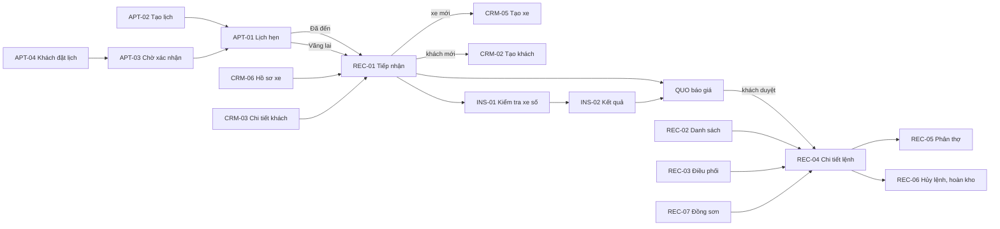

# UI/UX – Gói G2 (phần 1): Vận hành xưởng — CRM, Lịch hẹn, Tiếp nhận và Lệnh sửa chữa, Kiểm tra xe số

Phiên bản 0.1 · 30/10/2026 · Designer · Đầu vào: `design-system.md`, `00-foundation.md`, `ba-decisions.md`, `screen-inventory.md` §3.1–3.4, §5, §6, §7, §9.
Sản phẩm: thư mục `design/g2-workshop/` (HTML/CSS/JS thuần, mở bằng `file://`), tiền tố class `g2w-`. Không sửa `design/assets/*`.

## 1. Phạm vi

26 màn hình: CRM 12, APT 4, REC 7, INS 3. Đã thiết kế đủ 26/26 (trong đó có 4 màn hộp thoại/biểu mẫu nhỏ làm thành trang riêng: CRM-07, CRM-12, APT-02, REC-06). **G2-REC-04 (Chi tiết lệnh sửa chữa) là màn hình chuẩn số 1** để kiểm chứng design system, được làm kỹ nhất.

Phần không thuộc gói này nhưng được liên kết: QUO (báo giá), TEC (thợ tablet), DLV (QC, giao xe), PRT (in), INV, ACC, EIN. Liên kết tới các màn này dùng `href="#"` trong prototype.

Phụ thuộc kỹ thuật: `pack.css` (class `g2w-`, chỉ dùng token), `pack.js` (dựng Application Shell, thanh phạm vi, khóa theo vai trò, trạng thái demo, wizard, kéo thả kanban). `pack.js` nạp trước `../assets/app.js`. Shell do `pack.js` dựng từ một khối duy nhất, nội dung giống `design/foundation/shell.html`; khi chuyển sang sản phẩm thật, thay bằng component shell của framework.

## 2. Bảng màn hình

Cột “Trạng thái đã thiết kế” liệt kê các trạng thái bật xem được trong prototype (TT-L, TT-F, TT-D theo screen-inventory §0.5). Mọi file nằm trong `design/g2-workshop/`.

| Mã | Tên | File | Template | Vai trò (khóa) | Ưu tiên | Trạng thái đã thiết kế |
| --- | --- | --- | --- | --- | --- | --- |
| G2-CRM-01 | Danh sách khách hàng | `g2-crm-01.html` | C | QL, CV (S); CH, QV, QĐ, TN, KT (X); TH (Xn) | P1 | Có dữ liệu, đang tải, trống lần đầu, trống do lọc, lỗi, không quyền, SĐT che theo vai trò, mất mạng, card list mobile |
| G2-CRM-02 | Tạo / sửa khách | `g2-crm-02.html` | E | QL, CV | P1 | Mặc định, trùng khách, lỗi theo trường, khách DN (MST, hạn mức), đang lưu, xung đột phiên bản, chỉ đọc, đã lưu nháp, mất mạng |
| G2-CRM-03 | Chi tiết khách hàng | `g2-crm-03.html` | D | Như CRM-01 | P1 | Cá nhân, doanh nghiệp vượt hạn mức nợ, đang tải, không tìm thấy, không quyền, lỗi, PII Hiện/ghi log, rút đồng ý (NH) |
| G2-CRM-04 | Danh sách xe | `g2-crm-04.html` | C | Như CRM-01 | P1 | Như CRM-01; biển 4 số, xe máy, biển ngoại giao (chỉ cảnh báo), cờ đăng kiểm sắp đến hạn/quá hạn |
| G2-CRM-05 | Tạo / sửa xe | `g2-crm-05.html` | E | QL, CV | P1 | Mặc định, biển số trùng, km thấp hơn lần trước, biển đặc biệt, đang lưu, xung đột, chỉ đọc |
| G2-CRM-06 | Hồ sơ xe và lịch sử sửa chữa | `g2-crm-06.html` | D | Như CRM-01 | P1 | Đủ lịch sử, lịch sử chi nhánh khác chỉ hiện phần được phép, xe mới chưa có lịch sử, đang tải, không tìm thấy, không quyền, lỗi |
| G2-CRM-07 | Chuyển chủ xe / đổi biển số | `g2-crm-07.html` | E (Dlg) | QL, CV | P1 | Chuyển chủ, đổi biển, lỗi theo trường, đang lưu; xác nhận bằng gõ biển số |
| G2-CRM-08 | Phát hiện trùng và hợp nhất | `g2-crm-08.html` | E | QL | P2+ | Có cặp trùng, đang tải, không có cặp trùng, lỗi, không quyền, xác nhận NH |
| G2-CRM-09 | Nhắc bảo dưỡng, đăng kiểm, bảo hiểm | `g2-crm-09.html` | C | CV, QL (S); CH, QV (X) | P2 | Có dữ liệu, tải, trống, trống do lọc, lỗi, không quyền, nút Nhắc khóa khi khách chưa đồng ý kênh |
| G2-CRM-10 | Gửi tin nhắn và chiến dịch | `g2-crm-10.html` | E | CV, QL | P2 | Sẵn sàng gửi, chưa cấu hình nhà cung cấp (khóa gửi), đã gửi (kết quả từng tin), lỗi gửi; xác nhận số người nhận |
| G2-CRM-11 | Yêu cầu của chủ dữ liệu | `g2-crm-11.html` | C + D | QL (xử lý); CH (duyệt xóa) | P1 | Có dữ liệu, tải, trống, trống do lọc, lỗi, không quyền, quá hạn xử lý |
| G2-CRM-12 | Xuất danh sách khách | `g2-crm-12.html` | Dlg | CH, QL, KT có quyền xuất | P1 | Có quyền, không quyền (khóa kèm lý do), danh sách lớn (xuất nền), lỗi tạo tệp |
| G2-APT-01 | Lịch hẹn (ngày/tuần) | `g2-apt-01.html` | K | CV (S); QL; CH, QV (X) | P2 (lối tắt vãng lai P1) | Ngày, tuần, vượt công suất, vãng lai, trống, đang tải, lỗi, không quyền, agenda mobile, drawer chi tiết, hủy lịch (NH) |
| G2-APT-02 | Tạo / sửa lịch hẹn | `g2-apt-02.html` | E (Dlg) | CV, QL | P2 | Mặc định, vượt công suất, lỗi, đang lưu, giờ vừa bị đặt (xung đột) |
| G2-APT-03 | Lịch đặt trực tuyến chờ xác nhận | `g2-apt-03.html` | C | CV, QL | P2+ | Có dữ liệu, tải, trống, lỗi, không quyền, quá hạn xử lý, vượt công suất, từ chối (NH), đề xuất giờ khác |
| G2-APT-04 | Trang đặt lịch cho khách | `g2-apt-04.html` | P | KH (công khai) | P2+ | Biểu mẫu, đang gửi, đã gửi, khung giờ hết chỗ, lỗi, gửi quá nhiều lần; không có shell, chữ ≥ 16px |
| G2-REC-01 | Tiếp nhận xe (check-in) | `g2-rec-01.html` | W | CV (S), QL | P1 | 5 bước (chưa/đang/xong/lỗi), xe đã có, xe mới, km thấp hơn lần trước, ảnh đang tải/lỗi, lưu nháp, mất mạng, hủy hồ sơ (NH), đang tải xe, lỗi tra cứu |
| G2-REC-02 | Danh sách lệnh sửa chữa | `g2-rec-02.html` | C | M2: CV (S), QL (D), còn lại X; TH (Xn) | P1 | Có dữ liệu (ba badge Lệnh/Thanh toán/Hóa đơn tách), tải, trống, trống do lọc, lỗi, không quyền, mobile card |
| G2-REC-03 | Bảng điều phối chi nhánh | `g2-rec-03.html` | K | CV, QL, QĐ; CH, QV (X); TH (Xn) | P1 | Có dữ liệu, tải, trống, lỗi, không quyền, kéo thả có điều kiện, chuyển bằng nút (bàn phím/cảm ứng), chặn kèm lý do |
| **G2-REC-04** | **Chi tiết lệnh sửa chữa (chuẩn số 1)** | `g2-rec-04.html` | D | Như REC-02; tab Thanh toán ẩn với TH, QĐ; tab Hóa đơn ẩn với TH, QĐ, CV | P1 | 8 biến thể: Đang sửa, Tạm dừng chờ phụ tùng, **Chờ QC**, **Sẵn sàng bàn giao** (xuất hóa đơn bật, danh sách kiểm), Hoàn tất (chỉ đọc), Ngày đã chốt sổ, Khách DN vượt hạn mức nợ, Đã hủy; tải, không tìm thấy, không quyền, lỗi; phát sinh chờ duyệt; vai trò Thợ |
| G2-REC-05 | Phân thợ và tải việc | `g2-rec-05.html` | K/C | QĐ (S); QL (D); CV (X) | P1 | Có dữ liệu, tải, trống, lỗi, không quyền, quá tải, đổi thợ (NH khi đang làm) |
| G2-REC-06 | Hủy lệnh và hoàn kho | `g2-rec-06.html` | Dlg/W | CV (đề xuất); QL (duyệt) | P1 | Soạn yêu cầu, chờ duyệt, QL duyệt, bị từ chối, lỗi gửi; nút gửi khóa tới khi đủ phiếu hoàn kho |
| G2-REC-07 | Bảng đồng sơn theo công đoạn | `g2-rec-07.html` | K | QĐ, CV (S); QL; CH, QV (X) | P2+ | Có dữ liệu, tải, trống, lỗi, không quyền, trễ dự kiến, chưa có người phụ trách |
| G2-INS-01 | Thực hiện kiểm tra xe số | `g2-ins-01.html` | E/W (tablet) | TH, QĐ (S); CV, QL, CH, QV (X) | P1? | 8/14 chấm, đủ 14/14, ảnh/video tải chậm hoặc lỗi, chưa có mẫu, tải, lỗi, không quyền, chỉ đọc, mất mạng giữ nháp |
| G2-INS-02 | Kết quả kiểm tra và danh sách lỗi | `g2-ins-02.html` | D | CV (S); QL, CH, QV (X); TH, QĐ | P1? | Có lỗi, chưa hoàn tất, không có lỗi, đã đưa vào báo giá, tải, không tìm thấy, không quyền, lỗi |
| G2-INS-03 | Quản lý mẫu kiểm tra | `g2-ins-03.html` | S | AD/quản trị trụ sở; QL (X) | P1? | Soạn nháp, xem phiên bản cũ (chỉ đọc), xung đột, tải, trống, lỗi, không quyền; phát hành, thu hồi (NH) |

Ghi chú: `index.html` liệt kê toàn bộ màn hình, có hướng dẫn đổi vai trò, trạng thái, biến thể.

## 3. UI/UX flow

### 3.1 Luồng chính: tiếp nhận đến lệnh (screen-inventory §7.4, bước 2–8)

1. Cố vấn mở **G2-APT-01** (lịch hẹn hôm nay). Khách đến theo hẹn: bấm “Đã đến, tiếp nhận” trong drawer chi tiết lịch. Khách vãng lai: banner “Tiếp nhận xe vãng lai” ngay đầu trang (lối tắt P1).
2. **G2-REC-01** bước 1: gõ biển số; xe đã có thì tự điền xe, chủ xe, lịch sử gần nhất; xe mới thì chuyển “Xe mới” (dạng nhúng của **G2-CRM-05**), khách mới thì thêm nhanh (**G2-CRM-02**).
3. Bước 2 (km, yêu cầu theo lời khách bắt buộc; hiện trạng; ảnh) → bước 3 (đồ đạc, nhắc hạng mục từng bị từ chối từ **G2-CRM-06**) → bước 4 (dịch vụ, cố vấn, hẹn giao, phụ tùng khách mang) → bước 5 (xem lại, xem trước phiếu A5).
4. “Hoàn tất tiếp nhận” → hộp thoại chọn **G2-INS-01** (kiểm tra xe số) hoặc lập báo giá (G2-QUO-02, ngoài gói).
5. **G2-INS-01** (thợ, tablet) → “Hoàn tất” → **G2-INS-02** (cố vấn): chọn dòng lỗi → “Đưa vào báo giá”.
6. Khách duyệt báo giá (ngoài gói) → mở lệnh → **G2-REC-04**. Lệnh hiện ở **G2-REC-02** (danh sách) và **G2-REC-03** (điều phối).
7. Quản đốc phân thợ ở **G2-REC-05**; đổi thợ ghi lý do.
8. Sửa chữa, phát sinh, QC, giao xe: xem **G2-REC-04** (banner phát sinh, nút chuyển bước) và các màn ngoài gói (TEC, DLV, ACC, EIN).

### 3.2 Luồng khách hàng và xe

1. **G2-CRM-01** → chọn khách → **G2-CRM-03** (tab Xe, Lịch sử, Báo giá, Thanh toán, Đồng ý, Ghi chú) → “Tiếp nhận xe” (**G2-REC-01**).
2. **G2-CRM-04** → **G2-CRM-06** (hồ sơ xe) → “Chuyển chủ / đổi biển…” (**G2-CRM-07**, NH, gõ biển số để xác nhận).
3. Hai hồ sơ nghi trùng: cảnh báo ở CRM-02/05 → **G2-CRM-08** (QL) hợp nhất (NH).
4. Sau giao xe: **G2-CRM-09** (danh sách nhắc) → **G2-CRM-10** (gửi tin, chỉ khách đã đồng ý).
5. Yêu cầu xóa/xem/sửa dữ liệu: CRM-03 → **G2-CRM-11** (QL xử lý, CH duyệt xóa). Xuất danh sách: CRM-01 → **G2-CRM-12** (cần quyền xuất riêng).

### 3.3 Luồng hủy lệnh

**G2-REC-04** → “Hủy lệnh…” → **G2-REC-06**: nhập lý do, tạo phiếu hoàn kho cho từng phụ tùng đã xuất (G3-INV-10), chọn xử lý tiền đã thu → gửi duyệt (xác nhận gõ mã lệnh) → QL duyệt (G4-APR-02) → lệnh “Đã hủy”, công bị đảo. Nút gửi khóa tới khi đủ lý do và phiếu hoàn kho, lý do hiện ngay dưới nút.

## 4. Mô tả theo nhóm

### 4.1 Nguyên tắc chung của gói

- **Năm đối tượng, năm bộ trạng thái, không gộp** (FR-REC-028): Báo giá (Duyệt một phần…), Lệnh (7 trạng thái, Tạm dừng kèm tag lý do), Hạng mục (5 + thuộc tính “Chờ khách duyệt (phát sinh)”), Thanh toán (+ cờ “Quá hạn”), Hóa đơn (+ chỉ báo `sync`). Dùng đúng bảng A.2 của `ba-decisions.md`; “Chờ phụ tùng” là tag lý do, không là trạng thái.
- **Phạm vi chi nhánh và thời điểm dữ liệu (RULE-015)**: mọi trang có thanh `scope-banner` (phạm vi, khoảng thời gian, “Cập nhật lúc”, nút Làm mới) ngay dưới page header; branch selector theo vai trò của shell. Khi đang soạn (nháp) mà đổi phạm vi, hỏi lưu nháp trước (D-06, nút “Thử: đang soạn”).
- **Khóa kèm lý do**: nút bị cấm quyền hoặc chưa đủ điều kiện nghiệp vụ luôn `disabled` + `title` + (với nút quan trọng) dòng giải thích hiển thị cạnh/dưới nút. Không ẩn lặng lẽ nút trong mục mà người dùng có quyền xem.
- **Hành động nguy hiểm** (hủy lệnh, hủy lịch, chuyển chủ, rút đồng ý, hợp nhất, xóa/ẩn danh, thu hồi mẫu, đổi thợ khi đang làm, gửi hàng loạt, xuất danh sách): hộp thoại nêu hậu quả bằng danh sách, bắt buộc lý do (≥ 5 ký tự, giả định), gõ mã/biển số/số để mở nút. Không có nút “Xóa” cho chứng từ đã ghi sổ: phiếu thu dùng “Đảo bút toán”, hóa đơn dùng điều chỉnh/thay thế/hủy (G4-EIN-04).
- **PII**: SĐT/email/địa chỉ dùng cơ chế `.pii` ở trang chi tiết (nút Hiện, tự che 30 giây, KT chọn lý do), và `g2w-pii` ở danh sách (chỉ che theo vai trò, không có nút Hiện, đúng “che trong danh sách” của ba-decisions câu 8). Giá trị đầy đủ nằm trong JS mô phỏng API, không nằm trong HTML. Thợ (TH) không thấy SĐT, địa chỉ, giá.
- **Tiền, mã, biển số**: `1.250.000 ₫`, `dd/MM/yyyy`, mã `RO-Q7-2610-00128`, `BG-Q7-2610-00231-v2`, biển `51H-123.45` (tabular-nums, không ngắt dòng). Cột tiền căn phải.
- **Mất kết nối**: banner `net-banner`, nháp lưu trên thiết bị, nêu rõ việc không làm được (xuất kho, thu tiền, hóa đơn).
- **Responsive**: sidebar thu gọn < 1024px, drawer + bottom nav < 640px; bảng → card list < 640px; sidebar liên quan của REC-04 xuống dưới < 1280px; board kanban và lịch tuần cuộn ngang trong khung, không cuộn ngang toàn trang.
- **In**: REC-04 có menu In phiếu gồm lệnh bản xưởng (A5), báo giá (A4), phiếu tiếp nhận (A5), biên bản giao xe (A4, khóa tới khi đạt QC); REC-01 có xem trước phiếu tiếp nhận A5. Thiết kế mẫu in đầy đủ thuộc G2-PRT (ngoài gói); `pack.css` có `@media print` ẩn thanh điều khiển.

### 4.2 G2-REC-04 Chi tiết lệnh sửa chữa (màn hình chuẩn số 1)

Template D: header, nội dung nghiệp vụ, sidebar liên quan, timeline.

| Khối | Nội dung | Component dùng |
| --- | --- | --- |
| Header | Mã lệnh (h1, tabular), biển số (plate-tag), loại dịch vụ, xe, khách, cố vấn, thợ chính; hạn giao (đỏ nếu trễ, cam nếu sắp tới); km vào xưởng | `g2w-ro-head`, `plate-tag`, `tag` |
| Năm đối tượng | Báo giá, Lệnh (+ tag lý do), Hạng mục (tóm tắt đếm), Thanh toán (+ cờ Quá hạn + số đã thu), Hóa đơn (+ chỉ báo) | `badge`, `tag`, mỗi badge có nhãn đối tượng phía trên |
| Hành động | Chính: nút theo trạng thái (Chuyển sang Chờ QC / Tiếp tục sửa chữa / Xem biên bản giao xe) · Phụ: In phiếu (menu), Phân thợ, Yêu cầu phụ tùng, Báo phát sinh · Tertiary: Xem lịch sử (drawer) · Nguy hiểm: Hủy lệnh… (tách sang phải, viền đỏ, dẫn tới REC-06) | `btn--primary/secondary/ghost/danger-outline`, nhóm có vạch ngăn |
| Lý do nút chính khóa | Dòng `g2w-why` dưới nhóm hành động: “Chưa thể chuyển… còn 2 hạng mục chưa hoàn thành…” | `g2w-why`, `aria-describedby` |
| Tiến trình | Stepper 5 bước: Đã duyệt → Đang sửa chữa → Chờ QC → Sẵn sàng bàn giao → Hoàn tất. Tạm dừng/Đã hủy là rẽ nhánh (nhãn cạnh tên lệnh) | `stepper` |
| Banner nghiệp vụ | Phát sinh chờ khách duyệt (khóa Bắt đầu); thiếu phụ tùng (kèm đề xuất chuyển kho/mua hàng); khách DN vượt hạn mức nợ; ngày đã chốt sổ; chỉ đọc | `alert` |
| Hạng mục và phụ tùng (tab 1) | Mỗi hạng mục: tên, trạng thái hạng mục riêng, thợ chính, giờ thực/giờ chuẩn (thanh), thành tiền; dưới là dòng phụ tùng (đã giữ chỗ/đã xuất, mã phiếu xuất, thiếu hàng + Đang về); hạng mục phát sinh nền cảnh báo; tổng: công, phụ tùng, trước thuế, thuế (theo cấu hình), tổng lệnh | `g2w-item`, `g2w-part`, `g2w-total` |
| Công thợ (tab 2) | Hạng mục, thợ, mốc thời gian, giờ chuẩn, giờ thực, tổng. Không hiện tiền công thợ/hoa hồng | `table--compact` |
| Thanh toán (tab 3) | Phiếu thu, còn phải thu, “Thu tiền” (TN, QL), “Đảo bút toán” từng phiếu (không có nút xóa) | `table`, dialog đảo |
| Hóa đơn (tab 4) | Chưa xuất: nêu điều kiện thiếu, nút Xuất khóa; Đã xuất: số hóa đơn, tải PDF, điều chỉnh/thay thế/hủy | `alert`, `btn` |
| Timeline | Người, thời điểm, lý do mọi lần đổi trạng thái; “Xem toàn bộ” mở drawer | `timeline`, `drawer` |
| Sidebar | Xe và khách (PII), chứng từ liên quan (báo giá + bằng chứng duyệt, báo giá bổ sung, phiếu xuất, thanh toán, hóa đơn), ghi chú nội bộ, đồ đạc trong xe và ảnh hiện trạng | `card`, `g2w-link`, `vehicle-card` |
| Hộp thoại/drawer | Yêu cầu phụ tùng (combobox + 4 số tồn + qty), Báo phát sinh, Đảo phiếu thu, Chi tiết hạng mục (checklist con, bình luận, đổi người phụ trách), Lịch sử | `combobox`, `stock4`, `qty`, `drawer` |

Biến thể bật bằng thanh “Biến thể lệnh” hoặc `?variant=working|paused|done|locked|debt|cancelled`.

Theo vai trò: Thợ chỉ thấy hạng mục của mình, giá và thanh toán bị ẩn (••• ₫), PII bị chặn; CH/QV/QĐ/TK/TN/KT chỉ xem (nút chính và Hủy khóa kèm lý do); CV/QL thao tác; AD không truy cập (trang báo không quyền).

Tablet/mobile: sidebar xuống dưới nội dung chính; hàng hạng mục chuyển 2 cột; nhóm hành động xuống dòng, nút giãn đều, vạch ngăn ẩn, khu nguy hiểm xuống cuối.

### 4.3 CRM (CRM-01..12)

- **CRM-01/04** (C): bộ lọc + chip đang lọc; cột SĐT che theo vai trò; công nợ chỉ hiện cho vai trò có quyền; xuất danh sách là NH có quyền riêng. Biển số tìm không cần dấu chấm/gạch.
- **CRM-02/05** (E): sticky footer Lưu / Lưu và thêm xe / Hủy, nháp tự lưu. Khách DN thêm pháp nhân, MST, hạn mức nợ, kỳ thanh toán. Đồng ý xử lý dữ liệu ghi theo mục đích và kênh (một mục bắt buộc cho dịch vụ).
- **CRM-03/06** (D): tab; CRM-06 gồm lịch sử mọi chi nhánh (phần chi nhánh khác chỉ hiện hạng mục và km), hạng mục từng bị từ chối (nguồn nhắc cho REC-01), bảo hành còn hạn, lịch sử sở hữu.
- **CRM-07/08/12** (hộp thoại/biểu mẫu NH): hậu quả, lý do, gõ mã xác nhận.
- **CRM-09/10**: nhắc theo km/thời gian, chỉ kênh đã đồng ý; kênh chưa kích hoạt thì khóa gửi và nêu lý do (D-13).
- **CRM-11**: danh sách + panel chi tiết, phạm vi dữ liệu bắt buộc giữ theo luật là cấu hình `[Cần xác nhận]`.

### 4.4 APT, REC (ngoài REC-04), INS

- **APT-01**: ngày/tuần, công suất xưởng theo số xe mỗi ngày, ô “vượt công suất” có nhãn chữ; trạng thái lịch dùng bộ Lịch hẹn/Tiếp nhận. **APT-04** không có shell, chữ ≥ 16px, nút 52px, khung giờ hết chỗ có chữ “Hết chỗ”, chống gửi tràn cấu hình.
- **REC-01** (wizard): validate theo bước; km thấp hơn lần trước bật cảnh báo + lý do bắt buộc; ảnh đang tải/lỗi hiện trên thumb.
- **REC-02/03**: ba badge riêng (Lệnh, Thanh toán, Hóa đơn). Kanban: dải “Trước lệnh” (Đã hẹn → Chờ tiếp nhận → Báo giá chờ khách duyệt) tách khỏi 6 cột trạng thái lệnh. Kéo thả chỉ khi đủ điều kiện, chặn kèm lý do; mỗi thẻ có nút “Chuyển trạng thái…” thay kéo thả cho bàn phím/cảm ứng. Tạm dừng bắt buộc chọn lý do (không kéo thả được).
- **REC-05**: giao việc bằng chọn thợ + nút (không phụ thuộc kéo thả); tải việc hiện số giờ và thanh, quá tải có nhãn chữ, vẫn cho giao nhưng cảnh báo.
- **REC-06**: xem mục 3.3.
- **REC-07**: cột công đoạn lấy từ cấu hình (giả định), nhãn cảnh báo ghi rõ chưa khảo sát.
- **INS-01**: nút 52px, ba mức có chữ + biểu tượng + màu, tự lưu mỗi lần chọn, tiến độ n/14, “Hoàn tất” khóa kèm lý do tới khi chấm đủ. **INS-02**: đúng một thao tác “Đưa vào báo giá”, hạng mục xanh không sinh dòng. **INS-03**: phát hành theo chi nhánh và ngày hiệu lực, phiên bản cũ chỉ đọc, thu hồi là NH.

## 5. Ánh xạ FR, RULE

| Nhóm | FR/RULE chính được thể hiện |
| --- | --- |
| CRM | FR-CRM-001, 002, 003, 004, 005, 006, 007, 008, 009, 010, 011, 012, 013, 014, 015, 016, 017, 018; NFR-SEC-03 (PII); RULE-003 (chủ xe), RULE-012; UAT-10, 18, 20 |
| APT | FR-REC-019, 027, 035; BR-REC-09 |
| REC-01 | FR-REC-001, 002, 003, 024, 025, 027; FR-CRM-004; BR-REC-01 |
| REC-02/03 | FR-REC-010, 015, 022, 028, 030; FR-RPT-012; RULE-014 |
| REC-04 | FR-REC-004, 009, 010, 012, 013, 014, 015, 016, 018, 021, 028, 029, 030; FR-INV-006, 007, 016, 020; FR-ACC-019; RULE-005, 006, 007, 008, 010, 014, 015 |
| REC-04 (bổ sung) | FR-REC-017 (biên bản giao xe), 018 (lệnh bảo hành), 026 (duyệt tại quầy); FR-EIN (danh sách kiểm xuất hóa đơn) |
| REC-05 | FR-REC-012, 029; FR-HRM-008, 013, 014 |
| REC-07 (bổ sung) | FR-REC-033 |
| INS (bổ sung) | FR-INS-004 (ghi chú, ảnh, video) |
| REC-06 | FR-REC-021; FR-INV-008; FR-HRM-008; RULE-010 |
| REC-07 | FR-REC-032, 033; BR-REC-13, 14 |
| INS | FR-INS-001..008 (009 là Could, chỉ ghi chú) |
| Chung | RULE-015 (phạm vi + thời điểm), NFR-OFF-01 (nháp), NFR-COM-01 (khổ in), D-06 (đổi phạm vi khi đang soạn) |

## 6. Tự đánh giá accessibility (WCAG 2.2 AA)

| Hạng mục | Kết quả |
| --- | --- |
| Tương phản | Dùng token chữ/badge đã kiểm ở foundation; không hard-code màu trong `pack.css`. Chưa đo lại trên thiết bị thật |
| Không chỉ dựa vào màu | Mọi badge có chữ; trễ hẹn có chữ “Trễ”; vượt công suất, quá tải, hết chỗ có chữ; mức kiểm tra có biểu tượng + chữ |
| Bàn phím | Toàn bộ qua `button`/`a`/`input`; dialog/drawer có focus trap, Esc, trả focus (app.js); kanban có nút “Chuyển trạng thái…” thay cho kéo thả; board cuộn ngang có `tabindex=0` + `role=region` |
| Touch ≥ 44px | Nhờ components.css; thêm `g2w-appt`, chip nhiên liệu ≥ 44px khi cảm ứng; nút INS và đặt lịch khách 48–52px |
| Label | Mọi ô nhập có `<label>`; ô tìm trong bảng dùng nhãn `aria-label` hoặc label ẩn; nhóm radio/chip có `aria-labelledby` |
| Lỗi nêu cách sửa | `aria-invalid` + `field__error` (km, yêu cầu, biển số, họ tên, SĐT) |
| Trạng thái live | Toast `aria-live`, banner mất mạng `role=alert`, lý do khóa nút `role=status` |
| Khóa kèm lý do | `title` + `aria-describedby`/dòng giải thích; liên kết bị khóa dùng `aria-disabled` và chặn điều hướng |
| Giảm chuyển động | Theo `base.css` |
| Chưa kiểm | Screen reader thật; thiết bị cảm ứng thật; roving tabindex cho lịch tuần; kéo thả bằng bàn phím chỉ qua nút thay thế |

## 7. Giả định (bản 0.1, đã đối chiếu BA ở mục 9; mục nào BA đổi thì theo mục 9)

1. Mã chứng từ theo `ba-decisions.md` câu 11. Mã **yêu cầu chủ dữ liệu** `DS-Q7-2610-00003` và **yêu cầu đặt lịch** `DL-Q7-2610-00019` do designer tạm đặt theo cùng quy tắc, chưa có trong bảng tiền tố của BA.
2. Stepper tiến trình lệnh có 5 bước (Đã duyệt → Đang sửa chữa → Chờ QC → Sẵn sàng bàn giao → Hoàn tất), Tạm dừng và Đã hủy là rẽ nhánh.
3. Lệnh chuyển “Đã duyệt → Đang sửa chữa” tự động khi thợ bắt đầu hạng mục đầu tiên (Journey WF-01/04 chưa nói rõ).
4. Thuế GTGT trong tổng lệnh: tỷ lệ 8% là số mẫu minh họa, thực tế lấy từ cấu hình có ngày hiệu lực. Mọi số tiền, hạn mức nợ (40.000.000 ₫), công suất xưởng (20 xe/ngày) là giá trị mẫu.
5. Lý do bắt buộc ≥ 5 ký tự; tự che PII 30 giây (theo foundation).
6. Tablet mặc định là màn hình thợ chấm kiểm tra; CV dùng desktop.
7. Điều kiện xuất hóa đơn trong REC-04 hiển thị là “lệnh Sẵn sàng bàn giao” cho minh họa; thực tế lấy từ cấu hình G4-EIN-02.
8. Dải nhãn “Quá hạn”, “Vượt hạn mức nợ” trong danh sách khách là tag, không phải trạng thái.
9. Công suất xưởng tính theo ngày (FR-REC-019); chưa có công suất theo khung giờ hoặc khoang.
10. Khách DN hiển thị công nợ cho CH, QV, QL, KT, TN, CV; ẩn với QĐ, TH (ma trận M9 chưa chi tiết).
11. Trạng thái “nhắc” (Chưa nhắc, Đã nhắc, Đã đặt hẹn, Bỏ qua) dùng `tag`, không phải badge của 5 đối tượng.
12. Vai trò TH xem được “hạng mục của mình” trong lệnh và biển số/tên khách, không xem hạng mục của thợ khác.

## 8. Câu hỏi cho BA (bản 0.1, BA đã trả lời cả 16 câu trong `ba-answers-02.md`; câu còn mở ở mục 12)

1. **Chuyển trạng thái lệnh**: “Đã duyệt → Đang sửa chữa” có tự động khi thợ bắt đầu hạng mục đầu, hay do cố vấn bấm? Điều kiện chính xác để “Đang sửa chữa → Chờ QC” (mọi hạng mục Hoàn thành, trừ phát sinh chưa duyệt đã đúng chưa?).
2. **Hủy lệnh sau khi xuất kho**: các lựa chọn xử lý tiền đã thu (hoàn lại, giữ làm cọc cho lệnh khác, trừ phí…) và hạn mức duyệt hoàn tiền; ai duyệt khi QL là người đề xuất.
3. **Hóa đơn**: điều kiện lệnh/thanh toán để được xuất hóa đơn; có cho xuất khi Thanh toán một phần?
4. **Hợp nhất hồ sơ khách (CRM-08)**: cách gộp bản ghi đồng ý dữ liệu và công nợ khi hai hồ sơ có đồng ý khác nhau; có cho hợp nhất khác chi nhánh ngoài quyền?
5. **Nhắc bảo dưỡng**: bộ trạng thái “nhắc” có cần chuẩn hóa như đối tượng thứ sáu không; ngưỡng “sắp đến hạn” (số ngày/số km) để cấu hình; nhắc lặp tối đa mấy lần.
6. **Công suất lịch hẹn**: chỉ theo số xe mỗi ngày hay cần theo khung giờ, khoang, cố vấn? Cho phép đặt vượt công suất tới mức nào, ai duyệt?
7. **Tiền tố mã** cho yêu cầu chủ dữ liệu và yêu cầu đặt lịch trực tuyến (thêm vào bảng mã chứng từ của câu 11).
8. **Hạng mục phát sinh khách không duyệt**: hạn duyệt, trạng thái cuối (Từ chối/Hết hạn), có tự đưa vào “hạng mục từng bị từ chối” (FR-REC-024) không.
9. **Phụ tùng khách mang đến**: có nhập vào kho như hàng ký gửi hay chỉ ghi chú; chính sách bảo hành cho phụ tùng này.
10. **Quyền xem của Thợ**: thợ xem cả lệnh hay chỉ hạng mục của mình; thợ có xem biển số/tên khách đầy đủ (tên có, SĐT/địa chỉ không) đã đúng ý?
11. **Ma trận quyền**: CV có xem công nợ khách không (FRD “Tài chính: CV Xem trạng thái thu”)? CH, QV có được tạo/sửa khách và xe không (FRD ghi X)? REC-01 chỉ CV, QL tạo hồ sơ tiếp nhận có đúng không?
12. **Kiểm tra xe số**: nhãn mức Tốt / Theo dõi / Hỏng (kèm xanh/vàng/đỏ) có thay cho “xanh/vàng/đỏ” trong FRD không? Chỉ dùng chữ, không dựa vào màu.
13. **Km thấp hơn lần trước**: ngoài lý do bắt buộc có cần duyệt nếu chênh lớn không (đề phòng sửa đồng hồ)?
14. **Đồng sơn (REC-07)**: danh sách công đoạn thật sau khảo sát xưởng; có gắn ảnh trước/sau từng công đoạn không.
15. **Thời hạn lưu dữ liệu** sau khi xử lý yêu cầu xóa (CRM-11), mốc “quá hạn xử lý” tính bao nhiêu ngày.
16. **Tạm dừng**: lý do “Nghỉ” và “Khác” của thợ có dừng đồng hồ giờ thực của hạng mục không (ba-decisions câu 13 đã nêu, cần xác nhận cho tính hiệu suất).

## 9. Cập nhật theo `ba-answers-02.md` và `review-02-workshop-intake-ba.md` (bản 0.2)

### 9.1 Bảng quyền theo bước chuyển trạng thái lệnh (dùng chung REC-03, REC-04)

Nguồn: `ba-answers-02.md` A.1. Mọi lần chuyển ghi người, thời điểm, lý do. QĐ được “Gửi QC” và chấm QC, không tạo/sửa/hủy lệnh, không thu tiền, không xuất hóa đơn.

| Bước | Ai | Cách thực hiện trên giao diện |
| --- | --- | --- |
| Đã duyệt → Đang sửa | Hệ thống, khi thợ bắt đầu hạng mục đầu tiên | Không có nút hay kéo thả; REC-03 nêu lý do khi cố kéo |
| Đang sửa → Tạm dừng | Thợ (tablet), CV/QĐ/QL, hoặc hệ thống khi thiếu phụ tùng | Nút “Tạm dừng…” (REC-04), hộp chọn lý do khi kéo ở REC-03 |
| Tạm dừng → Đang sửa | CV/QĐ/QL, hoặc tự động khi hết lý do | Nút chính “Tiếp tục sửa chữa”, khóa kèm lý do tới khi hết lý do |
| Đang sửa → Chờ QC | CV, QĐ, QL | Nút chính “Chuyển sang Chờ QC”, khóa kèm lý do nếu thiếu điều kiện |
| Chờ QC → Sẵn sàng bàn giao | QĐ/nhân viên QC | Nút “Mở màn chấm QC” (liên kết ngoài gói), không kéo thả |
| Sẵn sàng bàn giao → Hoàn tất | CV tại màn giao xe | Nút “Giao xe…” (liên kết ngoài gói), không kéo thả |
| → Đã hủy | CV/QL đề xuất, người khác duyệt | Chỉ từ Đã duyệt, Đang sửa, Tạm dừng; từ Chờ QC khóa kèm lý do |

### 9.2 Finding → đã xử lý ở đâu

| Finding | Mức | Xử lý | Ở đâu |
| --- | --- | --- | --- |
| F2-01 Thợ thấy tiền, báo giá, công nợ | Major | Ẩn khối Báo giá, Thanh toán, Hóa đơn, banner công nợ, mục timeline tài chính với TH | `g2-rec-04.html` (`data-g2w-hide-for`) |
| F2-02 Quản đốc, Cố vấn thấy tab tài chính; nút hóa đơn không khóa | Major | Tab Thanh toán ẩn với TH, QĐ; tab Hóa đơn ẩn với TH, QĐ, CV; Điều chỉnh/Hủy hóa đơn chỉ KT, kèm lý do | `g2-rec-04.html` |
| F2-03 Thiếu biến thể Chờ QC, Sẵn sàng bàn giao | Major | Thêm hai biến thể, Xuất hóa đơn bật khi đủ điều kiện, Thu tiền, biên bản giao xe | `g2-rec-04.html` (script `V.qc`, `V.ready`) |
| F2-04 Hành động bật ở lệnh chỉ đọc | Major | `data-v-edit` cho Phân thợ, Yêu cầu phụ tùng, Báo phát sinh, đổi thợ, Thu tiền; khóa kèm lý do | `g2-rec-04.html` |
| F2-05 Quyền chuyển trạng thái REC-03 khác REC-04 | Major | Một bảng quyền (9.1); `ROLES_MOVE` kiểm quyền trong `tryMove`; REC-04 mở nút chính cho CV, QĐ, QL | `pack.js`, `g2-rec-03.html`, `g2-rec-04.html` |
| F2-06 Kéo thả qua mặt QC/biên bản | Major | `ALLOWED` chỉ còn 3 bước; các bước còn lại hiện lý do và liên kết, nút khóa trong hộp “Chuyển trạng thái…” | `pack.js`, `g2-rec-03.html` |
| F2-07 Thiếu “Tạm dừng…” | Major | Nút và hộp thoại chọn lý do ở REC-04; hộp chọn lý do khi kéo ở REC-03 | `g2-rec-04.html`, `g2-rec-03.html` |
| F2-08 REC-06 thiếu nhánh hoàn kho, tiền, chặn hóa đơn | Major | Viết lại: mỗi dòng Hoàn kho hoặc Đã dùng (Miễn/Tính phí); 4 cách xử lý tiền (2 cách tắt chờ kế toán); chặn khi có hóa đơn và từ Chờ QC; phiếu hoàn số riêng | `g2-rec-06.html` |
| F2-09 Người đề xuất tự duyệt | Major | Trạng thái “QL tự đề xuất”: QL bị khóa, QV/CH duyệt; CH, QV được xem màn | `g2-rec-06.html` |
| F2-10 CRM-08 cách ly chi nhánh, đồng ý, câu hỏi BA lọt giao diện | Major | Biến thể cùng chi nhánh/liên chi nhánh/khác loại; QL chỉ đề nghị khi liên chi nhánh; bảng xem trước đồng ý; công nợ giữ theo lệnh gốc; bỏ chữ “câu hỏi cho BA” | `g2-crm-08.html` |
| F2-11 Điều kiện xuất hóa đơn chỉ một câu | Minor | Danh sách kiểm Đạt/Thiếu 5 điều kiện | `g2-rec-04.html` |
| F2-12 Banner công nợ sai | Minor | Sửa câu (giao xe, mở thêm lệnh cần duyệt; thu tiền không bị chặn), bọc số tiền, ẩn với TH, QĐ | `g2-rec-04.html` |
| F2-13 Biến thể Đã hủy làm mất sự thật | Minor | Giữ trạng thái cuối hạng mục, thêm tag Công đã đảo, Đã hoàn kho | `g2-rec-04.html` |
| F2-14 Thiếu “Tạo lệnh bảo hành” | Minor | Nút ở biến thể Hoàn tất/Chốt sổ | `g2-rec-04.html` |
| F2-15 Khóa Hủy theo bước | Minor | Khóa từ Chờ QC kèm dòng lý do hiển thị | `g2-rec-04.html` |
| F2-16 Mốc thời gian lệch | Minor | Thống nhất 09:25 và “Cập nhật lúc 09:30” | `g2-rec-04.html` |
| F2-17 Giá chi nhánh khác | Minor | Giá lịch sử chi nhánh khác chỉ hiện với vai trò có quyền xem lệnh chi nhánh đó (CH, QV, KT) | `g2-rec-01.html`, `g2-crm-03.html`, `g2-crm-06.html` |
| F2-18 Bước 4 thiếu bắt buộc; phụ tùng khách mang | Minor | Ngày hẹn giao bắt buộc có lỗi theo trường; bảng dòng “Phụ tùng khách cung cấp” | `g2-rec-01.html` |
| F2-19 Cờ km bất thường | Minor | Nêu ngưỡng và cờ cho QL ở cảnh báo; chưa hiện cờ ở REC-02/04 (xem mục 11) | `g2-rec-01.html` |
| F2-20 Chân wizard lơ lửng | Minor | Chỉ nâng 72px dưới 640px, có `safe-area-inset-bottom` | `pack.css` |
| F2-21 CRM-09 nhắc khi chưa có kênh | Minor | Nút “Ghi nhận đã gọi”, hiện ngưỡng hiện hành và quy tắc nhắc lặp | `g2-crm-09.html` |
| F2-22 Dải Trước lệnh lộ cho Thợ | Minor | `data-g2w-hide-for="TH"` | `g2-rec-03.html` |
| F2-23 Giá trị dự phòng cứng; chú thích sai | Minor | Bỏ giá trị dự phòng, sửa chú thích | `pack.css` |
| F2-24 Mã tự đặt | Minor | `CD-`, `LH-`, `TX-`; phiếu hoàn kho `PN-` số riêng | CRM-11, APT-01, APT-04, REC-01, REC-06 |
| F2-25 Shell dựng bằng JS | Minor | `<noscript>` trên mọi trang; ghi handoff mục 10 | tất cả trang, `pack.js` |
| F2-26 Lọc theo vai trò ở máy khách | Minor | Ghi chú đầu `pack.js` và mục 10 | `pack.js`, tài liệu |
| F2-27 Đồng bộ tài liệu | Minor | Mục 2, 5, 7, 8, 9, 10, 11, 12 cập nhật | tài liệu này |

Rà thêm các màn BA chưa đọc hết, theo cùng tiêu chí: CRM-01 ẩn cột công nợ với CV (BA câu 11: CV không xem sổ công nợ tổng hợp); CRM-11 đổi mã `CD-`, hạn xử lý 15 ngày làm việc và mốc cấu hình; CRM-09 sửa kênh chưa kích hoạt; APT-02 nêu mức vượt công suất tối đa cấu hình; APT-04 đổi mã `LH-`.

### 9.3 Giả định đã được BA xác nhận hoặc điều chỉnh

Giả định 1 (mã): đổi thành `CD`, `LH`, `TX`. Giả định 3: xác nhận (Đã duyệt → Đang sửa tự động). Giả định 7 (hóa đơn): thay bằng danh sách kiểm A.3, thanh toán một phần vẫn xuất được. Giả định 9: xác nhận (công suất theo ngày). Giả định 10: CV không xem sổ công nợ tổng hợp; QĐ không thấy tài chính. Giả định 11, 12: xác nhận.

## 10. Ghi chú handoff: máy chủ quyết định phân quyền và dữ liệu (F2-25, F2-26)

1. **Khung ứng dụng (sidebar, topbar, bottom nav) phải render ở máy chủ hoặc bằng component của framework**, có khung tĩnh trước khi hydrate. Prototype dựng bằng `pack.js` (nên có `<noscript>`) chỉ để kiểm chứng giao diện; không sao chép cách dựng này.
2. **Ẩn, che và khóa theo vai trò, chi nhánh phải do dữ liệu máy chủ quyết định**: API chỉ trả phần được phép (giá, thanh toán, hóa đơn, SĐT, địa chỉ, hạng mục của thợ khác không được gửi xuống thiết bị Thợ). Thuộc tính `hidden`/`disabled` ở prototype chỉ là minh họa, dễ bị bỏ qua nếu dùng làm cơ chế bảo mật.
3. Tham số `?role=`, bảng `PHONES` trong `pack.js`, lệnh `?variant=` chỉ có ở bản demo.
4. Mọi điều kiện chuyển trạng thái, hủy, xuất hóa đơn được máy chủ kiểm lại; giao diện chỉ phản ánh và nêu lý do. Danh sách kiểm xuất hóa đơn, lý do tạm dừng, mốc quá hạn, ngưỡng nhắc, công suất vượt tối đa là cấu hình có ngày hiệu lực.
5. Gom ủy quyền sự kiện; không dùng nhiều `document.addEventListener('click')` rải rác như prototype. Kiểm thử trực quan 4 vai trò × 3 độ rộng cho REC-04.

## 11. Chưa xử lý trọn vẹn

1. **F2-19**: cờ “Số km bất thường” mới được nêu ở cảnh báo của REC-01, chưa hiện thành tag ở REC-02 và REC-04 cho Quản lý.
2. **F2-10**: ở biến thể liên chi nhánh, cột hồ sơ B chưa thu gọn xuống “mức tối thiểu” cho Quản lý chi nhánh (hiện cảnh báo bằng chữ).
3. Hộp “Tạm dừng…” chưa bắt buộc chọn lý do bằng ràng buộc nút (chỉ có nhãn bắt buộc).
4. Thẻ ở REC-03 chưa tự di chuyển sang cột Tạm dừng sau khi chọn lý do (chờ máy chủ xác nhận).

## 12. Câu hỏi còn lại cho BA

1. Giao diện chuyển Đang sửa → Chờ QC: “nhắc khi đủ điều kiện” (thông báo) chưa vẽ; cần màn/thông báo nào cho CV, QĐ, QL?
2. “Tính phí khách phần đã dùng” khi hủy lệnh (REC-06): tạo phiếu bán/hóa đơn nào, cần FR mới (gap G2-A); màn REC-06 chỉ ghi nhận lựa chọn.
3. Hai cách xử lý tiền “giữ làm khoản đặt trước”, “trừ phí” đang tắt chờ kế toán: khi bật cần màn con nào (hạn giữ, đồng ý khách)?
4. Yêu cầu “thu đủ trước khi xuất hóa đơn”: hiển thị trong danh sách kiểm như điều kiện thứ sáu khi bật cấu hình?
5. Quản lý vùng có được xem toàn bộ hồ sơ B ở CRM-08 liên chi nhánh, hay cũng ở mức tối thiểu cho tới khi duyệt?
6. Cờ “Số km bất thường”: ngưỡng cuối cùng, và ai nhận thông báo ngoài Quản lý chi nhánh.
7. Xác nhận QĐ xem tài chính: tab Thanh toán, Hóa đơn ẩn hoàn toàn (đã làm theo câu 11), còn cảnh báo vượt hạn mức nợ có cần cho QĐ biết để không giao xe?
