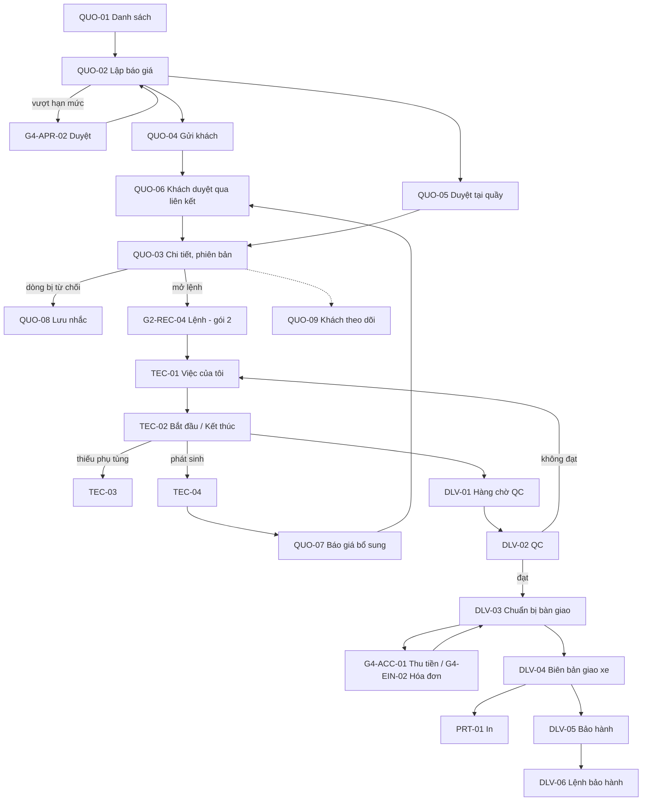

# UI/UX – Gói 3: Báo giá, Thợ (tablet), Giao xe, Bảo hành, Mẫu in (G2-QUO, G2-TEC, G2-DLV, G2-PRT)

Phiên bản 0.1 · 30/10/2026 · Người lập: designer · Nguồn: `screen-inventory.md` §3.5–3.7, §5, §6, §7, §9; `00-foundation.md`; `ba-decisions.md`; `design-system.md`; FRD/Journey (FR-REC, FR-INS, FR-HRM, FR-INV, FR-ACC, NFR-USA/PRT/COM/OFF).

Prototype: `design/g2-quote-delivery/` (mở `index.html` bằng trình duyệt, không cần build). Tiền tố class `g2q-`. Không sửa `design/assets/*`, không sửa file gói 2 (`design/g2-workshop/`). Dùng chung dữ liệu mẫu với gói 2 để hai gói khớp nhau (xem §3).

## 1. Phạm vi

Gói gồm 21 màn hình, trọn các nhóm:

- **G2-QUO** báo giá và duyệt (9): danh sách, lập/sửa, chi tiết và phiên bản, gửi khách, ghi nhận duyệt tại quầy (kể cả duyệt một phần), **trang khách duyệt qua liên kết (điện thoại, layout riêng)**, báo giá bổ sung cho hạng mục phát sinh, hạng mục khách từ chối, trang khách theo dõi tiến độ.
- **G2-TEC** màn hình thợ trên tablet (5): việc được giao, bắt đầu/tạm dừng/kết thúc **tối đa 2 chạm**, yêu cầu phụ tùng, báo phát sinh, công của tôi. Màn nhập PIN chọn thợ là G1-AUT-10 (gói 1), gói này chỉ dẫn tới.
- **G2-DLV** QC, giao xe, bảo hành (6): hàng chờ QC, thực hiện QC, chuẩn bị bàn giao, biên bản giao xe, danh sách bảo hành, tạo lệnh bảo hành.
- **G2-PRT** mẫu in (1 màn xem trước, 3 mẫu × 3 khổ): báo giá (A4), lệnh sửa chữa bản xưởng (A5), phiếu giao nhận (nhiệt 80 mm); mỗi mẫu đổi được sang A4, A5, nhiệt 80 mm và có `@media print` thật.

Ngoài phạm vi gói: chi tiết lệnh G2-REC-04 và tiếp nhận (gói 2); thu tiền G4-ACC, hóa đơn G4-EIN, phê duyệt G4-APR (gói 4; chỉ liên kết tới); xuất kho G3-INV (gói 3 khác); đăng nhập PIN G1-AUT-10 (gói 1).

## 2. Bảng màn hình

Mức "Đã thiết kế": **Đầy đủ** = có luồng tương tác và đủ trạng thái nêu trong danh mục; **Chi tiết vừa** = đủ trạng thái, ít tương tác mô phỏng.

| Mã | Tên | File | Template | Thiết bị chính | Vai trò (FRD §2) | Ưu tiên | Đã thiết kế |
| --- | --- | --- | --- | --- | --- | --- | --- |
| G2-QUO-01 | Danh sách báo giá | `g2-quo-01.html` | C | D, T | CV (S), QL (D); CH, QV, QĐ, TK, TN, KT (X) | P1 | Đầy đủ |
| G2-QUO-02 | Lập / sửa báo giá | `g2-quo-02.html` | E | D, T | CV (S); giá vốn chỉ QL, CH | P1 | Đầy đủ |
| G2-QUO-03 | Chi tiết báo giá và phiên bản | `g2-quo-03.html` | D | D, T | như QUO-01 | P1 | Đầy đủ |
| G2-QUO-04 | Gửi báo giá cho khách | `g2-quo-04.html` | Dlg | D, T | CV | P1 (liên kết, email, in), P2 (Zalo/SMS) | Đầy đủ |
| G2-QUO-05 | Ghi nhận duyệt tại quầy (toàn phần / một phần) | `g2-quo-05.html` | Dlg/W | D, T | CV | P1 | Đầy đủ |
| G2-QUO-06 | Trang khách duyệt báo giá qua liên kết | `g2-quo-06.html` | P | M | KH | P1 | Đầy đủ |
| G2-QUO-07 | Hạng mục phát sinh: đề xuất và báo giá bổ sung | `g2-quo-07.html` | E/Dlg | D, T | TH, QĐ (đề xuất); CV (lập); QL (D) | P1 | Chi tiết vừa |
| G2-QUO-08 | Hạng mục khách từ chối / chưa làm | `g2-quo-08.html` | C | D, T | CV, QL | P2 | Đầy đủ |
| G2-QUO-09 | Trang khách theo dõi tiến độ xe | `g2-quo-09.html` | P | M | KH | P2+ | Chi tiết vừa |
| G2-TEC-01 | Việc được giao | `g2-tec-01.html` | C/B | T | TH (Xn), QĐ | P1 | Đầy đủ |
| G2-TEC-02 | Hạng mục: Bắt đầu / Tạm dừng / Kết thúc | `g2-tec-02.html` | D/E | T | TH (Xn) | P1 | Đầy đủ |
| G2-TEC-03 | Yêu cầu phụ tùng | `g2-tec-03.html` | Dlg | T | TH (S theo lệnh) | P1 | Đầy đủ |
| G2-TEC-04 | Báo hư hỏng phát sinh | `g2-tec-04.html` | Dlg | T | TH (S) | P1 | Đầy đủ |
| G2-TEC-05 | Công của tôi | `g2-tec-05.html` | C | T, M | TH (Xn); QL, KT (X) | P2 | Đầy đủ |
| G2-DLV-01 | Hàng chờ kiểm tra chất lượng | `g2-dlv-01.html` | C | T, D | QĐ/QC (S), QL (D), CV (X) | P1 | Đầy đủ |
| G2-DLV-02 | Thực hiện kiểm tra chất lượng | `g2-dlv-02.html` | E | T | QĐ/QC (S) | P1 | Đầy đủ |
| G2-DLV-03 | Chuẩn bị bàn giao xe | `g2-dlv-03.html` | D | D, T | CV (S); TN (X) | P1 | Đầy đủ |
| G2-DLV-04 | Biên bản giao xe và xác nhận khách | `g2-dlv-04.html` | E | D, T | CV (S) | P1 | Đầy đủ |
| G2-DLV-05 | Danh sách bảo hành | `g2-dlv-05.html` | C | D, T | CV, QL (S); CH, QV (X) | P2 | Đầy đủ |
| G2-DLV-06 | Tạo lệnh bảo hành | `g2-dlv-06.html` | E | D, T | CV, QL (S) | P2 | Chi tiết vừa |
| G2-PRT-01 | Xem trước và in chứng từ | `g2-prt-01.html` | Dlg/P | D, T | theo quyền xem chứng từ | P1 | Đầy đủ |

Tệp hỗ trợ: `index.html` (danh mục + luồng thử), `pack.css` (class `g2q-`, chỉ dùng token), `pack.js` (dựng Application Shell chuẩn cho các trang nhân viên, biến thể/trạng thái xem thử, danh sách thẻ trên điện thoại, hộp thoại dùng chung màn thợ; chỉ phục vụ prototype).

**Cách xem thử.** Thanh "Xem thử trạng thái (chỉ prototype)" ở đầu mỗi trang đổi trạng thái; có thể mở thẳng bằng `?v=<biến thể>`, `?role=CV|QL|QD|TH|TN|KT`, `?dlg=0` (không tự mở hộp thoại). Menu tài khoản có "Xem thử theo vai trò". Nút "Thử: mất kết nối" bật banner mất kết nối chuẩn. Màn hình khách (QUO-06, QUO-09) không có shell và không có thanh này ngoài một khối `
` thu gọn.

## 3. Dữ liệu mẫu dùng chung (khớp gói 2)

| Đối tượng | Giá trị |
| --- | --- |
| Lệnh chính | RO-Q7-2610-00128 · 51H-123.45 Toyota Vios 1.5G 2019 · Nguyễn Văn An · 48.200 km · vào xưởng 08:00 30/10/2026 · hẹn giao 16:00 · cố vấn Nguyễn Hoàng Yến · thợ Lê Minh Tuấn, Trần Văn Hậu · quản đốc Phạm Quốc Bảo · thu ngân Mai Thu Thảo |
| Báo giá | BG-Q7-2610-00231-v2 (v1 gửi 08:20, v2 gửi 08:35, khách duyệt 08:50). 4 hạng mục: (1) thay dầu và lọc dầu 1.585.000, (2) thay má phanh trước 1.070.000, (3) cân chỉnh góc đặt bánh 300.000 (thêm ở v2), (4) vệ sinh buồng đốt 650.000 (khách từ chối). Cộng 3.605.000 + thuế 8% (số mẫu) 288.400 = **3.893.400 ₫**; được duyệt 3/4 = 2.955.000 + 236.400 = **3.191.400 ₫** (khớp tổng lệnh ở G2-REC-04); không duyệt 702.000 ₫ |
| Phát sinh | BG-Q7-2610-00236 · "Thay lọc gió điều hòa" · công 80.000 + lọc gió 220.000 + thuế 24.000 = 324.000 ₫ · thợ đề xuất 09:05, hạn duyệt 02/11/2026 |
| Luồng QC → giao | RO-Q7-2610-00123 · 29A-345.67 Hyundai i10 · Đinh Thị Hạnh · tổng 2.916.000 ₫, cọc 500.000 ₫ |
| Khác | RO-Q7-2610-00122 (QC trả lại, 51G-765.43), RO-Q7-2610-00121 (tạm dừng chờ phụ tùng, 51K-987.65), RO-Q7-2610-00126 (59A-111.22), RO-Q7-2610-00118 (xe doanh nghiệp, QC trễ hẹn) |
| Mã chứng từ | theo `00-foundation.md` §4: `BG-Q7-2610-00231-v2`, `RO-Q7-2610-00128`, `PT-Q7-…`, `PX-Q7-…`. Mã biên bản giao xe `BB-Q7-2610-00123` là đề xuất của designer (xem câu hỏi BA) |

Biển số, tiền, ngày theo `00-foundation.md` §4; thuế suất 8% luôn gắn nhãn "số mẫu" và lấy từ cấu hình, không là hằng trong giao diện.

## 4. UI/UX flow

### 4.1 Luồng chính (danh sách bước có mã màn hình)

1. Cố vấn mở **G2-QUO-01**, chọn "+ Lập báo giá" (hộp thoại chọn biển số) hoặc mở bản nháp.
2. **G2-QUO-02** lập báo giá theo hạng mục (công + phụ tùng đi kèm), kiểm tồn khả dụng, giá niêm yết/thực tế. Lỗi theo trường hoặc giảm giá vượt hạn mức thì khóa "Gửi cho khách" và nêu lý do; vượt hạn mức thì gửi yêu cầu duyệt (G4-APR-02).
3. "Gửi cho khách" → **G2-QUO-04** chọn kênh (Zalo nếu đã kích hoạt, email, sao chép liên kết, in giấy; SMS/Zalo chưa cấu hình thì khóa kèm lý do). Gửi xong báo giá thành "Chờ khách duyệt", phiên bản cũ bị thay.
4. Khách mở liên kết **G2-QUO-06** trên điện thoại, chọn hạng mục, duyệt/từ chối; hoặc khách đến quầy → **G2-QUO-05** (chữ ký, OTP, hoặc xác nhận bằng lời có ghi chú).
5. **G2-QUO-03** hiện "Duyệt một phần", tổng báo giá / tổng được duyệt, bằng chứng duyệt; hạng mục từ chối vào **G2-QUO-08**; từ đây mở lệnh **G2-REC-04** (gói 2) chỉ gồm dòng đã duyệt.
6. Thợ mở **G2-TEC-01** → chạm "Bắt đầu" (hoặc vào **G2-TEC-02**) → "Kết thúc". Thiếu phụ tùng: **G2-TEC-03**. Phát hiện hỏng thêm: **G2-TEC-04** → cố vấn lập **G2-QUO-07** → khách duyệt qua QUO-06/QUO-05 → nút "Bắt đầu" mới mở.
7. Hết hạng mục, lệnh vào **G2-DLV-01** → **G2-DLV-02**. Đạt: "Sẵn sàng bàn giao" và công thợ phát sinh. Không đạt: trả thợ, hạng mục hiện nổi bật ở TEC-01.
8. Cố vấn mở **G2-DLV-03**; thu tiền và xuất hóa đơn ở gói 4 (G4-ACC-01, G4-EIN-02); đủ điều kiện thì **G2-DLV-04** lấy chữ ký, xác nhận giao xe, lệnh Hoàn tất; in **G2-PRT-01**.
9. Sau giao: **G2-DLV-05** (bảo hành) → **G2-DLV-06**; hạng mục lưu nhắc **G2-QUO-08**; khách theo dõi **G2-QUO-09**.

### 4.2 Sơ đồ

### 4.3 Đếm chạm màn thợ (NFR-USA-01)

| Thao tác | Từ danh sách TEC-01 | Từ chi tiết TEC-02 |
| --- | --- | --- |
| Bắt đầu | 1 chạm "Bắt đầu" trên thẻ (toast ghi giờ; có thể bấm "Tạm dừng" ngay nếu nhầm); hoặc chạm thẻ rồi "Bắt đầu" = 2 chạm | 1 chạm |
| Kết thúc | "Kết thúc" → "Kết thúc hạng mục" = 2 chạm | "Kết thúc" → "Kết thúc hạng mục" = 2 chạm |
| Tạm dừng | "Tạm dừng" → chọn lý do (Chờ phụ tùng, Chờ khách duyệt phát sinh, Nghỉ, Khác) = 2 chạm | như bên trái |

Kết thúc có bước xác nhận vì khóa hạng mục và chuyển Chờ QC; bước này chỉ có 2 nút lớn.

## 5. Mô tả theo nhóm màn hình

Quy ước chung cả gói: Application Shell chuẩn (`.app`, sidebar theo vai trò, branch selector hoặc chi nhánh tĩnh) và **thanh phạm vi** (chi nhánh, khoảng thời gian, thời điểm cập nhật; RULE-015) trên mọi trang nhân viên. Trang khách (QUO-06, QUO-09) không dùng shell. Hộp thoại dùng `.overlay/.dialog`: focus trap, Esc, trả focus (app.js). Thao tác nguy hiểm dùng Confirmation có hậu quả (`impact-list`) và lý do ≥ 5 ký tự. Không có nút "Xóa" cho chứng từ đã ghi sổ: dùng "Hủy báo giá", "Hủy phát sinh", "Trả thợ làm lại", biên bản điều chỉnh.

### 5.1 G2-QUO – Báo giá và duyệt

**Mục đích.** Cố vấn lập báo giá nhanh (dưới 15 phút), gửi khách, theo dõi và ghi nhận duyệt; mọi thay đổi sau khi gửi tạo phiên bản mới; chỉ dòng đã duyệt vào lệnh (RULE-005/006).

**QUO-01 (C).** Filter bar (tìm không phân biệt dấu, trạng thái, thời gian, cố vấn), chip bộ lọc đang áp dụng kèm "Xóa tất cả", chip lọc nhanh theo trạng thái có số đếm. Bảng sắp xếp mặc định theo mã mới nhất, cột phiên bản, trạng thái báo giá (bộ badge riêng), tổng báo giá và tổng được duyệt, thời gian chờ/hiệu lực; chân bảng có tổng. Dưới 640 px bảng thành danh sách thẻ. Hành động chính "+ Lập báo giá" (QL, CV); vai trò khác thấy nút khóa kèm tooltip lý do. "Nhắc khách" chỉ ở dòng Chờ khách duyệt. Trạng thái: có dữ liệu, tải (skeleton đúng cột), trống lần đầu, trống do lọc, lỗi, không quyền.

**QUO-02 (E).** Bố cục hai cột: trái là xe/khách, bảng hạng mục (mỗi hạng mục gồm dòng công và phụ tùng; chọn Bắt buộc/Tùy chọn ở hạng mục), ô thêm phụ tùng (combobox không dấu), ghi chú cho khách, hiệu lực; phải là tóm tắt tiền, phiên bản giá, tồn dòng đang chọn (bốn số: thực tế, giữ chỗ, đang về, khả dụng), biên lợi nhuận. Phụ tùng hiển thị tồn **khả dụng** và badge sắp hết/hết hàng, kèm tồn chi nhánh khác và nút yêu cầu chuyển kho. Giá vốn/biên lợi nhuận chỉ QL, CH (cột và thẻ ẩn bằng quyền; CV thấy lời giải thích). Chân dính "Lưu nháp / Xem trước bản in / Gửi cho khách". Trạng thái: soạn, lỗi theo trường (tóm tắt + lỗi tại ô, nêu cách sửa), giảm giá vượt hạn mức (khóa gửi, nút "Gửi yêu cầu duyệt giảm giá"), sửa sau khi đã gửi (banner giải thích sẽ tạo v3), xung đột phiên bản, chỉ đọc, đã lưu nháp; mất kết nối (banner + giữ nháp).

**QUO-03 (D).** Header: mã, bộ chọn v2 (hiện tại)/v1 (cũ), xe, khách (SĐT che theo vai trò), **các badge song song** (báo giá, lệnh, thanh toán, hóa đơn); hành động đổi theo trạng thái (Xem lệnh / Ghi nhận duyệt tại quầy / Gửi cho khách / Tạo phiên bản mới / In / Hủy báo giá). Tab "Nội dung & duyệt" dùng Approval Panel: từng hạng mục có quyết định của khách, tổng báo giá/tổng được duyệt/không duyệt, bằng chứng duyệt (cách duyệt, thời điểm, người ghi nhận). Tab "Phiên bản" so sánh v1–v2 (thêm/bỏ/đổi, có chữ không chỉ màu, giữ giá và thuế tại thời điểm gửi). Tab "Lịch sử". Cột bên: năm đối tượng liên quan (FR-ACC-019). Nút "Mở lệnh" bị khóa kèm lý do khi chưa duyệt. Trạng thái: duyệt một phần, toàn phần, chờ khách, nháp, từ chối, hết hạn, tải, không tìm thấy, không quyền; nội dung đã duyệt chỉ đọc.

**QUO-04 (Dlg).** Chọn kênh bằng thẻ radio (Zalo, Email, Sao chép liên kết, In giấy, SMS); kênh chưa cấu hình bị khóa kèm lý do, trạng thái "Chưa kích hoạt" (D-13); SĐT/email che (`.pii`); xem trước nội dung tin và trang khách; OTP khi duyệt hiển thị là cấu hình (D-08). Trạng thái: chọn kênh, đang gửi, đã gửi (liên kết, hạn), lỗi gửi (thử lại không gửi trùng), chưa cấu hình kênh nhắn tin.

**QUO-05 (Dlg/W).** Bước 1 tích hạng mục (hạng mục bắt buộc khóa), tổng tính lại tức thời; bước 2 cách xác nhận (chữ ký, OTP, xác nhận bằng lời bắt buộc ghi chú, gắn nhãn "Ngoại lệ"), nút Tiếp tục chỉ mở khi đủ bằng chứng; bước 3 xem lại hậu quả (tạo lệnh, giữ chỗ phụ tùng, lệnh có thể Tạm dừng nếu thiếu hàng). "Từ chối toàn bộ" là hành động nguy hiểm riêng có lý do. Chặn duyệt phiên bản đã bị thay và báo giá hết hạn, kèm đường đi tiếp.

**QUO-06 (P, điện thoại).** Layout riêng: không shell, cột 480 px, chữ 16 px, nút 52 px, vùng bấm 44 px. Tiêu đề chào khách, thông tin xe, hạn hiệu lực, kết quả kiểm tra dạng xanh/vàng/đỏ có chữ, danh sách hạng mục có ô chọn lớn, lý do bằng ngôn ngữ đơn giản, ảnh, "Xem chi tiết giá". Thanh đáy cố định: số hạng mục đã chọn, tổng tiền (tính lại), "Duyệt các hạng mục đã chọn", "Từ chối", "Gọi chi nhánh". Xác nhận bằng bottom sheet (có biến thể OTP theo cấu hình). SĐT chỉ hiện dạng che. Trạng thái: báo giá, phát sinh (một việc, "Đồng ý làm/Không làm"), tải, mất kết nối giữa lúc gửi (giữ lựa chọn, "Thử lại"), lỗi hệ thống, đã gửi, đã duyệt rồi, có bản mới, hết hạn (kèm số chi nhánh; đồng bộ ý với G1-ERR-05).

**QUO-07 (E/Dlg).** Đề xuất của thợ (mô tả, ảnh), nội dung báo giá bổ sung, trạng thái hạng mục phát sinh theo BA A.3: "Chưa làm" + tag "Chờ khách duyệt (phát sinh)", không phải trạng thái thứ 6. Biến thể: đang lập, chờ khách, khách duyệt, khách từ chối, thợ xem (thợ không thấy giá).

**QUO-08 (C).** Bảng hạng mục lưu nhắc với giá cũ so giá hiện tại (tag tăng/giảm), trạng thái nhắc (Đang nhắc/Đã bỏ nhắc), chọn nhiều dòng → "Đưa vào báo giá mới" (chỉ cho cùng một xe, nếu khác xe thì khóa nút kèm thông báo) và "Bỏ nhắc"; callout khi xe vừa vào lại.

**QUO-09 (P).** Tiến độ dạng bước dọc (Đã nhận xe → Đã duyệt → Đang sửa → Kiểm tra → Sẵn sàng giao), thẻ "Cần anh quyết định" khi có phát sinh, ảnh trong lúc sửa; không có giá ngoài phần cần duyệt, không tài khoản.

**Responsive.** QUO-01/08: bảng → thẻ dưới 640 px. QUO-02/03/07: hai cột → một cột dưới 1280 px; bảng dòng cuộn ngang trong khung. QUO-06/09: thiết kế cho điện thoại, trên desktop hiện khung 480 px ở giữa.

### 5.2 G2-TEC – Màn hình thợ (tablet)

**Nguyên tắc.** Nút xl 52 px, nút chính 64 px, chữ 16–24 px, khoảng cách rộng, thẻ lớn một cột (hai cột khi ngang), chip lọc 48 px, tương phản cao; thợ chỉ thấy việc của mình; trạng thái hạng mục luôn có chữ.

**TEC-01.** Thanh thợ (tên, thiết bị xưởng, thông báo tự khóa 3 phút theo D-04), 4 ô tóm tắt (đang làm, chưa làm, tạm dừng, bị trả lại), chip lọc, thẻ việc. Thẻ có biển số cỡ lớn, tên hạng mục, mã lệnh, giờ chuẩn, hẹn giao. Việc bị QC trả lại đứng đầu, nền cảnh báo và nêu lý do. Việc đang làm có đồng hồ, thanh giờ thực/giờ chuẩn, nút "Tạm dừng"/"Kết thúc" ngay trên thẻ. Việc bị khóa (phát sinh chưa duyệt, thiếu phụ tùng) hiện **lý do bằng chữ ngay trên thẻ**, không chỉ tooltip (tablet không có hover). Trạng thái: có việc, tải, chưa có việc, lỗi, mất mạng (xem dữ liệu đã tải, mốc giờ ghi bù).

**TEC-02.** Đầu trang (biển số, tên hạng mục, badge), đồng hồ lớn, một hoặc hai nút rất lớn theo trạng thái, hàng nút phụ "Yêu cầu phụ tùng", "Báo hư hỏng phát sinh". Phần dưới: phụ tùng đã cấp, các bước làm (checkbox 56 px), ảnh (chụp/chọn, nén, lỗi từng ảnh), trao đổi nội bộ với quản đốc, nhật ký giờ làm (mốc giờ do hệ thống ghi, thợ không tự sửa). Hộp thoại Tạm dừng (4 lý do 1 chạm) và Kết thúc (xác nhận nhanh). Biến thể: chưa làm, đang làm, tạm dừng, khóa vì phát sinh, khóa vì thiếu phụ tùng, hoàn thành (khóa, "công chưa ghi tới khi QC"), bị trả lại, quên kết thúc (cảnh báo giờ vượt), mất mạng (mốc giờ chờ đồng bộ, nhãn "nhập bù").

**TEC-03.** Chỉ liệt kê phụ tùng có trong lệnh (RULE-007), số lượng tối đa = cần − đã xuất, phụ tùng xuất đủ bị làm mờ, ô hướng dẫn "báo cố vấn" cho phụ tùng ngoài lệnh; thiếu hàng vẫn gửi được kèm giải thích; trạng thái gửi, lỗi, mất mạng (cần mạng).

**TEC-04.** Mô tả bắt buộc, ảnh/video có nén và lỗi, lưu nháp khi mất mạng, màn "đã gửi" có stepper Thợ báo → Cố vấn báo giá → Khách duyệt → Bắt đầu.

**TEC-05.** Chỉ xem: giờ chuẩn, giờ thực, giờ công đã ghi, trạng thái công (Đã ghi / Chưa ghi chờ QC / Chưa ghi QC trả lại / Kỳ đã khóa). Số là **giờ**, không hiện tiền vì công thức công thợ là cấu hình chưa chốt. QL, KT thêm bộ chọn thợ.

### 5.3 G2-DLV – QC, giao xe, bảo hành

**DLV-01.** Bốn ô tóm tắt, filter, hai tab (Chờ QC, Đã trả thợ làm lại), bảng dòng cao 56 px, sắp xếp theo hẹn giao, tag "Trễ". "Bắt đầu QC" chỉ QĐ, QL; vai trò khác thấy ghi chú vì sao không có nút. Số "Chờ QC 06" khớp ô "Chờ kiểm tra QC" ở tổng quan.

**DLV-02.** Thanh tiến độ có số đếm Đạt/Không đạt/Chưa kiểm, tự lưu nháp; checklist theo nhóm, mỗi mục hai nút lớn "Đạt"/"Không đạt" 52 px (có biểu tượng + chữ); chọn Không đạt mở khối nhóm lỗi, thợ chịu trách nhiệm, ghi chú bắt buộc, ảnh. Chân dính: "Không đạt, trả thợ" (chỉ mở khi có mục không đạt) và "Đạt, chuyển sẵn sàng giao" (chỉ mở khi đạt đủ), đều có hộp thoại hậu quả; "trả thợ" bắt buộc lý do. Mất mạng: vẫn tick được, chưa chốt được. Đã QC đạt: chỉ đọc.

**DLV-03.** Danh sách điều kiện, mỗi dòng có biểu tượng + chữ (Đạt/Chưa đạt/Chờ duyệt) và nút xử lý tại chỗ: QC đạt, đã thu đủ hoặc ghi công nợ hợp lệ, có hóa đơn hợp lệ, phụ tùng cũ và đồ đạc, hạng mục lưu nhắc, lịch nhắc kế tiếp (lấy theo cấu hình). Chân dính "Bàn giao xe" khóa kèm lý do cụ thể. Giao xe còn nợ vượt hạn mức: nút nguy hiểm "Đề nghị duyệt giao xe còn nợ" (so giá trị với hạn mức, theo quyết định 14; số trong mẫu là giả lập). Biến thể: chưa đủ, đủ, nợ trong hạn mức, nợ vượt hạn mức, chờ duyệt, đã bàn giao. Lựa chọn "khách không lấy hóa đơn" **không mở** vì `[Cần xác nhận]`.

**DLV-04.** Hạng mục + bảo hành, tình trạng và km khi giao, đồ đạc trả khách, khách xác nhận bằng chữ ký trên màn hình hoặc bản giấy (đính ảnh). Nút "Xác nhận giao xe" chỉ mở khi đủ; hộp thoại nêu hậu quả (lệnh Hoàn tất, biên bản không sửa, lịch nhắc bắt đầu). Đã giao: chỉ đọc, sửa sai bằng biên bản điều chỉnh. Mất mạng: lưu nháp, in biên bản giấy dự phòng.

**DLV-05, DLV-06.** Danh sách bảo hành tra cả chi nhánh khác trong phạm vi, dòng chi nhánh khác chỉ hiện phần được phép (có biểu tượng khóa); tag còn hạn/sắp hết/hết hạn có chữ. Tạo lệnh bảo hành: chọn lệnh gốc, hạng mục + điều kiện (cấu hình), thợ gốc gắn tự động, loại chi phí "Bảo hành" cố định, chi nhánh chịu chi phí chọn theo cấu hình; ngoài hạn thì không tạo được mà gửi đề nghị ngoại lệ (có lý do).

### 5.4 G2-PRT – Mẫu in

`g2-prt-01.html` là màn xem trước (Dlg/P) có bộ chọn **loại chứng từ** (báo giá, lệnh sửa chữa bản xưởng, phiếu giao nhận) và **khổ giấy** (A4, A5, nhiệt 80 mm; 58 mm là cấu hình). Trang giấy mô phỏng đúng kích thước (mm), chữ pt, `@page` đổi theo khổ, `@media print` ẩn toàn bộ shell/điều khiển, chỉ in tờ giấy; thẻ in lại hiện "BẢN IN LẠI (lần 2)" và ghi nhật ký in (FR-ACC-014).

| Mẫu | Khổ đề xuất | Nội dung chính | Ghi chú theo khổ |
| --- | --- | --- | --- |
| Báo giá | A4 | Đơn vị phát hành (chi nhánh, pháp nhân, MST số mẫu), số báo giá + phiên bản, ngày, hiệu lực, khách, xe, bảng hạng mục (công/phụ tùng), cộng trước thuế, thuế, tổng, bằng chữ, điều khoản, ký (khách, cố vấn, quản lý), QR duyệt, người in/lần in/trang | A5 thu nhỏ cột; nhiệt 80 mm: mỗi dòng hai hàng "tên / SL × đơn giá = thành tiền", không QR |
| Lệnh sửa chữa (bản xưởng) | A5 | Không đơn giá, không SĐT khách; yêu cầu của khách, hạng mục được duyệt với giờ chuẩn, thợ, phụ tùng đã cấp (số phiếu xuất), ô tick "Xong"; hạng mục phát sinh chưa duyệt in rõ "KHÔNG làm"; ký cố vấn/quản đốc/thợ | Nhiệt chỉ dùng khi in nhanh (có gợi ý) |
| Phiếu giao nhận | Nhiệt 80 mm / A5 | Khách, xe, km giao, hạng mục + bảo hành, thanh toán, số hóa đơn, khách xác nhận nhận xe/đồ đạc, ký | Nhiệt: một cột, chữ ký hai bên |

SĐT trên bản in mặc định che; chỉ in đầy đủ khi người in có quyền (ô tick bị khóa nếu không). Bản mô phỏng "Thiếu thông tin bắt buộc" cho phép in nháp nhưng gắn ghi chú. Model máy in là `[Cần xác nhận]`, thiết kế theo khổ.

## 6. Ánh xạ FR / RULE

| Nhóm | FR / RULE được thể hiện |
| --- | --- |
| QUO-01, 02 | FR-REC-004, 005, 006, 007, 011, 020, 023, 031; FR-INV-020, 025; FR-INS-005; BR-REC-02, BR-REC-12; WF-07; RULE-008 (tồn khả dụng); NFR-USA-02 |
| QUO-03, 05 | FR-REC-009, 023, 024, 026, 031; FR-ACC-019; RULE-005; UAT-17, UAT-22 |
| QUO-04, 06 | FR-REC-008, 009, 034; FR-INS-006; BR-REC-03; D-08, D-13; NFR-SEC-03 (che SĐT) |
| QUO-07 | FR-REC-014; BR-REC-04; RULE-005, RULE-006; WF-03; UAT-03; BA A.3 |
| QUO-08 | FR-REC-024; BR-REC-11; FR-CRM-004 |
| QUO-09 | BR-CRM-04; Journey khách; G-05 (chưa có FR) |
| TEC-01..04 | FR-REC-013, 014, 029; FR-HRM-005; FR-INV-007, 020; BR-REC-06; NFR-USA-01; WF-03, WF-08; D-04; RULE-007, RULE-008; NFR-OFF-01 |
| TEC-05 | FR-HRM-005, 007, 010; BR-HRM-03 |
| DLV-01, 02 | FR-REC-016; FR-HRM-007, 008, 016; BR-REC-07; WF-04; FR-REC-015 |
| DLV-03, 04 | FR-REC-015, 017, 025; FR-ACC-001, 020; FR-EIN-009; BR-REC-07; WF-04, WF-05; RULE-010 |
| DLV-05, 06 | FR-REC-018, 036; FR-HRM-016; BR-REC-08; RULE-014; UAT-24 |
| PRT-01 | NFR-PRT-01; NFR-COM-01; FR-ACC-014; FR-REC-017, 025; FR-SYS-006 (mẫu có hiệu lực theo ngày); ba-decisions câu 12 |
| Toàn gói | RULE-007 (chứng từ gắn nguồn), RULE-010 (không xóa, dùng hủy/đảo), RULE-015 (phạm vi và thời điểm), NFR-ISO-01, FR-SYS-003 (nhật ký) |

## 7. Kiểm tra accessibility đã tự đánh giá (WCAG 2.2 AA)

| Hạng mục | Kết quả tự rà (không có trình duyệt nên chưa chạy công cụ) |
| --- | --- |
| Tương phản | Chỉ dùng token đã kiểm ở `00-foundation.md` §9 (chữ badge/tag bản đậm, link brand-600, viền control #868D9A). Pack không thêm màu. Cần đo lại sau khi có file phông thật |
| Không chỉ dựa vào màu | Badge/tag luôn có chữ; QC dùng "Đạt/Không đạt" có biểu tượng; so sánh phiên bản dùng tag "Thêm mới/Không đổi" ngoài viền màu; xanh/vàng/đỏ kiểm tra xe có chữ "Cần xử lý sớm/Nên làm/Bình thường" |
| Cỡ chữ, vùng bấm | Chữ ≥ 12 px (bảng 14 px); trang khách ≥ 16 px; nút thợ 52–64 px; control ≥ 44 px khi cảm ứng hoặc dưới 1024 px (theo `components.css`) |
| Bàn phím, focus | Tất cả control là phần tử gốc (button, a, input); hộp thoại dùng focus trap/Esc/trả focus của app.js; tab dùng ← → Home End; thẻ radio dạng thẻ có `:focus-visible` riêng |
| Nhãn, lỗi | Mọi trường có `<label>`; lỗi theo trường có chữ và `field__error`; bắt buộc có `*` |
| Nút bị khóa | Dùng `aria-disabled` + lý do nhìn thấy (chữ hoặc tooltip có `aria-describedby`); màn thợ hiện lý do bằng chữ vì cảm ứng không có hover |
| Trạng thái động | Banner mất mạng `role="alert"`, trạng thái lỗi `role="alert"`, toast `aria-live`; đồng hồ có `role="timer"` và nhãn |
| Chuyển động | `prefers-reduced-motion` do `base.css` xử lý; không thêm hoạt ảnh mới |
| In | `@media print` ẩn điều hướng; màu in bị đưa về đen/xám để máy in đen trắng và nhiệt |
| Chưa kiểm | Screen reader thật, thiết bị cảm ứng thật, máy in thật (độ rộng nhiệt 72 mm in được), khung chữ ký dùng canvas thật (hiện mô phỏng bằng nút), dark mode (ngoài phạm vi phát hành) |

## 8. Giả định (đánh dấu rõ, dễ đổi)

1. Khách duyệt theo **hạng mục** (gồm công và phụ tùng đi kèm), khớp cách gói 2 hiển thị "duyệt 3/4 hạng mục". Danh mục ghi "từng dòng" ở QUO-05; chọn mức hạng mục cho dễ hiểu.
2. Hạng mục **bắt buộc** khóa ô chọn trên trang khách và ở QUO-05; muốn không đồng ý thì "Từ chối". Hạng mục **tùy chọn** chọn tự do.
3. Báo giá phiên bản cũ hiển thị bằng tag "Phiên bản cũ (chỉ đọc)", không phải trạng thái báo giá thứ 7.
4. Bắt đầu việc từ thẻ ở danh sách là 1 chạm, có toast ghi giờ; ngoài ra vẫn đủ ≤ 2 chạm như BA câu 13.
5. Kết thúc hạng mục có xác nhận nhanh (hộp thoại 2 nút); tạm dừng chọn lý do là 1 chạm, lý do "Khác" ghi chú thêm ở chi tiết.
6. Quên kết thúc: cảnh báo khi giờ thực vượt quá một bội số giờ chuẩn (mẫu 4 giờ 20 phút / 1,5 giờ); ngưỡng và người điều chỉnh giờ là cấu hình.
7. Thiếu hàng: thợ vẫn gửi yêu cầu cho thủ kho; hạng mục chuyển Tạm dừng lý do "Chờ phụ tùng" (Journey §4 bước 9, BA câu 3).
8. Kênh Zalo được coi là đã kích hoạt trong dữ liệu mẫu (gói 2 dùng Zalo); SMS chưa kích hoạt. Mọi kênh theo cấu hình.
9. Số tiền hiển thị trên trang khách: giá hạng mục chưa thuế, thuế ở tổng; thuế suất 8% là số mẫu.
10. Mã biên bản giao xe `BB-Q7-2610-00123` theo mẫu `LOẠI-MÃCN-YYMM-STT`; tiền tố BB chưa có trong bảng mã chứng từ.
11. Công thợ ở TEC-05 hiển thị bằng **giờ** (không tiền) vì công thức công/hoa hồng chưa chốt.
12. Mẫu in lệnh sửa chữa là bản xưởng không đơn giá; báo giá và phiếu giao nhận có tiền.
13. Số liệu hạn mức công nợ (40.000.000 ₫, 48.500.000 ₫), hạn mức giảm giá (5%), ngưỡng "sắp hết hạn bảo hành" (14 ngày) đều là **giá trị mẫu**, lấy từ cấu hình; giao diện chỉ hiển thị giá trị cấu hình so với giá trị thực tế.

## 9. Câu hỏi cho BA

| # | Câu hỏi | Ảnh hưởng |
| --- | --- | --- |
| 1 | Bộ trạng thái báo giá (Journey §7) không có trạng thái cho phiên bản bị thay thế. Có thêm "Đã thay thế" hay chỉ là thuộc tính của phiên bản (như đang thiết kế)? | QUO-01, 03 |
| 2 | Duyệt một phần ở mức **hạng mục** hay **từng dòng** (FR-REC-026)? Hạng mục "Bắt buộc" khách có được từ chối riêng không, hay chỉ được từ chối cả báo giá? | QUO-03, 05, 06, UAT-17 |
| 3 | Báo giá bổ sung cho phát sinh: khi khách từ chối, hạng mục phát sinh có tồn tại trong lệnh (trạng thái nào) hay chỉ lưu ở danh sách lưu nhắc? Hạn duyệt phát sinh mặc định bao lâu? | QUO-07, 08, TEC-02 |
| 4 | Bộ trạng thái bảo hành (Còn hạn / Sắp hết hạn / Hết hạn) và ngưỡng "sắp hết" có chính thức không? Bảo hành tính theo thời gian, km hay cái nào đến trước? | DLV-05, 06 |
| 5 | Yêu cầu phụ tùng của thợ có bộ trạng thái riêng (đã gửi, thủ kho nhận, đã xuất, thiếu hàng)? Khi thiếu hàng, ai chuyển lệnh sang Tạm dừng: tự động hay thủ kho? | TEC-03, G3-INV-06 |
| 6 | Chữ ký khách trên màn hình có yêu cầu pháp lý/lưu trữ riêng (hình ảnh, băm, dấu thời gian) không? Xác nhận bằng lời có cần quản lý đồng ý trước không? | QUO-05, DLV-04 |
| 7 | "Khách không lấy hóa đơn" (WF-05) xử lý thế nào để mở điều kiện bàn giao? Hiện đang để `[Cần xác nhận]`, không mở lựa chọn. | DLV-03 |
| 8 | Ngưỡng cảnh báo "quên kết thúc" và ai được điều chỉnh giờ thực của thợ (quản đốc? có lý do?) | TEC-02 |
| 9 | Mã biên bản giao xe: thêm tiền tố `BB` vào bảng mã chứng từ (ba-decisions câu 11)? Có phiếu giao nhận riêng khác biên bản không? | DLV-04, PRT-01 |
| 10 | Nội dung bắt buộc từng mẫu in (MST pháp nhân, điều khoản bảo hành, lệnh bản xưởng có in giá không), có in QR không, khổ nhiệt có dùng cho báo giá/lệnh không? Ghi nhật ký in lại ở cấp nào? | PRT-01 |
| 11 | Cách hiển thị giá cho khách (chưa thuế + thuế ở tổng) có phù hợp quy định về niêm yết/hiển thị giá với người tiêu dùng không? | QUO-06, PRT-01 |
| 12 | OTP khi khách duyệt là cấu hình: mặc định bật hay tắt cho pilot? Có bắt buộc khi giá trị lớn hơn ngưỡng? | QUO-04, 05, 06 |
| 13 | Công thợ ở TEC-05 hiện giờ hay tiền? Thợ có được xem hoa hồng của mình không? | TEC-05, G3-HRM-09 |
| 14 | Giao xe còn nợ: hạn mức công nợ khách và người duyệt (G4-APR-03) áp cho khách cá nhân hay chỉ doanh nghiệp? | DLV-03 |

## 10. Điểm yếu tự đánh giá

- Không có trình duyệt nên chưa xem trực quan, chưa đo tương phản, chưa thử in thật; bố cục in A5/nhiệt dựa trên kích thước mm, cần kiểm thử với máy in thực.
- Chữ ký khách, quét OTP, tải ảnh là mô phỏng; chưa có canvas ký thật.
- Phông Be Vietnam Pro chưa có file WOFF2 (đang rơi về phông hệ thống), độ rộng chữ khi in có thể khác.
- `pack.js` dựng shell bằng `document.write` để tránh lặp ~150 dòng mỗi trang; khi chọn stack, thay bằng component của framework (class và cấu trúc giữ nguyên).
- QUO-07, QUO-09, DLV-06 chi tiết vừa; QUO-02 chưa có gói bảo dưỡng chọn sẵn (chỉ nút), chưa có so sánh nhiều chi nhánh về tồn.
- Chưa thiết kế mẫu in phiếu tiếp nhận, phiếu thu/chi, phiếu kho (thuộc G2-REC/G4/G3).
