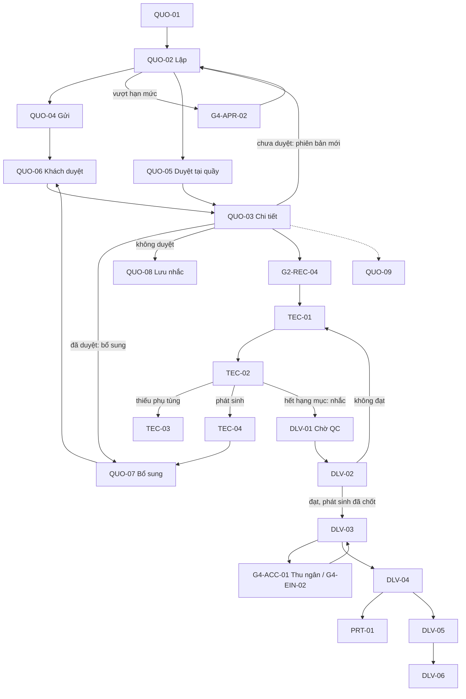

# UI/UX – Gói 3: Báo giá, Thợ (tablet), Giao xe, Bảo hành, Mẫu in (G2-QUO, G2-TEC, G2-DLV, G2-PRT)

Phiên bản 0.2 · 30/10/2026 · Người lập: designer · Đã xử lý review BA `review-03-quote-technician-delivery-ba.md` (F3-01..F3-36) và trả lời `ba-answers-03.md` (14 câu + D-13). Nguồn: `screen-inventory.md` §3.5–3.7, §5–7, §9; `00-foundation.md`; `ba-decisions.md`; `ba-answers-02.md` A.1/A.2; `design-system.md`; FRD/Journey.

Prototype: `design/g2-quote-delivery/` (mở `index.html`, không cần build). Tiền tố class `g2q-`. Không sửa `design/assets/*` và file gói 2 (`design/g2-workshop/`). Dùng chung dữ liệu mẫu với gói 2.

## 1. Phạm vi

21 màn hình: **G2-QUO** (9), **G2-TEC** (5), **G2-DLV** (6), **G2-PRT** (1 màn xem trước, 3 mẫu × 3 khổ A4/A5/nhiệt 80 mm, có `@media print`). Ngoài gói: chi tiết lệnh G2-REC-04 (gói 2), thu tiền G4-ACC, hóa đơn G4-EIN, phê duyệt G4-APR, xuất kho G3-INV, nhập PIN G1-AUT-10.

## 2. Bảng màn hình

| Mã | Tên | File | Template | Thiết bị | Vai trò (FRD §2) | Ưu tiên | Mức |
| --- | --- | --- | --- | --- | --- | --- | --- |
| G2-QUO-01 | Danh sách báo giá (một dòng mỗi báo giá = phiên bản hiện tại) | `g2-quo-01.html` | C | D, T | CV (S), QL (D); CH, QV, QĐ, TK, TN, KT (X) | P1 | Đầy đủ |
| G2-QUO-02 | Lập / sửa báo giá | `g2-quo-02.html` | E | D, T | CV (S); giá vốn CH, QV, QL, KT | P1 | Đầy đủ |
| G2-QUO-03 | Chi tiết báo giá và phiên bản | `g2-quo-03.html` | D | D, T | như QUO-01 | P1 | Đầy đủ |
| G2-QUO-04 | Gửi báo giá cho khách | `g2-quo-04.html` | Dlg | D, T | CV | P1 (liên kết, email, in), P2 (Zalo/SMS) | Đầy đủ |
| G2-QUO-05 | Ghi nhận duyệt tại quầy | `g2-quo-05.html` | Dlg/W | D, T | CV | P1 | Đầy đủ |
| G2-QUO-06 | Trang khách duyệt qua liên kết | `g2-quo-06.html` | P | M | KH | P1 | Đầy đủ |
| G2-QUO-07 | Phát sinh: đề xuất và báo giá bổ sung | `g2-quo-07.html` | E/Dlg | D, T | TH, QĐ (đề xuất); CV (lập); QL (D) | P1 | Đầy đủ |
| G2-QUO-08 | Hạng mục khách từ chối / chưa làm | `g2-quo-08.html` | C | D, T | CV, QL | P2 | Đầy đủ |
| G2-QUO-09 | Trang khách theo dõi tiến độ | `g2-quo-09.html` | P | M | KH | P2+ | Chi tiết vừa |
| G2-TEC-01 | Việc được giao | `g2-tec-01.html` | C/B | T | TH (Xn), QĐ | P1 | Đầy đủ |
| G2-TEC-02 | Bắt đầu / Tạm dừng / Kết thúc | `g2-tec-02.html` | D/E | T | TH (Xn) | P1 | Đầy đủ |
| G2-TEC-03 | Yêu cầu phụ tùng | `g2-tec-03.html` | Dlg | T | TH | P1 | Đầy đủ |
| G2-TEC-04 | Báo hư hỏng phát sinh | `g2-tec-04.html` | Dlg | T | TH | P1 | Đầy đủ |
| G2-TEC-05 | Công của tôi | `g2-tec-05.html` | C | T, M | TH (Xn); QL, KT (X) | P2 | Đầy đủ |
| G2-DLV-01 | Hàng chờ QC | `g2-dlv-01.html` | C | T, D | QĐ (S), QL (D), CV (X) | P1 | Đầy đủ |
| G2-DLV-02 | Thực hiện QC | `g2-dlv-02.html` | E | T | QĐ (S) | P1 | Đầy đủ |
| G2-DLV-03 | Chuẩn bị bàn giao xe | `g2-dlv-03.html` | D | D, T | CV (S); TN (X) | P1 | Đầy đủ |
| G2-DLV-04 | Biên bản giao xe | `g2-dlv-04.html` | E | D, T | CV (S) | P1 | Đầy đủ |
| G2-DLV-05 | Danh sách bảo hành | `g2-dlv-05.html` | C | D, T | CV, QL (S); CH, QV (X) | P2 | Đầy đủ |
| G2-DLV-06 | Tạo lệnh bảo hành | `g2-dlv-06.html` | E | D, T | CV, QL (S) | P2 | Chi tiết vừa |
| G2-PRT-01 | Xem trước và in chứng từ | `g2-prt-01.html` | Dlg/P | D, T | theo quyền xem chứng từ | P1 | Đầy đủ |

Tệp hỗ trợ: `index.html`, `pack.css` (token mức pack `--g2q-*` cho kích thước đặc thù, không đổi token chuẩn), `pack.js`. Xem thử bằng thanh "Xem thử trạng thái (chỉ prototype)", `?v=<biến thể>`, `?role=CV|QL|QD|TH|TN|KT|MH|NS`, `?dlg=0`. Mỗi trang có `<noscript>`.

**Ghi chú handoff `document.write` (F3-36).** `pack.js` dựng Application Shell bằng `document.write` và DLV-02 dựng checklist bằng script để prototype không lặp mã. Chỉ chấp nhận ở prototype: nếu một script giữa chừng lỗi hoặc thiếu `g2q.end()` thì cấu trúc HTML sai; toàn bộ dùng script inline nên không tương thích CSP nghiêm ngặt. Sản phẩm thật dùng component của framework, giữ nguyên class và cấu trúc, **không sao chép `document.write`**.

## 3. Dữ liệu mẫu dùng chung (khớp gói 2)

| Đối tượng | Giá trị |
| --- | --- |
| Lệnh chính | RO-Q7-2610-00128 · 51H-123.45 Toyota Vios 1.5G 2019 · Nguyễn Văn An (khách cá nhân) · 48.200 km · vào 08:00 30/10/2026 · hẹn giao 16:00 · CV Nguyễn Hoàng Yến · thợ Lê Minh Tuấn, Trần Văn Hậu · quản đốc Phạm Quốc Bảo · thu ngân Mai Thu Thảo |
| Báo giá | BG-Q7-2610-00231-v2 (v1 gửi 08:20, v2 gửi 08:35, khách duyệt 08:50). 4 hạng mục chưa thuế 1.585.000 / 1.070.000 / 300.000 / 650.000 = 3.605.000, thuế 8% (số mẫu) 288.400, tổng **3.893.400 ₫**; duyệt 3/4 = **3.191.400 ₫** (khớp G2-REC-04). Khách cá nhân thấy giá hạng mục đã gồm thuế: 1.711.800 / 1.155.600 / 324.000 / 702.000 |
| Phát sinh | BG-Q7-2610-00236 · "Thay lọc gió điều hòa" (hạng mục phát sinh P1) · 324.000 ₫ · gửi 09:05, hạn duyệt 16:00 hôm nay (24 giờ, không quá giờ hẹn giao) |
| Luồng QC → giao | RO-Q7-2610-00123 · 29A-345.67 · Đinh Thị Hạnh · 2.916.000 ₫, cọc 500.000 ₫ · biên bản `BB-Q7-2610-00041` · khách DN minh họa: Cty TNHH Xây dựng Phú Gia, RO-Q7-2610-00118 |

## 4. UI/UX flow

### 4.1 Luồng chính

1. **QUO-01** → "+ Lập báo giá" → **QUO-02** (hạng mục gồm công + phụ tùng; nhãn Bắt buộc/Tùy chọn và cờ "Khách đã yêu cầu"; tồn khả dụng; giảm giá vượt hạn mức thì khóa gửi và xin duyệt G4-APR-02).
2. "Gửi cho khách" → **QUO-04** (kênh chưa kích hoạt bị khóa, không hiện tên nhà cung cấp; mặc định chọn kênh hợp lệ).
3. Khách mở **QUO-06** (hoặc cố vấn ghi nhận ở **QUO-05**). Duyệt theo **hạng mục**; "Bắt buộc" chỉ là nhãn tư vấn: bỏ tick mở cảnh báo an toàn + lý do + ghi "Từ chối hạng mục bắt buộc" + lưu nhắc cờ An toàn; có cấu hình khóa (mặc định cho phép). Nút "Từ chối" = **từ chối toàn bộ báo giá**.
4. **QUO-03**: Duyệt toàn phần / một phần, bằng chứng (kèm mã băm). **Tạo phiên bản mới chỉ khi chưa có hạng mục được duyệt**; sau đó dùng **báo giá bổ sung** (QUO-07). Hạng mục không duyệt vào **QUO-08**. Mở lệnh ở G2-REC-04.
5. Thợ: **TEC-01** → "Bắt đầu" (1 chạm, có Hoàn tác 10 giây) → "Kết thúc" (2 chạm). Thiếu phụ tùng **TEC-03**. Phát sinh **TEC-04** → **QUO-07** (thuộc tính duyệt Chờ / Đã duyệt / Từ chối / Hết hạn, hạn mặc định 24 giờ) → khách duyệt ở QUO-06.
6. Hạng mục cuối xong → hệ thống **nhắc** Quản đốc chuyển lệnh sang Chờ QC (**lệnh không tự chuyển**, ba-answers-02 A.1) → **DLV-01** → **DLV-02**. QC đạt chỉ chuyển "Sẵn sàng bàn giao" khi mọi phát sinh đã có quyết định cuối.
7. **DLV-03** kiểm điều kiện: QC đạt, thu đủ hoặc công nợ hợp lệ (Thu tiền chỉ Thu ngân, G4-ACC-01), hóa đơn hợp lệ (G4-EIN-02), phát sinh có quyết định cuối. → **DLV-04** (người nhận; ủy quyền cần xác minh; chữ ký) → in **PRT-01**.
8. Sau giao: **DLV-05** → **DLV-06**; **QUO-08**; khách theo dõi **QUO-09**.

### 4.2 Sơ đồ

### 4.3 Đếm chạm màn thợ (NFR-USA-01)

| Thao tác | Từ danh sách TEC-01 | Từ chi tiết TEC-02 |
| --- | --- | --- |
| Bắt đầu / Làm lại | 1 chạm; toast có "Hoàn tác" 10 giây (hoàn tác ghi mốc "hủy bắt đầu" có vết, không tính giờ); hoặc chạm thẻ rồi "Bắt đầu" = 2 chạm | 1 chạm |
| Kết thúc | "Kết thúc" → "Kết thúc hạng mục" = 2 chạm | 2 chạm |
| Tạm dừng | "Tạm dừng" → chọn lý do = 2 chạm | 2 chạm |

**Mất kết nối (chốt cho TEC-01/03/04, NFR-OFF-01, giai đoạn 1).** Chỉ cảnh báo và lưu nháp: mốc giờ bắt đầu/tạm dừng/kết thúc vẫn ghi trên máy và đồng bộ sau (nhãn "nhập bù"). **Yêu cầu phụ tùng và báo hư hỏng phát sinh bị chặn gửi**: nháp lưu trên máy hiện rõ "CHƯA gửi" (`sync--wait`), thợ báo trực tiếp quản đốc/cố vấn hoặc dùng phiếu giấy dự phòng; có mạng thì bấm "Gửi ngay". Không tự gửi nền (đó là offline đầy đủ, ngoài phạm vi).

## 5. Mô tả theo nhóm màn hình

Quy ước chung: Application Shell chuẩn và thanh phạm vi (RULE-015) cho trang nhân viên; **màn thợ dùng shell rút gọn** (F3-11): không tìm kiếm toàn hệ thống, menu chỉ "Việc của tôi" và "Công của tôi", thông báo chỉ gồm việc mới, QC trả lại, phát sinh được duyệt, phụ tùng sẵn sàng, không có menu xem thử vai trò. Trang khách không shell. Hộp thoại: focus trap, Esc, trả focus. Nguy hiểm: Confirmation nêu hậu quả + lý do ≥ 5 ký tự. Không "Xóa" chứng từ đã ghi sổ.

### 5.1 G2-QUO

- **QUO-01 (C).** Mỗi báo giá một dòng (phiên bản hiện tại, ghi "(có v1, v2)"). Filter, chip đang lọc, chip trạng thái có số đếm, tổng chân bảng, thẻ trên điện thoại. 6 trạng thái Báo giá đúng A.2. Trạng thái: dữ liệu, tải, trống, trống do lọc, lỗi, không quyền.
- **QUO-02 (E).** Hạng mục có chọn **Bắt buộc/Tùy chọn** (nhãn tư vấn), cờ **"Khách đã yêu cầu"** (tick sẵn trên trang khách), tồn khả dụng + bốn số, giá vốn chỉ CH, QV, QL, KT. Sửa sau khi gửi giải thích: chỉ tạo v mới khi chưa có hạng mục được duyệt. Control 36 px chỉ khi chuột và ≥ 1024 px, còn lại ≥ 44 px.
- **QUO-03 (D).** Header với badge song song; **"Tạo phiên bản mới" chỉ hiện khi Đã gửi, Từ chối, Hết hạn**; Duyệt một phần/toàn phần thay bằng "Lập báo giá bổ sung" và nút Tạo phiên bản mới khóa kèm lý do. Tab Nội dung, Phiên bản (so sánh), Lịch sử. Bằng chứng duyệt kèm mã băm SHA-256 (bằng chứng nghiệp vụ, không phải chữ ký số). Trạng thái: 6 trạng thái báo giá, tải, lỗi, trống, không tìm thấy, không quyền.
- **QUO-04 (Dlg).** Thẻ kênh; kênh chưa kích hoạt bị khóa và **không hiện tên nhà cung cấp**; biến thể "chưa cấu hình Zalo/SMS" chọn sẵn Sao chép liên kết và nút Gửi chỉ bật khi có kênh hợp lệ (F3-05). OTP ba mức (Tắt / khi vượt ngưỡng / luôn bật), mặc định pilot Tắt, bật được khi SMS kích hoạt. Liên kết khách: token ngẫu nhiên ≥ 128 bit (ví dụ dài hơn).
- **QUO-05 (Dlg/W).** Đơn vị duyệt là hạng mục; hạng mục Bắt buộc bỏ tick được → khối cảnh báo + lý do bắt buộc; biến thể "cấu hình khóa" khóa ô. Giá hiển thị đã gồm thuế (khách cá nhân). Xác nhận bằng lời: ghi chú ≥ 10 ký tự + tick đã đọc lại + nhãn Ngoại lệ vào danh sách rà soát; OTP khóa khi SMS chưa kích hoạt. Hậu quả bước 3 sinh động (hạng mục thiếu hàng bị khóa, lệnh chỉ Tạm dừng khi không còn việc làm tiếp). "Từ chối toàn bộ báo giá" là hành động riêng.
- **QUO-06 (P).** Trang riêng điện thoại; hiện mã báo giá + bản; hạng mục Bắt buộc bỏ tick được qua bottom sheet cảnh báo an toàn + lý do ("Giữ hạng mục này" / "Vẫn không làm"); biến thể khóa theo cấu hình; nút **"Từ chối toàn bộ báo giá"** có hộp thoại nêu hậu quả, sau đó trang chuyển "Anh đã từ chối", khóa duyệt; **phát sinh** có bottom sheet xác nhận (và OTP theo cấu hình), màn thành công riêng, "Không làm" riêng, biến thể hết hạn. Thêm trạng thái báo giá đã hủy. Giá hạng mục đã gồm thuế, "Trong đó thuế". Hạng mục Tùy chọn chỉ tick sẵn khi khách đã yêu cầu. Input có tên truy cập đặt trên `<input>`, `autocomplete="one-time-code"` cho OTP.
- **QUO-07.** Thuộc tính duyệt: Chờ / Đã duyệt / Từ chối / **Hết hạn**; hạn 24 giờ không quá giờ hẹn giao, nhắc cố vấn trước hạn, **Gia hạn** một lần có lý do; Từ chối/Hết hạn giữ dòng trong lệnh (nhóm "Không thực hiện"), ẩn khỏi việc của thợ, vào lưu nhắc. Đánh số P1; biến thể thợ xem không có liên kết báo giá gốc.
- **QUO-08.** Giá cũ so giá hiện tại, cờ **An toàn**, chọn nhiều dòng chỉ cùng một xe, xe đang có lệnh mở thì dẫn tới **báo giá bổ sung** (không tạo báo giá mới), dòng đã bỏ nhắc không chọn được, lý do bỏ nhắc bắt buộc với hạng mục An toàn.
- **QUO-09.** Tiến độ cho khách, thẻ "Cần anh quyết định" có hạn, thêm biến thể không tìm thấy.

### 5.2 G2-TEC

TEC-01: thẻ việc có lý do khóa bằng chữ (aria-describedby trỏ đúng), phân biệt Tạm dừng (đã bắt đầu, chờ phụ tùng) với Chưa làm bị khóa; việc phát sinh bị từ chối/hết hạn biến khỏi danh sách; thêm trạng thái không quyền. TEC-02: `blocked-parts` là **Tạm dừng · Chờ phụ tùng** khớp TEC-01; nhật ký giờ của "quên kết thúc" khớp (05:45); Hoàn tác 10 giây; hộp thoại Kết thúc nói đúng "nhắc quản đốc chuyển Chờ QC" (F3-06). TEC-03: trạng thái yêu cầu gợi ý theo BA câu 5 (Đã gửi, Thủ kho đã nhận, Đã xuất, Thiếu hàng), mất mạng chặn gửi. TEC-04: mất mạng chỉ lưu nháp, **không** hiện "Đã gửi". TEC-05: giờ, có thông báo tiền công/hoa hồng đang ẩn theo cấu hình (câu 13).

### 5.3 G2-DLV

DLV-01 mô tả đúng việc nhắc chuyển Chờ QC, có khối nhắc; chỉ QĐ/QL bắt đầu QC. DLV-02: biến thể **phát sinh chờ quyết định** khóa "Đạt, chuyển sẵn sàng giao", chỉ đọc đặt 11/11 và khóa nút, thêm trạng thái trống/lỗi, bỏ "nhân viên QC", ghi người QC khác người làm. DLV-03: thêm điều kiện **phát sinh có quyết định cuối** (xử lý/chốt không làm), **chỉ Thu ngân có nút Thu tiền** (CV/QL thấy chờ Thu ngân), mọi dòng có chữ trạng thái, nút "Khách không lấy hóa đơn" khóa kèm lý do, dữ liệu mẫu nợ dùng khách DN thật (Phú Gia), có lỗi/không quyền. DLV-04: bắt buộc tick (không tick sẵn), **người được ủy quyền** cần họ tên, SĐT, quan hệ, ảnh giấy tờ; mã `BB-Q7-2610-00041`; lưu bằng chứng + mã băm; một biên bản hiệu lực mỗi lệnh, sửa bằng biên bản điều chỉnh; trạng thái lỗi/không quyền. DLV-05/06: lệnh chi nhánh khác **che tên khách và tên thợ**, thêm nhãn **Vô hiệu**; mô tả cách tính bảo hành.

### 5.4 G2-PRT

Mẫu theo `ba-answers-03` câu 10. Khổ mặc định theo loại chứng từ (báo giá A4, lệnh xưởng A5, phiếu giao nhận A5; nhiệt cho bản rút gọn). `@page` nhiệt dùng `80mm 297mm` (không dùng `80mm auto` vì không hợp lệ; chiều dài cấu hình theo máy; **cần thử máy nhiệt thật và Chrome/Edge/Safari**). Chiều cao A4 296 mm, A5 209 mm để tránh trang trắng. Báo giá: ô "Đồng ý/Không" từng hạng mục, giá hạng mục đã gồm thuế + "Trong đó thuế", điều khoản bảo hành tóm tắt, chữ ký Quản lý chỉ khi có duyệt giảm giá vượt hạn mức; lệnh xưởng không đơn giá/SĐT; phiếu giao nhận **bỏ QR tra cứu bảo hành** (chưa có màn hình/FR), có người nhận. Ô in SĐT đầy đủ chỉ CV, QL, TN; vai trò khác thấy ô khóa kèm lý do. Trạng thái: bình thường, thiếu thông tin bắt buộc (cho in nháp "NHÁP – THIẾU THÔNG TIN"), in lại (lý do bắt buộc với biên bản và chứng từ tài chính), đang tạo, lỗi tạo bản in, không quyền. Nhật ký in ghi mỗi lần (đề xuất FR-SYS-019). Số hóa đơn và MST trên mẫu là **số mẫu**. Hạn chế: "Trang 1/1" cố định; báo giá nhiều trang cần đếm trang và lặp tiêu đề bảng (để dev xử lý).

## 6. Ánh xạ FR / RULE

| Nhóm | FR / RULE |
| --- | --- |
| QUO-01, 02 | FR-REC-004, 005, 006, 007, 011, 020, 023, 031; FR-INV-020, 025; FR-INS-005; BR-REC-02, 12; WF-07; RULE-008 |
| QUO-03, 05 | FR-REC-009, 023, 024, 026, 031; FR-ACC-019; RULE-005; UAT-17, 22 |
| QUO-04, 06 | FR-REC-008, 009, 034; FR-INS-006; BR-REC-03; D-08, D-13; NFR-SEC-03 |
| QUO-07 | FR-REC-014; (đề xuất FR-REC-037); BR-REC-04; RULE-005, 006, 010; WF-03, 09; BA A.3 |
| QUO-08 | FR-REC-024; BR-REC-11 |
| TEC | FR-REC-013, 014, 029; FR-HRM-005, 007, 010; FR-INV-007, 020 (đề xuất FR-INV-029); BR-REC-06; NFR-USA-01; NFR-OFF-01; RULE-007, 008; D-04 |
| DLV-01..04 | FR-REC-015, 016, 017, 025; FR-HRM-007, 008; FR-ACC-001, 020; FR-EIN-009; (đề xuất FR-REC-039); BR-REC-07; WF-03, 04, 05; RULE-006, 010 |
| DLV-05, 06 | FR-REC-018, 036; (đề xuất FR-REC-038); FR-HRM-016; BR-REC-08; NFR-ISO-01; RULE-014; UAT-24 |
| PRT-01 | NFR-PRT-01; NFR-COM-01; FR-ACC-014 (mẫu chứng từ kế toán); FR-SYS-003, 006; (đề xuất FR-SYS-019 nhật ký in); NFR-SEC-03 |
| Toàn gói | RULE-007, 010, 015; NFR-ISO-01; FR-SYS-003 |

## 7. Accessibility tự đánh giá (WCAG 2.2 AA)

Chỉ dùng token đã kiểm; badge/tag luôn có chữ; mọi điều kiện bàn giao có chữ trạng thái; control ≥ 44 px khi cảm ứng (QUO-02 chỉ thu 36 px khi chuột + ≥ 1024 px); lý do khóa nhìn thấy và nối `aria-describedby`; `aria-label` đặt trên `<input>`; OTP `autocomplete="one-time-code"`; banner lỗi `role="alert"`; `prefers-reduced-motion` do `base.css`. **Chưa kiểm**: screen reader thật, thiết bị cảm ứng thật, máy in thật (A4/A5/nhiệt), `@page` nhiệt, chữ ký canvas thật, OTP thật, độ tương phản bằng công cụ.

## 8. Giả định còn hiệu lực

1. Thuế 8%, hạn mức giảm giá 5%, hạn mức công nợ 40.000.000 ₫, ngưỡng "sắp hết hạn" 14 ngày, hạn duyệt phát sinh 24 giờ, hạn gia hạn 1 lần là **giá trị mẫu/khởi tạo, lấy từ cấu hình**.
2. Chế độ hiển thị giá: khách cá nhân đã gồm thuế, doanh nghiệp chưa thuế (cấu hình, `[Cần xác nhận]` kế toán/pháp chế).
3. Số hóa đơn `C26TAA-0001302`, MST `0312345678`, mã biên bản `BB-Q7-2610-00041` là số mẫu; tiền tố `BB` chờ chủ dự án xác nhận.
4. Khổ nhiệt `80mm 297mm` là giá trị mẫu, chiều dài theo máy in `[Cần xác nhận]`.
5. Mất kết nối giai đoạn 1: chặn gửi + nháp trên máy + phiếu giấy (không tự gửi nền).
6. Kênh Zalo "đã kích hoạt" trong dữ liệu mẫu chỉ để minh họa; SMS chưa kích hoạt; không tên nhà cung cấp.
7. Số điện thoại đầy đủ trong mô phỏng PRT-01 nằm trong mã prototype (như `PII_DB` của `app.js`); bản thật chỉ tải khi người in có quyền và ghi nhật ký.

## 9. Bảng Finding → đã xử lý ở đâu

| Finding | Mức | Xử lý | Ở đâu |
| --- | --- | --- | --- |
| F3-01 Bắt buộc khóa cứng | Major | Nhãn tư vấn; bỏ tick → cảnh báo + lý do + lưu nhắc An toàn; cấu hình khóa; Tùy chọn chỉ tick sẵn khi "Khách đã yêu cầu" | QUO-02, 05, 06, 08 |
| F3-02 Phiên bản mới sau khi duyệt | Major | Nút chỉ ở Đã gửi/Từ chối/Hết hạn; sau duyệt dùng báo giá bổ sung, nút khóa kèm lý do | QUO-03, 02 |
| F3-03 Phát sinh trên trang khách | Major | Bottom sheet xác nhận/OTP, màn thành công, "Không làm" và hết hạn riêng | QUO-06 |
| F3-04 "Từ chối" mơ hồ | Major | "Từ chối toàn bộ báo giá" + hậu quả + trạng thái cuối khóa duyệt | QUO-06 |
| F3-05 Kênh khóa vẫn gửi được | Major | Biến thể chọn sẵn kênh hợp lệ, Zalo khóa, nút Gửi gating | QUO-04 |
| F3-06 Tự chuyển Chờ QC | Major | Hệ thống chỉ nhắc, nút "Chuyển sang Chờ QC", sửa copy | pack.js (hộp thoại Kết thúc), DLV-01, §4.1 |
| F3-07 Điều kiện phát sinh | Major | Dòng điều kiện + biến thể khóa nút Đạt/Bàn giao | DLV-02, 03 |
| F3-08 CV có nút Thu tiền | Major | Chỉ TN thấy nút; CV/QL chờ Thu ngân | DLV-03 |
| F3-09 Người ủy quyền | Major | Khối xác minh (tên, SĐT, quan hệ, ảnh), gating | DLV-04, PRT-01 |
| F3-10 `@page` nhiệt | Major | `80mm 297mm` + ghi chú thử máy thật | PRT-01. **Chưa kiểm thực tế được** |
| F3-11 Shell nhân viên cho thợ | Major | Shell rút gọn (tech mode) | pack.js, TEC-01..05 |
| F3-12 Bảo hành liên chi nhánh | Major | Che tên khách/thợ, nhãn Vô hiệu | DLV-05, 06 |
| F3-13 Mất mạng báo phát sinh | Major | Chặn + nháp "Chưa gửi" + phiếu giấy; thống nhất TEC-01/03/04 | TEC-01, 03, 04 |
| F3-14 Token liên kết | Minor | Token dài, ghi chú bảo mật (≥128 bit, no-store, no-referrer) | QUO-04, 06, §8 |
| F3-15 Trang khách: mã báo giá, "số mẫu" | Minor | Hiện mã + bản, bỏ nhãn "số mẫu" trên trang khách | QUO-06 |
| F3-16 Tên truy cập, OTP, trạng thái thiếu | Minor | aria-label trên input, one-time-code, đã hủy/đã từ chối, không tìm thấy, lỗi/trống QUO-03 | QUO-06, 09, 03 |
| F3-17 Hiển thị giá/thuế | Minor | Giá hạng mục đã gồm thuế (cá nhân), "Trong đó thuế", cấu hình | QUO-05, 06, PRT-01 |
| F3-18 QUO-05 ghi chú, hậu quả | Minor | ≥ 10 ký tự, tick đã đọc lại, hậu quả động | QUO-05 |
| F3-19 Điều khiển Bắt buộc/Tùy chọn | Minor | Select + cờ Khách đã yêu cầu | QUO-02 |
| F3-20 Mục tiêu < 44 px | Minor | 36 px chỉ khi chuột + ≥ 1024 px | pack.css, QUO-02 |
| F3-21 Giá vốn quá chặt | Minor | CH, QV, QL, KT | QUO-02 |
| F3-22 Dữ liệu QUO-01 trái WF-01 | Minor | Đổi xe/khách dòng v3 | QUO-01 |
| F3-23 QUO-07 | Minor | Ẩn báo giá gốc với thợ, đánh số P1, hạn 24 giờ, Hết hạn + Gia hạn | QUO-07 |
| F3-24 blocked-parts mâu thuẫn | Minor | Là Tạm dừng · Chờ phụ tùng | TEC-02 |
| F3-25 Nhật ký "quên kết thúc" | Minor | Dòng 05:45 riêng | TEC-02 |
| F3-26 Toast hoàn tác | Minor | Nút Hoàn tác 10 giây, ghi vết | pack.js, TEC-01, 02 |
| F3-27 aria-describedby sai | Minor | Trỏ đúng khối lý do | TEC-01 |
| F3-28 DLV-02 chỉ đọc, vai trò QC | Minor | Chỉ đọc 11/11 khóa nút, bỏ "nhân viên QC", trống/lỗi, QC khác người làm | DLV-01, 02 |
| F3-29 DLV-03 dữ liệu/trạng thái | Minor | Chữ trạng thái mọi dòng, badge thanh toán, khách DN thật, lỗi/không quyền | DLV-03 |
| F3-30 DLV-04 | Minor | Bỏ tick sẵn, STT BB riêng, lỗi/không quyền | DLV-04, PRT-01 |
| F3-31 Chú thích thiết kế lọt vào UI | Minor | Đã bỏ | DLV-01 |
| F3-32 Cơ chế in | Minor | 296/209 mm, ô in SĐT theo quyền, khổ mặc định theo chứng từ, lỗi tạo bản in | pack.css, PRT-01. "Trang x/y" chưa động (xem §10) |
| F3-33 Nội dung mẫu in | Minor | Ô Đồng ý, bỏ QR bảo hành, điều khoản bảo hành, đánh dấu số mẫu | PRT-01 |
| F3-34 Tài liệu | Minor | Viết lại tài liệu này (v0.2) | tài liệu này |
| F3-35 Kích thước cứng, `!important` | Minor | Token `--g2q-*`, bỏ `!important` | pack.css |
| F3-36 `document.write`, noscript | Minor | `<noscript>` mọi trang, ghi handoff §2 | mọi trang, §2 |

Câu trả lời BA đã áp dụng: câu 1 (QUO-01/03), 2 (QUO-02/05/06/08), 3 (QUO-07, TEC), 4 (DLV-05/06), 5 (TEC-02/03), 6 (QUO-03/05, DLV-04), 7 (DLV-03), 8 (TEC-02), 9 (DLV-04, PRT-01), 10 (PRT-01), 11 (QUO-05/06, PRT-01), 12 (QUO-04/05/06), 13 (TEC-05), 14 (DLV-03), D-13 (QUO-04).

## 10. Chưa xử lý trọn vẹn / hạn chế

- **F3-10** `@page` nhiệt và **F3-32** (nhiều trang, "Trang x/y", tiêu đề bảng lặp) cần thử trên máy in và trình duyệt thật; prototype chỉ cung cấp thiết kế và CSS khả dụng.
- **F3-32** số điện thoại đầy đủ vẫn nằm trong mã mô phỏng (như `app.js`), chưa có API thật.
- **F3-36** `document.write` được giữ ở prototype (ghi handoff), không thay bằng framework vì chưa chọn stack.
- Chưa có màn hình cho cấu hình ("Cho phép khách bỏ hạng mục bắt buộc", OTP ba mức, chế độ hiển thị giá, ngưỡng): thuộc G4-SYS; gói này chỉ phản ánh kết quả.
- Chưa kiểm bằng trình duyệt: mọi nhận định hiển thị là tự rà mã.

## 11. Câu hỏi còn lại cho BA

| # | Câu hỏi | Ảnh hưởng |
| --- | --- | --- |
| 1 | Mất kết nối giai đoạn 1: chốt "chặn gửi, nháp trên máy, thợ bấm Gửi khi có mạng" cho báo phát sinh và yêu cầu phụ tùng. Review F3-13 từng nêu "tự gửi khi có mạng"; có chấp nhận bản chặn (đúng phạm vi cảnh báo + lưu nháp) không? | TEC-03, 04 |
| 2 | Trạng thái yêu cầu phụ tùng (câu 5) hiển thị ở TEC-03 chỉ là chữ gợi ý, chưa có badge chính thức; BA cung cấp tên và màu chính thức để thêm vào bảng A.2? | TEC-03 |
| 3 | Lệnh có hạng mục phát sinh bị từ chối/hết hạn: hiển thị trong nhóm "Không thực hiện" ở G2-REC-04 (gói 2); cần gói 2 đồng bộ. Ai (gói 2/BA) cập nhật? | QUO-07, REC-04 |
| 4 | "Khách đã yêu cầu" do cố vấn đặt: có cần lưu bằng chứng (ghi cuộc gọi/tin nhắn) không? | QUO-02, 06 |
| 5 | Biên bản giao xe điều chỉnh (khi sai) do QL duyệt: có cần màn hình riêng (G2-DLV-07) hay dùng hộp thoại từ DLV-04 đã giao? | DLV-04 |
| 6 | Cờ "An toàn" của hạng mục lưu nhắc: lưu bao lâu và có báo cáo cho QL không? | QUO-08 |
| 7 | Chế độ hiển thị giá cho khách cá nhân vs doanh nghiệp: xác nhận kế toán/pháp chế và quy tắc làm tròn thuế (theo hạng mục hay theo tổng). | QUO-05, 06, PRT-01 |
| 8 | Phát sinh được duyệt tại quầy (QUO-05) hay qua liên kết: có áp cùng ngưỡng OTP/giá trị như báo giá thường không? | QUO-05, 06, 07 |
| 9 | Báo giá nhiều trang khi in: yêu cầu đếm trang và lặp tiêu đề bảng; có cần giới hạn số dòng trên A4/A5? | PRT-01 |
| 10 | Giao xe cho người ủy quyền: bắt buộc ảnh giấy tờ cho mọi chi nhánh hay cấu hình? Thời hạn lưu ảnh? | DLV-04 |
