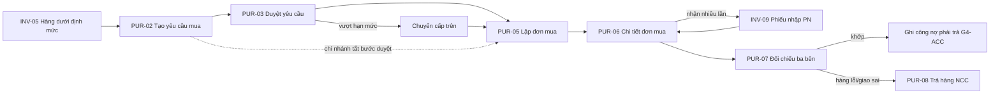
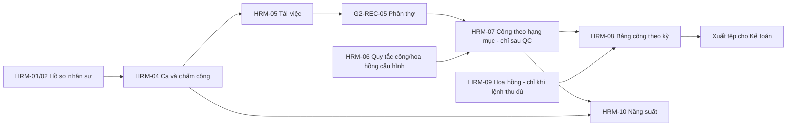

# UI/UX – Gói G3: Kho, Mua hàng, Nhân sự (INV · PUR · HRM)

Phiên bản 0.2 · 30/10/2026 · Người lập: Designer · Trạng thái: đã xử lý review BA (31 finding F4-01…F4-31, xem mục 13) và 20 câu trả lời `ba-answers-04.md`. Các mục 3, 4, 10, 11 bên dưới là bản 0.1; nơi nào mâu thuẫn thì mục 12–15 thắng. Nguồn chuẩn: `docs/design-system.md`, `docs/ui-ux/00-foundation.md`, `docs/ui-ux/ba-decisions.md`, `docs/ui-ux/screen-inventory.md` §4–§7, FRD, Journey.

Prototype: `design/g3-inventory-hr/` (mở `index.html`; HTML/CSS thuần chạy bằng `file://`, không sửa `design/assets/*`; style bổ sung nằm ở `pack.css`, tiền tố class `g3-`).

---

## 1. Phạm vi và kế hoạch

Gói G3 gồm 39 màn hình: Kho phụ tùng INV (19), Mua hàng PUR (10), Nhân sự và công thợ HRM (10). Đã thiết kế đủ 39/39 màn hình; hộp thoại, drawer và trạng thái đặc thù gộp trong file màn hình cha (mục 3).

Nguyên tắc xuyên suốt của gói:

1. **Bốn con số tồn** luôn đi cùng nhau và cùng thứ tự: Thực tế · Giữ chỗ · Đang vận chuyển · Khả dụng. Khả dụng = Thực tế − Giữ chỗ; hàng đang vận chuyển không cộng vào Khả dụng; cảnh báo và chặn xuất tính trên Khả dụng (RULE-008). Con số được tính bằng một hàm duy nhất trong `pack.js` (`expandStock`, `data-g3-stock4`) nên không thể lệch giữa các màn hình.
2. **Không có màn hình sửa tồn trực tiếp.** Mọi biến động tồn qua chứng từ (RULE-009): danh mục không có ô số lượng; thẻ kho chỉ đọc; điều chỉnh đi qua kiểm kê và phiếu điều chỉnh có duyệt.
3. **Không có nút “Xóa” trên chứng từ đã ghi sổ.** Dùng: hoàn kho, trả hàng NCC, phiên bản đơn mới, đảo công, bút toán điều chỉnh, đóng đơn có lý do (RULE-010).
4. **Quy tắc có thể đổi là cấu hình, không hard-code:** công thức công/hoa hồng (G3-HRM-06), giá vốn (hiện “phương pháp theo cấu hình”), hạn mức duyệt (mọi số hạn mức hiện là “giá trị mẫu”, lấy từ G4-APR-03), ngưỡng lệch nhận hàng, bước yêu cầu/duyệt mua hàng (bật/tắt theo chi nhánh), chính sách ưu tiên lấy hàng từ chi nhánh dư, ngưỡng rảnh/quá tải của thợ, thời hạn khóa kỳ công.
5. **Phạm vi chi nhánh và thời điểm dữ liệu** luôn hiện trong thanh phạm vi (RULE-015); mọi KPI có dòng phạm vi riêng.

## 2. Kết quả theo giai đoạn

| Giai đoạn | Nội dung | Kết quả |
| --- | --- | --- |
| 1. Rà danh mục, kế hoạch | Mục 1 | Xong |
| 2. Ưu tiên P1 / luồng chính | INV-01…10, INV-19 + `pack.css`, `pack.js` | Xong |
| 3. Còn lại | INV-11…18, PUR-01…10, HRM-01…10 | Xong |
| 4. Hoàn thiện | `index.html`, tài liệu, tự review | Xong (còn các điểm yếu ở mục 9) |

## 3. Bảng màn hình

Cột “Trạng thái xem thử” là các nút trong thanh “Xem thử trạng thái” (ngoài ra mọi màn hình có nút “Mất kết nối” bật banner mất mạng và có thể mở `?state=<khóa>`, `?role=<mã vai trò>`). TT = loading, empty, filtered, error, denied (khóa mặc định). Trạng thái “không có quyền” cũng tự hiện khi đổi sang vai trò không được mở màn hình.

| Mã | Tên | File | Mẫu | Thiết bị | Vai trò (mở được) | Ưu tiên | Trạng thái xem thử và khối trong file |
| --- | --- | --- | --- | --- | --- | --- | --- |
| G3-INV-01 | Danh mục phụ tùng | `g3-inv-01.html` | C | D, M | TK (S); CH, QV, QL, KT (X) | P1 | TT-L đủ; dialog quét mã vạch (camera) |
| G3-INV-02 | Tạo / sửa phụ tùng | `g3-inv-02.html` | E | D | TK (S); khác chỉ đọc | P1 | Biểu mẫu, loading, error, denied; mô phỏng mã trùng, tên trùng nghĩa, xung đột phiên bản, đã lưu nháp, đang lưu; chỉ đọc |
| G3-INV-03 | Chi tiết phụ tùng và thẻ kho | `g3-inv-03.html` | D | D, T | TK, QL, CH, QV, KT | P1 | Có dữ liệu, loading, 404, error, denied; 5 tab; giá vốn che theo vai trò |
| G3-INV-04 | Tồn kho – bốn con số | `g3-inv-04.html` | C | D, M | TK, QL (S); CH, QV, KT (X) | P1 | TT-L đủ; số tạm vs chính thức; 4 KPI |
| G3-INV-05 | Hàng dưới định mức và gợi ý đặt hàng | `g3-inv-05.html` | C | D, M | TK, QL, CH, QV | P1 / P2 | TT-L đủ; chính sách “lấy từ chi nhánh dư” là cấu hình |
| G3-INV-06 | Yêu cầu cấp phụ tùng | `g3-inv-06.html` | C (thẻ) | D, T | TK; QL, CH, QV | P1 | TT-L đủ; thẻ đủ hàng / thiếu hàng; dialog báo thiếu hàng |
| G3-INV-07 | Phiếu xuất kho (PX) | `g3-inv-07.html` | D/E | D, T | TK; QL duyệt xuất bất thường | P1 | Soạn phiếu, Đã ghi sổ, loading, error, denied; mô phỏng thiếu chứng từ gốc, vượt Khả dụng, đang ghi; dialog xác nhận, quét mã, xem trước in A5 |
| G3-INV-08 | Danh sách chứng từ kho | `g3-inv-08.html` | C | D | TK, QL; CH, QV, KT (X) | P1 | TT-L đủ |
| G3-INV-09 | Phiếu nhập kho (PN) | `g3-inv-09.html` | E | D, T | TK; QL duyệt khi lệch | P1 | Soạn phiếu, loading, error, denied; lệch giá, nhận một phần, nhập không có đơn mua; quét mã; dialog gửi duyệt; xem trước in A4 |
| G3-INV-10 | Hoàn kho / khách trả phụ tùng | `g3-inv-10.html` | E | D, T | TK; QL duyệt | P1 / P2+ | Soạn phiếu, loading, error, denied; cảnh báo hóa đơn điều chỉnh; dialog xác nhận có lý do |
| G3-INV-11 | Xuất dùng nội bộ, vật tư tiêu hao | `g3-inv-11.html` | E | D | TK; QL duyệt | P2+ | Soạn phiếu + cảnh báo vượt hạn mức |
| G3-INV-12 | Danh sách phiếu chuyển kho | `g3-inv-12.html` | C | D, T | TK, QL; CH, QV duyệt | P2 | TT-L đủ; tab Gửi đi / Cần nhận |
| G3-INV-13 | Tạo / gửi phiếu chuyển kho | `g3-inv-13.html` | E | D, T | TK, QL | P2 | Soạn phiếu, loading, error, denied; chờ duyệt giá trị lớn |
| G3-INV-14 | Nhận hàng chuyển kho và biên bản chênh lệch | `g3-inv-14.html` | D/E | D, T | TK bên nhận; QL duyệt | P2 | Đang nhận, Đã nhận đủ, loading, 404, error, denied; quét mã, tải ảnh |
| G3-INV-15 | Danh sách đợt kiểm kê | `g3-inv-15.html` | C | D | QL (D), TK (S); CH, QV, KT (X) | P2 | TT-L đủ; dialog tạo đợt |
| G3-INV-16 | Thực hiện kiểm kê (quét mã) | `g3-inv-16.html` | E | M, T | TK, QL | P2 | Đang đếm, Đã nộp số đếm, loading, error, denied; camera bị chặn; mã lạ; bản nháp trên thiết bị; dialog chốt đếm |
| G3-INV-17 | Duyệt chênh lệch kiểm kê (ADJ) | `g3-inv-17.html` | D | D | QL; CH, QV khi vượt ngưỡng; TK giải trình | P2 | Chờ duyệt, Đã duyệt, loading, 404, error, denied; quá hạn duyệt; hai dialog duyệt / từ chối |
| G3-INV-18 | Bán lẻ phụ tùng tại quầy | `g3-inv-18.html` | E | D | CV, TK, TN, QL, CH | P2+ | Soạn phiếu, loading, error, denied; giảm giá vượt hạn mức; dialog gửi duyệt |
| G3-INV-19 | Bảng giá phụ tùng | `g3-inv-19.html` | C + E | D | TK (S), CH (D); QV, QL, KT (X) | P1 | TT-L đủ; drawer phiên bản giá, drawer lịch sử, dialog đổi giá hàng loạt |
| G3-PUR-01 | Danh sách yêu cầu mua | `g3-pur-01.html` | C | D | TK (MH), QL; CH, QV, KT (X) | P2 | TT-L đủ |
| G3-PUR-02 | Tạo yêu cầu mua | `g3-pur-02.html` | E | D, T | TK, QL | P2 | Soạn yêu cầu, loading, error, denied; mô phỏng tắt bước duyệt, mua gấp |
| G3-PUR-03 | Chi tiết và phê duyệt yêu cầu mua | `g3-pur-03.html` | D | D, M | QL; CH, QV theo hạn mức | P2 | Chờ duyệt, Đã duyệt, Đã chuyển cấp trên, loading, 404, error, denied; dialog duyệt chuyển cấp, từ chối |
| G3-PUR-04 | Danh sách đơn mua | `g3-pur-04.html` | C | D | TK, QL; CH, QV, KT (X) | P2 | TT-L đủ |
| G3-PUR-05 | Lập / điều chỉnh đơn mua | `g3-pur-05.html` | E | D | TK, QL | P2 | Soạn đơn, Điều chỉnh đơn đã gửi (phiên bản mới), loading, error, denied; sửa giá khác bảng giá NCC |
| G3-PUR-06 | Chi tiết đơn mua | `g3-pur-06.html` | D | D | TK, QL; CH, QV, KT (X) | P2 | Có dữ liệu, loading, 404, error, denied; NCC giao thiếu; dialog đóng đơn |
| G3-PUR-07 | Hóa đơn NCC và đối chiếu ba bên | `g3-pur-07.html` | D | D | KT; TK, QL, CH, QV (X) | P2 | TT-L đủ; chặn ghi công nợ khi lệch; dialog ghi nhận chênh lệch |
| G3-PUR-08 | Phiếu trả hàng cho NCC | `g3-pur-08.html` | E | D | TK; QL duyệt | P2 | Soạn phiếu, loading, error, denied; mô phỏng trả hàng đã xuất (chặn); dialog gửi duyệt |
| G3-PUR-09 | Danh sách nhà cung cấp | `g3-pur-09.html` | C | D | TK, QL; KT (X) | P2 | TT-L đủ; che SĐT liên hệ |
| G3-PUR-10 | Chi tiết / sửa nhà cung cấp | `g3-pur-10.html` | D/E | D | TK, QL; KT (X) | P2 (đánh giá P2+) | Có dữ liệu, loading, 404, error, denied; 4 tab |
| G3-HRM-01 | Danh sách nhân sự | `g3-hrm-01.html` | C | D | QL (S); CH, QV, KT (X) | P2 | TT-L đủ; che SĐT |
| G3-HRM-02 | Hồ sơ nhân sự | `g3-hrm-02.html` | D/E | D | QL (S); CH (X) | P2 | Có dữ liệu, loading, 404, error, denied; che SĐT, căn cước, địa chỉ; dialog ghi ngày nghỉ |
| G3-HRM-03 | Điều chuyển nhân sự | `g3-hrm-03.html` | E (Dlg) | D | QL, CH | P2 | Hộp thoại tự mở (thêm `?open=0` để tắt); điều chuyển khác vùng chờ CH duyệt |
| G3-HRM-04 | Ca làm việc và chấm công | `g3-hrm-04.html` | K/C | D, T | QL (S); TH (Xn) | P2 | Có dữ liệu, Kỳ đã khóa, loading, empty, error, denied; dialog sửa giờ; nút Vào ca / Ra ca cho thợ |
| G3-HRM-05 | Lịch làm việc và tải việc thợ | `g3-hrm-05.html` | K | D, T | QĐ, QL; CV (X) | P2 | TT-L đủ; cảnh báo quá tải |
| G3-HRM-06 | Quy tắc tính công và hoa hồng | `g3-hrm-06.html` | S | D | CH (D); QL (S trong quyền); KT (X) | P2 | Có dữ liệu, loading, error, denied; bảng thử tính; dialog lưu phiên bản có ngày hiệu lực |
| G3-HRM-07 | Công thợ theo lệnh và hạng mục | `g3-hrm-07.html` | C | D, T | QL; CH, QV, KT (X); TH, CV (Xn) | P2 | TT-L đủ; dialog điều chỉnh công |
| G3-HRM-08 | Bảng công theo kỳ | `g3-hrm-08.html` | C/D | D | QL (D); KT, CH, QV (X) | P2 | Kỳ đang mở, Kỳ đã khóa, loading, empty, error, denied; dialog khóa kỳ, mở lại kỳ, xuất tệp |
| G3-HRM-09 | Hoa hồng cố vấn và thợ | `g3-hrm-09.html` | C | D | QL (D); CV, TH (Xn); KT, CH, QV (X) | P2 | TT-L đủ; “Chưa ghi nhận” khi lệnh chưa thu đủ |
| G3-HRM-10 | Năng suất kỹ thuật viên | `g3-hrm-10.html` | B/C | D, T | QL, QĐ; CH, QV, KT (X); TH (Xn) | P2 | TT-L đủ; bảng + thanh; so sánh chi nhánh |

Số màn hình đã thiết kế: 39/39.

**Cập nhật bản 0.2 cho bảng trên (thắng nếu mâu thuẫn):**
- Vai trò: nhân viên mua hàng (MH) mở và thao tác PUR-01…10 (lập yêu cầu, lập đơn, cập nhật bảng giá NCC; không nhận hàng), xem INV-01, 04, 05, 19 (INV-04/05 chỉ Khả dụng và Đang vận chuyển, không Thực tế/Giữ chỗ/giá vốn); nhân sự (NS) mở HRM-01…10 (sửa: 01, 02, 03, 04, chuẩn bị 08; xem: 05, 06, 07, 09, 10). Cố vấn (CV) xem INV-01 và INV-19 ở chế độ chỉ đọc (chỉ Khả dụng, giá niêm yết), không mở INV-04; CV không còn trong HRM-07 (xem hoa hồng ở HRM-09).
- Trạng thái xem thử: thêm “Không tìm thấy” (404) cho INV-07, 09, 10, 11, 13, 16, 18, PUR-02, 05, 08; PUR-03 có Chờ duyệt vượt hạn mức QL / trong hạn mức / cấp Chủ garage-QV / Đã duyệt; HRM-08 và HRM-04 có kỳ đã khóa hiện bảng chỉ đọc.
- Khối mới: INV-03 tab “Chi nhánh khác” chỉ Khả dụng và Số có thể cho; INV-09 chứng từ gốc chọn đơn mua hoặc yêu cầu Mua gấp (YM); INV-18 xem trước phiếu nhiệt 80 mm; PUR-07 chọn tập phiếu nhập; PUR-10 đơn vị đặt và SL tối thiểu NCC; HRM-06 đơn giá giờ công, hoa hồng cố vấn có phiên bản.
- `design/assets/app.js` đã được designer foundation vá thêm MH/NS (không do gói này sửa); `pack.js` vẫn giữ tên vai trò và quyền theo màn.

## 4. Bộ badge cho các đối tượng mới của gói (đã thay bằng Phụ lục A của `ba-answers-04.md`)

Bảng dưới là đề xuất bản 0.1; prototype đã áp dụng Phụ lục A (khác biệt chính: loại biến động trong thẻ kho là tag Neutral chứ không phải badge; “Đã nhận” của phiếu chuyển không kèm tag “Đã đóng”; “Nhận một phần” luôn Warning; “Đã đếm” của kiểm kê là Info; giá và ngày nằm ngoài badge; “Chờ duyệt” luôn Warning; “Đã đặt N” là tag Neutral ngoài bốn số). Trước đó bảng A.2 của `ba-decisions.md` chưa có các đối tượng này. Mỗi đối tượng có bộ trạng thái riêng, không dùng chung. Màu theo quy tắc: xanh lá chỉ cho thành công; vàng cho cần chú ý; đỏ cho lỗi; xanh dương cho đang xử lý/đang vận chuyển; tím chỉ “Chờ QC”.

| Đối tượng | Trạng thái → màu |
| --- | --- |
| Tồn kho (đã chốt, A.2) | Đủ hàng success · Sắp hết warning · Hết hàng danger · Chưa đặt định mức neutral · tag “Đang về N” info |
| Chứng từ kho (PN, PX, DC, TR) | Nháp neutral · Chờ duyệt warning (+ tag lý do: Lệch giá, Có chênh lệch) · Đã ghi sổ success · Từ chối danger |
| Yêu cầu mua | Nháp neutral · Chờ duyệt warning · Đã duyệt success · Từ chối danger · Đã lập đơn info |
| Đơn mua | Nháp neutral · Đã gửi info · NCC xác nhận info · Nhận một phần warning · Nhận đủ success · (Đã đóng neutral) |
| Phiếu chuyển kho | Nháp neutral · Chờ duyệt warning · Đang vận chuyển info · Có chênh lệch danger · Đã nhận success + tag “Đã đóng” |
| Đợt kiểm kê | Đang đếm info · Chờ duyệt warning · Đã ghi sổ success · Từ chối danger |
| Đối chiếu ba bên | Khớp success · Lệch giá/lệch số lượng danger · Chờ hóa đơn warning |
| Công thợ (hạng mục) | Đã ghi success · Chờ QC purple (đúng bộ Lệnh/Hạng mục) · QC trả lại danger · Đã đảo neutral |
| Hoa hồng | Chưa ghi nhận neutral · Chờ duyệt warning · Đã duyệt success; thanh toán lệnh dùng đúng badge Thanh toán của A.2 |
| Kỳ công | Đang mở → Đã duyệt → Đã khóa (stepper); khóa hiện alert + icon khóa |
| Nhân sự | Đang làm success · Nghỉ phép warning · Đã nghỉ neutral · tag “Đã liên kết / Chưa liên kết / Đã khóa” tài khoản |
| Chấm công | Đang trong ca success · Chưa vào ca neutral · Đi muộn N phút warning |
| Nhà cung cấp | Đang hợp tác success · Tạm ngừng neutral |

## 5. UI/UX flow

### 5.1 Luồng chính nối với gói khác

1. **Giữ chỗ khi duyệt báo giá** (từ G2-QUO-03/G2-REC-04) → số “Giữ chỗ” của G3-INV-04/INV-03 tăng, Khả dụng giảm.
2. **Cấp phụ tùng cho lệnh:** thợ yêu cầu (G2-TEC-03) → G3-INV-06 hàng chờ xuất → [đủ] G3-INV-07 xác nhận xuất (giữ chỗ chuyển thành xuất, ghi giá vốn) → thợ nhận. [Thiếu] dialog “Báo thiếu hàng” (lệnh Tạm dừng, lý do Chờ phụ tùng) → chọn tiếp: G3-INV-13 chuyển kho hoặc G3-PUR-02 yêu cầu mua.
3. **Cảnh báo dưới định mức:** G3-INV-04 / thông báo → G3-INV-05 (xem chi nhánh dư trước) → G3-INV-13 hoặc G3-PUR-02.
4. **Hủy lệnh sau khi xuất:** G2-REC-06 → G3-INV-10 hoàn kho (cảnh báo hóa đơn điều chỉnh nếu đã xuất hóa đơn) → duyệt → đảo công (G3-HRM-07).

### 5.2 Mua hàng

Bước 1–2 có thể tắt theo cấu hình chi nhánh (nút “Lập đơn mua” thay “Gửi duyệt”).

### 5.3 Chuyển kho, kiểm kê

- Chuyển kho: INV-05/INV-04 → INV-13 (soạn, giá trị lớn gửi duyệt G4-APR-02) → hàng “Đang vận chuyển” (chưa tính vào Khả dụng cả hai bên) → INV-14 bên nhận so số gửi và số nhận → [đủ] đóng phiếu; [lệch] biên bản, QL xử lý → INV-12 theo dõi.
- Kiểm kê: INV-15 tạo đợt (chụp tồn sổ sách) → INV-16 đếm bằng camera/nhập tay (nháp giữ trên thiết bị khi mất mạng) → chốt đếm (không sửa lại) → INV-17 QL duyệt (hoặc chuyển cấp trên khi vượt ngưỡng) → phiếu điều chỉnh DC ghi sổ → INV-08, INV-03 (thẻ kho).

### 5.4 Nhân sự và công

Điều hướng trong phân hệ: thanh tab dưới tiêu đề (tự lọc theo vai trò) và breadcrumb có cha. Menu trái có đúng 3 mục của gói: Kho phụ tùng, Mua hàng, Nhân sự và Công thợ (theo vai trò ở foundation §7).

## 6. Mô tả theo nhóm màn hình

### 6.1 Danh mục, tồn kho, giá (INV-01…05, 19)

- **Mục đích:** tra cứu phụ tùng, thấy tồn bốn số để quyết định xuất, chuyển hay mua; quản lý giá niêm yết có phiên bản.
- **Bố cục (template C):** page header, thanh phạm vi, thanh lọc (tìm không dấu theo mã/tên/mã vạch/dòng xe), chip bộ lọc đang áp dụng, bảng (cột thao tác, chọn dòng, sticky header, sắp xếp mặc định Khả dụng tăng dần ở INV-04), phân trang. Mobile: bảng chuyển thành thẻ (`data-g3-cards`).
- **Component:** `stock4` (INV-03, INV-06), badge tồn + tag “Đang về N”, KPI card có dòng phạm vi, tab, drawer (phiên bản giá, lịch sử), dialog nguy hiểm.
- **Hành động:** chính “Thêm phụ tùng”, “Tạo phiếu chuyển”; phụ lọc, xuất; nguy hiểm “Đổi giá hàng loạt” (xem trước, lý do, Chủ garage duyệt). Không có “Sửa tồn”: ở INV-03 là chú thích dẫn tới kiểm kê.
- **Vai trò:** TK sửa danh mục; giá vốn chỉ CH, QV, QL, KT (còn lại hiện `•••••` có tooltip lý do); nút không đủ quyền bị khóa kèm lý do; Thủ Đức chỉ hiện cho CH, QV.
- **Responsive:** thẻ trên mobile; stock4 2×2 dưới 480px; thao tác kéo dài (bulk) dùng thanh chọn dòng.

### 6.2 Chứng từ kho (INV-06…11, 18)

- **Mục đích:** xuất, nhập, hoàn kho, xuất nội bộ, bán lẻ, luôn có chứng từ gốc.
- **Bố cục (template E/D):** form chia nhóm (form-section), bảng dòng hàng có `qty` (stepper) và cột Khả dụng/giữ chỗ/lô, cột phải “Tóm tắt lệnh gốc” và nút xác nhận (sticky). Tablet: nút 52px (`g3-tablet-xl`).
- **Hành động nguy hiểm:** “Xác nhận xuất kho” (nêu hậu quả: giữ chỗ chuyển thành xuất thực, không sửa sau ghi sổ); xuất vượt Khả dụng bị chặn (ngoại lệ cần cấu hình + duyệt); nhập lệch giá/số lượng vượt ngưỡng chờ QL; hoàn kho của lệnh đã có hóa đơn kèm nhắc hóa đơn điều chỉnh; giảm giá bán lẻ vượt hạn mức.
- **Trạng thái đặc thù:** thiếu chứng từ gốc (lỗi trường), đang ghi (nút loading, chống bấm lặp), chỉ đọc, đã ghi sổ.
- **In:** xem trước mẫu PX khổ A5 (INV-07) và PN khổ A4 (INV-09) trong dialog; `@media print` trong `pack.css` ẩn khung ứng dụng. Phiếu thermal chưa làm (xem 9).

### 6.3 Chuyển kho và kiểm kê (INV-12…17)

- **Mục đích:** di chuyển hàng giữa chi nhánh có kiểm soát đang vận chuyển; kiểm kê và điều chỉnh có duyệt.
- **Điểm nhấn UX:** INV-14 chặn nút “Xác nhận nhận đủ” khi có chênh lệch và nói lý do, thay bằng biên bản chênh lệch (ghi chú bắt buộc + ảnh bằng upload có sẵn). INV-16 dùng khung quét camera (giả lập), nhập tay làm phương án thay thế, báo “mã không có trong danh mục”, camera bị chặn có hướng dẫn, nháp số đếm lưu trên thiết bị; số sổ sách ẩn khi đếm. INV-17 hiện giải trình, cờ lệch lặp lại, cấp duyệt so với hạn mức mẫu, cảnh báo quá hạn duyệt.
- **Responsive:** INV-16 ưu tiên điện thoại/tablet, touch target ≥ 44px, nút chính 52px.

### 6.4 Mua hàng (PUR)

- **Mục đích:** yêu cầu → duyệt → đơn mua (phiên bản) → nhận nhiều lần → hóa đơn NCC → trả hàng.
- **Điểm nhấn UX:** stepper quy trình; đơn nhận một phần vẫn mở và hiện “Còn lại”; sửa đơn đã gửi tạo phiên bản mới (không ghi đè); đối chiếu ba bên đặt ba cột cạnh nhau, tô giá trị lệch và chặn ghi công nợ cho tới khi xử lý; trả hàng đã xuất bị chặn kèm giải thích; PUR-03 dùng được trên mobile cho QL/CH (đơn giản, nút lớn).
- **Hạn mức:** UI không chứa số hạn mức thật; hiện “Giá trị so với hạn mức cùng cấp” với thẻ “giá trị mẫu”.

### 6.5 Nhân sự và công (HRM)

- **Mục đích:** cung cấp giờ công và hoa hồng, không tính lương/BHXH/thuế.
- **HRM-06 (cấu hình công thức):** phương pháp theo loại việc (giờ chuẩn, khoán, giờ thực được duyệt, tỷ lệ %, cố định cộng thưởng), tham số, ghi đè theo chi nhánh trong quyền được cấp (ngoài quyền bị khóa kèm lý do), phiên bản với ngày hiệu lực, bảng “Thử tính” nhận ví dụ của khách (ví dụ thay dầu 0,3 giờ chuẩn) và hiện công thức đang áp dụng. Tất cả số trong bảng là mẫu; cảnh báo ở đầu trang nói rõ công thức chưa được khách chốt.
- **HRM-04/05:** lịch ca và heat-map tải việc là bảng có chữ, không chỉ màu (ví dụ “113% · Quá tải”); ngưỡng là cấu hình. Thợ (TH) chỉ thấy dòng của mình và có nút Vào ca/Ra ca lớn.
- **HRM-07/08/09:** công chỉ phát sinh sau QC; đổi thợ/làm lại/hủy là dòng đảo, không xóa; khóa kỳ cần gõ “KHOA”, mở lại kỳ cần CH duyệt và lý do; hoa hồng “Chưa ghi nhận” khi lệnh chưa thu đủ, số dự kiến hiện mờ.
- **HRM-10:** ba chỉ số kèm công thức cạnh tên, bảng + thanh (bảng là bản thay thế của biểu đồ), so sánh chi nhánh cho CH, QV, KT.
- **Dữ liệu cá nhân:** SĐT, căn cước, địa chỉ nhân sự và SĐT liên hệ NCC che theo vai trò, nút Hiện ghi nhật ký, tự che sau 30 giây (`data-g3-pii`, giá trị đầy đủ không nằm trong HTML).

## 7. Ánh xạ FR / RULE

| Nhóm | FR / RULE được phủ |
| --- | --- |
| INV-01, 02 | FR-INV-001, 002, 013, 024; BR-INV-01 |
| INV-03, 04 | FR-INV-003, 013, 020, 021, 027; FR-RPT-005; RULE-008, 009; FR-INV-019 (chặn tồn âm) |
| INV-05 | FR-INV-013, 014; FR-PUR-001; BR-INV-07 |
| INV-06, 07 | FR-INV-006, 007, 019, 020, 021; RULE-007, 008, 009; UAT-02 |
| INV-08 | FR-INV-021; RULE-009 |
| INV-09 | FR-INV-005, 003; FR-PUR-005; BR-INV-03 |
| INV-10 | FR-INV-008, 022; BR-INV-04, 12; RULE-010 |
| INV-11 | FR-INV-017, 023; BR-INV-09 |
| INV-12–14 | FR-INV-010, 026; BR-INV-05, 14; UAT-04 |
| INV-15–17 | FR-INV-011, 012, 021; FR-SYS-004; UAT-05 |
| INV-18 | FR-INV-018, 028; BR-INV-15 |
| INV-19 | FR-INV-025, 027; FR-SYS-006; BR-INV-13; UAT-22 |
| PUR-01–03 | FR-PUR-001, 002; FR-SYS-004, 015; RULE-011 |
| PUR-04–06 | FR-PUR-003, 004, 005; FR-INV-004, 015; UAT-16 |
| PUR-07 | FR-PUR-006; FR-ACC-007; UAT-16 |
| PUR-08 | FR-PUR-007; FR-INV-021 |
| PUR-09, 10 | FR-INV-015; FR-PUR-008 |
| HRM-01–03 | FR-HRM-001, 002, 012, 013; NFR-SEC-03 |
| HRM-04, 05 | FR-HRM-003, 014; FR-REC-012 |
| HRM-06 | FR-HRM-004, 006, 015; NFR-MNT-01; UAT-11 |
| HRM-07 | FR-HRM-005, 007, 008, 016 |
| HRM-08, 09 | FR-HRM-009, 010; BR-HRM-04 |
| HRM-10 | FR-HRM-011, 016; FR-RPT-006 |
| Toàn gói | RULE-007, 008, 009, 010, 011, 015; FR-SYS-003 (nhật ký), NFR-OFF-01 (nháp khi mất mạng), NFR-ISO-01 |

## 8. Accessibility và kiểm tra tự đánh giá

Chưa chạy trên trình duyệt thật (không có trình duyệt); rà bằng đọc mã, đối chiếu tên class với `components.css`, id/đường dẫn tương đối.

| Hạng mục | Tự đánh giá |
| --- | --- |
| Tương phản | Dùng token và cặp màu đã kiểm ở foundation; chữ trạng thái dùng `--color-*-text`; thanh `g3-bar` luôn kèm con số |
| Không chỉ dựa vào màu | Badge luôn có chữ; chênh lệch có dấu/chữ (“−1 (thiếu)”, “Quá tải”); ô lịch/heat-map có chữ |
| Bàn phím | Dùng dialog/drawer/dropdown/tab của `app.js` (focus trap, Esc, trả focus); nút khóa là `aria-disabled` + `aria-describedby` lý do; liên kết bị khóa vẫn focus được để đọc lý do |
| Label | Mọi field có label (hoặc `aria-label` cho ô trong bảng); dấu `*` kèm giải thích |
| Touch target | Control ≥ 44px khi cảm ứng/dưới 1024px (do `components.css`); tablet INV-06/16, HRM-04 nút 52px (`g3-tablet-xl`) |
| Trạng thái | Loading (skeleton), empty lần đầu, empty do lọc, lỗi + thử lại, không tìm thấy (404), không có quyền, mất mạng và nháp |
| Live region | Kết quả quét mã (`role=status`), kết quả thử tính (`aria-live`), toast |
| Reduced motion | Vạch quét camera tắt hoạt ảnh khi `prefers-reduced-motion` |
| Chưa kiểm | Screen reader thật; thiết bị cảm ứng thật; camera thật (quét là giả lập, không gọi `getUserMedia`); in thật; dark mode (không thuộc phạm vi) |

## 9. Điểm yếu tự đánh giá

1. Shell, breadcrumb, tab phân hệ và bottom nav của gói được dựng bằng `document.write` trong `pack.js` để tránh lặp ~100 dòng mỗi file; chỉ là tiện ích prototype (production dùng shell thật). Không có JS thì trang trống.
2. Quét mã vạch là mô phỏng (không dùng camera thật); mẫu in chỉ có A5 (PX) và A4 (PN), chưa có nhiệt 80 mm cho gói này (gói này không có phiếu thu/bán lẻ in nhiệt; INV-18 chưa có mẫu in) và `@media print` mới ở mức cơ bản.
3. Bảng → thẻ trên mobile do JS sinh từ `<th data-card>`; toolbar/phân trang bên trong khung bảng ẩn trên mobile, thanh lọc và chip vẫn hiện.
4. Chưa có kiểm thử trực quan; có thể còn lệch nhỏ về khoảng cách ở các cột phải của trang chi tiết (`g3-split`).
5. Dữ liệu mẫu nhất quán trong gói nhưng không đồng bộ chi tiết với gói G2/G4 (ví dụ lệnh RO-Q7-2610-0012x chỉ dùng trong G3).
6. Một số chứng từ dùng tiền tố mã tạm (YM yêu cầu mua, DC điều chỉnh tồn, TR trả hàng NCC), chờ BA.
7. Danh sách đánh giá NCC, kỹ năng nhân sự (Could) chỉ là bản phác.

## 10. Giả định ban đầu bản 0.1 (đã được BA trả lời, xem mục 12)

| Mã | Giả định | Ảnh hưởng |
| --- | --- | --- |
| A-01 | Vai trò xem giá vốn: CH, QV, QL, KT. TK không xem giá vốn bình quân nhưng xem giá đơn/giá nhập khi nhận hàng (PN) để đối chiếu | Cờ `COST_ROLES` trong `pack.js`; INV-01/03/04/08, PUR |
| A-02 | MH (nhân viên mua hàng) và NS (nhân sự) không có trong 10 khóa vai trò của foundation, nên gộp: MH → TK, NS → QL | Nút/quyền ở PUR, HRM |
| A-03 | “Đang vận chuyển” gồm hàng đã gửi trong phiếu chuyển kho; hàng ở đơn mua đã NCC xác nhận nhưng chưa nhận chưa tính (xem câu hỏi BA 1) | Cột “Đang vận chuyển” ở INV-01/04/05 |
| A-04 | Số lượng đề xuất mặc định ở INV-05 = định mức tối đa − (Khả dụng + Đang về); “chi nhánh đang dư” = chi nhánh có Khả dụng trên mức tối thiểu của họ; chính sách là cấu hình | INV-05 |
| A-05 | Kiểm kê ẩn số sổ sách khi đếm (đếm mù) và sổ sách chụp tại thời điểm bắt đầu | INV-15/16/17 |
| A-06 | Khi kho đi khác chi nhánh của người dùng, phiếu chuyển là “Yêu cầu chuyển” gửi bên kho đi | INV-13 |
| A-07 | Ba chỉ số năng suất: Hiệu suất = giờ chuẩn ÷ giờ thực; Mức sử dụng = giờ thực ÷ giờ có mặt; Năng suất tổng = giờ chuẩn ÷ giờ có mặt | HRM-10 |
| A-08 | Giờ có mặt = giờ chấm công vào/ra ca; giờ thực = thời gian hạng mục “Đang làm” trừ tạm dừng | HRM-04/07/10 |
| A-09 | Hoa hồng thợ cũng chỉ ghi nhận khi lệnh thu đủ (FR-HRM-009 nêu cố vấn và thợ) | HRM-09 |
| A-10 | Kỳ công nửa tháng (1–15 và 16–cuối tháng); chu kỳ là cấu hình | HRM-08 |
| A-11 | Ngưỡng tải việc: Rảnh < 60%, Hợp lý 60–100%, Quá tải > 100%; giờ khả dụng một ngày 8 giờ; đều là cấu hình | HRM-05 |
| A-12 | Lý do bắt buộc tối thiểu 5 ký tự (theo foundation); gõ mã/từ khóa để mở nút ở thao tác nguy hiểm mức cao (kiểm kê chốt đếm, đóng đơn, khóa kỳ) | Dialog NH |
| A-13 | Che dữ liệu nhân sự: QL xem đầy đủ trong chi nhánh; CH, QV bấm Hiện (ghi nhật ký); KT chỉ thấy SĐT đã che; thợ xem hồ sơ của mình đầy đủ; vai trò khác không thấy | HRM-01/02, PUR-09/10 |
| A-14 | Thông báo trong hệ thống ở hai mức “Cần xử lý / Thông tin” (đã chốt D-07); ở gói này chỉ hiện ví dụ trong chuông | Shell |

## 11. Câu hỏi bản 0.1 (đã được BA trả lời trong `ba-answers-04.md`)

1. **Đang vận chuyển:** có gồm số đã đặt ở đơn mua đã NCC xác nhận nhưng chưa giao, hay chỉ hàng đã thực sự xuất đi (phiếu chuyển kho, NCC đã giao vận)? `ba-decisions` dùng “Đang về”, `screen-inventory` dùng “Đang vận chuyển”: thống nhất nhãn.
2. **Giá vốn và giá nhập:** vai trò nào xem giá vốn (A-01)? Thủ kho có xem giá nhập khi nhận hàng để đối chiếu đơn mua không?
3. **Trạng thái và màu** cho các đối tượng ở mục 4 (chứng từ kho, yêu cầu mua, đơn mua, phiếu chuyển, kiểm kê, công thợ, hoa hồng, kỳ công): xác nhận hoặc sửa để đưa vào bảng A.2.
4. **Tiền tố mã chứng từ:** yêu cầu mua, điều chỉnh tồn, trả hàng NCC, hoàn kho (PN hay mã riêng), phiếu xuất dùng nội bộ; phiếu chuyển kho đánh số theo chi nhánh gửi hay nhận (prototype dùng chi nhánh gửi).
5. **Vai trò MH và NS** (A-02): có tạo vai trò riêng hay cấu hình quyền cho vai trò hiện có?
6. **Cố vấn tra tồn:** foundation §7 không có menu Kho cho CV, nhưng INV-01 liệt kê CV (X) và INV-18 cần CV/TN bán lẻ. Đề xuất: không hiện menu Kho cho CV, tra tồn khi chọn phụ tùng lúc lập báo giá, bán lẻ vào từ menu Tài chính/Phiếu sửa chữa. Cần xác nhận lối vào.
7. **Công thức gợi ý đặt hàng** (A-04): số lượng đề xuất, định nghĩa “chi nhánh dư”, chính sách ưu tiên lấy từ chi nhánh dư.
8. **Mua gấp tại cửa hàng:** ghi nhận thế nào (yêu cầu có lý do + phiếu nhập không có đơn mua, hay luồng riêng)?
9. **Xuất vượt Khả dụng:** FR-INV-019 chặn tồn âm; có cho phép ngoại lệ có duyệt không? Prototype chỉ chặn và gợi ý chuyển kho/mua.
10. **Hạn mức và ngưỡng** cần G4-APR-03 định nghĩa: ngưỡng lệch số lượng/giá khi nhập, giá trị chuyển kho cần duyệt, hạn mức xuất nội bộ, hạn mức điều chỉnh tồn/công, hạn mức giảm giá bán lẻ, thời gian quá hạn duyệt và chuyển cấp.
11. **Chuyển kho:** bên nhận được tạo “yêu cầu chuyển” không (A-06)? Cách xử lý chênh lệch khi nhận thiếu/hỏng (chờ bù, ghi mất/hỏng, điều chỉnh với bên gửi): danh mục, ai chịu giá trị?
12. **Kiểm kê:** đếm mù (A-05) có phù hợp? Xử lý phát sinh nhập/xuất trong lúc đang đếm?
13. **Định nghĩa ba chỉ số năng suất** (A-07) và giờ có mặt (A-08): FRD chưa nêu công thức.
14. **Công thợ và hoa hồng:** đơn vị “công” (giờ công hay tiền), cách ghép phương pháp theo loại việc, hệ số theo chức danh, cơ sở tính hoa hồng cố vấn (doanh thu hay lợi nhuận gộp), hoa hồng thợ (A-09), ví dụ khách ký xác nhận (UAT-11).
15. **Khóa kỳ công:** chu kỳ kỳ (A-10), ai khóa, ai được mở lại.
16. **Dữ liệu nhân sự nhạy cảm** (A-13): ma trận che căn cước, địa chỉ, SĐT riêng cho nhân sự (khác khách hàng).
17. **Đánh giá nhà cung cấp** (Could): công thức và nguồn dữ liệu.
18. **Khách trả phụ tùng chưa lắp:** chính sách (thời hạn, phí, tình trạng hàng) và liên kết hoàn tiền G4-ACC-07.
19. **Hiển thị dư nợ NCC** ở danh bạ: vai trò nào được xem (prototype dùng nhóm xem giá vốn).
20. **Mẫu in:** gói này có cần mẫu in nhiệt (INV-18 bán lẻ) và mẫu PN/PX/CK/KK chính thức theo khổ nào? Hiện chỉ xem trước PX A5, PN A4.

## 12. Quyết định BA đã áp dụng vào prototype (bản 0.2)

| Chủ đề | Áp dụng |
| --- | --- |
| Đang vận chuyển (câu 1) | Chỉ hàng đã gửi theo phiếu chuyển kho (CK, kho tổng, chênh lệch treo). Hàng đặt NCC chưa giao là tag “Đã đặt N” và cột “Đã đặt – chờ giao” (INV-04/05, PUR-02), ngoài bốn số. Dữ liệu mẫu: PT-0002 Đang vận chuyển 4 (CK-TD-2610-00014) và Đã đặt 10 (DM-Q7-2610-00014); PT-0008 Đang vận chuyển 6 |
| Giá (câu 2, 19) | Hai cờ: `data-g3-cost` (giá vốn, giá trị tồn: CH QV QL KT) và `data-g3-buy` (giá đơn, giá nhập phiếu đang nhận, bảng giá NCC: thêm TK, MH). Dư nợ NCC ẩn cột với TK, MH |
| MH, NS (câu 5) | Vai trò riêng trong `ROLE_NAME` và registry quyền của `pack.js` (MH: PUR, INV-01/04/05/19 xem; NS: HRM). Menu/phạm vi do `design/assets/app.js` (đã vá) xử lý; `pack.js` có hàm dự phòng |
| CV (câu 6) | CV mở INV-01 và INV-19 chỉ đọc (chỉ Khả dụng, giá niêm yết, không giá vốn); không mở INV-04; tra tồn qua bộ chọn báo giá; INV-18 vào từ Tài chính |
| Gợi ý đặt hàng (câu 7) | Đề xuất = Tối đa − (Khả dụng + Đang vận chuyển + Đã đặt); “số có thể cho” = Khả dụng − tối thiểu của chi nhánh kia |
| Mua gấp (câu 8) | Yêu cầu mua có cờ “Mua gấp”, hậu duyệt trong thời hạn cấu hình; phiếu nhập lấy YM làm chứng từ gốc |
| Xuất kho (câu 9) | Xuất tối đa = giữ chỗ còn lại của chính lệnh + Khả dụng; hiện trên INV-06/07 |
| Hạn mức (câu 10) | Mọi hạn mức là giá trị mẫu, ghi “giá trị mẫu”; vẫn cấu hình G4-APR-03 |
| Chuyển kho (câu 11) | YK (yêu cầu chuyển) → CK mã chi nhánh gửi; biên bản chênh lệch có cách xử lý và “bên chịu giá trị” |
| Kiểm kê (câu 12) | Không đóng băng kho; mỗi dòng có thời điểm đếm; cột “Phát sinh trong lúc đếm” ở INV-17; ô chưa đếm để trống, không chốt khi còn mã chưa đếm; người đếm khác người duyệt |
| Năng suất (câu 13) | Ba công thức giữ nguyên, thêm định nghĩa giờ có mặt, giờ thực, giờ chuẩn bán ra |
| Công và hoa hồng (câu 14) | Tách: công ghi khi QC đạt (HRM-07, 08), hoa hồng ghi khi lệnh thu đủ (HRM-09). HRM-08 có hai cột tiền công và hoa hồng, khớp HRM-09 |
| Kỳ công (câu 15) | Chu kỳ cấu hình; khóa kỳ chỉ từ ngày kết thúc kỳ, chặn khi còn điều chỉnh chờ duyệt, không chặn vì hạng mục chờ QC |
| Dữ liệu nhân sự (câu 16) | Ma trận Phụ lục D trong `piiPolicy` |
| Mẫu in (câu 20) | PX A5, PN A4, BL nhiệt 80 mm xem trước; khi in chỉ in tờ phiếu |

## 13. Bảng Finding → đã xử lý ở đâu

| Finding | Mức | Xử lý | Ở đâu |
| --- | --- | --- | --- |
| F4-01 tab “Chi nhánh khác” lộ Thực tế/Giữ chỗ | Blocker | Chỉ hiện Khả dụng và Số có thể cho, kèm “tính đến”; bỏ dòng chi nhánh ngoài phạm vi; INV-05 chỉ nói “có thể cho N” | `g3-inv-03.html` tab 4; `g3-inv-05.html` |
| F4-02 thẻ mobile INV-04 thiếu 3 số | Blocker | `data-card="stock4"` vẽ lưới 4 số (Khả dụng nhấn mạnh) dùng chung `stock4HTML` | `pack.js` `cards()`; `g3-inv-04.html` |
| F4-03 Đang vận chuyển lẫn hàng đặt NCC | Major | Tách “Đang về” và “Đã đặt”; sửa dữ liệu INV-01/04/05/06/12/14, PUR-02, hộp thoại đóng đơn PUR-06; bỏ chữ “chờ BA” ở INV-05 | các file trên; `pack.js` `stockBadge` |
| F4-04 MH, NS | Major | Thêm vào `ROLE_NAME`, registry quyền, danh sách nhánh; sửa nhãn nút PUR, HRM; ghi chú app.js đã vá | `pack.js`; PUR-01/02/05/09/10, HRM-01/02/03/04/08 |
| F4-05 một cờ giá | Major | Tách `data-g3-buy`; INV-03 bảng giá NCC, INV-08 giá trị PN, PUR-10; INV-13 TK thấy “vượt hạn mức cấp bạn” không số giá vốn; PUR-09/10 ẩn dư nợ cho TK, MH | `pack.js`; các file đó |
| F4-06 CV INV-01/19 | Major | Thêm CV (chỉ Khả dụng, không giá vốn), thông báo chế độ chỉ xem; INV-04 không mở cho CV | `pack.js` registry; `g3-inv-01.html`, `g3-inv-19.html` |
| F4-07 giữ chỗ của chính lệnh | Major | Hiện “Giữ chỗ cho lệnh này”, xuất tối đa; sửa thẻ 2 và 3, “sau xuất” | `g3-inv-06.html`, `g3-inv-07.html` |
| F4-08 phát sinh lúc đếm | Major | Cột thời điểm đếm, cột “Phát sinh trong lúc đếm”, cảnh báo ở INV-13; sửa số PT-0001 | `g3-inv-16.html`, `g3-inv-17.html`, `g3-inv-13.html` |
| F4-09 dòng chưa đếm | Major | Ô trống “–”; chặn chốt, cần QL cho loại mã kèm lý do; đếm lại | `g3-inv-16.html` |
| F4-10 PUR-03 thiếu Duyệt | Major | Thêm trạng thái “trong hạn mức” và “cấp Chủ garage/QV” có nút Duyệt, Từ chối; không tự duyệt | `g3-pur-03.html` |
| F4-11 đối chiếu 1:1 | Major | Chọn tập PN, PN chưa ghi sổ chặn, dung sai, mở phiếu trả điền sẵn | `g3-pur-07.html` |
| F4-12 thẻ INV-05 thiếu cột | Major | Thêm mọi cột vào thẻ và nút “Tạo phiếu chuyển/yêu cầu mua” trên thẻ (`data-g3-card-actions`) | `g3-inv-05.html`, `pack.js` |
| F4-13 HRM-09 trộn công khoán | Major | Bỏ dòng khoán; ghi chú công vs hoa hồng; cột điều kiện ghi nhận ở HRM-06 | `g3-hrm-09.html`, `g3-hrm-06.html` |
| F4-14 số HRM-08 ≠ HRM-09 | Major | Hai cột tiền công và hoa hồng; hoa hồng 271.500 ₫ khớp; kỳ HRM-10 thống nhất | `g3-hrm-08/09/10.html` |
| F4-15 khóa kỳ sớm | Major | Nút duyệt/khóa bị khóa có lý do (`data-g3-block`); điều kiện khóa; trạng thái đã khóa hiện bảng chỉ đọc | `g3-hrm-08.html`, `pack.js` |
| F4-16 HRM-06 sửa v1 trực tiếp | Minor | v1 chỉ đọc, nút “Soạn nháp phiên bản mới”, ghi đè có hiệu lực riêng, cảnh báo xung đột ngày hiệu lực | `g3-hrm-06.html` |
| F4-17 PII | Minor | `piiPolicy` theo Phụ lục D, thêm NS; handoff ghi production không gửi giá trị đầy đủ | `pack.js`; mục 15 |
| F4-18 / F4-19 rủi ro thẻ JS và document.write | Minor | Bỏ `<a>` lồng, mang `data-g3-hide/roles` sang thẻ; thêm `<noscript>`; ghi rủi ro vào handoff | `pack.js`; 39 file `<noscript>`; mục 15 |
| F4-20 thiếu trạng thái | Minor | Thêm `notfound` cho INV-07/09/10/11/13/16/18, PUR-02/05/08; banner mất mạng theo phân hệ; Vào/Ra ca khóa khi mất mạng | `pack.js`; các file đó; `g3-hrm-04.html` |
| F4-21 nút khóa dùng disabled | Minor | `aria-disabled` + chặn click ở pha capture + toast lý do, giữ focus | `pack.js` |
| F4-22 badge | Minor | Tag Neutral cho loại biến động; “Nhận một phần” Warning; INV-19 tách badge và giá; bỏ tag “Đã đóng”; “Đã đếm” Info; thêm badge “Chờ xuất/Thiếu hàng” | INV-03/09/12/14/16/19, INV-06 |
| F4-23 dữ liệu mẫu | Minor | Sửa 25 phút, PN-00031, 11 mã khớp, Thủ Đức có thể cho, RO-126 “Đang sửa chữa”, kỳ công thống nhất | PUR-02/03/05, INV-17/06, HRM-04/10 |
| F4-24 in ấn | Minor | Chỉ in `.g3-paper` khi hộp thoại mở; thêm xem trước nhiệt 80 mm cho BL | `pack.css`; `g3-inv-18.html` |
| F4-25 mã PT trùng tiền tố | Minor | Chỉ ghi chú ở INV-01 (chưa đổi mã mẫu, xem mục 14) | `g3-inv-01.html` |
| F4-26 CSS | Minor | `.g3-cell--off` đổi màu, giới hạn `.g3-subnav .tab`, `.cell-sub` trong matrix, tag “Dữ liệu tồn lệch”, bottom nav có Nhân sự | `pack.css`, `pack.js` |
| F4-27 HRM-10 | Minor | Thay câu “khớp bảng công”, thêm định nghĩa đầu vào và chú giải ngưỡng | `g3-hrm-10.html` |
| F4-28 INV-10, INV-09 | Minor | Nút “Gửi duyệt hoàn kho”; cột Chất lượng ở PN | `g3-inv-10.html`, `g3-inv-09.html` |
| F4-29 BS-2, HRM-07 CV | Minor | Ghi “sự kiện hệ thống”; bỏ CV khỏi HRM-07 | `g3-inv-06.html`, `pack.js` |
| F4-30 tài liệu | Minor | Cập nhật tài liệu này (mục 12–15) | tài liệu này |
| F4-31 phân tách nhiệm vụ | Minor | Ghi chú người đếm ≠ người duyệt, không tự sửa giờ mình, không tự duyệt yêu cầu mình lập | INV-16/17, HRM-04, PUR-03 |

### 13b. Vòng 2 (`review-04-round2-ba.md`)

| Finding | Mức | Xử lý | Ở đâu |
| --- | --- | --- | --- |
| F4R2-01 MH không lập được đơn mua | Major | Thêm MH vào “+ Lập đơn mua” và “Lập đơn mua từ yêu cầu” | `g3-pur-04.html`, `g3-pur-03.html` |
| F4R2-02 Mua gấp không khép kín | Major | INV-09 “Chứng từ gốc” chọn DM, YM Mua gấp (hiện hạn hậu duyệt, bắt buộc ảnh hóa đơn) hoặc không có đơn mua (hiếm); bỏ ví dụ mua gấp ở nhánh ngoại lệ | `g3-inv-09.html` |
| F4R2-03 đề xuất đặt thừa | Major | Quy tắc R2-D1: chỉ đề xuất khi Khả dụng + Đang vận chuyển + Đã đặt ≤ Tối thiểu; PT-0002 và PT-0008 đề xuất 0 kèm dòng theo dõi; chân bảng cập nhật | `g3-inv-05.html` |
| F4R2-04 một việc hai phương pháp | Minor | RO-Q7-2610-00126 là “sửa chữa chung” theo giờ chuẩn (HRM-07/08); hoa hồng 18% chuyển sang việc khác (RO-Q7-2610-00122, sơn cản, đồng sơn) | `g3-hrm-07.html`, `g3-hrm-09.html` |
| F4R2-05 đơn giá giờ công | Minor | Mục “Đơn giá giờ công theo chức danh × chi nhánh” có phiên bản d1, ghi đè hiệu lực riêng, snapshot khi ghi công | `g3-hrm-06.html` |
| F4R2-06 quy cách đóng gói NCC | Minor | PUR-10 thêm “Đơn vị đặt (bội số)” mặc định 1 và “SL tối thiểu NCC” (chỉ cảnh báo); INV-05 nêu làm tròn lên | `g3-pur-10.html`, `g3-inv-05.html` |
| F4R2-07 badge | Minor | “Trễ 1 ngày” đổi sang Danger; badge “Chờ gửi” của INV-11 đổi “Nháp” | `g3-pur-04.html`, `g3-inv-11.html` |
| F4R2-08 thẻ mobile INV-04 của MH | Minor | `stock4HTML` ẩn riêng ô Thực tế, Giữ chỗ theo vai trò; MH còn Đang vận chuyển và Khả dụng | `pack.js` |
| F4-08 (còn lại) | Minor | Cảnh báo “mã đang trong đợt kiểm kê” ở INV-07 và INV-09 (không chặn); đóng băng nhóm hàng là cấu hình G4-SYS, ghi chú chuyển cho G4 | `g3-inv-07.html`, `g3-inv-09.html` |
| F4-16 (còn lại) | Minor | Hoa hồng cố vấn có phiên bản h1, h2 chờ duyệt; so sánh nháp với bản hiện hành đưa vào backlog Phase 2 theo BA | `g3-hrm-06.html` |
| F4-30 (còn lại) | Minor | Mục 3 có đoạn “Cập nhật bản 0.2” và ghi chú app.js đã vá | tài liệu này |

## 14. Câu hỏi còn lại cho BA và việc chưa làm hết (đã cập nhật sau vòng 2)

Các mục dưới đây được BA trả lời ở `review-04-round2-ba.md` §4: đơn giá giờ công (4.1, đã làm ở HRM-06), hạn hậu duyệt Mua gấp 24 giờ (4.2), quy cách NCC (4.3, đã làm ở PUR-10), mã `PT-xxxx` không đổi (4.4), F4-16 và F4-08 (4.5, 4.6, đã làm hoặc chuyển), thợ xem hồ sơ qua G1-PRF (4.7). Còn lại chỉ là kiểm tra bằng trình duyệt (mục 7 bên dưới) và việc cho dev.

Danh sách bản 0.2 (giữ để tra cứu):

1. **F4-25:** có đổi mã phụ tùng mẫu (ví dụ `LD-0001`) trên toàn gói không? Prototype mới ghi chú vì đổi 39 file dễ lệch dữ liệu; nên chốt quy ước mã phụ tùng của khách trước.
2. **F4-16 (một phần):** chỉ có nháp phiên bản mới ở HRM-06, chưa có so sánh nháp với bản hiện hành và chưa có phiên bản riêng cho bảng “Hoa hồng cố vấn”.
3. **F4-08 (một phần):** cảnh báo “mã đang trong đợt đếm” mới có ở INV-13 (lốp); chưa có ở INV-07/09; tùy chọn “đóng băng nhóm hàng” chưa thiết kế màn cấu hình.
4. **F4-17 (c):** thợ xem hồ sơ của mình qua Hồ sơ cá nhân (G1-PRF), chưa có trong gói này.
5. **F4-04:** menu MH/NS và phạm vi chi nhánh do `app.js`; bản `pack.js` có hàm dự phòng không còn được gọi. Cần chủ Phase 0 giữ `00-foundation.md` §7 đồng bộ.
6. Câu hỏi mới: tiền công = giờ công × đơn giá giờ theo cấp bậc (đơn giá mẫu ở HRM-08 là giả định), cần bảng đơn giá do khách cung cấp; thời hạn hậu duyệt “mua gấp” và quy cách đóng gói NCC (làm tròn đề xuất) là cấu hình cần giá trị mặc định.
7. Chưa kiểm tra bằng trình duyệt: các thay đổi JS mới (`cards()` stock4, chặn click, `data-g3-block`, `data-g3-needs-net`) chỉ rà bằng đọc mã.

## 15. Ghi chú bàn giao (dev)

- **Không sao chép markup shell từ `pack.js`.** Sidebar, topbar, breadcrumb, tab phân hệ và bottom nav được ghi bằng `document.write` chỉ để prototype gọn; hỏng nếu `pack.js` đặt `defer/async/module`, không dùng được với CSP chặn script nội tuyến, và công cụ kiểm tra tĩnh chỉ thấy trang sau khi script chạy. Dev lấy shell từ `design/foundation/shell.html`. Mỗi trang có `<noscript>` báo cần bật JavaScript.
- **Thẻ mobile do JS sinh** từ `<th data-card>` (title, sub, badge, meta, foot, stock4) và `data-g3-card-actions`. Production: một component dữ liệu, hai bố cục; mỗi cột khai báo vị trí thẻ hoặc `none` (lint cột thiếu khai báo); không lồng `<a>`; kiểm tay ở 375 px: INV-01, 04, 05, PUR-03.
- **Dữ liệu cá nhân**: giá trị đầy đủ của nhân sự/NCC nằm trong `PIID` của `pack.js` chỉ để mô phỏng. Production không gửi giá trị đầy đủ xuống trình duyệt trước khi bấm Hiện; ghi nhật ký; tự che sau 30 giây.
- **Nút khóa**: dùng `aria-disabled` + chặn click + toast lý do (không dùng `disabled`) để vẫn nhận focus; `data-g3-block` là khóa theo trạng thái nghiệp vụ; `data-g3-needs-net` khóa khi mất mạng.
- **Cờ dữ liệu**: `data-g3-cost`, `data-g3-buy`, `data-g3-roles`, `data-g3-hide`, `data-g3-need`, `data-g3-edit`, `data-g3-pii`, `data-g3-stock4`, `data-s`/`data-min`/`data-ordered` chỉ là hook prototype; quyền thật do API.
