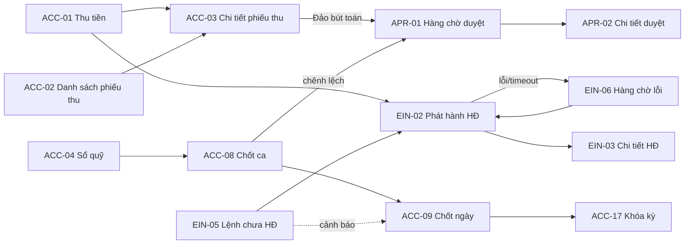

# UI/UX Gói 5: Tài chính và hóa đơn (G4-ACC, G4-APR, G4-EIN)

Phiên bản 0.2 · 30/10/2026 · Designer · Trạng thái: đã dựng đủ 32/32 màn hình (31 màn hình ban đầu + G4-ACC-21 mới) và đã xử lý 22 finding của BA (`review-05-finance-invoice-ba.md`) theo 17 quyết định (`ba-answers-05.md`, BA đề xuất, chờ chủ dự án xác nhận). Xem bảng “Finding → đã xử lý ở đâu” ở §10. Prototype: `design/g4-finance/` (mở `index.html` bằng trình duyệt, `file://`). Class riêng có tiền tố `g4f-`. Nguồn: `design-system.md`, `00-foundation.md`, `ba-decisions.md`, `screen-inventory.md` §8.1 đến §8.3, FRD (ACC, EIN, SYS-004), Journey (WF-05, WF-06, WF-09).

## 1. Phạm vi và kế hoạch đã thực hiện

Gói gồm 32 màn hình: G4-ACC-01..21 (ACC-21 “Khoản nhận trước” thêm theo BA câu 5; thu tiền, sổ quỹ, chi, hoàn tiền, chốt ca/ngày/kỳ, công nợ phải thu/phải trả có tuổi nợ, giá vốn, lãi lỗ, đối soát ngân hàng, kết xuất, phân bổ chi phí chung, sơ đồ tài khoản), G4-APR-01..03 (hàng chờ phê duyệt, chi tiết, cấu hình hạn mức), G4-EIN-01..08 (hóa đơn điện tử). Trọng tâm thiết kế là **phòng ngừa lỗi khi xử lý tiền và hóa đơn**: xác nhận thao tác tiền, bút toán đảo thay vì xóa, ghi lý do, nhật ký, khóa chống bấm đúp.

Thứ tự đã làm: (1) hạ tầng dùng chung `pack.js`/`pack.css`; (2) luồng Phase 1 sống còn ACC-01/02/03/04/08/09, APR-01/02/03, EIN-01 đến 08; (3) công nợ, giá vốn, lãi lỗ, hoàn tiền, đề xuất chi (P2/P3); (4) ngân hàng, khóa kỳ, kết xuất, phân bổ, sơ đồ tài khoản; (5) tài liệu, index, tự review.

### 1.1 Sản phẩm kèm theo

| File | Nội dung |
| --- | --- |
| `design/g4-finance/index.html` | Danh mục 32 màn hình (mã, tên, link, template, vai trò, ưu tiên) |
| `design/g4-finance/g4-acc-01.html` … `g4-ein-08.html` | 32 màn hình, tên file = mã màn hình viết thường |
| `design/g4-finance/pack.css` | Style bổ sung, class `g4f-*`, chỉ dùng token, không hex |
| `design/g4-finance/pack.js` | Dựng Application Shell chuẩn (sidebar, topbar, branch selector, scope banner, bottom nav), thanh “Xem thử trạng thái”, khóa nút theo vai trò và theo mất kết nối, khóa chống bấm đúp, cổng xác nhận, wizard, biến thể tình huống, nâng ô ngày thành Date Picker. Từ v0.2: một hàm duy nhất quyết định nút có bật không (`G4F.setEnabled`/`refreshBtn`: hợp lệ theo trang AND biến thể AND cổng xác nhận AND NOT khóa vai trò AND NOT mất mạng AND NOT đã gửi), và `G4F.canApprove(loại, vai trò, người lập)` cho quyền duyệt. Không sửa `design/assets/*` |

Mỗi trang khai báo `window.G4F_PAGE` (mã, tên, vai trò mặc định, danh sách vai trò được xem, các trạng thái) rồi nạp `pack.js` trước `../assets/app.js`. Nội dung màn hình nằm trong `#g4f-body`. Đây là cách làm cho prototype; khi dev chọn stack, lớp shell và bộ chuyển trạng thái được thay bằng component thật, nội dung từng màn hình giữ nguyên.

### 1.2 Cách xem

Menu tài khoản (góc phải trên) có “Xem thử theo vai trò”: lựa chọn được nhớ trong phiên, đổi menu, phạm vi chi nhánh, nút bị khóa kèm lý do, và tự chuyển sang trạng thái “Không có quyền” nếu vai trò không được xem màn hình. Thanh “Xem thử trạng thái” (đứt nét) có: Có dữ liệu, Đang tải, Trống (lần đầu), Trống (do lọc), Lỗi tải, Không có quyền, cộng nút “Thử: mất kết nối” (banner cảnh báo và khóa nút ghi tiền/hóa đơn). Nhiều màn hình có thêm “Xem thử tình huống” (ví dụ QC chưa đạt, ngày đã khóa, timeout hóa đơn, chưa kích hoạt nhà cung cấp).

## 2. Bảng màn hình

Template theo `screen-inventory.md` §0.2. Trạng thái thiết kế: các trạng thái chuẩn (loading, empty, error, no-permission) có ở mọi màn hình qua thanh xem thử; cột cuối chỉ ghi trạng thái đặc thù đã có.

| Mã | Tên | File | Template | Vai trò (FRD M8/M9/M10) | Trạng thái đặc thù đã thiết kế |
| --- | --- | --- | --- | --- | --- |
| G4-ACC-01 | Thu tiền theo lệnh | g4-acc-01.html | E | TN (S); QL (D); CV, KT, CH, QV (X) | QC chưa đạt chặn thu; ngày khóa chỉ đọc; thu một phần/đủ/vượt (khoản nhận trước + chip khách có khoản nhận trước); “khách đưa/tiền thối”; tiền cọc có xác nhận mức 2; nháp; mất mạng. Badge hiện tại không đổi trước khi ghi, trạng thái dự kiến là tag ở khối tóm tắt |
| G4-ACC-02 | Danh sách phiếu thu | g4-acc-02.html | C | TN (S); KT, QL, CH, QV, CV (X) | Dòng bút toán đảo và phiếu bị đảo; xuất file cần quyền xuất; card list mobile |
| G4-ACC-03 | Chi tiết thanh toán và phân bổ | g4-acc-03.html | D | Như ACC-02; KT phân bổ | Chuỗi 5 đối tượng; Phase 1: “Phân bổ lại nhiều-nhiều” hiển thị nhưng khóa kèm lý do “có từ giai đoạn 2”, Phase 2: phân bổ (drawer); đảo bút toán (guard); in A5/nhiệt 80 mm; ngày khóa chỉ đọc |
| G4-ACC-04 | Sổ quỹ tiền mặt | g4-acc-04.html | C | TN (S); QL (D); KT, CH, QV (X) | Số dư chạy; phiếu chi (xác nhận mức 2, cảnh báo vượt hạn mức, chặn cứng chi quá số dư kèm hai lối thoát: chuyển khoản hoặc nạp quỹ, nút “Nạp quỹ” khóa tới giai đoạn 2); phiếu thiếu chứng từ gốc; ngày khóa; dòng đảo |
| G4-ACC-05 | Đề xuất chi / phiếu chi | g4-acc-05.html | E | KT, TN, QL (S); QL/QV/CH (D) | Nháp, chờ duyệt, đã duyệt, đã chi/chờ đối soát; nút chi khóa kèm lý do; đảo phiếu chi |
| G4-ACC-06 | Danh sách đề xuất chi | g4-acc-06.html | C | Như ACC-05 | Chip lọc nhanh; phiếu đã đảo; thiếu chứng từ gốc |
| G4-ACC-07 | Hoàn tiền cho khách | g4-acc-07.html | E | TN, KT (S); QL (D); CH/QV (D vượt hạn mức) | Chưa/đã có hóa đơn (nhắc điều chỉnh); vượt số đã thu; vượt hạn mức; trạng thái Thanh toán dự kiến theo thu ròng/tổng phải thu (Hoàn tiền / Đã thanh toán / Thanh toán một phần) kèm tag “Đã hoàn một phần X ₫” |
| G4-ACC-08 | Chốt ca | g4-acc-08.html | W | TN (S); QL (D chênh lệch) | 4 bước; đếm tiền theo mệnh giá; chênh lệch bắt buộc giải trình; ca đã chốt; KT, CH, QV xem chỉ đọc; ca mở khi nhận quỹ, một ca mở mỗi quầy |
| G4-ACC-09 | Chốt ngày chi nhánh | g4-acc-09.html | W | QL (D); TN, KT (X); đề nghị mở lại: KT, QL; duyệt: CH | Bị chặn (chênh lệch chưa duyệt, ca chưa chốt) / đủ điều kiện / đã khóa / đang được mở lại (có hạn, tự khóa lại); đề nghị mở lại có mật khẩu và MFA |
| G4-ACC-10 | Công nợ phải thu (tuổi nợ) | g4-acc-10.html | C/B | KT (S); CH, QV, QL (X) | Thanh xếp chồng tuổi nợ + bảng thay thế; nhắc nợ hàng loạt (Zalo/SMS “Chưa kích hoạt”); quá hạn; vượt hạn mức |
| G4-ACC-11 | Chi tiết công nợ khách | g4-acc-11.html | D | KT (S); QL, CH, QV (X); **không có CV** (CV chỉ thấy số dư/hạn mức/cảnh báo trên lệnh và hồ sơ khách) | Trong/vượt hạn mức công nợ; thu nợ; bảng kê; nới hạn mức tạm thời có hạn và cần duyệt khi bàn giao; khoản nhận trước của khách; SĐT/email che (`.pii`, KT cần lý do) |
| G4-ACC-12 | Công nợ phải trả | g4-acc-12.html | C/B | KT (S); CH, QV, QL (X) | Tuổi nợ phải trả; lên lịch thanh toán |
| G4-ACC-13 | Chi tiết công nợ nhà cung cấp | g4-acc-13.html | D | KT (S) | Mỗi lần chi gắn phiếu nhập; chênh lệch 3 bên chặn chi thường, có “Chi kèm ngoại lệ” (lý do bắt buộc, luôn qua đề xuất chi và duyệt); chi vượt hạn mức đi qua đề xuất chi; nút ghi đúng theo số tiền hợp lệ |
| G4-ACC-14 | Giá vốn và lãi gộp theo lệnh | g4-acc-14.html | C/D | KT (S); CH, QV, QL (X) | Banner “phương pháp chưa chốt”; công thức (drawer); đổi phương pháp (guard); lệnh lãi thấp |
| G4-ACC-15 | Lãi lỗ theo chi nhánh và nguồn | g4-acc-15.html | B/C (M) | KT (S); CH, QV, QL (X) | Số tạm; chi nhánh lỗ; tổng chi nhánh = toàn chuỗi (tính lại theo vai trò); card mobile |
| G4-ACC-16 | Giao dịch ngân hàng và đối soát | g4-acc-16.html | C | KT (S) | Ghép hai khung; lệch số tiền cần loại lý do (Phí chuyển khoản, Làm tròn, Khác) và ghi chú, lưu thành chênh lệch đối soát; bỏ ghép (guard + khóa chống bấm đúp); định dạng sao kê chưa chốt |
| G4-ACC-17 | Khóa kỳ kế toán | g4-acc-17.html | E | KT (S); CH (D mở lại) | Kỳ chưa kết thúc / chưa đủ điều kiện (ngày chưa khóa, yêu cầu phê duyệt đang chờ, kỳ trước chưa khóa) / đủ / đã khóa; đề nghị mở lại kỳ (KT, QL đề nghị; CH duyệt; mật khẩu + MFA; mở có hạn rồi tự khóa) |
| G4-ACC-21 | Khoản nhận trước (mới) | g4-acc-21.html | C | KT (S); TN bù/đề xuất hoàn; QL, CH, QV (X) | Bù vào lệnh còn nợ của cùng khách (xác nhận mức 2); hoàn lại qua ACC-07; khách không có lệnh để bù (khóa kèm lý do); P2 |
| G4-ACC-18 | Kết xuất sang phần mềm kế toán | g4-acc-18.html | E | KT (S) | Chưa chọn định dạng (khóa); kỳ đã kết xuất (cảnh báo trùng); xem trước Nợ = Có |
| G4-ACC-19 | Phân bổ chi phí chung | g4-acc-19.html | E | KT (S); CH (D) | Tiêu chí cấu hình, tính lại tức thì; kỳ khóa chỉ xem; chạy lại (guard) |
| G4-ACC-20 | Sơ đồ tài khoản | g4-acc-20.html | S | KT (S); CH (D) | Cân đối Nợ = Có; ngày hiệu lực; đổi sơ đồ khi đã có bút toán (guard) |
| G4-APR-01 | Hàng chờ phê duyệt | g4-apr-01.html | C (M) | CH, QV, QL, KT (D); người đề xuất xem của mình | 3 tab; duyệt hàng loạt chỉ cho mục đủ điều kiện và **cùng một loại** (ô chọn loại khác khóa kèm lý do); duyệt/từ chối/chuyển cấp theo (loại yêu cầu × vai trò) và người lập ≠ người duyệt; xác nhận mức 2 và khóa chống bấm đúp; từ chối bắt buộc lý do; quá hạn; drawer; card mobile |
| G4-APR-02 | Chi tiết yêu cầu phê duyệt | g4-apr-02.html | D/Dlg (M) | Như APR-01 | 4 loại (giảm giá, hoàn tiền, chi, hóa đơn thay thế); đã được người khác duyệt; bản ghi gốc đã đổi |
| G4-APR-03 | Cấu hình hạn mức và ma trận | g4-apr-03.html | S | CH (D); AD (S kỹ thuật) | “Chưa ban hành”; chế độ xem/sửa; ngày hiệu lực; tác động lên yêu cầu đang chờ |
| G4-EIN-01 | Danh sách hóa đơn | g4-ein-01.html | C | TN, KT (S); CH, QV, QL (X) | Đã xuất/Điều chỉnh/Thay thế/Hủy; hóa đơn gốc giữ “Đã xuất” + tag “Đã được điều chỉnh bởi…” / “Bị thay thế bởi…” (gạch ngang), hóa đơn mới mang badge theo loại; chỉ báo `sync`; chưa kích hoạt |
| G4-EIN-02 | Phát hành hóa đơn từ lệnh | g4-ein-02.html | E (Dlg) | TN, KT (S) | Đủ điều kiện / thiếu / đang gửi / timeout / đã có hóa đơn / chưa kích hoạt; mã chống trùng |
| G4-EIN-03 | Chi tiết hóa đơn | g4-ein-03.html | D | TN, KT (S); CH, QV, QL (X) | Đã xuất, chờ duyệt thay thế, đã bị thay thế, gửi khách lỗi, đã hủy (chỉ đọc); in A4; Zalo/SMS “Chưa kích hoạt”; Thu ngân có nút “Báo kế toán hóa đơn này có sai” (không tạo yêu cầu); mã chống trùng chỉ KT/AD thấy |
| G4-EIN-04 | Điều chỉnh / thay thế / hủy | g4-ein-04.html | E | KT lập (S); duyệt: KT có cờ Kế toán trưởng (không phải người lập) hoặc CH | Lập mới / chờ duyệt (khóa form) / bị từ chối; guard; P1 mức tối thiểu (BA đề xuất) |
| G4-EIN-05 | Lệnh hoàn tất chưa có hóa đơn | g4-ein-05.html | C | TN, KT (S); QL, CH (X) | Tuổi, lý do; “Khách không lấy hóa đơn” khóa vì chưa xác nhận quy tắc |
| G4-EIN-06 | Hàng chờ lỗi và thử lại | g4-ein-06.html | C | KT (S); CH, QV, QL (X); **AD không xem** (chẩn đoán ở EIN-07) | Lỗi dữ liệu (phải sửa trước), từ chối, timeout; mã yêu cầu `YH-…`; “Thử lại” = truy vấn trước; hủy yêu cầu: truy vấn lần cuối rồi mới hủy, guard và khóa chống bấm đúp |
| G4-EIN-07 | Tình trạng kết nối nhà cung cấp | g4-ein-07.html | B | KT (X); AD (S) | **Chưa kích hoạt (mặc định)**, đã kết nối (môi trường thử), mất kết nối; đổi sang môi trường thật (guard) |
| G4-EIN-08 | Cấu hình đơn vị phát hành | g4-ein-08.html | S | KT, AD (S); CH (D) | Ngày hiệu lực; quy tắc `[Cần xác nhận]` mặc định “Chưa chốt”; cột Pháp nhân tự hiện |

## 3. UI/UX flow

### 3.1 Luồng chính Phase 1: từ thu tiền đến chốt ngày (Journey bước 13 đến 17)

1. Thu ngân mở lệnh sẵn sàng bàn giao, vào **G4-ACC-01** thu tiền. Lệnh còn “Chờ QC” thì thu bị chặn kèm lý do.
2. Chia nhiều hình thức, màn hình tính còn nợ/dư tức thì. Bấm “Ghi nhận” chỉ mở màn xác nhận (số tiền, hình thức, tích đã đối chiếu); xác nhận xong nút khóa (idempotent) và hiện phiếu **PT-…**.
3. Từ phiếu: **G4-ACC-03** in phiếu thu (A5 hoặc nhiệt 80 mm) hoặc phát hành hóa đơn **G4-EIN-02**. Sai tiền thì “Đảo bút toán” (guard, QL duyệt), không có nút xóa.
4. **G4-EIN-02** kiểm điều kiện, phát hành (khóa chống trùng). Lỗi/timeout vào **G4-EIN-06**; xem kết quả ở **G4-EIN-03**; lệnh thiếu hóa đơn ở **G4-EIN-05**.
5. Cuối ca: Thu ngân **G4-ACC-08** (rà lệnh, đếm quỹ, giải trình), chênh lệch vào **G4-APR-01** cho QL duyệt.
6. Cuối ngày: QL **G4-ACC-09** (chặn khi còn chênh lệch chưa duyệt) rồi khóa ngày; số tạm thành chính thức.

### 3.2 Luồng phụ

- **Hoàn tiền (Journey, luồng phụ 3):** ACC-03 hoặc ACC-02 → **ACC-07** (lý do, số tiền ≤ đã thu) → gửi duyệt → **APR-01/02** → phiếu chi hoàn; đã có hóa đơn → **EIN-04** (điều chỉnh). Hoàn một phần: Thanh toán giữ trạng thái theo thu ròng kèm tag “Đã hoàn một phần”.
- **Thu vượt và khoản nhận trước (BA câu 5):** ACC-01 (thu vượt, tích xác nhận; tiền mặt dư là tiền thối, không phải thu vượt) → khoản nhận trước gắn khách → **ACC-21**: bù vào lệnh sau của cùng khách, hoặc hoàn lại qua ACC-07 (duyệt như hoàn tiền). Chip “Khách có khoản nhận trước” hiện ở ACC-01, ACC-11, ACC-03.
- **Mở lại ngày/kỳ (BA câu 10):** KT hoặc QL “Đề nghị mở lại” ở ACC-09/17 (lý do + mật khẩu + MFA) → yêu cầu `YC-…` vào **APR-01** → CH duyệt ở APR-02 → ngày/kỳ mở có hạn (mặc định 48 giờ) → “Hoàn tất điều chỉnh” hoặc hết hạn thì hệ thống kiểm điều kiện và tự khóa lại.
- **Thu ngân thấy hóa đơn sai (BA câu 11):** EIN-03 “Báo kế toán hóa đơn này có sai” → thông báo “Cần xử lý” cho Kế toán → Kế toán lập EIN-04 → duyệt.
- **Hóa đơn sai (luồng phụ 2):** EIN-03 → **EIN-04** → KTT duyệt ở APR-01/02 → gửi nhà cung cấp → EIN-03 cập nhật.
- **Chi tiền:** ACC-12/13 hoặc ACC-04 → **ACC-05** (đề xuất, duyệt theo hạn mức, chi, đối soát) → ACC-06 danh sách → ACC-16 đối soát ngân hàng.
- **Công nợ:** ACC-10 (tuổi nợ) → ACC-11 (khách) → thu nợ / nhắc nợ / đề xuất nới hạn mức → APR.
- **Cuối kỳ:** ACC-09 các ngày → ACC-17 khóa kỳ → ACC-18 kết xuất → ACC-14/15 lãi lỗ chính thức; ACC-19, ACC-20 là cấu hình phục vụ.
- **Kích hoạt hóa đơn điện tử:** EIN-07 (Chưa kích hoạt) → AD/CH chọn nhà cung cấp → nhập kết nối thử → EIN-08 → chuyển môi trường thật (guard).

## 4. Mô tả theo nhóm màn hình

### 4.1 Khung chung (Application Shell)

Shell chuẩn (sidebar 248/72, topbar 64, branch selector 3 cấp, banner phạm vi, bottom nav mobile). Mục menu “Tài chính” và “Hóa đơn” trỏ tới ACC-02 và EIN-01; “Tài chính” có pill 7 yêu cầu chờ duyệt, “Hóa đơn” có pill 2 hóa đơn lỗi. Thanh điều hướng con (`g4f-subnav`) chia 8 nhóm: Thu tiền, Sổ quỹ và chi, Công nợ, Chốt ca/ngày/kỳ, Giá vốn và lãi lỗ, Ngân hàng và kết xuất, Phê duyệt (pill), Hóa đơn điện tử; nhóm không thuộc vai trò tự ẩn. Nút “Chờ duyệt (7)” ở topbar cho CH, QV, QL, KT, TN, CV, TK. Mọi màn hình ghi chi nhánh, khoảng thời gian, “Cập nhật lúc” (RULE-015); số tạm có tag “Tạm”, số chính thức có tag “Chính thức”.

### 4.2 Nhóm thu tiền (ACC-01, 02, 03, 07)

- **Mục đích:** thu tiền chính xác, truy vết được, sửa bằng bút toán đảo.
- **ACC-01 (E):** cột trái là lệnh (3 badge riêng Lệnh, Thanh toán, Hóa đơn), bảng khoản phải thu, dòng thanh toán nhiều hình thức; cột phải (sticky) là tóm tắt: còn phải thu, ghi nhận lần này, còn nợ/dư. Thu vượt hiện cảnh báo và bắt tích “ghi thành khoản nhận trước”. Chân trang dính: lưu nháp (giữ khi mất mạng), Hủy, “Ghi nhận thanh toán X ₫” (số tiền nằm ngay trên nút).
- **Phòng ngừa lỗi:** (1) ghi nhận luôn qua màn xác nhận tóm tắt có tích đối chiếu; ghi nhận tiền cọc cũng vậy (v0.2); (2) sau xác nhận nút khóa và có trạng thái “Đang ghi nhận…” rồi “Đã ghi nhận”, bấm hai lần không tạo phiếu thứ hai; (3) lệnh QC chưa đạt hoặc ngày khóa thì nút khóa kèm dòng lý do hiện sẵn; (4) mất kết nối khóa nút ghi tiền, báo giữ nháp, và không script nào của màn hình bật lại nút (một hàm `setEnabled` hợp nhất các cờ khóa); (5) badge của lệnh chỉ đổi sau khi ghi, trạng thái dự kiến là tag ở khối tóm tắt; (6) “Khách đưa” và “Tiền thối” chỉ là phép tính hỗ trợ, phiếu thu chỉ ghi phần thu thật (FR-ACC-024, Could).
- **ACC-02 (C):** thẻ tổng hợp, filter bar, chip đang lọc, bảng có tổng ròng cuối bảng (đã trừ bút toán đảo), phiếu bị đảo gạch ngang, dòng bút toán đảo nền cảnh báo kèm lý do; chỉ có hành động “Mở”, không có “Xóa”. Mobile: card list.
- **ACC-03 (D):** chuỗi 5 đối tượng báo giá, lệnh, thanh toán, phiếu thu, hóa đơn, mỗi cái badge riêng (FR-ACC-019). Bảng phân bổ nhiều-nhiều có dòng “phần dư thành khoản nhận trước”, tổng phân bổ = số phiếu. Hành động: In phiếu thu (A5 và nhiệt 80 mm, xem trước), Phân bổ lại (drawer, tổng kiểm tra tức thì), **Đảo bút toán** (nguy hiểm).
- **ACC-07 (E):** phiếu gốc chỉ đọc, số hoàn không vượt đã thu (lỗi nêu cách sửa), tóm tắt “Sau khi hoàn”, cảnh báo vượt hạn mức kèm cấp duyệt, nhắc hóa đơn điều chỉnh nếu đã có hóa đơn. Nút “Gửi duyệt hoàn tiền” mở guard (lý do + gõ HOÀN TIỀN).

### 4.3 Nhóm quỹ, chi, chốt (ACC-04, 05, 06, 08, 09)

- **ACC-04:** bốn thẻ số dư (đầu ngày + thu − chi = cuối) và sổ quỹ có số dư chạy; ngày đã khóa là chế độ chỉ đọc kèm dòng bút toán đảo. Phiếu chi: chặn chi quá số dư quỹ; vượt hạn mức thì đổi nút thành “Gửi duyệt” và ghi rõ chưa trừ quỹ.
- **ACC-05/06:** vòng đời Đề xuất → Duyệt → Chi → Đối soát bằng stepper; mỗi bước có người và thời điểm (FR-ACC-018); khoản vượt hạn mức không chi được cho tới khi duyệt, nút “Chi tiền” khóa kèm lý do.
- **ACC-08 (wizard 4 bước):** rà lệnh → đếm quỹ theo mệnh giá (không điền sẵn số dự kiến) → giải trình (chỉ bắt buộc khi lệch) → xác nhận. Bước tiếp chỉ mở khi hợp lệ, lý do nêu bằng toast chữ. Chốt ca là xác nhận mức 2.
- **ACC-09 (BA câu 1, 10):** danh sách điều kiện với biểu tượng + chữ Đạt/Chặn/Cảnh báo, nhãn đọc từ cấu hình chi nhánh. Mặc định **chặn**: chênh lệch quỹ chưa giải trình hoặc vượt ngưỡng chưa được Quản lý duyệt (trong ngưỡng chỉ cần giải trình), ca chưa chốt, thanh toán/phiếu chi đang xử lý dở. Mặc định **cảnh báo**: lệnh còn mở, lệnh hoàn tất chưa thu, chưa có hóa đơn, phiếu thiếu chứng từ gốc, yêu cầu phê duyệt đang chờ. Nút “Khóa ngày” khóa và hiện lý do khi còn chặn; khóa ngày là hành động nguy hiểm (gõ ngày). **Mở lại ngày không do CH bấm trực tiếp**: KT hoặc QL “Đề nghị mở lại” (lý do, mật khẩu, MFA) → CH duyệt ở APR → ngày mở có hạn, đếm ngược, tự khóa lại; QV chỉ duyệt khi CH ủy quyền bằng cấu hình.
- **ACC-08:** ca mở khi Thu ngân nhận quỹ, đóng khi đếm quỹ cuối ca, mỗi quầy một ca mở; nhãn Ca sáng/Ca chiều chỉ là gợi ý. KT, CH, QV xem chỉ đọc (nút lưu nháp/chốt khóa kèm lý do).

### 4.4 Nhóm công nợ (ACC-10 đến 13)

- **ACC-10/12:** KPI, thanh xếp chồng tuổi nợ 4 nhóm (sắc độ thương hiệu tăng dần, kèm nhãn và số trong chú giải, không dựa vào màu), bảng thay thế có tổng khớp tổng dư nợ. Nhắc nợ hàng loạt qua email; Zalo/SMS “Chưa kích hoạt”. Các mốc tuổi nợ là cấu hình.
- **ACC-11 (BA câu 9):** thanh dư nợ/hạn mức có vạch hạn mức, chuyển đỏ khi vượt kèm cảnh báo bằng chữ; chính sách theo khách (cảnh báo / cần duyệt / chặn cứng, mặc định cần duyệt khi bàn giao hoặc hoàn tất lệnh); nới hạn mức là tạm thời có thời hạn và là guard; thu nợ mặc định phân bổ vào lệnh nợ lâu nhất. Cố vấn không vào màn này mà chỉ thấy số dư, hạn mức, cảnh báo trên lệnh và hồ sơ khách.
- **ACC-13 (BA câu 6):** mỗi lần chi gắn một phiếu nhập; chênh lệch 3 bên vượt dung sai (cấu hình, mặc định 0) chặn chi thường; “Chi kèm ngoại lệ” bắt buộc lý do và luôn qua đề xuất chi; chi vượt hạn mức cũng đi qua đề xuất chi; nút ghi đổi nhãn theo số tiền và bị khóa khi số tiền không hợp lệ.
- **ACC-21 (mới, BA câu 5):** khoản nhận trước gắn khách, không gắn lệnh; hai cách xử lý: bù vào lệnh còn nợ của cùng khách (không chuyển giữa khách) hoặc hoàn lại có duyệt.

### 4.5 Nhóm giá vốn, lãi lỗ, cuối kỳ (ACC-14 đến 20)

- **ACC-14/15:** luôn ghi phương pháp giá vốn đang dùng và trạng thái “chưa chốt”; công thức hiện trong drawer; lãi gộp quản trị, không phải lợi nhuận sau thuế. ACC-15 tính lại tổng theo các chi nhánh vai trò được thấy (CH thấy toàn chuỗi, QL một chi nhánh, KT các chi nhánh được gán).
- **ACC-16:** hai khung chọn một-một, ghép chỉ khi cùng chiều thu/chi; lệch số tiền cần ghi chú; bỏ ghép là guard. **ACC-17/18:** điều kiện khóa kỳ và kết xuất; kết xuất kỳ đã xuất cảnh báo trùng, cần lý do. **ACC-19/20:** cấu hình có ngày hiệu lực; đổi khi đã có bút toán chỉ áp dụng từ ngày hiệu lực, cần duyệt.

### 4.6 Nhóm phê duyệt (APR-01 đến 03)

- **APR-01 (C, mobile ưu tiên):** tab “Cần tôi duyệt / Tôi đã đề xuất / Đã xử lý”, lọc theo loại và độ trễ, cột “So với hạn mức” (giá trị lấy từ cấu hình, có nhãn minh họa), tag “Quá hạn” kèm chuyển cấp. Duyệt hàng loạt (BA câu 8) chỉ chọn được mục đủ điều kiện và **cùng loại** (chọn một loại thì ô chọn loại khác khóa kèm lý do), chỉ giảm giá và chênh lệch quỹ trong hạn mức; mục còn lại có checkbox khóa kèm chữ “Duyệt riêng”; hoàn tiền, hóa đơn, chi vượt hạn mức, hủy lệnh, mở lại ngày/kỳ, đổi cấu hình luôn duyệt riêng. Duyệt hàng loạt là xác nhận mức 2 và ghi nhật ký từng mục. Người đề xuất (TN, CV, TK) chỉ thấy dòng của mình. **Quyền duyệt** theo cặp (loại yêu cầu, vai trò) và “người lập ≠ người duyệt”: giảm giá/chênh lệch quỹ/hoàn tiền/hủy lệnh do QL, CH, QV; chi vượt hạn mức cấp QL do QV hoặc CH; hóa đơn điều chỉnh/thay thế/hủy do KT có cờ Kế toán trưởng (không phải người lập) hoặc CH; mở lại ngày/kỳ do CH. KT không duyệt hoàn tiền, chi hay chênh lệch quỹ (FRD §2: KT chỉ xem). Công tắc “Kế toán có cờ Kế toán trưởng” ở menu tài khoản để xem thử. Duyệt/từ chối/chuyển cấp dùng xác nhận (mức 2), khóa chống bấm đúp; từ chối bắt buộc lý do.
- **APR-02:** Approval Panel đầy đủ: người đề xuất, lý do, giá trị, thanh so với hạn mức, bản ghi gốc, lịch sử. Duyệt (xác nhận, ghi nhật ký), Từ chối (lý do bắt buộc), Chuyển cấp. Trạng thái “đã được người khác duyệt” và “bản ghi gốc đã đổi” khóa mọi quyết định. APR-01 dùng drawer rút gọn cùng nội dung.
- **APR-03:** ma trận Hành động × ngưỡng × cấp × thời hạn, mặc định chế độ xem; lưu phiên bản mới cần ngày hiệu lực và hiện số yêu cầu đang chờ bị ảnh hưởng. Banner “chưa ban hành chính thức”; mọi số là minh họa (D-11).

### 4.7 Nhóm hóa đơn điện tử (EIN-01 đến 08)

- **EIN-01/03 (BA câu 2):** trạng thái hóa đơn dùng đúng bộ Chưa xuất/Đã xuất/Điều chỉnh/Thay thế/Hủy, gán theo **loại chứng từ**: hóa đơn mới mang badge “Điều chỉnh”/“Thay thế” kèm liên kết hóa đơn gốc; **hóa đơn gốc giữ “Đã xuất”** và có tag “Chờ duyệt điều chỉnh/thay thế”, sau xác nhận là “Đã được điều chỉnh bởi số …” hoặc “Bị thay thế bởi số …” (gạch ngang, không mở lại để sửa); “Hủy” chỉ khi thao tác Hủy. Trên lệnh hiện hóa đơn hiệu lực mới nhất. Ánh xạ trạng thái nhà cung cấp → 5 trạng thái là bảng cấu hình trong lớp tích hợp; cách xử lý từng trường hợp theo Thông tư 91/2026 `[Cần kế toán xác nhận]`. **Đồng bộ nhà cung cấp là chỉ báo `sync`** (đang gửi, lỗi phát hành, chờ truy vấn) cạnh badge, không là badge thứ 6 (ba-decisions A.2). Số hóa đơn do nhà cung cấp cấp, chưa có thì ghi “Chưa có số”.
- **EIN-02 (idempotent):** kiểm tra điều kiện (thuế suất, người mua, đơn vị phát hành, kết nối); thiếu điều kiện thì liệt kê và khóa nút, không gửi. Phát hành qua xác nhận, nút khóa “Đang gửi nhà cung cấp…”, hiển thị mã chống trùng. **Timeout:** thông báo rõ “không gửi lại”, chỉ có “Truy vấn trạng thái”. Đã có hóa đơn hợp lệ thì khóa. Chưa chọn nhà cung cấp: “Chưa kích hoạt”.
- **EIN-04:** chọn Điều chỉnh/Thay thế/Hủy, lý do bắt buộc, bảng giá trị cũ → mới, luồng 4 bước; gửi KTT duyệt bằng guard (gõ số hóa đơn gốc). Hóa đơn gốc không bao giờ bị sửa.
- **EIN-06:** lỗi dữ liệu phải sửa trước (nút Thử lại khóa kèm lý do), timeout truy vấn trước khi gửi; hủy yêu cầu là guard và vẫn truy vấn lần cuối.
- **EIN-07:** mặc định “Chưa kích hoạt” nêu rõ cái gì làm được/không và 5 bước kích hoạt; không có tên hay logo nhà cung cấp. **EIN-08:** quy tắc thời điểm lập và tiền cọc mặc định “Chưa chốt”, cột Pháp nhân ẩn khi một pháp nhân.

### 4.8 Ba mức xác nhận (áp dụng nhất quán)

| Mức | Dùng cho | Thành phần |
| --- | --- | --- |
| 1. Xác nhận thường | Gửi duyệt, chuyển cấp, gửi nhắc nợ | Dialog nêu việc sắp làm |
| 2. Xác nhận tiền | Ghi nhận thanh toán (ACC-01), thu nợ (ACC-11), chi tiền (ACC-05, 13), chốt ca, duyệt, ghép ngân hàng, phát hành hóa đơn | Dialog có tóm tắt đối tượng và số tiền, tích “đã đối chiếu”, nút ghi số tiền, khóa chống bấm đúp, trạng thái đang xử lý/đã xử lý |
| 3. Nguy hiểm | Đảo bút toán thu/chi, hoàn tiền, khóa ngày/kỳ, mở lại ngày/kỳ (thêm mật khẩu), đổi giá vốn, đổi sơ đồ, chạy lại phân bổ, hủy yêu cầu phát hành, điều chỉnh/thay thế/hủy hóa đơn, đổi môi trường hóa đơn thật, đổi đơn vị phát hành | Danh sách hậu quả, lý do ≥ 5 ký tự (giả định), gõ mã/cụm từ để mở nút, nút `danger`, ghi nhật ký |

Không màn hình nào có nút “Xóa” cho chứng từ đã ghi sổ; các hành động tương ứng gọi là “Đảo bút toán”, “Hủy yêu cầu”, “Bỏ ghép”, “Điều chỉnh”, “Thay thế”.

### 4.9 Quy tắc hiển thị theo vai trò

Ánh xạ trong `pack.js` (`data-g4f-need`, `data-g4f-roles`, `allow`): nút không được phép bị khóa kèm lý do và một dòng thông báo “Bạn đang xem với vai trò …: một số nút bị khóa”; mục không được xem thì ẩn (subnav, hàng của người khác). Tóm tắt:

| Vai trò | Quyền trong gói |
| --- | --- |
| TN | Thu tiền, phiếu chi, chốt ca, phát hành hóa đơn; xem hóa đơn và “Báo kế toán hóa đơn sai” (không lập điều chỉnh/hủy); đề xuất hoàn tiền; bù khoản nhận trước; không thấy công nợ, giá vốn, lãi lỗ; không duyệt |
| QL | Duyệt (giảm giá, chênh lệch quỹ, hoàn tiền, hủy lệnh), khóa ngày, đề nghị mở lại ngày/kỳ; xem phần lớn; hóa đơn chỉ xem; lãi lỗ chỉ chi nhánh mình |
| KT | Phân bổ, công nợ, giá vốn, hóa đơn (lập điều chỉnh/thay thế/hủy), đối soát, kết xuất, khóa kỳ, đề nghị mở lại ngày/kỳ; chỉ xem thu tiền và sổ quỹ; duyệt hóa đơn chỉ khi có cờ Kế toán trưởng và không phải người lập; SĐT/email khách che, Hiện cần lý do |
| CH / QV | Xem, duyệt (QV/CH cho chi vượt hạn mức cấp QL; CH cho mở lại ngày/kỳ và ban hành hạn mức); QV duyệt mở lại chỉ khi CH ủy quyền |
| CV | Xem trạng thái thu của lệnh mình (M8 = X); **không xem sổ công nợ** (M9 = “-”), chỉ thấy số dư, hạn mức, cảnh báo trên lệnh và hồ sơ khách; đề xuất giảm giá |
| AD | Chỉ cấu hình kỹ thuật hóa đơn (EIN-07/08, APR-03 hỗ trợ); **không xem hàng chờ lỗi EIN-06** vì có dữ liệu người mua |

### 4.10 Responsive, in ấn, ngoại tuyến

- Desktop là chính cho ACC/EIN; tablet có chốt ngày (ACC-09) và APR; mobile ưu tiên APR-01/02, ACC-15, ACC-10 và danh sách (bảng → card list dưới 640px, dialog thành bottom sheet).
- In: phiếu thu A5 và nhiệt 80 mm (ACC-03), hóa đơn bản thể hiện A4 (EIN-03), nút In dùng CSS `@media print` chỉ in vùng cần in. Mẫu in chính thức do G2-PRT; bản trong gói là mẫu tham khảo theo khổ.
- Mất kết nối: banner nêu rõ cái gì khóa (ghi tiền, chi, chốt ca/ngày, phát hành hóa đơn), nháp giữ trên thiết bị lúc 09:14; xem số liệu cũ vẫn được, ghi “Cập nhật lúc”.

## 5. Ánh xạ FR / RULE

| Màn hình | FR / RULE / UAT |
| --- | --- |
| ACC-01 | FR-ACC-001, 002, 015, 019; FR-REC-016; RULE-007, 010; BR-ACC-01 |
| ACC-02 | FR-ACC-001, 015, 019; FR-SYS-013 (xuất) |
| ACC-03 | FR-ACC-015, 019; RULE-010; UAT-14 |
| ACC-04 | FR-ACC-003; RULE-007, 010, 011 |
| ACC-05, 06 | FR-ACC-018; RULE-011; BR-ACC-10 |
| ACC-07 | FR-ACC-016; BR-ACC-11; RULE-010, 011 |
| ACC-08, 09 | FR-ACC-004, 005; WF-06; UAT-07; RULE-010 |
| ACC-10, 11 | FR-ACC-006, 020; FR-CRM-018; UAT-26; NFR-SEC-03 (PII) |
| ACC-12, 13 | FR-ACC-007; FR-PUR-006 |
| ACC-14 | FR-ACC-008; BR-ACC-03; D-13 (3) |
| ACC-15 | FR-ACC-011, 013; FR-RPT-013; RULE-015 |
| ACC-16 | FR-ACC-017; BR-ACC-12 |
| ACC-17 | FR-ACC-005; RULE-010 |
| ACC-18 | FR-ACC-012; BR-ACC-07 |
| ACC-19 | FR-ACC-013 |
| ACC-20 | FR-ACC-010, 009 (hiệu lực); BR-ACC-07 |
| ACC-21 | FR-ACC-015, 022 (đề xuất), 016, 002; BR-ACC-09 |
| ACC-01 (bổ sung) | FR-ACC-024 (đề xuất, Could: khách đưa/tiền thối); RULE-007 |
| ACC-04, 05, 13 (bổ sung) | RULE-007 (chứng từ gốc của phiếu chi); FR-PUR-006 (chênh lệch 3 bên trước khi ghi công nợ) |
| ACC-02, 10, 12, EIN-01 (xuất file) | FR-SYS-013 (quyền xuất) |
| ACC-03, EIN-01, EIN-03 (trạng thái riêng) | FR-REC-028 (không dùng một status chung) |
| ACC-09, 17 | FR-ACC-023 (đề xuất: điều kiện chặn/cảnh báo là cấu hình, mở lại có hạn); FR-ACC-021 (đề xuất: đảo bút toán) |
| APR-01..03 | FR-SYS-004, 015; WF-09; RULE-011; BR-SYS-03, BR-SYS-07; D-11 |
| EIN-01 | FR-EIN-005, 006; BR-EIN-03 |
| EIN-02 | FR-EIN-001, 002, 003, 011, 012, 013; UAT-23 |
| EIN-03 | FR-EIN-005..008; FR-ACC-019 |
| EIN-04 | FR-EIN-007; UAT-08 |
| EIN-05 | FR-EIN-009; FR-RPT-008 |
| EIN-06 | FR-EIN-010, 013 |
| EIN-07 | FR-EIN-004, 005; NFR-INT-01, NFR-OPS-01; D-13 (1) |
| EIN-08 | FR-EIN-003, 012; FR-SYS-005, 018 |
| Toàn gói | RULE-015 (phạm vi và thời điểm), RULE-010 (đảo thay vì xóa), NFR-OFF-01 (nháp), NFR-ISO-01 (phạm vi chi nhánh) |

## 6. Accessibility: tự đánh giá (WCAG 2.2 AA, chưa kiểm bằng trình duyệt hay screen reader)

| Hạng mục | Cách xử lý | Tự đánh giá |
| --- | --- | --- |
| Không chỉ dựa vào màu | Badge/tag luôn có chữ; điều kiện chốt có biểu tượng + chữ Đạt/Chặn/Cảnh báo; âm tiền có dấu “−” và chữ “Lỗ”; thanh tuổi nợ có nhãn và số trong chú giải | Đạt |
| Tương phản | Chỉ dùng token đã đo (`*-text`, `--input-border`); thanh tuổi nợ dùng viền `border-strong` quanh dải màu | Đạt theo token, chưa đo lại các cặp mới |
| Bàn phím | Dialog/drawer dùng focus trap và trả focus của foundation; wizard đưa focus vào tiêu đề bước mới; tab/segmented/menu theo foundation | Đạt theo foundation, chưa thử thực tế |
| Nút bị khóa | `disabled` + `aria-disabled` + `title`/dòng chữ lý do hiện sẵn (không chỉ tooltip) | Đạt |
| Live region | Tóm tắt số tiền/chênh lệch `role=status` `aria-live=polite`; trạng thái ghi nhận đọc qua vùng `sr-only` | Đạt, cần thử với screen reader |
| Lỗi nêu cách sửa | `aria-invalid`, thông báo cạnh trường (số hoàn quá mức, vượt số dư, MST) | Đạt |
| Touch target | Nút/ô nhập theo quy tắc 44px của foundation khi cảm ứng; các nút icon trong bảng dùng `btn-icon` | Đạt theo foundation |
| Thanh phụ thuộc màu (biểu đồ) | Mọi biểu đồ có bảng số thay thế ngay dưới; thanh có `role=img` + `aria-label` đọc đủ số | Đạt |
| Chưa làm / chưa kiểm | Roving tabindex menu; thiết bị cảm ứng thật; dark mode (ngoài phạm vi phát hành); date picker trong drawer có thể bị cắt cạnh; font Be Vietnam Pro chưa có file nên dùng font hệ thống | Rủi ro |

## 7. Giả định (đánh dấu rõ, dễ đổi)

1. Lý do bắt buộc tối thiểu 5 ký tự; thời gian tự che PII 30 giây; mật khẩu nhập lại khi mở lại ngày/kỳ (theo D-02); đều là tham số.
2. Mọi số hạn mức, thuế suất 8%, ngưỡng tỷ suất, mốc tuổi nợ (trong hạn, 1–30, 31–60, trên 60), số lần tự thử lại 5, thời hạn xử lý trước chuyển cấp là **giá trị minh họa**, được gắn nhãn “minh họa” hoặc “cấu hình” trên giao diện; không phải quy tắc nghiệp vụ.
3. KTT (kế toán trưởng) mô phỏng bằng vai trò KT có cờ quyền; chưa có vai trò riêng.
4. Chênh lệch quỹ do QL duyệt (ma trận Journey); khi vượt ngưỡng cấu hình chuyển CH.
5. “Ca” có hai giá trị mẫu Ca sáng/Ca chiều; số ca và giờ là cấu hình chi nhánh.
6. Mã chứng từ theo ba-decisions và BA câu 16: `PT-Q7-2610-00930`, `PC-…`, `RO-…`, `PN-…`, `DX-` (đề xuất chi), `YC-` (yêu cầu phê duyệt), **`YH-Q7-2610-00231` (yêu cầu phát hành hóa đơn, thay `YC-EIN-`)**, `CQ-` (nạp/chuyển quỹ, giai đoạn 2). Mã chống trùng là khóa kỹ thuật, chỉ KT/AD thấy trong “Chi tiết kỹ thuật”, không in.
7. Phiếu thu/chi không phải một trong 5 đối tượng có bộ trạng thái riêng; các nhãn “Đã đảo”, “Bút toán đảo”, “Cọc, chưa phân bổ”, “Đã phân bổ” dùng **tag**, không dùng badge của Thanh toán/Hóa đơn.
8. (Đã chốt theo BA câu 2) Badge “Điều chỉnh”/“Thay thế” nằm trên **hóa đơn mới**; hóa đơn gốc giữ “Đã xuất” kèm tag trạng thái điều chỉnh/thay thế.
9. Mô phỏng ngày hiện tại là 30/10/2026 09:15 cho mọi màn hình.

## 8. Câu hỏi cho BA ở v0.1: đã được trả lời (lưu vết)

17 câu dưới đây đã được BA trả lời trong `docs/ui-ux/ba-answers-05.md`. Cột “Thiết kế tạm” là bản v0.1, **đã được thay bằng quyết định BA** ở các màn hình nêu (xem §4 và §10). Các câu còn mở nằm ở §11.

| # | Câu hỏi | Màn hình ảnh hưởng | Thiết kế tạm |
| --- | --- | --- | --- |
| 1 | Điều kiện nào **chặn** khóa ngày: chỉ chênh lệch quỹ chưa giải trình (FR-ACC-004 và UAT-07 nêu) hay cả lệnh còn mở, lệnh hoàn tất chưa thu, chưa có hóa đơn, phiếu thiếu chứng từ gốc? | ACC-09, 17 | Chỉ chênh lệch quỹ chặn; 4 mục còn lại là cảnh báo, chặn hay không là cấu hình |
| 2 | Trạng thái hóa đơn “Điều chỉnh” và “Thay thế” gán cho hóa đơn **gốc** (đã bị điều chỉnh/thay) hay cho hóa đơn **mới**? Hóa đơn gốc bị thay thế có chuyển “Hủy” không? | EIN-01, 03, 04 | Gán cho hóa đơn mới; gốc giữ “Đã xuất” cho tới khi nhà cung cấp xác nhận |
| 3 | Quy tắc “khách không lấy hóa đơn” (FR-EIN-009 `[Cần xác nhận]`) và thời điểm lập hóa đơn, xử lý tiền cọc (FR-EIN-012) | EIN-05, 08, 02 | Nút khóa kèm lý do; select mặc định “Chưa chốt” |
| 4 | Hoàn tiền một phần hiển thị trạng thái Thanh toán nào: giữ “Đã thanh toán”/“Thanh toán một phần” hay có “Hoàn tiền một phần”? Bộ Thanh toán hiện chỉ có “Hoàn tiền”. | ACC-07, 01, 03 | Chỉ hiện “Hoàn tiền” khi hoàn toàn bộ; hoàn một phần giữ trạng thái theo số còn lại |
| 5 | Thu vượt: phần dư thành “khoản nhận trước” (FR-ACC-015) được trả lại khách hay bù vào lệnh sau? Có hiển thị số dư nhận trước của khách ở đâu? | ACC-01, 03 | Bắt tích xác nhận, ghi khoản nhận trước; chưa có màn quản lý khoản nhận trước |
| 6 | Đối chiếu 3 bên chênh lệch có **chặn chi** cho nhà cung cấp không? | ACC-13 | Khóa nút chi cho phiếu chênh lệch, kèm lý do (đề xuất) |
| 7 | Ghép giao dịch ngân hàng khi lệch số tiền (phí chuyển khoản): cho phép kèm ghi chú hay phải tạo bút toán phí riêng? | ACC-16 | Cho ghép khi có ghi chú ≥ 5 ký tự |
| 8 | Duyệt hàng loạt: loại nào, điều kiện “đủ” cụ thể (cùng loại, trong hạn mức cấp duyệt, không cờ rủi ro)? | APR-01 | Chỉ giảm giá và chênh lệch quỹ trong hạn mức; còn lại duyệt riêng |
| 9 | Vượt hạn mức công nợ khách doanh nghiệp: chặn lập lệnh/giao xe, cảnh báo, hay cần duyệt? (`[Cần xác nhận chính sách]`) | ACC-11 | Cảnh báo + đề xuất nới hạn mức qua duyệt |
| 10 | Mở lại ngày/kỳ: có hạn tự khóa lại không? Ai trong nhóm Quản lý vùng được mở? Có bắt MFA lại hay chỉ mật khẩu? | ACC-09, 17 | CH duyệt + mật khẩu + lý do; không tự khóa lại |
| 11 | TN có quyền M10 = S nhưng EIN-04 ghi chỉ KT: TN có được **lập yêu cầu** điều chỉnh/hủy hóa đơn không? | EIN-03, 04 | Chỉ KT |
| 12 | Có vai trò riêng “Kế toán trưởng” và “Trưởng kho/Quản lý vận hành” (G-06) hay chỉ cờ quyền? | APR-01..03, EIN-04 | Cờ quyền trên KT |
| 13 | QL xem lãi lỗ: chỉ chi nhánh mình hay cả so sánh với chi nhánh khác? Đề xuất: chỉ mình. | ACC-14, 15 | Chỉ chi nhánh mình |
| 14 | Chi tiền mặt vượt số dư quỹ: chặn cứng (đang làm) hay cho phép kèm duyệt? | ACC-04 | Chặn cứng |
| 15 | Ca làm việc: cố định theo giờ hay mở/chốt tự do? Một thu ngân có thể mở nhiều ca một ngày? | ACC-08, 04 | Ca mở khi nhận quỹ, chốt khi đếm quỹ |
| 16 | Mã phiếu/yêu cầu mới (DX-, YC-, YC-EIN-) có cần quy ước chính thức như mã RO/PT/PC? | ACC-05, APR, EIN-06 | Cùng dạng `LOẠI-MÃCN-YYMM-STT` |
| 17 | Giai đoạn 1: màn hình P1 (BA) ACC-01/02/04/08/09 cần FRD §13 cập nhật (G-01); G4-ACC-03 xem ở P1, phân bổ ở P2 — có tách hai chế độ không? | ACC-01..09 | Một màn hình, nút phân bổ khóa ở P1 |

## 9. Điểm yếu tự đánh giá và việc chưa làm

- Không có trình duyệt nên **chưa xem trực quan**; chỉ rà cú pháp HTML, đường dẫn và tên class. Cần mở thử ở 1440, 768 và 375 px (đặc biệt `.g4f-two`, bảng rộng ACC-10/11, chuỗi `g4f-flow`, popup Date Picker trong drawer).
- Khối shell và bộ chuyển trạng thái do `pack.js` sinh nên không xem được khi tắt JS; đây là chủ ý cho prototype, nhưng handoff cho dev phải dựa vào các mô tả ở §4, không phải mã `pack.js`.
- Phần tử nhóm “nhiều pháp nhân” chỉ có ở EIN-08 (cột Pháp nhân) và bộ lọc topbar; báo cáo ACC-15 chưa tách theo pháp nhân.
- Khoản nhận trước đã có G4-ACC-21 (v0.2); “nhật ký truy cập” vẫn thuộc G4-SYS.
- Che dữ liệu cá nhân (F5-14): `.pii` trong prototype chỉ minh họa hành vi của KT (Hiện có lý do, tự che 30 giây). Bảng quyền đúng (ba-decisions câu 8): CV, QL, TN thấy đầy đủ không cần Hiện; CH, QV có nút Hiện không cần lý do; KT bắt buộc lý do; TK che; TH, AD không thấy. Giá trị đầy đủ chỉ được tải về sau khi Hiện, không nằm sẵn trong HTML. Handoff dev theo bảng này, không theo hộp thoại dùng chung của prototype.
- Rà class (F5-21): đã rà thủ công các class dùng trong gói với `components.css`/`base.css`/`pack.css`; môi trường không có công cụ chạy script nên chưa grep tự động toàn bộ, designer kế tiếp nên chạy lại.
- Biểu đồ chỉ gồm thanh tuổi nợ và thanh lãi gộp dựng bằng HTML/CSS (không có thư viện biểu đồ); chưa có line chart xu hướng vì không nằm trong màn hình của gói.
- Mẫu in A5/nhiệt/A4 là bản tham khảo, không thay G2-PRT.

## 10. Finding → đã xử lý ở đâu

Nguồn: `docs/ui-ux/review-05-finance-invoice-ba.md` (22 finding) và `docs/ui-ux/ba-answers-05.md`. “Đã xử lý” = đã sửa trong prototype và tài liệu; chưa kiểm bằng trình duyệt.

| Finding | Mức | Xử lý | Ở đâu |
| --- | --- | --- | --- |
| F5-01 Duyệt trong drawer và hàng loạt thiếu xác nhận mức 2, không khóa bấm đúp; từ chối không bắt lý do | Major | Duyệt = dialog tóm tắt + tích đọc + khóa chống bấm đúp; Từ chối = guard bắt lý do ≥ 5 ký tự; Chuyển cấp có dialog; duyệt hàng loạt có `data-g4f-submit` | `g4-apr-01.html` (drawer, `dlg-approve`, `dlg-reject`, `dlg-bulk`) |
| F5-02 Quyền duyệt rộng hơn FRD §2; không kiểm soát người lập ≠ người duyệt | Major | `G4F.canApprove(loại, vai trò, người lập)`: KT không duyệt hoàn tiền/chi/chênh lệch quỹ; hóa đơn chỉ KT có cờ Kế toán trưởng hoặc CH; chi vượt cấp QL do QV/CH; mở lại do CH; người lập bị khóa kèm lý do; công tắc cờ KTT ở menu tài khoản; tên người dùng theo vai trò | `pack.js`; `g4-apr-01.html`; `g4-apr-02.html`; ghi chú `g4-apr-03.html`; §4.6, §4.9 |
| F5-03 ACC-11 cho CV xem sổ công nợ | Major | Bỏ CV khỏi `allow` ACC-11 và subnav “Công nợ”; CV chỉ thấy số dư/hạn mức/cảnh báo trên lệnh và hồ sơ | `g4-acc-11.html`; `pack.js`; §2, §4.4, §4.9 |
| F5-04 ACC-13 gửi được số tiền sai, nhãn nút không đổi | Major | Nút khóa khi số tiền = 0, > còn nợ, hoặc thiếu lý do ngoại lệ; nhãn “Chi tiền X ₫” / “Gửi đề xuất chi X ₫” theo hạn mức (minh họa); thêm “Chi kèm ngoại lệ” (BA câu 6) | `g4-acc-13.html` |
| F5-05 Phiếu chi ở ACC-04 thiếu xác nhận mức 2 | Major | Dialog `alertdialog` có cổng tích đối chiếu, nhãn nút kèm số tiền, khóa chính nút “Phiếu chi” bằng `data-lock`; chặn chi quá quỹ nêu hai lối thoát (BA câu 14); nút “Nạp quỹ” khóa tới giai đoạn 2 | `g4-acc-04.html` |
| F5-06 Ghi nhận tiền cọc ghi thẳng | Major | Dialog cọc theo mẫu mức 2 (tóm tắt, tích, khóa chống bấm đúp, số tiền > 0, nhãn kèm số tiền) | `g4-acc-01.html` (`dlg-deposit`) |
| F5-07 Khóa mất kết nối bị script ghi đè | Major | `G4F.setEnabled`/`refreshBtn`: nút bật chỉ khi mọi cờ cho phép (trang, biến thể, cổng, vai trò, mạng, đã gửi); thay mọi chỗ gán `disabled` của nút tiền | `pack.js`; `g4-acc-01/04/07/13/16/21`, `g4-apr-01/02` |
| F5-08 Bỏ ghép và hủy yêu cầu không khóa bấm đúp | Major | `data-g4f-submit` + `data-lock`; EIN-06 hủy: truy vấn lần cuối trước khi hủy, nhãn nút “Truy vấn lần cuối rồi hủy” | `g4-acc-16.html`; `g4-ein-06.html` |
| F5-09 ACC-09 CH mở lại trực tiếp, không có đề nghị, không có hạn | Major | “Đề nghị mở lại ngày” (KT, QL) + mật khẩu + MFA → CH duyệt; thêm biến thể “Đang được mở lại” có hạn 48 giờ, đếm ngược, “Hoàn tất điều chỉnh”, tự khóa lại; ACC-17 cùng mẫu (có cảnh báo kỳ đã kết xuất, thứ tự kỳ) | `g4-acc-09.html`; `g4-acc-17.html`; §3.2, §4.3 |
| F5-10 Chưa có chỗ xem khoản nhận trước | Major | Màn mới G4-ACC-21; chip ở ACC-01; dòng ở ACC-03 và ACC-11; hoàn lại qua ACC-07 | `g4-acc-21.html`; `g4-acc-01/03/11.html`; `index.html`; §2, §3.2 |
| F5-11 AD xem hàng chờ lỗi có dữ liệu người mua | Minor | Bỏ AD khỏi `allow` EIN-06 và khỏi nút “Hàng chờ lỗi” ở EIN-01; AD chẩn đoán ở EIN-07 | `g4-ein-06.html`; `g4-ein-01.html` |
| F5-12 Badge Thanh toán đổi trước khi ghi | Minor | Badge giữ nguyên; trạng thái dự kiến là tag “Dự kiến: …” ở khối tóm tắt | `g4-acc-01.html` |
| F5-13 Hoàn một phần chưa có trạng thái và tag | Minor | Khối “Dự kiến sau khi duyệt” theo thu ròng/tổng phải thu (tùy chọn tổng phải thu giảm) với tag “Đã hoàn một phần X ₫” (BA câu 4) | `g4-acc-07.html` |
| F5-14 Che PII mô phỏng chưa theo bảng quyền | Minor | **Xử lý một phần**: chưa đổi hành vi nút Hiện theo vai trò trong prototype; ghi bảng quyền đúng và yêu cầu dev theo bảng, giá trị đầy đủ không nằm sẵn trong HTML | §9 |
| F5-15 Dữ liệu mẫu PC-…00041 mâu thuẫn | Minor | ACC-04 ghi “Thiếu chứng từ gốc” khớp ACC-09 | `g4-acc-04.html` |
| F5-16 Điều kiện chặn khóa ngày chưa khớp BA câu 1 | Minor | Thêm chặn “ca chưa chốt” và “chênh lệch vượt ngưỡng chưa duyệt”; nhãn Chặn/Cảnh báo là cấu hình; bỏ câu “chờ BA/khách xác nhận” khỏi giao diện; ACC-17 thêm chặn yêu cầu phê duyệt đang chờ, kỳ trước | `g4-acc-09.html`; `g4-acc-17.html` |
| F5-17 Mã YC-EIN- và mã chống trùng hiện cho Thu ngân | Minor | Đổi sang `YH-Q7-2610-NNNNN`; mã chống trùng nằm trong “Chi tiết kỹ thuật” chỉ KT/AD thấy | `g4-ein-02/03/06/07.html` |
| F5-18 Thiếu tag hóa đơn gốc sau điều chỉnh/thay thế | Minor | Tag “Đã được điều chỉnh bởi…”, “Bị thay thế bởi…” (gạch ngang), biến thể “Đã bị thay thế” ở EIN-03, hóa đơn thay thế mang badge “Thay thế” | `g4-ein-01.html`; `g4-ein-03.html` |
| F5-19 Thiếu empty/filtered ở báo cáo và danh sách | Minor | ACC-15 thêm empty/filtered; ACC-13 thêm empty; ACC-21 đủ | `g4-acc-15.html`; `g4-acc-13.html`; `g4-acc-21.html` |
| F5-20 Duyệt hàng loạt cho chọn khác loại | Minor | Chọn một loại thì ô loại khác khóa kèm lý do; bỏ “chọn tất cả” | `g4-apr-01.html` |
| F5-21 Liên kết dẫn tới màn bị từ chối; chưa đối chiếu class | Minor | ACC-08 cho KT, CH, QV xem chỉ đọc; liên kết “Xem lỗi” ở EIN-05 ẩn theo vai trò. **Class: rà thủ công, chưa grep tự động** (không có công cụ chạy script) | `g4-acc-08.html`; `g4-ein-05.html`; §9 |
| F5-22 Tài liệu cần cập nhật | Minor | Cập nhật §2, §3, §4, §5, §7, §8; thêm §10, §11 | tài liệu này |

Ngoài finding, đã áp dụng các quyết định BA: câu 1 (ACC-09/17), 2 (EIN), 3 (EIN-05/08 giữ `[Cần xác nhận]`), 4 (ACC-07), 5 (ACC-01/21, tiền thối), 6 (ACC-13), 7 (ACC-16), 8 (APR-01/03), 9 (ACC-11), 10 (ACC-09/17/APR), 11 (EIN-03), 12 (cờ KTT, APR-03), 13 (ACC-14/15 giữ chi nhánh mình), 14 (ACC-04), 15 (ACC-08), 16 (mã YH-), 17 (ACC-03 hai chế độ, ưu tiên Phase 1).

### Phase 1 sau quyết định BA (câu 17)

P1: ACC-01 (kèm cọc), 02, 03 (xem, in, đảo; phân bổ nhiều-nhiều khóa tới P2), 04, 08, 09; APR-01/02/03; EIN-01 đến 03, 05 đến 08, **EIN-04 mức tối thiểu**. P2: ACC-05, 06, 07, 10 đến 13, 21 và phân bổ nhiều-nhiều. P3: ACC-14 (chốt phương pháp), 15, 17 đến 20. P4: ACC-16.

## 11. Câu hỏi còn lại cho BA

| # | Câu hỏi | Màn hình | Thiết kế tạm |
| --- | --- | --- | --- |
| 1 | Hoàn khoản nhận trước (không gắn lệnh) dùng ACC-07 thế nào, vì ACC-07 hiện lấy “phiếu thu gốc” làm đầu vào? Có cần biến thể “Hoàn khoản nhận trước” riêng? | ACC-07, 21 | ACC-21 chỉ liên kết sang ACC-07; chưa có biến thể riêng |
| 2 | Khi thu tiền ở ACC-01, có thêm hình thức thanh toán “Dùng khoản nhận trước” để bù ngay trong lúc thu, hay chỉ bù ở ACC-21? | ACC-01, 21 | Chỉ chip và ACC-21 |
| 3 | “Chi kèm ngoại lệ” (ACC-13) luôn cần duyệt: cấp duyệt nào (QL hay QV/CH) khi số tiền nhỏ? | ACC-13, APR-03 | Đi vào đề xuất chi, cấp theo ma trận hạn mức |
| 4 | Cờ rủi ro “yêu cầu lặp trong 24 giờ” và “thiếu chứng từ gốc” của duyệt hàng loạt: hiển thị thế nào và ai thấy? | APR-01 | Mới có điều kiện “cùng loại, trong hạn mức”; chưa có dữ liệu mẫu cho hai cờ này |
| 5 | Ủy quyền Quản lý vùng duyệt mở lại ngày/kỳ: cấu hình đặt ở G4-APR-03 hay G4-SYS, theo nhóm chi nhánh? | ACC-09, 17, APR-03 | Chỉ ghi chú, chưa có điều khiển cấu hình |
| 6 | Phase 1 chỉ có một chi nhánh và có thể một người kế toán: ai giữ cờ Kế toán trưởng để duyệt EIN-04 khi người lập là chính kế toán đó? (BA câu 12 cho chuyển Chủ garage) | EIN-04, APR | Chủ garage duyệt thay |
| 7 | Hiển thị Thanh toán của lệnh khi hóa đơn thay thế đang chờ cơ quan thuế: lệnh hiện hóa đơn gốc hay hóa đơn mới? (câu 2 nêu “hiệu lực mới nhất”, chưa nói trạng thái chờ) | EIN-03, lệnh G2 | Hiện gốc cho tới khi nhà cung cấp xác nhận |
| 8 | Ngưỡng “chênh lệch quỹ trong ngưỡng” và ngưỡng ghép đối soát cần Kế toán trưởng: đặt ở cấu hình nào (APR-03 hay G4-SYS-23) và có giá trị khởi tạo không? | ACC-08, 09, 16 | Giá trị minh họa, chưa có điều khiển cấu hình riêng |
