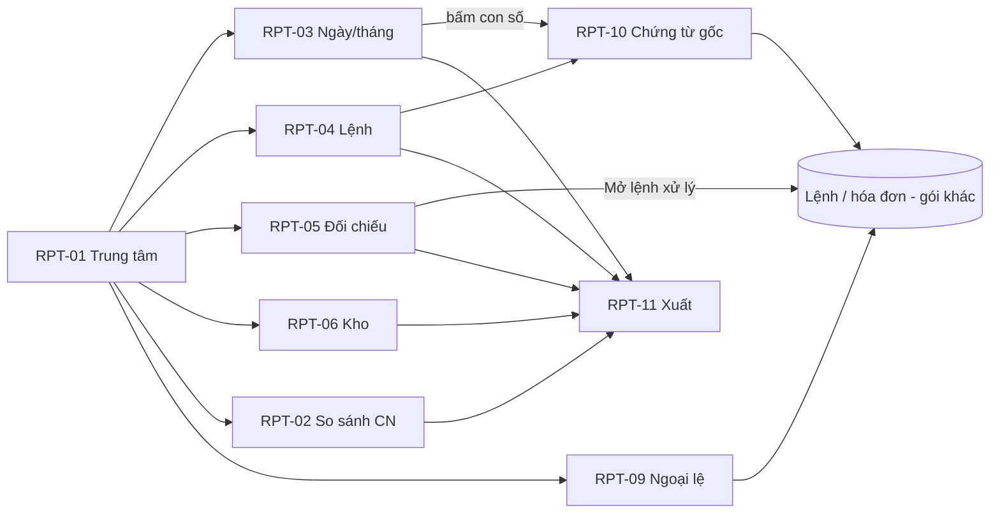

# UI/UX – Gói 6: Báo cáo và Hệ thống (G4-RPT, G4-SYS)

Phiên bản 0.3 (đã xử lý review BA vòng 1 F6-01…F6-35, vòng 2 F6R2-01…09 và trả lời các câu hỏi) · Người lập: designer · Căn cứ: `docs/design-system.md`, `docs/ui-ux/00-foundation.md`, `docs/ui-ux/ba-decisions.md`, `docs/ui-ux/screen-inventory.md` §8.4–8.5, §5, §6, §7, §9, FRD (FR-RPT, FR-SYS), Journey, `docs/ui-ux/ba-answers-06.md`, `docs/ui-ux/review-06-reports-system-ba.md`.

Sản phẩm: `design/g4-reports-system/` (35 file `.html` + `index.html` + `pack.css` + `pack.js`). Prototype HTML/CSS thuần, mở bằng trình duyệt (file://), dùng chung `../assets/tokens.css`, `base.css`, `components.css`, `app.js` (không sửa). Tiền tố class của gói: `g4r-`.

## 1. Phạm vi và kế hoạch

Gói gồm 35 màn hình: 11 báo cáo (G4-RPT-01…11) và 24 màn hình cài đặt, quản trị (G4-SYS-01…24). Đã làm đủ 35/35.

Kế hoạch đã thực hiện theo giai đoạn: (1) rà danh mục, chọn cách dựng chung; (2) khung dùng chung `pack.js`/`pack.css` (shell, trạng thái, bộ lọc, biểu đồ, hộp thoại xuất, drawer cấu hình); (3) màn hình ưu tiên P1: RPT-01, 03, 04, 05, 10, SYS-01…07, 09, 10, 12, 13, 14, 16, 19…22, 24; (4) các màn P2 trở đi (RPT-02, 06…09, 11, SYS-08, 11, 15, 17, 18, 23); (5) tài liệu, index, tự rà.

Nguyên tắc thiết kế riêng của gói:
- **Mọi con số nêu rõ phạm vi, kỳ và thời điểm** (RULE-015): thanh phạm vi (`scope-banner`) dưới tiêu đề; thẻ KPI có dòng `kpi__scope`; tệp xuất ghi phạm vi và thời điểm ở dòng đầu (xem trước trong hộp thoại xuất).
- **Biểu đồ theo design-system §9** bằng SVG/CSS thuần: line (xu hướng), horizontal bar (so sánh chi nhánh), stacked bar (trạng thái, kết quả báo giá), bar dọc (tồn theo nhóm). Mỗi biểu đồ có tên, đơn vị, kỳ, tooltip (hover và focus bàn phím), công thức/ghi chú và **bảng số liệu thay thế** (nút “Bảng số liệu”). Trục dọc bắt đầu từ 0; không dùng biểu đồ tròn, dual-axis, 3D.
- **Cấu hình có ngày hiệu lực**: mọi màn hình danh mục/thuế/mẫu/quy trình hiển thị phiên bản “Hiện hành / Sắp hiệu lực / Chờ duyệt”, drawer sửa luôn có “Ngày hiệu lực”, khối “Ảnh hưởng khi lưu” (không đổi chứng từ đã tạo), lý do bắt buộc, lỗi trùng ngày hiệu lực.
- **Quyền hiển thị rõ, không âm thầm ẩn**: nút/trường ngoài quyền bị khóa kèm lý do (`title` + dòng giải thích “Vai trò của bạn chỉ xem…”); màn hình ngoài quyền hiện trạng thái “Không có quyền” nêu vai trò được xem và nút gửi yêu cầu.
- **Không có nút “Xóa” cho dữ liệu đã ghi sổ hay nhật ký**: dùng Khóa, Thu hồi, Hoàn tác, Ngưng áp dụng, Đảo/điều chỉnh.

## 2. Bảng màn hình

Cột “Trạng thái” liệt kê các trạng thái đã có trong prototype (bật bằng thanh “Xem thử trạng thái” hoặc `?state=`). Trạng thái chuẩn mỗi trang: **data** (có dữ liệu), **loading**, **empty** (lần đầu), **filtered** (trống do lọc, chỉ ở màn danh sách/báo cáo), **error**, **denied**; ngoài ra là trạng thái đặc thù.

### 2.1 Báo cáo (G4-RPT)

| Mã | Tên | File | Template | Vai trò | Trạng thái thêm | Ưu tiên |
| --- | --- | --- | --- | --- | --- | --- |
| G4-RPT-01 | Trung tâm báo cáo | `g4-rpt-01.html` | C (thẻ) | CH QV QL KT; CV QĐ TH TK TN (Xn) | thẻ ẩn theo vai trò, nhóm rỗng ẩn, “Của tôi” | P1 |
| G4-RPT-02 | So sánh chi nhánh | `g4-rpt-02.html` | B/C | CH QV KT | `single` (chỉ 1 chi nhánh), pháp nhân | P3 |
| G4-RPT-03 | Báo cáo chi nhánh theo ngày và tháng | `g4-rpt-03.html` | C | QL KT CH QV | số tạm / chính thức, khớp số liệu, hợp nhất theo chi nhánh | P1 |
| G4-RPT-04 | Báo cáo lệnh sửa chữa | `g4-rpt-04.html` | C + biểu đồ | CH QV QL CV QĐ | “Của tôi” cho CV, QĐ; card list mobile | P1 |
| G4-RPT-05 | Đối chiếu lệnh – xuất kho – hóa đơn – thu tiền | `g4-rpt-05.html` | C | KT QL CH QV | chỉ lệnh thiếu / hiện cả lệnh đủ; công nợ hợp lệ | P1 |
| G4-RPT-06 | Báo cáo kho | `g4-rpt-06.html` | C + biểu đồ | TK (Xn) KT QL CH QV | bốn số tồn, “Chưa đặt định mức”, “Đang về N” | P2 |
| G4-RPT-07 | Báo cáo khách hàng | `g4-rpt-07.html` | C | CH QV QL KT | che SĐT theo vai trò (`.pii`), lý do cho KT | P2+ |
| G4-RPT-08 | Chỉ số bổ sung | `g4-rpt-08.html` | B | CH QV QL KT | “Cách tính” bung ra, đi sâu | P2+ |
| G4-RPT-09 | Cảnh báo ngoại lệ | `g4-rpt-09.html` | C | CH QV QL | chọn nhiều, đánh dấu đã xem, yêu cầu xử lý | P2 |
| G4-RPT-10 | Danh sách chứng từ gốc | `g4-rpt-10.html` | C | theo quyền chứng từ | tổng khớp con số nguồn, tab lệnh / phiếu thu | P1 |
| G4-RPT-11 | Xuất báo cáo | `g4-rpt-11.html` | Dlg | CH QV QL KT | không quyền xuất, chọn dữ liệu cá nhân (cảnh báo + lý do), tệp lớn xử lý nền, lỗi tạo tệp | P2 (Could) |

### 2.2 Cài đặt và quản trị (G4-SYS)

| Mã | Tên | File | Template | Vai trò (S/D/X) | Trạng thái thêm | Ưu tiên |
| --- | --- | --- | --- | --- | --- | --- |
| G4-SYS-01 | Danh sách người dùng | `g4-sys-01.html` | C | AD, QL (chi nhánh mình), CH | QL chỉ thấy chi nhánh mình; đã mời, bị khóa | P1 |
| G4-SYS-02 | Mời / sửa người dùng | `g4-sys-02.html` | E | AD CH QL | `dup` (email trùng), `sent`, QL không gán vượt quyền, xác nhận gán vai trò quản lý/kế toán | P1 |
| G4-SYS-03 | Chi tiết người dùng và phiên | `g4-sys-03.html` | D | AD CH QL | `locked`, `notfound`; khóa / thu hồi / đăng xuất mọi phiên có xác nhận mật khẩu | P1 |
| G4-SYS-04 | Vai trò và quyền | `g4-sys-04.html` | S | AD (sửa) CH (duyệt) | thay đổi chưa lưu, xem trước ảnh hưởng, ô khóa vượt ma trận chuẩn, AD khóa với dữ liệu cá nhân | P1 |
| G4-SYS-05 | Cơ cấu tổ chức | `g4-sys-05.html` | S (cây) | AD CH | `one` (1 chi nhánh), cấp pháp nhân ẩn/hiện, chi nhánh bị khóa | P1 |
| G4-SYS-06 | Cấu hình chi nhánh | `g4-sys-06.html` | E | AD, QL (giới hạn), CH | `locked`; trường tài chính bị khóa cho QL | P1 |
| G4-SYS-07 | Dịch vụ, giờ chuẩn, đơn giá | `g4-sys-07.html` | S | AD QL CH; KT CV (X) | phiên bản sắp hiệu lực / chờ duyệt, trùng ngày hiệu lực, lịch sử | P1 |
| G4-SYS-08 | Gói bảo dưỡng định kỳ | `g4-sys-08.html` | S | AD QL CH | chờ duyệt | P2 |
| G4-SYS-09 | Hạn mức giảm giá, chương trình giảm | `g4-sys-09.html` | S | QV (đề xuất hạn mức) CH (duyệt) QL (tạo chương trình trong hạn mức) | QL không tự nâng hạn mức, chương trình vượt hạn mức báo lỗi, chương trình hết hạn | P1 |
| G4-SYS-10 | Thuế suất theo ngày hiệu lực | `g4-sys-10.html` | S | KT (S) CH (D) | ví dụ kiểm thử, mốc 01/01/2027 chờ nhập | P1 |
| G4-SYS-11 | Chu kỳ nhắc đăng kiểm, bảo dưỡng, bảo hiểm | `g4-sys-11.html` | S | AD QL CH | ba tab | P2 |
| G4-SYS-12 | Mẫu chứng từ, mẫu in, mẫu tin | `g4-sys-12.html` | S | AD (S) KT (D mẫu kế toán) CH QL (xem) | xem trước A5/nhiệt 80/A4, Zalo/SMS “Chưa kích hoạt” | P1 |
| G4-SYS-13 | Quy trình theo loại dịch vụ | `g4-sys-13.html` | S | AD (S) QL (D) | đồng sơn “Chưa khảo sát” | P1 / P2+ |
| G4-SYS-14 | Mẫu checklist QC | `g4-sys-14.html` | S | AD QĐ (S) QL (D) | phiên bản nháp chờ duyệt | P1 (Should) |
| G4-SYS-15 | Danh mục dùng chung, phát hành | `g4-sys-15.html` | S | AD CH | chi nhánh ngừng nhận lệnh mới không nhận, phát hành có ngày hiệu lực và duyệt, thu hồi | P2 |
| G4-SYS-16 | Tích hợp hóa đơn điện tử | `g4-sys-16.html` | S | AD (S) KT (X) CH (D) | `unset` (chưa chọn NCC), `fail` (kết nối lỗi), chuyển môi trường thật | P1 |
| G4-SYS-17 | Tích hợp SMS, Zalo, email | `g4-sys-17.html` | S | AD (S) QL (X) | Zalo/SMS “Chưa kích hoạt”, gửi thử, bật gửi cho khách | P1 email / P2 |
| G4-SYS-18 | API và khóa tích hợp | `g4-sys-18.html` | C + E | AD | khóa hiện một lần, tái tạo, thu hồi | P2 |
| G4-SYS-19 | Nhật ký thao tác | `g4-sys-19.html` | C | AD CH QL KT (X) | chi tiết trước/sau (drawer), nhật ký truy cập dữ liệu cá nhân | P1 |
| G4-SYS-20 | Nhập dữ liệu từ Excel | `g4-sys-20.html` | W (6 bước) | AD QL CH; TK (tồn đầu kỳ), KT (công nợ đầu kỳ) | `badfile`, `big` (nền), `done`; lỗi theo dòng | P1 |
| G4-SYS-21 | Lịch sử lô nhập, hoàn tác | `g4-sys-21.html` | C | AD (đề xuất) CH (duyệt) | không hoàn tác được vì đã phát sinh giao dịch | P1 |
| G4-SYS-22 | Sao lưu và khôi phục | `g4-sys-22.html` | C | AD CH | `fail` (sao lưu thất bại), thử khôi phục, khôi phục thật | P1 |
| G4-SYS-23 | Chính sách lưu trữ, ẩn danh | `g4-sys-23.html` | S | AD CH KT | thời hạn chưa nhập, xem trước ẩn danh | P2 |
| G4-SYS-24 | Bảo mật và phiên | `g4-sys-24.html` | S | AD (S) CH (D) | cảnh báo “đang hạ mức bảo mật”, thiết bị xưởng | P1 |

Mã dùng chung: trang chủ gói `index.html` liệt kê đủ 35 màn hình.

## 3. UI/UX flow

### 3.1 Luồng báo cáo (đi sâu tới chứng từ gốc, FR-RPT-011)

1. Mở **Báo cáo** (menu) → G4-RPT-01 chọn báo cáo trong quyền.
2. Báo cáo (RPT-02/03/04/05/06/07/08/09): đổi kỳ/lọc → xem biểu đồ, chuyển “Bảng số liệu” nếu cần số chính xác.
3. Bấm một con số hoặc dòng → G4-RPT-10 (chứng từ cấu thành, tổng khớp) → mở lệnh / phiếu ở màn hình gói khác.
4. Từ mọi báo cáo bấm **Xuất báo cáo** → hộp thoại G4-RPT-11 (chọn định dạng, cột; dữ liệu cá nhân mặc định che) → tệp ghi phạm vi và thời điểm.
5. Đối chiếu cuối ngày: RPT-05 → mở lệnh thiếu để xử lý (G2/G4-EIN) → quay lại RPT-05 thấy hết thiếu.

### 3.2 Luồng người dùng và phân quyền

1. SYS-01 → “Mời người dùng” → SYS-02: nhập thông tin, gán vai trò × chi nhánh → (vai trò quản lý/kế toán/quản trị: hộp thoại xác nhận có lý do) → gửi lời mời (72 giờ).
2. SYS-01 → mở người dùng → SYS-03: vai trò, thiết bị, lịch sử đăng nhập; khóa / đăng xuất mọi phiên / buộc đặt lại MFA (nhập lại mật khẩu).
3. SYS-04: Quản trị chỉnh quyền theo hành động hoặc quyền che dữ liệu cá nhân → “Xem trước ảnh hưởng và lưu” → Chủ garage duyệt.
4. SYS-24: chính sách mật khẩu, MFA, hết phiên; hạ mức bảo mật → gửi Chủ garage duyệt.

### 3.3 Luồng cấu hình có ngày hiệu lực (SYS-07/08/09/10/11/12/13/14/15)

Mở danh sách (Hiện hành) → “Sửa”/“Đổi…” mở drawer → nhập giá trị + **ngày hiệu lực** (không quá khứ, không trùng ngày với phiên bản khác) + lý do → xem “Ảnh hưởng” → gửi duyệt → phiên bản “Chờ duyệt” → người duyệt mở hộp thoại “Duyệt yêu cầu” (xem thay đổi trước → sau, tick đã xem ảnh hưởng) và chọn **Duyệt** hoặc **Từ chối** (bắt buộc lý do ≥ 5 ký tự) → “Sắp hiệu lực” → đến ngày hiệu lực thành Hiện hành, bản cũ vào lịch sử. Người đề xuất không tự duyệt. Ba nhóm duyệt theo BA-06 câu 2: Chủ garage (thuế, hạn mức, giờ chuẩn, đơn giá, tài chính chi nhánh, quyền, bảo mật…), cấp chi nhánh (bộ bước QL duyệt, checklist QC QL duyệt, mẫu kế toán KT duyệt), không cần duyệt (thông tin chung chi nhánh, mẫu tin nội dung). Chứng từ đã tạo không đổi.

### 3.4 Luồng nhập Excel (FR-SYS-007)

SYS-20 bước 1 (loại dữ liệu theo vai trò, chi nhánh, môi trường) → 2 tải mẫu → 3 tải tệp + ánh xạ cột → 4 kiểm tra: nếu lỗi, bảng lỗi theo dòng, **không ghi một phần**, tải tệp lỗi, tải lại → 5 xem trước (mới/cập nhật/cảnh báo) → 6 tick đối chiếu, gõ “GHI LO” → đã ghi lô → SYS-21 để xem/hoàn tác (AD đề xuất, CH duyệt; bị chặn nếu đã phát sinh giao dịch).

### 3.5 Luồng tích hợp

SYS-16 (chọn bộ chuyển đổi nhà cung cấp → nhập kết nối → kiểm tra kết nối → môi trường thử; chuyển “Thật” là thao tác rủi ro) · SYS-17 (email hoạt động; Zalo/SMS “Chưa kích hoạt” → hộp thoại giải thích) · SYS-18 (khóa riêng từng hệ thống, hiện một lần).

## 4. Mô tả theo nhóm màn hình

### 4.1 Báo cáo (RPT-01…10)

**Bố cục chung** (template C/B): page header (tên + mô tả công thức ngắn + “Xuất báo cáo”) → thanh phạm vi (chi nhánh, kỳ, thời điểm, Làm mới) → bộ lọc chung (FR-RPT-014: kỳ, loại dịch vụ, nhân viên, trạng thái lệnh, nhóm doanh thu; chi nhánh lấy từ bộ chọn Phạm vi dữ liệu và hiển thị chữ) + chip bộ lọc đang áp dụng → hàng KPI (≤ 4 thẻ, mỗi thẻ có công thức/so sánh kỳ trước/phạm vi) → 1 biểu đồ chính → bảng chi tiết.

**Component dùng**: `scope-banner`, `filter-bar`, `chip-row`, `kpi` (+`kpi__scope`, `kpi__delta` mũi tên + chữ), `table`/`record-list` (mobile), `badge`/`tag`, `tabs`, `segmented`, `state`, `skeleton`, `dialog`, `drawer`, `.pii`; lớp mới `g4r-chart`, `g4r-hbar`, `g4r-stack`, `g4r-legend`, `g4r-ok/g4r-miss` (biểu tượng + chữ, không chỉ màu).

**Chỉ báo số tạm / chính thức** (FR-RPT-010): RPT-03 dùng tag “Số tạm” trên KPI và điểm cuối biểu đồ (viền nét đứt + chú giải).

**Từng màn hình**
- RPT-01: thẻ báo cáo theo nhóm, lọc theo vai trò (`data-show-roles`), nhóm không còn thẻ tự ẩn; “Thường dùng”, nút Ghim; thẻ báo cáo của gói khác (ACC-10/12/15, HRM-10) nằm ở đây với liên kết “#”. Hành động chính: mở báo cáo.
- RPT-02: tab chỉ số (doanh thu, số lệnh, giá trị TB, đúng hạn) → hbar xếp hạng + bảng xếp hạng có tổng và kiểm tra khớp; ẩn khi 1 chi nhánh (trạng thái `single`); cấp pháp nhân không cộng gộp (`data-legal`).
- RPT-03: bốn KPI ngày/tháng, dòng “Khớp số liệu” (thu + công nợ = doanh thu), line chart 14 ngày, bảng thu theo hình thức, so sánh tháng, bảng hợp nhất mỗi chi nhánh một dòng khi phạm vi hợp nhất.
- RPT-04: KPI (đang sửa, thời gian hoàn thành TB, đúng hạn, trễ hẹn), stacked bar trạng thái lệnh × chi nhánh, bảng lệnh trễ/tạm dừng (badge lệnh đúng bộ A.2, tag lý do tạm dừng).
- RPT-05: bốn thành phần mỗi lệnh; ô thiếu có biểu tượng + chữ (“Thiếu hóa đơn”, “Thiếu phiếu xuất kho”, “Chưa thu quá 3 ngày”); công nợ hợp lệ phân biệt với thiếu; mặc định chỉ hiện lệnh thiếu.
- RPT-06: bốn số tồn + cảnh báo theo **khả dụng** (badge Đủ hàng/Sắp hết/Hết hàng/Chưa đặt định mức, tag Đang về N), bar dọc giá trị tồn theo nhóm, hàng chậm luân chuyển, chênh lệch kiểm kê (điều chỉnh qua phiếu có duyệt).
- RPT-07: KPI, line 2 đường (liền/đứt), bảng khách có SĐT che theo vai trò (CH/QV Hiện không lý do, KT chọn lý do, QL đầy đủ).
- RPT-08: sáu chỉ số mỗi thẻ có “Cách tính” và “Xem chứng từ”; chiều tốt/xấu của delta thể hiện bằng mũi tên + chữ (ví dụ làm lại giảm = tốt).
- RPT-09: tab theo loại, chọn nhiều → “Đánh dấu đã xem”, “Yêu cầu xử lý” (dialog ghi chú).
- RPT-10: thẻ “Con số đã bấm” + dòng khớp tổng; tab Lệnh / Phiếu thu; chứng từ ngoài quyền hiện khóa kèm lý do.

### 4.2 Xuất dữ liệu (RPT-11)

Hộp thoại dùng chung `#dlg-export` có trong mọi báo cáo/nhật ký: định dạng (xlsx/PDF/CSV), cột (dữ liệu cá nhân mặc định tắt), **dòng đầu tệp xem trước** (phạm vi + kỳ + thời điểm + người xuất, RULE-015), tệp lớn xử lý nền (progress). Theo quyền (FR-SYS-013): vai trò không có quyền xuất → nút “Xuất báo cáo” disabled kèm lý do và hộp thoại hiện thông báo; tick dữ liệu cá nhân chỉ CH, KT → cảnh báo + lý do bắt buộc + ghi nhật ký. Trang RPT-11 còn có lịch sử xuất của tài khoản (kể cả “Lỗi, thử lại”).

### 4.3 Người dùng và phân quyền (SYS-01…04, 24)

- Danh sách: tìm không dấu, lọc vai trò/chi nhánh/trạng thái; vai trò × chi nhánh hiện bằng tag; MFA có biểu tượng + chữ; QL chỉ thấy chi nhánh mình; không có “Xóa” (khóa/vô hiệu).
- Mời người dùng: wizard một trang (3 mục), cho nhiều dòng vai trò × chi nhánh; người không email (thợ) dùng mã tạm/PIN; QL bị khóa các vai trò cao hơn kèm lý do; sticky footer Lưu nháp / Gửi lời mời; hộp thoại xác nhận khi gán vai trò quản lý/kế toán/quản trị.
- Chi tiết: tab vai trò, thiết bị/phiên (tin cậy 14 ngày), lịch sử đăng nhập (không sửa/xóa, địa chỉ mạng che một phần); thao tác rủi ro gom vào menu “Thao tác rủi ro”, đều yêu cầu lý do + nhập lại mật khẩu.
- Vai trò và quyền: 3 tab. (1) Ma trận 12 chức năng × 10 vai trò chép nguyên FRD §2 + cột “Kế toán trưởng” (vai trò tự tạo) với khung vàng cho ô khác chuẩn; ký hiệu S/D/X/Xn/– luôn kèm chữ. (2) Quyền theo 8 hành động (xem, tạo, sửa, lưu trữ, duyệt, từ chối, xuất, quản lý) cho vai trò chọn; ô vượt ma trận chuẩn bị khóa; đếm thay đổi chưa lưu; “Xem trước ảnh hưởng” (số người bị ảnh hưởng) trước khi gửi duyệt. (3) Che SĐT/email/địa chỉ theo vai trò (5 mức); dòng AD khóa theo luật.
- Bảo mật và phiên: giá trị mặc định D-02…D-05, đổi được; hạ mức bảo mật hiện cảnh báo và nút đổi thành “Gửi Chủ garage duyệt”; danh sách thiết bị xưởng.

### 4.4 Tổ chức và chi nhánh (SYS-05, 06, 15)

Cây Company → (Pháp nhân, chỉ hiện khi nhiều pháp nhân) → Kho tổng / Chi nhánh → Kho; nút Thêm chi nhánh (mã duy nhất, không đổi sau khi có chứng từ); khóa chi nhánh gồm **hai bước** (BA-06 Phụ lục A.1): (1) “Ngừng nhận lệnh mới” (chặn lịch hẹn, báo giá, lệnh mới nhưng vẫn hoàn tất lệnh đang mở, thu tiền, xuất hóa đơn, xuất kho gắn lệnh mở); (2) “Khóa hoàn toàn” chỉ khi không còn lệnh mở, phiếu thu chưa chốt ca, hàng đang đi đường, hóa đơn lỗi; hộp thoại liệt kê mục chặn và nút bị khóa kèm lý do. Cấu hình chi nhánh: nhóm “Thông tin chung” (QL sửa, có hiệu lực ngay, ghi nhật ký) và “Tài chính và pháp lý” (chỉ hiển thị, nút “Đổi…” mở drawer có ngày hiệu lực; Quản trị đề xuất, Chủ garage duyệt); đồng sơn bị khóa chờ khảo sát. Danh mục dùng chung: bảng tình trạng phát hành, hộp thoại chọn chi nhánh nhận có ngày hiệu lực và duyệt, thu hồi có xác nhận.

### 4.5 Danh mục dịch vụ, giá, thuế, mẫu, quy trình (SYS-07…14)

Cùng một khuôn: danh sách theo phiên bản + drawer `g4rDrawer` (ngày hiệu lực, ảnh hưởng, lý do) + lịch sử thay đổi (SYS-07). Riêng:
- SYS-10 thuế: không có giá trị mặc định (chờ kế toán nhập), khối **ví dụ kiểm thử có chữ ký xác nhận** của kế toán và nút chạy lại (NFR-MNT-01), xem trước ảnh hưởng bằng ví dụ minh họa.
- SYS-12 mẫu in: xem trước **A5 / nhiệt 80 mm / A4** của phiếu thu bằng khối `g4r-print` (khổ theo tỷ lệ giấy, không theo hãng máy in); trường bắt buộc theo mẫu kế toán bị khóa; mẫu tin nhắn có biến `{{…}}` và kênh Zalo/SMS “Chưa kích hoạt”.
- SYS-13 quy trình: bước có người phụ trách mặc định, bắt buộc, yêu cầu ảnh, qua cổng QC, nút lên/xuống có nhãn; năm trạng thái hạng mục cố định; thay đổi chỉ áp dụng lệnh mới.
- SYS-14 checklist QC: mục “Bắt buộc” hiển thị bằng tag chữ.

### 4.6 Tích hợp (SYS-16, 17, 18)

Không gắn tên/logo nhà cung cấp. SYS-16: thẻ tình trạng (môi trường, kết nối, hóa đơn lỗi), form kết nối (khóa bí mật chỉ ghi), “Kiểm tra kết nối” có kết quả, nhật ký gọi; chuyển Thử → Thật gõ “THAT”. SYS-17: ba kênh, “Chưa kích hoạt” kèm giải thích, nhật ký gửi (người nhận che). SYS-18: khóa hiện một lần (hộp thoại 2 pha), quyền tối thiểu, khóa dữ liệu cá nhân không cấp qua API.

### 4.7 Dữ liệu và an toàn (SYS-19…23)

- Nhật ký (SYS-19): bộ lọc thời gian/người/đối tượng/tìm mã, hai tab (thao tác, truy cập dữ liệu cá nhân), drawer trước → sau; **không có sửa/xóa**; AD thấy dữ liệu khách ở dạng che; QL chỉ chi nhánh mình.
- Nhập Excel (SYS-20): stepper 6 bước, bảng ánh xạ cột có “chưa khớp”, bảng lỗi theo dòng (dòng, cột, giá trị, lỗi, cách sửa), hàng lỗi có biểu tượng + chữ; nút “Xem trước” disabled kèm tooltip lý do tới khi hết lỗi; ghi cả lô có xác nhận gõ chữ.
- Lịch sử lô (SYS-21): hoàn tác = yêu cầu có lý do, CH duyệt; lô đã có giao dịch bị khóa kèm lý do và hướng “dùng phiếu điều chỉnh”.
- Sao lưu (SYS-22): KPI tình trạng, danh sách bản sao lưu, chạy thử khôi phục (môi trường thử), khôi phục thật nêu số liệu sẽ mất, gõ “KHOI PHUC”, CH duyệt; trạng thái thất bại nêu mức mất dữ liệu.
- Lưu trữ (SYS-23): không có thời hạn mặc định; chứng từ kế toán khóa không đổi; xem trước ẩn danh trước khi chạy.

## 5. Quy tắc hiển thị theo vai trò (đã hiện thực)

| Cơ chế | Cách làm trong prototype |
| --- | --- |
| Menu | Dùng `app.js` (ROLE_MENU). Mục **Cài đặt** và nhãn chế độ (“Danh mục”, “Xem và duyệt”) do `app.js` đã vá quyết định (`set: full / approve / limited`); `pack.js` chỉ đặt đích liên kết là màn cài đặt đầu tiên vai trò được mở. Thanh điều hướng cài đặt chỉ liệt kê màn trong quyền, nhóm rỗng ẩn. |
| Màn hình ngoài quyền | `data-allow` mỗi trang; đổi vai trò sang vai trò không thuộc danh sách thì tự chuyển sang trạng thái “Không có quyền”. |
| Nút/trường chỉ vài vai trò sửa | `data-edit-roles` (disabled + `aria-disabled` + `title`), kèm dòng giải thích `data-why-roles` hiện cho vai trò chỉ xem. |
| Duyệt / Từ chối | Nút “Xem và duyệt” (`data-show-roles`) và thẻ “Yêu cầu chờ Chủ garage duyệt” mở hộp thoại dùng chung có Duyệt và Từ chối (lý do bắt buộc). |
| Phạm vi và vai trò trong dữ liệu mẫu | `body[data-g4r-level]` (hợp nhất hay từng chi nhánh) và lớp `g4r-only-merged`, `g4r-only-branch`, `g4r-notq7`, `g4r-notkt`, `g4r-notqv`, `g4r-money` (ẩn giá vốn với Thủ kho), `g4r-notcv`. Chỉ minh họa; sản phẩm thật lọc ở máy chủ. |
| Chỉ phần của mình (Xn) | Banner thông tin trên các báo cáo có `data-own`. |
| Dữ liệu cá nhân | Cơ chế `.pii` của foundation (che, Hiện, lý do cho KT, tự che 30 giây); hộp thoại lý do dùng chung có sẵn ở mọi trang. |
| Xuất | Nút Xuất bị disabled kèm dòng chữ “Chưa có quyền xuất dữ liệu” với vai trò ngoài CH QV QL KT; AD chỉ xuất nhật ký (SYS-19); cột cá nhân đầy đủ chỉ CH, KT và cần lý do + nhập lại mật khẩu. |

## 6. Responsive

- ≥ 1024: sidebar + nội dung; màn SYS có cột danh mục cài đặt 248px (sticky) bên trái.
- 640–1023: sidebar thu gọn (shell); danh mục cài đặt biến thành ô chọn “Mục cài đặt” (`select`) đầu trang; lưới KPI 2 cột (theo `base.css`); biểu đồ line/bar dọc là SVG có `min-width` đúng bằng rộng viewBox (640px) nên chữ trục 12px không bao giờ bị thu nhỏ; khung hẹp hơn 640px thì cuộn ngang trong khung. (Bản 0.1 ghi min 520px là sai: với 520px, chữ 12px chỉ còn khoảng 9,8px.)
- < 640: bảng chính → `record-list` (RPT-04, 05, 06, 07, 09, 10, SYS-01, 07, 08, 09, 10, 11, 12, 15, 17, 18, 19, 21, 22, 24…); hbar và stacked bar xếp lại thành 2 dòng (nhãn + giá trị, thanh bên dưới); dialog thành bottom sheet; drawer full width. Bảng ít cột/chỉ đọc nằm trong khung cuộn ngang. Ma trận quyền (SYS-04) cuộn ngang với cột chức năng cố định.
- Touch target ≥ 44px theo component có sẵn; control mới: nhãn checkbox trong bảng có `min-width` và `min-height` 44px, hàng thanh ngang 44px khi con trỏ cảm ứng.

## 7. Ánh xạ FR / RULE

| Màn hình | FR / RULE chính |
| --- | --- |
| RPT-01 | FR-RPT-014 (bộ lọc chung, báo cáo trong quyền), NFR-ISO-01 |
| RPT-02 | FR-RPT-002 (so sánh chi nhánh), RULE-015, design-system §9 (không biểu đồ tròn) |
| RPT-03 | FR-RPT-003, 010 (số tạm/chính thức), UAT-01, RULE-015 |
| RPT-04 | FR-RPT-012; khớp G2-REC-03 |
| RPT-05 | FR-RPT-004, 008; UAT-01; RULE-007 |
| RPT-06 | FR-RPT-005, 016; RULE-008, RULE-009 (bốn số tồn) |
| RPT-07 | FR-RPT-015; NFR-SEC-03 (che dữ liệu cá nhân), NFR-EXP-01 |
| RPT-08 | FR-RPT-016, 011 |
| RPT-09 | FR-RPT-008 |
| RPT-10 | FR-RPT-011 (tổng danh sách = con số nguồn) |
| RPT-11 | FR-RPT-009, FR-SYS-013, NFR-EXP-01, RULE-015, FR-SYS-003 |
| SYS-01…03 | FR-SYS-001, 002, 012, 014; RULE-012; D-01 |
| SYS-04 | FR-SYS-002, 012, 013; BR-SYS-06; UAT-19; NFR-SEC-03; FRD §2 |
| SYS-05, 06 | FR-SYS-005, 011, 018; RULE-001 |
| SYS-07 | FR-SYS-006; FR-HRM-004; FR-REC-005 |
| SYS-08 | FR-REC-020 |
| SYS-09 | FR-INV-025; UAT-22; D-11 |
| SYS-10 | FR-ACC-009; FR-SYS-006; UAT-09; NFR-MNT-01 |
| SYS-11 | FR-CRM-006, 007, 008; FR-SYS-006 |
| SYS-12 | FR-SYS-006, 016; FR-ACC-014; NFR-PRT-01; FR-CRM-009 |
| SYS-13, 14 | FR-REC-032, 033, 016; FR-SYS-016 |
| SYS-15 | FR-SYS-016 |
| SYS-16 | FR-EIN-004, 005; FR-SYS-017; NFR-INT-01; D-13 |
| SYS-17 | FR-CRM-009, 010; FR-REC-034; FR-EIN-008; FR-SYS-008; D-13 |
| SYS-18 | FR-SYS-017; NFR-INT-01 |
| SYS-19 | FR-SYS-003, 014; RULE-013; NFR-SEC-03 |
| SYS-20, 21 | FR-SYS-007; BR-SYS-05; UAT-12; FRD §12 |
| SYS-22 | FR-SYS-010; BR-SYS-04; NFR-AVA-02 |
| SYS-23 | FR-HRM-012; FR-CRM-011; NFR-DAT-01; NFR-PRI-01 |
| SYS-24 | FR-SYS-001, 014; NFR-SEC-01; D-02…D-05 |

## 8. Accessibility – tự đánh giá (WCAG 2.2 AA)

| Hạng mục | Kết quả tự kiểm |
| --- | --- |
| Không chỉ dựa vào màu | Đạt theo thiết kế: badge/tag luôn có chữ; thiếu/đạt dùng biểu tượng + chữ (`g4r-ok`, `g4r-miss`); delta KPI có mũi tên + chữ; ô ma trận quyền có chữ S/D/X/Xn/–; ô khác chuẩn có khung vàng **và** chú giải. Biểu đồ: có chú giải bằng chữ, nhãn giá trị trên thanh, bảng thay thế. |
| Tương phản | Dùng token chữ đã kiểm của foundation. Chữ trắng trên các màu `--chart-series-1..5` (đoạn xếp chồng) ước tính ≥ 4,5:1 nhưng **chưa đo bằng công cụ**. |
| Biểu đồ | `role="img"` + `aria-labelledby` trên SVG; biểu đồ line chỉ có một điểm dừng Tab, di chuyển giữa các điểm bằng ← → Home End; thanh/cột `tabindex="0"` + `aria-label` đầy đủ giá trị; tooltip hiện khi focus, Esc ẩn; có bảng số liệu thay thế. Chữ trục luôn ≥ 12px thực tế (xem §6). |
| Bàn phím | Tab/Shift+Tab, mũi tên cho tabs, Esc cho dialog/drawer/tooltip, focus trap (từ `app.js`). Chưa làm roving tabindex cho ma trận quyền. |
| Cỡ chữ / touch | Chữ bảng 14px, nhỏ nhất 12px, kể cả chữ trục SVG (SVG không co dưới kích thước viewBox, khung hẹp thì cuộn ngang). Control ≥ 44px trên cảm ứng; nhãn checkbox trong bảng rộng và cao tối thiểu 44px. |
| Label, lỗi | Mọi input có `<label>`; ô không có nhãn hiển thị dùng `sr-only`; lỗi nêu cách sửa (bảng lỗi nhập Excel, trùng email, trùng ngày hiệu lực). |
| Trạng thái | Alert dùng `role="alert"` (lỗi) hoặc `role="status"`/`note`; `aria-busy` ở trạng thái đang tải. |
| Reduced motion | Kế thừa `base.css`. |
| Chưa kiểm | Screen reader thật, thiết bị cảm ứng thật, độ tương phản dark mode (không thuộc phạm vi), đo tương phản chữ trên màu biểu đồ. Lý do khóa nút: nút Xuất, các radio SYS-20 và bước khóa SYS-13 đã có dòng chữ nhìn thấy; nút “Sửa” trong bảng dựa vào dòng giải thích ở đầu trang (“Vai trò của bạn chỉ xem…”) cùng `title` (không hiện trên cảm ứng). |

## 9. Giả định

1. Chọn các giá trị mẫu (doanh thu, thuế suất, giờ chuẩn, đơn giá, hạn mức giảm, chu kỳ đăng kiểm…) chỉ để minh họa, đều ghi “minh họa/chờ xác nhận” ở nơi hiện số. Không có số hạn mức duyệt nào được hard-code ngoài các màn hình cấu hình (SYS-09 là chính màn cấu hình).
2. Ngưỡng cấu hình giả định: “chưa thu quá 3 ngày” (RPT-05), hàng chậm luân chuyển 90 ngày (RPT-06), lý do bắt buộc ≥ 5 ký tự (kế thừa foundation), hết hạn lời mời 72 giờ, tin cậy thiết bị 14 ngày, giữ thông báo 12 tháng (ba-decisions).
3. Công thức chỉ số lấy từ BA-06 câu 4 (định nghĩa mặc định, tham số cấu hình được; kế toán ký ví dụ kiểm thử trước nghiệm thu). Doanh thu hiển thị chưa thuế; số đối chiếu thu tiền ghi “gồm thuế”; thuế suất 10% trong dữ liệu mẫu chỉ để suy ra số chưa thuế.
4. Duyệt cấu hình theo ba nhóm của BA-06 câu 2 (Chủ garage / cấp chi nhánh / không cần duyệt). Nhóm cấp chi nhánh (SYS-13, 14 QL duyệt; SYS-12 KT duyệt) dùng cùng hộp thoại duyệt; hàng chờ riêng chờ gói APR.
5. Hộp thoại xuất dùng chung cho mọi báo cáo; quyền xuất theo BA-06 câu 3: CH QV QL KT xuất báo cáo, AD chỉ xuất nhật ký, cột cá nhân đầy đủ chỉ CH, KT.
6. Báo cáo “theo từng chi nhánh” (RPT-03) khi phạm vi hợp nhất hiển thị bảng mỗi chi nhánh một dòng kèm dòng tổng, không cộng gộp chi tiết (BA-06 câu 7). Các trang ghi “Dữ liệu mẫu minh họa: Chi nhánh Quận 7” vì số liệu mẫu tĩnh.
7. Đồng sơn chưa bật cho chi nhánh nào, quy trình để trống chờ khảo sát (D-13).
8. Dữ liệu mẫu: 5 chi nhánh (Quận 7, Quận 1, Thủ Đức, Biên Hòa, Đà Nẵng) khớp shell, Đà Nẵng đang “ngừng nhận lệnh mới” (khớp việc vẫn có doanh thu); tổng chuỗi tháng 10 = 2.228.500.000 ₫ chưa thuế (cộng đúng, lệnh hoàn tất 752); doanh thu ngày 30/10 chuỗi 128,5 triệu gồm thuế (116.818.181 ₫ chưa thuế) khớp design-system §7; 42 xe đang sửa, 6 chờ QC, 3 trễ hẹn khớp dashboard mẫu; giá trị TB mỗi lệnh hoàn tất dùng cùng công thức ở RPT-02, 03, 08. Giả định nhóm chi nhánh QV (Miền Nam, không gồm Đà Nẵng) và chi nhánh KT được gán (Quận 7, Thủ Đức).

## 10. 14 câu hỏi lượt 1: đã được BA trả lời

Toàn bộ 14 câu hỏi của bản 0.1 đã được BA trả lời tại `docs/ui-ux/ba-answers-06.md` (BA đề xuất, chờ xác nhận) và đã áp vào prototype ở bản 0.2. Tóm tắt nơi áp dụng:

| Câu | Quyết định BA | Áp dụng ở |
| --- | --- | --- |
| 1 | Một mục “Cài đặt”, hiện cho vai trò có ít nhất một màn SYS; thanh điều hướng chỉ liệt kê màn trong quyền | `pack.js` (menu, `SYS_ALLOW`), mọi trang SYS |
| 2 | Ba nhóm duyệt (CH / cấp chi nhánh / không duyệt); có Nháp; không cho hiệu lực quá khứ; người đề xuất không tự duyệt; Duyệt và Từ chối | Hộp thoại duyệt dùng chung, `g4rPending`, drawer ngày hiệu lực |
| 3 | CH QV QL KT xuất báo cáo; cột cá nhân đầy đủ chỉ CH, KT (lý do + mật khẩu); AD chỉ xuất nhật ký | Hộp thoại xuất, `canExport` |
| 4 | Công thức RPT chính thức (bảng 4.1–4.3) | RPT-02…08 |
| 5 | Chính thức = đã Chốt ngày; mở lại ngày về “Số tạm – đã mở lại” | RPT-03, nhãn “Gồm N ngày chưa chốt” |
| 6 | Ngưỡng 3 ngày; công nợ hợp lệ; “Không áp dụng” | RPT-05 |
| 7 | Hợp nhất: mỗi chi nhánh một dòng kèm dòng tổng | RPT-03 (khối merged/branch) |
| 8 | Chỉ hiện thẻ báo cáo gói khác khi module bật và có quyền; không để liên kết cụt | RPT-01 |
| 9 | MFA bắt buộc cho KT | SYS-24 |
| 10 | Quyền che chỉnh theo vai trò có trần theo luật; vai trò tự tạo có vai trò nền; Xuất/Quản lý chỉ khi có Xem | SYS-02, SYS-04 |
| 11 | .xlsx; 20 MB / 50.000 dòng; quy tắc trùng mã theo loại; AD không xem PII thô; TK nhập tồn, KT nhập công nợ | SYS-20 |
| 12 | RPO ≤ 1 giờ, RTO ≤ 4 giờ; khôi phục theo thời điểm; QL không xem sao lưu | SYS-22 |
| 13 | Không đặt số năm mặc định; thêm dòng nhật ký, tệp đính kèm | SYS-23 |
| 14 | Không ánh xạ màu biểu đồ theo màu badge; thứ tự màu cố định theo quy trình | Biểu đồ stacked |

Phụ lục A của BA (khóa chi nhánh hai bước; QV đề xuất hạn mức, QL không tự nâng; Thủ kho không thấy giá vốn; bước quy trình khóa bởi quy tắc; báo cáo “của tôi”) cũng đã áp dụng (SYS-05, 09, RPT-06, SYS-13, RPT-01/10).

## 11. Bảng Finding F6-01…F6-35 → đã xử lý ở đâu

Nguồn: `docs/ui-ux/review-06-reports-system-ba.md`. Cột “Mức”: M = Major, m = Minor.

| Finding | Mức | Xử lý | Ở đâu |
| --- | --- | --- | --- |
| F6-01 chữ trục < 12px | M | `min-width` của SVG = rộng viewBox (640) nên không bao giờ thu nhỏ; khung hẹp cuộn ngang; sửa tuyên bố sai ở §6, §8 | `pack.css`, `pack.js`, tài liệu §6, §8 |
| F6-02 khớp số liệu RPT-03 | M | Theo BA câu 4.1: “Đã thu của lệnh trong ngày”, “Thu nợ cũ / thu trước”, doanh thu chưa thuế vs tổng giá trị gồm thuế, 6 phiếu / 5 lệnh, so sánh cùng 30 ngày | RPT-03, RPT-10 |
| F6-03 banner phạm vi tĩnh | M | Báo cáo dùng `data-scope-text`; thêm nhãn “Dữ liệu mẫu minh họa: …”; `scopeText` cho RPT-10/11; không dùng “Phạm vi cấu hình” cho báo cáo | `pack.js` g4rPage, RPT-03…11 |
| F6-04 lộ nhiều chi nhánh | M | Khối `g4r-only-merged` / `g4r-only-branch` và lớp `g4r-notq7`, `g4r-notkt`, `g4r-notqv` điều khiển bằng phạm vi và vai trò; RPT-10 lọc “của tôi” cho CV | `pack.js` syncLevel, `pack.css`, RPT-02, 03, 04, 05, 08, 09, 10 |
| F6-05 TK thấy giá vốn | M | Lớp `g4r-money` ẩn giá trị tồn, vòng quay, giá trị hàng chậm với Thủ kho; thông báo giải thích | RPT-06 |
| F6-06 SYS-04 Xuất/Quản lý | M | Chỉ chọn khi đã có Xem; đếm thay đổi thực; hộp thoại ảnh hưởng theo vai trò đang chọn; trần che dữ liệu cá nhân | SYS-04 |
| F6-07 luồng duyệt | M | Hộp thoại “Duyệt yêu cầu” có Duyệt và Từ chối (lý do ≥ 5 ký tự), thẻ “Yêu cầu chờ Chủ garage duyệt” ở SYS-04, 15, 16, 22, 23, 24; SYS-21 L-0011 mở hộp thoại duyệt đúng lô | `pack.js` approveDialog, g4rPending, SYS-07…16, 21…24 |
| F6-08 thu hồi vai trò | M | Hai hộp thoại riêng nêu quyền mất / còn lại, lý do, mật khẩu, không tự thu hồi chính mình | SYS-03 |
| F6-09 SYS-06 | M | Nhóm tài chính chỉ hiển thị + “Đổi…” mở drawer có ngày hiệu lực, chờ CH duyệt; CH không sửa trực tiếp | SYS-06 |
| F6-10 SYS-09 | M | QV đề xuất hạn mức, CH duyệt; QL không sửa hạn mức, chỉ tạo chương trình kèm kiểm tra ≤ hạn mức; nhật ký đổi người duyệt thành QV | SYS-09, SYS-19 |
| F6-11 SYS-05 | M | Khóa hai bước: “Ngừng nhận lệnh mới” (NGUNG) rồi “Khóa hoàn toàn” chặn khi còn mục treo, liệt kê mục chặn; đổi dữ liệu mẫu cho nhất quán | SYS-05, SYS-15 |
| F6-12 SYS-13 | M | Công tắc Bắt buộc / cổng QC của bước gắn RULE-005/006, FR-REC-016, RULE-007 bị khóa kèm lý do | SYS-13 |
| F6-13 SYS-20 | M | Quyền theo loại dữ liệu (TK tồn, KT công nợ, AD che PII), ngày hiệu lực, môi trường thật cần duyệt cho loại tài chính, văn bản theo môi trường | SYS-20 |
| F6-14 SYS-22 | M | Chọn ngày + giờ, tính dữ liệu mất theo thời điểm và theo chi nhánh, cảnh báo vượt RPO, hàng chờ duyệt | SYS-22 |
| F6-15 RPT-01 | M | “Thường dùng” và thẻ theo từng vai trò, bỏ thẻ liên kết cụt, trạng thái rỗng cho TH/TN | RPT-01 |
| F6-16 điều hướng cài đặt | M | `SYS_ALLOW` lọc theo quyền, nhóm rỗng ẩn; menu Cài đặt hiện cho QV KT CV QĐ TK với nhãn “Danh mục” (shim chờ `ROLE_MENU`) | `pack.js` |
| F6-17 công thức không nhất quán | M | “Số lệnh mở” vs “Số lệnh hoàn tất”, mốc Sẵn sàng bàn giao, hạng mục QC trả lại, DSO theo số ngày thực, bỏ ghi chú nội bộ | RPT-02…08 |
| F6-18 RPT-05 | M | “Không áp dụng”, trạng thái hóa đơn, quy tắc “thiếu” ở chân bảng | RPT-05 |
| F6-19 SYS-24 | m | Bản đồ hướng “yếu đi” cho từng ô | SYS-24 |
| F6-20 disabled bị ghi đè | m | Giữ trạng thái disabled ban đầu (`_d0`) | `pack.js` gate |
| F6-21 touch target, lý do khóa | m | Nhãn checkbox trong bảng `min-width` 44px; hbar 44px khi cảm ứng; dòng chữ lý do nhìn thấy cho nút Xuất, radio SYS-20, bước khóa SYS-13, các trang cấu hình thêm dòng “vai trò của bạn chỉ xem” | `pack.css`, `pack.js`, SYS-06…23 |
| F6-22 màu ngữ nghĩa | m | “Bắt buộc” dùng tag Info; MFA không bắt buộc dùng chữ trung tính | SYS-14, SYS-20, SYS-01 |
| F6-23 dữ liệu mâu thuẫn | m | Đà Nẵng “ngừng nhận lệnh mới” (khớp doanh thu), 5 chi nhánh, bỏ “3 tài khoản đã khóa”, bỏ PIN cho QL, đổi người phụ trách | SYS-05, 15, 23, 03, RPT-04 |
| F6-24 SYS-02 | m | Khóa vai trò vượt quyền cho QL, thêm vai trò thiếu, bỏ lựa chọn “Đầy đủ” theo người, thông báo trùng email trung lập cho QL | SYS-02 |
| F6-25 SYS-01 | m | Bổ sung lọc vai trò; người nhiều chi nhánh hiện với QL, vai trò ngoài chi nhánh ẩn | SYS-01 |
| F6-26 SYS-10 | m | Thêm lịch sử, ví dụ làm tròn chờ kế toán; ghi nhận chênh với FR-ACC-009 ở câu hỏi còn lại | SYS-10 |
| F6-27 vai trò/điều khiển thiếu | m | “Ngưng áp dụng” ở SYS-07; SYS-12 thêm CH, QL (xem) và khóa Sửa theo AD; SYS-17/18 thêm CH (xem); tái tạo khóa hiện khóa mới một lần; SYS-21 thêm QL (xem); SYS-15 có ngày hiệu lực và duyệt | SYS-07, 12, 15, 17, 18, 21 |
| F6-28 SYS-23 | m | Thêm dòng nhật ký, tệp đính kèm, bản sao lưu; loại trừ khi ẩn danh; thay chú thích nội bộ | SYS-23 |
| F6-29 SYS-20 nhỏ | m | Bộ lọc loại lỗi thật; nêu 20 MB / 50.000 dòng | SYS-20 |
| F6-30 hộp thoại xuất | m | Bỏ AD khỏi xuất báo cáo (chỉ nhật ký), thêm mật khẩu và số dòng ước tính, nói rõ hai thời hạn tệp / lịch sử | `pack.js`, RPT-11 |
| F6-31 biểu đồ, tiện ích | m | `nice()` mới (trục gọn), một điểm dừng Tab + mũi tên cho line, tiền tố `g4r-` cho lớp màu, tab RPT-09 lọc thật, nút Ghim bật/tắt | `pack.js`, `pack.css`, RPT-01, 09 |
| F6-32 mật khẩu xác nhận | m | `data-g4r-pw` bắt buộc nhập trước khi bật nút xác nhận | `pack.js`, SYS-03, 18 |
| F6-33 `document.write` | m | `<noscript>` ở cả 35 trang và index; ghi chú handoff ở mục 12 | mọi trang, tài liệu §12 |
| F6-34 RPT-02 | m | Chỉ chi nhánh trong phạm vi (KT: 2, QV: 4), dòng tổng 3 biến thể, “Tổng các chi nhánh trong phạm vi”, so sánh cùng 30 ngày | RPT-02 |
| F6-35 tài liệu | m | Sửa §6, §8, §5, §9, §10, cập nhật bảng vai trò | tài liệu |

Không có finding nào còn bỏ ngỏ; các điểm xử lý một phần được ghi ở mục 14.

## 12. Handoff về cách ghép khung bằng `document.write`

`pack.js` chèn shell, phần đầu/đuôi trang và `app.js` bằng `document.write` để mỗi file chỉ giữ nội dung nghiệp vụ. Chỉ chấp nhận cho prototype xem nội bộ qua `file://`. Khi chuyển cho dev: **không sao chép kỹ thuật ghép này**; dựng shell thành component dùng chung của framework được chọn, cấu trúc DOM/class bám `design/foundation/shell.html`. Rủi ro đã biết: không có JavaScript hoặc lỗi giữa chừng thì trang trắng (đã thêm `<noscript>` báo rõ), chặn phân tích HTML, không dùng được CSP chặt vì có script nội tuyến, skip link và landmark chỉ có sau khi script chạy. Mã lọc theo vai trò/phạm vi (`data-*`, CSS) trong prototype chỉ minh họa; sản phẩm thật phải lọc ở máy chủ (NFR-ISO-01).

## 13. Câu hỏi còn lại cho BA (bản 0.2): đã được BA trả lời ở vòng 2

11 câu dưới đây đã được BA trả lời tại `docs/ui-ux/review-06-round2-ba.md` §4 (BA đề xuất, chờ xác nhận) và đã áp vào bản 0.3: menu theo `app.js` đã vá (shim chỉ còn đổi đích liên kết); QV chỉ xuất trong nhóm được giao, xuất cột cá nhân đầy đủ là quyền riêng (mặc định CH, KT); “Nhóm chi nhánh” là danh mục có ngày hiệu lực ở SYS-05; KT Quận 7 + Thủ Đức là mẫu cấu hình; doanh thu chưa thuế là Σ giá chưa thuế từng dòng, làm tròn theo dòng; thuế chỉ có gợi ý ở Nháp; hàng chờ duyệt dùng chung lọc theo người duyệt (G4-APR-03 ánh xạ loại yêu cầu → cấp duyệt); khóa chi nhánh hai bước có danh sách mục chặn đầy đủ; dữ liệu giá thật vào danh sách Discovery; palette giữ BA-06 câu 14. Nội dung gốc các câu hỏi giữ lại bên dưới để đối chiếu.

1. **Cài đặt `ROLE_MENU`**: `00-foundation.md` §7 và `app.js` cần thêm chế độ `set: 'limited'` (nhãn “Danh mục”) cho QV, KT, CV, QĐ, TK như BA-06 câu 1; prototype dùng shim trong `pack.js`. Xác nhận nhãn chế độ.
2. **Quyền xuất của QV với dữ liệu ngoài nhóm được giao** và việc QL “xuất hàng loạt cột cá nhân” cần quyền riêng: BA-06 câu 3 nêu nguyên tắc, cần danh sách quyền cụ thể ở SYS-04 (mặc định tắt).
3. **Nhóm chi nhánh của QV**: prototype giả định nhóm “Miền Nam” gồm Quận 7, Quận 1, Thủ Đức, Biên Hòa; Đà Nẵng thuộc “Miền Trung”. Xác nhận cấu hình nhóm.
4. **Chi nhánh KT được gán**: giả định Quận 7 và Thủ Đức (khớp bộ chọn của shell). Xác nhận.
5. **Số liệu doanh thu chưa thuế**: BA-06 đề xuất hiển thị chưa thuế; số tháng của các chi nhánh (RPT-02/03) được hiểu là chưa thuế, thuế suất minh họa 10% chỉ để suy ra số gồm thuế. Kế toán xác nhận cách tính và quy tắc làm tròn (theo dòng hay theo hóa đơn) ở SYS-10.
6. **FR-ACC-009 “mặc định theo chính sách hiện hành”** mâu thuẫn với SYS-10 không có mặc định (BA-06 Phụ lục B): cần chốt có giá trị gợi ý ở trạng thái Nháp hay không.
7. **Người duyệt cấp chi nhánh** (SYS-13, 14 do QL duyệt; SYS-12 do KT duyệt): cần G4-APR-03 mô tả bước duyệt này như một hàng chờ riêng hay dùng chung hàng chờ Chủ garage.
8. **Hạn mức giảm vượt trên từng báo giá do QV hoặc CH duyệt** (BA-06 Phụ lục A.2): nếu chi nhánh không thuộc nhóm của QV nào thì ai duyệt? (hiện: CH).
9. **Khóa chi nhánh bước 2**: danh sách mục chặn (lệnh mở, phiếu thu chưa chốt ca, hàng đang đi đường, hóa đơn lỗi) đã đủ chưa; bước 1 có cần CH duyệt không (prototype: không, chỉ lý do và gõ NGUNG).
10. **Dữ liệu mẫu giá và thuế**: mọi số trong SYS-07…10 là minh họa; cần số thật từ khách trước khi nghiệm thu.
11. **Palette biểu đồ chỉ có 5 màu**: giữ nguyên theo BA-06 câu 14; đề nghị chủ dự án ghi vào phụ lục `design-system.md` thứ tự màu cố định theo quy trình (không phải câu hỏi nghiệp vụ).

## 15. Finding vòng 2 (review-06-round2-ba.md) → đã xử lý ở đâu

| Finding | Mức | Xử lý | Ở đâu |
| --- | --- | --- | --- |
| F6-04 (còn lại) | M | Quản lý vùng ở phạm vi hợp nhất không thấy Đà Nẵng ở RPT-03 (hàng + dòng tổng 4 chi nhánh 91.954.545 ₫ chưa thuế), RPT-04 (KPI 35 xe, 87,0%, biểu đồ, bảng), RPT-08 (biểu đồ), cùng quy tắc với RPT-02; Thu ngân ở RPT-10 chỉ thấy 4 phiếu thu mình lập và 3 lệnh gắn các phiếu đó (tổng 16.600.000 ₫ gồm thuế / 15.090.909 ₫ chưa thuế) | `pack.css` (`g4r-nottn`, `g4r-tn-only`), RPT-03, 04, 08, 10 |
| F6R2-01 | M | Hộp thoại “Duyệt yêu cầu” có phần “Ảnh hưởng” theo từng loại yêu cầu (ngày hiệu lực mặc định; khôi phục thật nêu dữ liệu mất và hóa đơn đã gửi thuế; ẩn danh; hoàn tác lô; môi trường thật; hạ bảo mật; đổi quyền) và bắt buộc nhập lại mật khẩu cho loại rủi ro cao trước khi bật nút Duyệt | `pack.js` approveDialog, g4rPending (`imp`, `risk`), SYS-04, 16, 21, 22, 23, 24 |
| F6R2-02 | m | Shim menu chỉ còn đặt `href` theo màn đầu tiên trong quyền; bỏ tạo/xóa nhãn và đổi `hidden` (nhãn do `app.js` quyết định) | `pack.js` gate |
| F6R2-03 | m | Chương trình giảm 10% mẫu được hiển thị là “Hạn mức riêng đã duyệt (Chủ garage 28/09/2026)”, chỉ Quản lý vùng đề xuất đổi; QL chỉ thêm chương trình ≤ 5% (drawer mẫu 5%, nút thử lỗi vượt hạn mức) | SYS-09 |
| F6R2-04 | m | Bỏ thẻ RPT-10 khỏi Trung tâm báo cáo (mở từ con số), TN/TH rơi vào trạng thái rỗng; “Mở Tổng quan” trỏ `../g1-auth-dashboard/index.html`; lọc Thu ngân ở RPT-10 | RPT-01, RPT-10 |
| F6R2-05 | m | Thêm danh mục “Nhóm chi nhánh” (nhóm, chi nhánh, Quản lý vùng, hiệu lực, đổi nhóm có ngày hiệu lực và duyệt); SYS-02 gán Quản lý vùng theo nhóm | SYS-05, SYS-02 |
| F6R2-06 | m | Khối “Yêu cầu chờ … duyệt” (cùng hàng chờ dùng chung G4-APR-01 lọc theo người duyệt) ở SYS-06, 11 (Chủ garage) và SYS-13 (Quản lý chi nhánh) | SYS-06, 11, 13, `pack.js` g4rPending(roles, who) |
| F6R2-07 | m | Hạng tính động bằng CSS counter trên các hàng đang hiện; tag “Ngừng nhận lệnh mới” cho Đà Nẵng | RPT-02, `pack.css` |
| F6R2-08 | m | DSO không tô màu cảnh báo khi chưa có ngưỡng; SYS-05 dùng 7 lệnh đang mở (khớp RPT-04) + 5 lệnh Hoàn tất còn công nợ | RPT-08, SYS-05 |
| F6R2-09 | m | SYS-04 tách “Xuất báo cáo (đã che)” và “Xuất cột cá nhân đầy đủ” (chỉ ở Hồ sơ khách và xe; mặc định CH, KT; AD không có; cần có quyền Xem; cấp cho QL cần Chủ garage duyệt; QV chỉ trong nhóm được giao) | SYS-04 |
| Quyết định mới BA | — | Khóa chi nhánh hai bước kèm danh sách mục chặn mở rộng và tồn kho phải chọn cách xử lý; Bước 1 do CH (AD chỉ đề xuất); doanh thu chưa thuế Σ theo dòng và quy tắc làm tròn; mức thuế chỉ gợi ý ở Nháp | SYS-05, RPT-03, SYS-10 |

## 14. Điểm yếu còn lại

- Vẫn chưa mở trình duyệt: bố cục, tràn chữ tiếng Việt dài và tương phản chữ trắng trên 5 màu biểu đồ chưa kiểm trực quan hay bằng công cụ (BA-06 giao lại cho designer, chưa làm được).
- Dữ liệu mẫu tĩnh theo chi nhánh Quận 7 (một số trang ghi “Dữ liệu mẫu minh họa”); đổi chi nhánh ở bộ chọn chỉ đổi nhãn phạm vi và các khối hợp nhất / từng chi nhánh, không đổi số.
- Hộp thoại “Duyệt yêu cầu” và thẻ “Yêu cầu chờ duyệt” là cơ chế minh họa dùng chung; hàng chờ phê duyệt đầy đủ là G4-APR-01/02 của gói khác.
- Ma trận quyền (SYS-04) vẫn chưa có roving tabindex; nút Sửa trong một số bảng vẫn dựa vào dòng giải thích ở đầu trang và `title`.
- Chữ trục SVG đảm bảo ≥ 12px bằng cách cuộn ngang (min 640px) nên trên điện thoại phải cuộn; hbar và stacked đã chuyển 2 dòng nên không cần cuộn.
- Chưa có skeleton theo đúng hình từng khối; trạng thái “số tạm so với chính thức” mới có ở RPT-03 và RPT-02.
