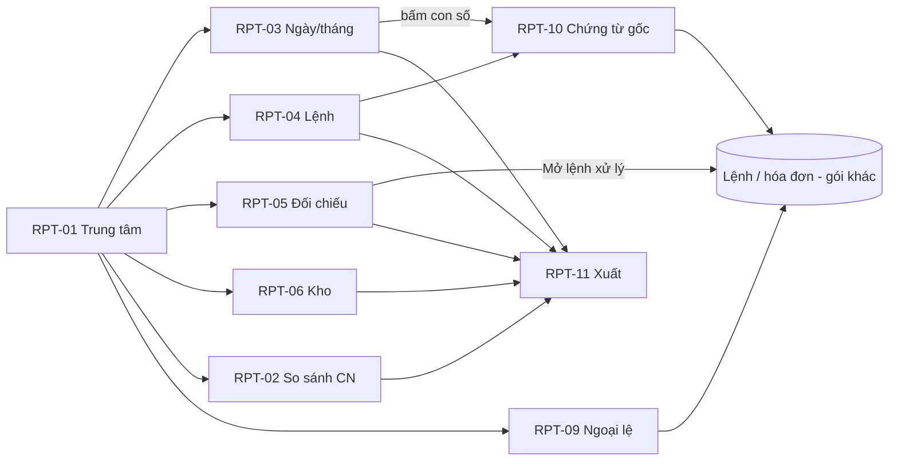

# UI/UX – Gói 6: Báo cáo và Hệ thống (G4-RPT, G4-SYS)

Phiên bản 0.1 · Người lập: designer · Căn cứ: `docs/design-system.md`, `docs/ui-ux/00-foundation.md`, `docs/ui-ux/ba-decisions.md`, `docs/ui-ux/screen-inventory.md` §8.4–8.5, §5, §6, §7, §9, FRD (FR-RPT, FR-SYS), Journey.

Sản phẩm: `design/g4-reports-system/` (35 file `.html` + `index.html` + `pack.css` + `pack.js`). Prototype HTML/CSS thuần, mở bằng trình duyệt (file://), dùng chung `../assets/tokens.css`, `base.css`, `components.css`, `app.js` (không sửa). Tiền tố class của gói: `g4r-`.

## 1. Phạm vi và kế hoạch

Gói gồm 35 màn hình: 11 báo cáo (G4-RPT-01…11) và 24 màn hình cài đặt, quản trị (G4-SYS-01…24). Đã làm đủ 35/35.

Kế hoạch đã thực hiện theo giai đoạn: (1) rà danh mục, chọn cách dựng chung; (2) khung dùng chung `pack.js`/`pack.css` (shell, trạng thái, bộ lọc, biểu đồ, hộp thoại xuất, drawer cấu hình); (3) màn hình ưu tiên P1: RPT-01, 03, 04, 05, 10, SYS-01…07, 09, 10, 12, 13, 14, 16, 19…22, 24; (4) các màn P2 trở đi (RPT-02, 06…09, 11, SYS-08, 11, 15, 17, 18, 23); (5) tài liệu, index, tự rà.

Nguyên tắc thiết kế riêng của gói:
- **Mọi con số nêu rõ phạm vi, kỳ và thời điểm** (RULE-015): thanh phạm vi (`scope-banner`) dưới tiêu đề; thẻ KPI có dòng `kpi__scope`; tệp xuất ghi phạm vi và thời điểm ở dòng đầu (xem trước trong hộp thoại xuất).
- **Biểu đồ theo design-system §9** bằng SVG/CSS thuần: line (xu hướng), horizontal bar (so sánh chi nhánh), stacked bar (trạng thái, kết quả báo giá), bar dọc (tồn theo nhóm). Mỗi biểu đồ có tên, đơn vị, kỳ, tooltip (hover và focus bàn phím), công thức/ghi chú và **bảng số liệu thay thế** (nút “Bảng số liệu”). Trục dọc bắt đầu từ 0; không dùng biểu đồ tròn, dual-axis, 3D.
- **Cấu hình có ngày hiệu lực**: mọi màn hình danh mục/thuế/mẫu/quy trình hiển thị phiên bản “Hiện hành / Sắp hiệu lực / Chờ duyệt”, drawer sửa luôn có “Ngày hiệu lực”, khối “Ảnh hưởng khi lưu” (không đổi chứng từ đã tạo), lý do bắt buộc, lỗi trùng ngày hiệu lực.
- **Quyền hiển thị rõ, không âm thầm ẩn**: nút/trường ngoài quyền bị khóa kèm lý do (`title` + dòng giải thích “Vai trò của bạn chỉ xem…”); màn hình ngoài quyền hiện trạng thái “Không có quyền” nêu vai trò được xem và nút gửi yêu cầu.
- **Không có nút “Xóa” cho dữ liệu đã ghi sổ hay nhật ký**: dùng Khóa, Thu hồi, Hoàn tác, Ngưng áp dụng, Đảo/điều chỉnh.

## 2. Bảng màn hình

Cột “Trạng thái” liệt kê các trạng thái đã có trong prototype (bật bằng thanh “Xem thử trạng thái” hoặc `?state=`). Trạng thái chuẩn mỗi trang: **data** (có dữ liệu), **loading**, **empty** (lần đầu), **filtered** (trống do lọc, chỉ ở màn danh sách/báo cáo), **error**, **denied**; ngoài ra là trạng thái đặc thù.

### 2.1 Báo cáo (G4-RPT)

| Mã | Tên | File | Template | Vai trò | Trạng thái thêm | Ưu tiên |
| --- | --- | --- | --- | --- | --- | --- |
| G4-RPT-01 | Trung tâm báo cáo | `g4-rpt-01.html` | C (thẻ) | CH QV QL KT; CV QĐ TH TK TN (Xn) | thẻ ẩn theo vai trò, nhóm rỗng ẩn, “Của tôi” | P1 |
| G4-RPT-02 | So sánh chi nhánh | `g4-rpt-02.html` | B/C | CH QV KT | `single` (chỉ 1 chi nhánh), pháp nhân | P3 |
| G4-RPT-03 | Báo cáo chi nhánh theo ngày và tháng | `g4-rpt-03.html` | C | QL KT CH QV | số tạm / chính thức, khớp số liệu, hợp nhất theo chi nhánh | P1 |
| G4-RPT-04 | Báo cáo lệnh sửa chữa | `g4-rpt-04.html` | C + biểu đồ | CH QV QL CV QĐ | “Của tôi” cho CV, QĐ; card list mobile | P1 |
| G4-RPT-05 | Đối chiếu lệnh – xuất kho – hóa đơn – thu tiền | `g4-rpt-05.html` | C | KT QL CH QV | chỉ lệnh thiếu / hiện cả lệnh đủ; công nợ hợp lệ | P1 |
| G4-RPT-06 | Báo cáo kho | `g4-rpt-06.html` | C + biểu đồ | TK (Xn) KT QL CH QV | bốn số tồn, “Chưa đặt định mức”, “Đang về N” | P2 |
| G4-RPT-07 | Báo cáo khách hàng | `g4-rpt-07.html` | C | CH QV QL KT | che SĐT theo vai trò (`.pii`), lý do cho KT | P2+ |
| G4-RPT-08 | Chỉ số bổ sung | `g4-rpt-08.html` | B | CH QV QL KT | “Cách tính” bung ra, đi sâu | P2+ |
| G4-RPT-09 | Cảnh báo ngoại lệ | `g4-rpt-09.html` | C | CH QV QL | chọn nhiều, đánh dấu đã xem, yêu cầu xử lý | P2 |
| G4-RPT-10 | Danh sách chứng từ gốc | `g4-rpt-10.html` | C | theo quyền chứng từ | tổng khớp con số nguồn, tab lệnh / phiếu thu | P1 |
| G4-RPT-11 | Xuất báo cáo | `g4-rpt-11.html` | Dlg | CH QV QL KT | không quyền xuất, chọn dữ liệu cá nhân (cảnh báo + lý do), tệp lớn xử lý nền, lỗi tạo tệp | P2 (Could) |

### 2.2 Cài đặt và quản trị (G4-SYS)

| Mã | Tên | File | Template | Vai trò (S/D/X) | Trạng thái thêm | Ưu tiên |
| --- | --- | --- | --- | --- | --- | --- |
| G4-SYS-01 | Danh sách người dùng | `g4-sys-01.html` | C | AD, QL (chi nhánh mình), CH | QL chỉ thấy chi nhánh mình; đã mời, bị khóa | P1 |
| G4-SYS-02 | Mời / sửa người dùng | `g4-sys-02.html` | E | AD CH QL | `dup` (email trùng), `sent`, QL không gán vượt quyền, xác nhận gán vai trò quản lý/kế toán | P1 |
| G4-SYS-03 | Chi tiết người dùng và phiên | `g4-sys-03.html` | D | AD CH QL | `locked`, `notfound`; khóa / thu hồi / đăng xuất mọi phiên có xác nhận mật khẩu | P1 |
| G4-SYS-04 | Vai trò và quyền | `g4-sys-04.html` | S | AD (sửa) CH (duyệt) | thay đổi chưa lưu, xem trước ảnh hưởng, ô khóa vượt ma trận chuẩn, AD khóa với dữ liệu cá nhân | P1 |
| G4-SYS-05 | Cơ cấu tổ chức | `g4-sys-05.html` | S (cây) | AD CH | `one` (1 chi nhánh), cấp pháp nhân ẩn/hiện, chi nhánh bị khóa | P1 |
| G4-SYS-06 | Cấu hình chi nhánh | `g4-sys-06.html` | E | AD, QL (giới hạn), CH | `locked`; trường tài chính bị khóa cho QL | P1 |
| G4-SYS-07 | Dịch vụ, giờ chuẩn, đơn giá | `g4-sys-07.html` | S | AD QL CH; KT CV (X) | phiên bản sắp hiệu lực / chờ duyệt, trùng ngày hiệu lực, lịch sử | P1 |
| G4-SYS-08 | Gói bảo dưỡng định kỳ | `g4-sys-08.html` | S | AD QL CH | chờ duyệt | P2 |
| G4-SYS-09 | Hạn mức giảm giá, chương trình giảm | `g4-sys-09.html` | S | CH (D) QV QL | nâng hạn mức = rủi ro, chương trình hết hạn | P1 |
| G4-SYS-10 | Thuế suất theo ngày hiệu lực | `g4-sys-10.html` | S | KT (S) CH (D) | ví dụ kiểm thử, mốc 01/01/2027 chờ nhập | P1 |
| G4-SYS-11 | Chu kỳ nhắc đăng kiểm, bảo dưỡng, bảo hiểm | `g4-sys-11.html` | S | AD QL CH | ba tab | P2 |
| G4-SYS-12 | Mẫu chứng từ, mẫu in, mẫu tin | `g4-sys-12.html` | S | AD (S) KT (D mẫu kế toán) | xem trước A5/nhiệt 80/A4, Zalo/SMS “Chưa kích hoạt” | P1 |
| G4-SYS-13 | Quy trình theo loại dịch vụ | `g4-sys-13.html` | S | AD (S) QL (D) | đồng sơn “Chưa khảo sát” | P1 / P2+ |
| G4-SYS-14 | Mẫu checklist QC | `g4-sys-14.html` | S | AD QĐ (S) QL (D) | phiên bản nháp chờ duyệt | P1 (Should) |
| G4-SYS-15 | Danh mục dùng chung, phát hành | `g4-sys-15.html` | S | AD CH | chi nhánh khóa không nhận, thu hồi | P2 |
| G4-SYS-16 | Tích hợp hóa đơn điện tử | `g4-sys-16.html` | S | AD (S) KT (X) CH (D) | `unset` (chưa chọn NCC), `fail` (kết nối lỗi), chuyển môi trường thật | P1 |
| G4-SYS-17 | Tích hợp SMS, Zalo, email | `g4-sys-17.html` | S | AD (S) QL (X) | Zalo/SMS “Chưa kích hoạt”, gửi thử, bật gửi cho khách | P1 email / P2 |
| G4-SYS-18 | API và khóa tích hợp | `g4-sys-18.html` | C + E | AD | khóa hiện một lần, tái tạo, thu hồi | P2 |
| G4-SYS-19 | Nhật ký thao tác | `g4-sys-19.html` | C | AD CH QL KT (X) | chi tiết trước/sau (drawer), nhật ký truy cập dữ liệu cá nhân | P1 |
| G4-SYS-20 | Nhập dữ liệu từ Excel | `g4-sys-20.html` | W (6 bước) | AD QL; KT/TK theo loại | `badfile`, `big` (nền), `done`; lỗi theo dòng | P1 |
| G4-SYS-21 | Lịch sử lô nhập, hoàn tác | `g4-sys-21.html` | C | AD (đề xuất) CH (duyệt) | không hoàn tác được vì đã phát sinh giao dịch | P1 |
| G4-SYS-22 | Sao lưu và khôi phục | `g4-sys-22.html` | C | AD CH | `fail` (sao lưu thất bại), thử khôi phục, khôi phục thật | P1 |
| G4-SYS-23 | Chính sách lưu trữ, ẩn danh | `g4-sys-23.html` | S | AD CH KT | thời hạn chưa nhập, xem trước ẩn danh | P2 |
| G4-SYS-24 | Bảo mật và phiên | `g4-sys-24.html` | S | AD (S) CH (D) | cảnh báo “đang hạ mức bảo mật”, thiết bị xưởng | P1 |

Mã dùng chung: trang chủ gói `index.html` liệt kê đủ 35 màn hình.

## 3. UI/UX flow

### 3.1 Luồng báo cáo (đi sâu tới chứng từ gốc, FR-RPT-011)

1. Mở **Báo cáo** (menu) → G4-RPT-01 chọn báo cáo trong quyền.
2. Báo cáo (RPT-02/03/04/05/06/07/08/09): đổi kỳ/lọc → xem biểu đồ, chuyển “Bảng số liệu” nếu cần số chính xác.
3. Bấm một con số hoặc dòng → G4-RPT-10 (chứng từ cấu thành, tổng khớp) → mở lệnh / phiếu ở màn hình gói khác.
4. Từ mọi báo cáo bấm **Xuất báo cáo** → hộp thoại G4-RPT-11 (chọn định dạng, cột; dữ liệu cá nhân mặc định che) → tệp ghi phạm vi và thời điểm.
5. Đối chiếu cuối ngày: RPT-05 → mở lệnh thiếu để xử lý (G2/G4-EIN) → quay lại RPT-05 thấy hết thiếu.

### 3.2 Luồng người dùng và phân quyền

1. SYS-01 → “Mời người dùng” → SYS-02: nhập thông tin, gán vai trò × chi nhánh → (vai trò quản lý/kế toán/quản trị: hộp thoại xác nhận có lý do) → gửi lời mời (72 giờ).
2. SYS-01 → mở người dùng → SYS-03: vai trò, thiết bị, lịch sử đăng nhập; khóa / đăng xuất mọi phiên / buộc đặt lại MFA (nhập lại mật khẩu).
3. SYS-04: Quản trị chỉnh quyền theo hành động hoặc quyền che dữ liệu cá nhân → “Xem trước ảnh hưởng và lưu” → Chủ garage duyệt.
4. SYS-24: chính sách mật khẩu, MFA, hết phiên; hạ mức bảo mật → gửi Chủ garage duyệt.

### 3.3 Luồng cấu hình có ngày hiệu lực (SYS-07/08/09/10/11/12/13/14/15)

Mở danh sách (Hiện hành) → “Sửa” mở drawer → nhập giá trị + **ngày hiệu lực** + lý do → xem “Ảnh hưởng” → lưu → phiên bản “Sắp hiệu lực / Chờ duyệt” → người có quyền Duyệt (nút hiện đúng vai trò) → đến ngày hiệu lực thành Hiện hành, bản cũ vào lịch sử. Chứng từ đã tạo không đổi.

### 3.4 Luồng nhập Excel (FR-SYS-007)

SYS-20 bước 1 (loại dữ liệu theo vai trò, chi nhánh, môi trường) → 2 tải mẫu → 3 tải tệp + ánh xạ cột → 4 kiểm tra: nếu lỗi, bảng lỗi theo dòng, **không ghi một phần**, tải tệp lỗi, tải lại → 5 xem trước (mới/cập nhật/cảnh báo) → 6 tick đối chiếu, gõ “GHI LO” → đã ghi lô → SYS-21 để xem/hoàn tác (AD đề xuất, CH duyệt; bị chặn nếu đã phát sinh giao dịch).

### 3.5 Luồng tích hợp

SYS-16 (chọn bộ chuyển đổi nhà cung cấp → nhập kết nối → kiểm tra kết nối → môi trường thử; chuyển “Thật” là thao tác rủi ro) · SYS-17 (email hoạt động; Zalo/SMS “Chưa kích hoạt” → hộp thoại giải thích) · SYS-18 (khóa riêng từng hệ thống, hiện một lần).

## 4. Mô tả theo nhóm màn hình

### 4.1 Báo cáo (RPT-01…10)

**Bố cục chung** (template C/B): page header (tên + mô tả công thức ngắn + “Xuất báo cáo”) → thanh phạm vi (chi nhánh, kỳ, thời điểm, Làm mới) → bộ lọc chung (FR-RPT-014: kỳ, loại dịch vụ, nhân viên, trạng thái lệnh, nhóm doanh thu; chi nhánh lấy từ bộ chọn Phạm vi dữ liệu và hiển thị chữ) + chip bộ lọc đang áp dụng → hàng KPI (≤ 4 thẻ, mỗi thẻ có công thức/so sánh kỳ trước/phạm vi) → 1 biểu đồ chính → bảng chi tiết.

**Component dùng**: `scope-banner`, `filter-bar`, `chip-row`, `kpi` (+`kpi__scope`, `kpi__delta` mũi tên + chữ), `table`/`record-list` (mobile), `badge`/`tag`, `tabs`, `segmented`, `state`, `skeleton`, `dialog`, `drawer`, `.pii`; lớp mới `g4r-chart`, `g4r-hbar`, `g4r-stack`, `g4r-legend`, `g4r-ok/g4r-miss` (biểu tượng + chữ, không chỉ màu).

**Chỉ báo số tạm / chính thức** (FR-RPT-010): RPT-03 dùng tag “Số tạm” trên KPI và điểm cuối biểu đồ (viền nét đứt + chú giải).

**Từng màn hình**
- RPT-01: thẻ báo cáo theo nhóm, lọc theo vai trò (`data-show-roles`), nhóm không còn thẻ tự ẩn; “Thường dùng”, nút Ghim; thẻ báo cáo của gói khác (ACC-10/12/15, HRM-10) nằm ở đây với liên kết “#”. Hành động chính: mở báo cáo.
- RPT-02: tab chỉ số (doanh thu, số lệnh, giá trị TB, đúng hạn) → hbar xếp hạng + bảng xếp hạng có tổng và kiểm tra khớp; ẩn khi 1 chi nhánh (trạng thái `single`); cấp pháp nhân không cộng gộp (`data-legal`).
- RPT-03: bốn KPI ngày/tháng, dòng “Khớp số liệu” (thu + công nợ = doanh thu), line chart 14 ngày, bảng thu theo hình thức, so sánh tháng, bảng hợp nhất mỗi chi nhánh một dòng khi phạm vi hợp nhất.
- RPT-04: KPI (đang sửa, thời gian hoàn thành TB, đúng hạn, trễ hẹn), stacked bar trạng thái lệnh × chi nhánh, bảng lệnh trễ/tạm dừng (badge lệnh đúng bộ A.2, tag lý do tạm dừng).
- RPT-05: bốn thành phần mỗi lệnh; ô thiếu có biểu tượng + chữ (“Thiếu hóa đơn”, “Thiếu phiếu xuất kho”, “Chưa thu quá 3 ngày”); công nợ hợp lệ phân biệt với thiếu; mặc định chỉ hiện lệnh thiếu.
- RPT-06: bốn số tồn + cảnh báo theo **khả dụng** (badge Đủ hàng/Sắp hết/Hết hàng/Chưa đặt định mức, tag Đang về N), bar dọc giá trị tồn theo nhóm, hàng chậm luân chuyển, chênh lệch kiểm kê (điều chỉnh qua phiếu có duyệt).
- RPT-07: KPI, line 2 đường (liền/đứt), bảng khách có SĐT che theo vai trò (CH/QV Hiện không lý do, KT chọn lý do, QL đầy đủ).
- RPT-08: sáu chỉ số mỗi thẻ có “Cách tính” và “Xem chứng từ”; chiều tốt/xấu của delta thể hiện bằng mũi tên + chữ (ví dụ làm lại giảm = tốt).
- RPT-09: tab theo loại, chọn nhiều → “Đánh dấu đã xem”, “Yêu cầu xử lý” (dialog ghi chú).
- RPT-10: thẻ “Con số đã bấm” + dòng khớp tổng; tab Lệnh / Phiếu thu; chứng từ ngoài quyền hiện khóa kèm lý do.

### 4.2 Xuất dữ liệu (RPT-11)

Hộp thoại dùng chung `#dlg-export` có trong mọi báo cáo/nhật ký: định dạng (xlsx/PDF/CSV), cột (dữ liệu cá nhân mặc định tắt), **dòng đầu tệp xem trước** (phạm vi + kỳ + thời điểm + người xuất, RULE-015), tệp lớn xử lý nền (progress). Theo quyền (FR-SYS-013): vai trò không có quyền xuất → nút “Xuất báo cáo” disabled kèm lý do và hộp thoại hiện thông báo; tick dữ liệu cá nhân chỉ CH, KT → cảnh báo + lý do bắt buộc + ghi nhật ký. Trang RPT-11 còn có lịch sử xuất của tài khoản (kể cả “Lỗi, thử lại”).

### 4.3 Người dùng và phân quyền (SYS-01…04, 24)

- Danh sách: tìm không dấu, lọc vai trò/chi nhánh/trạng thái; vai trò × chi nhánh hiện bằng tag; MFA có biểu tượng + chữ; QL chỉ thấy chi nhánh mình; không có “Xóa” (khóa/vô hiệu).
- Mời người dùng: wizard một trang (3 mục), cho nhiều dòng vai trò × chi nhánh; người không email (thợ) dùng mã tạm/PIN; QL bị khóa các vai trò cao hơn kèm lý do; sticky footer Lưu nháp / Gửi lời mời; hộp thoại xác nhận khi gán vai trò quản lý/kế toán/quản trị.
- Chi tiết: tab vai trò, thiết bị/phiên (tin cậy 14 ngày), lịch sử đăng nhập (không sửa/xóa, địa chỉ mạng che một phần); thao tác rủi ro gom vào menu “Thao tác rủi ro”, đều yêu cầu lý do + nhập lại mật khẩu.
- Vai trò và quyền: 3 tab. (1) Ma trận 12 chức năng × 10 vai trò chép nguyên FRD §2 + cột “Kế toán trưởng” (vai trò tự tạo) với khung vàng cho ô khác chuẩn; ký hiệu S/D/X/Xn/– luôn kèm chữ. (2) Quyền theo 8 hành động (xem, tạo, sửa, lưu trữ, duyệt, từ chối, xuất, quản lý) cho vai trò chọn; ô vượt ma trận chuẩn bị khóa; đếm thay đổi chưa lưu; “Xem trước ảnh hưởng” (số người bị ảnh hưởng) trước khi gửi duyệt. (3) Che SĐT/email/địa chỉ theo vai trò (5 mức); dòng AD khóa theo luật.
- Bảo mật và phiên: giá trị mặc định D-02…D-05, đổi được; hạ mức bảo mật hiện cảnh báo và nút đổi thành “Gửi Chủ garage duyệt”; danh sách thiết bị xưởng.

### 4.4 Tổ chức và chi nhánh (SYS-05, 06, 15)

Cây Company → (Pháp nhân, chỉ hiện khi nhiều pháp nhân) → Kho tổng / Chi nhánh → Kho; nút Thêm chi nhánh (mã duy nhất, không đổi sau khi có chứng từ); khóa chi nhánh là hành động rủi ro (nêu số lệnh đang mở, gõ mã chi nhánh); chi nhánh khóa vẫn tra cứu. Cấu hình chi nhánh: nhóm “Thông tin chung” (QL sửa) và “Tài chính và pháp lý” (AD/CH sửa, QL thấy bị khóa kèm lý do); đồng sơn bị khóa chờ khảo sát. Danh mục dùng chung: bảng tình trạng phát hành, hộp thoại chọn chi nhánh nhận (chi nhánh khóa không chọn được), thu hồi có xác nhận.

### 4.5 Danh mục dịch vụ, giá, thuế, mẫu, quy trình (SYS-07…14)

Cùng một khuôn: danh sách theo phiên bản + drawer `g4rDrawer` (ngày hiệu lực, ảnh hưởng, lý do) + lịch sử thay đổi (SYS-07). Riêng:
- SYS-10 thuế: không có giá trị mặc định (chờ kế toán nhập), khối **ví dụ kiểm thử có chữ ký xác nhận** của kế toán và nút chạy lại (NFR-MNT-01), xem trước ảnh hưởng bằng ví dụ minh họa.
- SYS-12 mẫu in: xem trước **A5 / nhiệt 80 mm / A4** của phiếu thu bằng khối `g4r-print` (khổ theo tỷ lệ giấy, không theo hãng máy in); trường bắt buộc theo mẫu kế toán bị khóa; mẫu tin nhắn có biến `{{…}}` và kênh Zalo/SMS “Chưa kích hoạt”.
- SYS-13 quy trình: bước có người phụ trách mặc định, bắt buộc, yêu cầu ảnh, qua cổng QC, nút lên/xuống có nhãn; năm trạng thái hạng mục cố định; thay đổi chỉ áp dụng lệnh mới.
- SYS-14 checklist QC: mục “Bắt buộc” hiển thị bằng tag chữ.

### 4.6 Tích hợp (SYS-16, 17, 18)

Không gắn tên/logo nhà cung cấp. SYS-16: thẻ tình trạng (môi trường, kết nối, hóa đơn lỗi), form kết nối (khóa bí mật chỉ ghi), “Kiểm tra kết nối” có kết quả, nhật ký gọi; chuyển Thử → Thật gõ “THAT”. SYS-17: ba kênh, “Chưa kích hoạt” kèm giải thích, nhật ký gửi (người nhận che). SYS-18: khóa hiện một lần (hộp thoại 2 pha), quyền tối thiểu, khóa dữ liệu cá nhân không cấp qua API.

### 4.7 Dữ liệu và an toàn (SYS-19…23)

- Nhật ký (SYS-19): bộ lọc thời gian/người/đối tượng/tìm mã, hai tab (thao tác, truy cập dữ liệu cá nhân), drawer trước → sau; **không có sửa/xóa**; AD thấy dữ liệu khách ở dạng che; QL chỉ chi nhánh mình.
- Nhập Excel (SYS-20): stepper 6 bước, bảng ánh xạ cột có “chưa khớp”, bảng lỗi theo dòng (dòng, cột, giá trị, lỗi, cách sửa), hàng lỗi có biểu tượng + chữ; nút “Xem trước” disabled kèm tooltip lý do tới khi hết lỗi; ghi cả lô có xác nhận gõ chữ.
- Lịch sử lô (SYS-21): hoàn tác = yêu cầu có lý do, CH duyệt; lô đã có giao dịch bị khóa kèm lý do và hướng “dùng phiếu điều chỉnh”.
- Sao lưu (SYS-22): KPI tình trạng, danh sách bản sao lưu, chạy thử khôi phục (môi trường thử), khôi phục thật nêu số liệu sẽ mất, gõ “KHOI PHUC”, CH duyệt; trạng thái thất bại nêu mức mất dữ liệu.
- Lưu trữ (SYS-23): không có thời hạn mặc định; chứng từ kế toán khóa không đổi; xem trước ẩn danh trước khi chạy.

## 5. Quy tắc hiển thị theo vai trò (đã hiện thực)

| Cơ chế | Cách làm trong prototype |
| --- | --- |
| Menu | Dùng `app.js` (ROLE_MENU). Riêng mục **Cài đặt** cho vai trò ngoài (CH QL AD) nhưng được phép xem màn hình (KT, CV…) bị mở ra bởi `pack.js` (xem Câu hỏi 1). |
| Màn hình ngoài quyền | `data-allow` mỗi trang; đổi vai trò sang vai trò không thuộc danh sách thì tự chuyển sang trạng thái “Không có quyền”. |
| Nút/trường chỉ vài vai trò sửa | `data-edit-roles` (disabled + `aria-disabled` + `title`), kèm dòng giải thích `data-why-roles` hiện cho vai trò chỉ xem. |
| Nút Duyệt của Chủ garage | `data-show-roles="CH"` trên phiên bản “Chờ duyệt”. |
| Chỉ phần của mình (Xn) | Banner thông tin trên các báo cáo có `data-own`. |
| Dữ liệu cá nhân | Cơ chế `.pii` của foundation (che, Hiện, lý do cho KT, tự che 30 giây); hộp thoại lý do dùng chung có sẵn ở mọi trang. |
| Xuất | Nút Xuất bị disabled kèm lý do với vai trò ngoài (CH QV QL KT AD); cột cá nhân chỉ CH, KT. |

## 6. Responsive

- ≥ 1024: sidebar + nội dung; màn SYS có cột danh mục cài đặt 248px (sticky) bên trái.
- 640–1023: sidebar thu gọn (shell); danh mục cài đặt biến thành ô chọn “Mục cài đặt” (`select`) đầu trang; lưới KPI 2 cột (theo `base.css`); biểu đồ line/bar cuộn ngang trong khung (min 520px) để chữ trục không nhỏ hơn 12px.
- < 640: bảng chính → `record-list` (RPT-04, 05, 06, 07, 09, 10, SYS-01, 07, 08, 09, 10, 11, 12, 15, 17, 18, 19, 21, 22, 24…); hbar và stacked bar xếp lại thành 2 dòng (nhãn + giá trị, thanh bên dưới); dialog thành bottom sheet; drawer full width. Bảng ít cột/chỉ đọc nằm trong khung cuộn ngang. Ma trận quyền (SYS-04) cuộn ngang với cột chức năng cố định.
- Touch target ≥ 44px theo component có sẵn (control mới như checkbox ma trận dùng `min-height: 44px`).

## 7. Ánh xạ FR / RULE

| Màn hình | FR / RULE chính |
| --- | --- |
| RPT-01 | FR-RPT-014 (bộ lọc chung, báo cáo trong quyền), NFR-ISO-01 |
| RPT-02 | FR-RPT-002 (so sánh chi nhánh), RULE-015, design-system §9 (không biểu đồ tròn) |
| RPT-03 | FR-RPT-003, 010 (số tạm/chính thức), UAT-01, RULE-015 |
| RPT-04 | FR-RPT-012; khớp G2-REC-03 |
| RPT-05 | FR-RPT-004, 008; UAT-01; RULE-007 |
| RPT-06 | FR-RPT-005, 016; RULE-008, RULE-009 (bốn số tồn) |
| RPT-07 | FR-RPT-015; NFR-SEC-03 (che dữ liệu cá nhân), NFR-EXP-01 |
| RPT-08 | FR-RPT-016, 011 |
| RPT-09 | FR-RPT-008 |
| RPT-10 | FR-RPT-011 (tổng danh sách = con số nguồn) |
| RPT-11 | FR-RPT-009, FR-SYS-013, NFR-EXP-01, RULE-015, FR-SYS-003 |
| SYS-01…03 | FR-SYS-001, 002, 012, 014; RULE-012; D-01 |
| SYS-04 | FR-SYS-002, 012, 013; BR-SYS-06; UAT-19; NFR-SEC-03; FRD §2 |
| SYS-05, 06 | FR-SYS-005, 011, 018; RULE-001 |
| SYS-07 | FR-SYS-006; FR-HRM-004; FR-REC-005 |
| SYS-08 | FR-REC-020 |
| SYS-09 | FR-INV-025; UAT-22; D-11 |
| SYS-10 | FR-ACC-009; FR-SYS-006; UAT-09; NFR-MNT-01 |
| SYS-11 | FR-CRM-006, 007, 008; FR-SYS-006 |
| SYS-12 | FR-SYS-006, 016; FR-ACC-014; NFR-PRT-01; FR-CRM-009 |
| SYS-13, 14 | FR-REC-032, 033, 016; FR-SYS-016 |
| SYS-15 | FR-SYS-016 |
| SYS-16 | FR-EIN-004, 005; FR-SYS-017; NFR-INT-01; D-13 |
| SYS-17 | FR-CRM-009, 010; FR-REC-034; FR-EIN-008; FR-SYS-008; D-13 |
| SYS-18 | FR-SYS-017; NFR-INT-01 |
| SYS-19 | FR-SYS-003, 014; RULE-013; NFR-SEC-03 |
| SYS-20, 21 | FR-SYS-007; BR-SYS-05; UAT-12; FRD §12 |
| SYS-22 | FR-SYS-010; BR-SYS-04; NFR-AVA-02 |
| SYS-23 | FR-HRM-012; FR-CRM-011; NFR-DAT-01; NFR-PRI-01 |
| SYS-24 | FR-SYS-001, 014; NFR-SEC-01; D-02…D-05 |

## 8. Accessibility – tự đánh giá (WCAG 2.2 AA)

| Hạng mục | Kết quả tự kiểm |
| --- | --- |
| Không chỉ dựa vào màu | Đạt theo thiết kế: badge/tag luôn có chữ; thiếu/đạt dùng biểu tượng + chữ (`g4r-ok`, `g4r-miss`); delta KPI có mũi tên + chữ; ô ma trận quyền có chữ S/D/X/Xn/–; ô khác chuẩn có khung vàng **và** chú giải. Biểu đồ: có chú giải bằng chữ, nhãn giá trị trên thanh, bảng thay thế. |
| Tương phản | Dùng token chữ đã kiểm của foundation. Chữ trắng trên các màu `--chart-series-1..5` (đoạn xếp chồng) ước tính ≥ 4,5:1 nhưng **chưa đo bằng công cụ**. |
| Biểu đồ | `role="img"` + `aria-labelledby` trên SVG; từng điểm/thanh `tabindex="0"` + `aria-label` đầy đủ giá trị; tooltip hiện khi focus, Esc ẩn; đồng hành bảng số liệu bằng nút “Bảng số liệu”. |
| Bàn phím | Tab/Shift+Tab, mũi tên cho tabs, Esc cho dialog/drawer/tooltip, focus trap (từ `app.js`). Chưa làm roving tabindex cho ma trận quyền. |
| Cỡ chữ / touch | Chữ bảng 14px, nhỏ nhất 12px (trục SVG 12px ở kích thước chuẩn, cuộn ngang khi hẹp). Control ≥ 44px trên cảm ứng nhờ component có sẵn; các ô checkbox ma trận đặt `min-height: 44px`. |
| Label, lỗi | Mọi input có `<label>`; ô không có nhãn hiển thị dùng `sr-only`; lỗi nêu cách sửa (bảng lỗi nhập Excel, trùng email, trùng ngày hiệu lực). |
| Trạng thái | Alert dùng `role="alert"` (lỗi) hoặc `role="status"`/`note`; `aria-busy` ở trạng thái đang tải. |
| Reduced motion | Kế thừa `base.css`. |
| Chưa kiểm | Screen reader thật, thiết bị cảm ứng thật, độ tương phản dark mode (không thuộc phạm vi), đo tương phản chữ trên màu biểu đồ. Nút disabled chỉ có `title` làm tooltip (không hiện trên cảm ứng); phần lớn đã có thêm dòng giải thích hiện, một số nút (xuất, sửa trong bảng) chỉ có `title`. |

## 9. Giả định

1. Chọn các giá trị mẫu (doanh thu, thuế suất, giờ chuẩn, đơn giá, hạn mức giảm, chu kỳ đăng kiểm…) chỉ để minh họa, đều ghi “minh họa/chờ xác nhận” ở nơi hiện số. Không có số hạn mức duyệt nào được hard-code ngoài các màn hình cấu hình (SYS-09 là chính màn cấu hình).
2. Ngưỡng cấu hình giả định: “chưa thu quá 3 ngày” (RPT-05), hàng chậm luân chuyển 90 ngày (RPT-06), lý do bắt buộc ≥ 5 ký tự (kế thừa foundation), hết hạn lời mời 72 giờ, tin cậy thiết bị 14 ngày, giữ thông báo 12 tháng (ba-decisions).
3. Công thức chỉ số: tỷ lệ đúng hạn, thời gian hoàn thành TB, tỷ lệ quay lại, tỷ lệ báo giá được duyệt, tỷ lệ làm lại, DSO là **đề xuất của designer** để minh họa dòng công thức; BA/kế toán cần xác nhận (Câu hỏi 4).
4. Mọi thay đổi cấu hình quan trọng đi qua trạng thái “Chờ duyệt” của Chủ garage (theo cột “CH (D)” trong danh mục); các cấu hình không có cột D (SYS-08, 11, 13…) vẫn để lộ nút Duyệt cho CH vì danh mục ghi CH (D) hoặc QL (D).
5. Hộp thoại xuất dùng chung cho mọi báo cáo; quyền xuất mặc định cho CH QV QL KT AD, cột cá nhân chỉ CH, KT.
6. Báo cáo “theo từng chi nhánh” (RPT-03) khi phạm vi hợp nhất hiển thị bảng mỗi chi nhánh một dòng thay vì cộng gộp chi tiết.
7. Đồng sơn chưa bật cho chi nhánh nào, quy trình để trống chờ khảo sát (D-13).
8. Dữ liệu mẫu: 5 chi nhánh (Quận 7, Quận 1, Thủ Đức, Biên Hòa, Đà Nẵng) khớp shell; tổng chuỗi tháng 10 = 2.228.500.000 ₫ (5 chi nhánh cộng đúng); doanh thu ngày 30/10 chuỗi = 128,5 triệu khớp design-system §7; 42 xe đang sửa, 6 chờ QC, 3 trễ hẹn khớp dashboard mẫu.

## 10. Câu hỏi cho BA

1. **Menu “Cài đặt” cho KT, CV, QĐ, TK**: bảng vai trò → menu (foundation §7) chỉ cho CH, QL, AD có “Cài đặt”, nhưng danh mục §8.5 có KT (S thuế SYS-10; X SYS-07, 16, 19, 23), CV (X SYS-07), QĐ (S checklist SYS-14), TK (nhập Excel theo loại, SYS-20), QV (S SYS-09). Prototype tạm mở mục Cài đặt cho các vai trò này khi vào đúng màn hình. Cần BA chốt: các vai trò trên có thấy mục “Cài đặt” hay các màn hình này nên đặt ở menu nghiệp vụ tương ứng (Tài chính, Kho, Nhân sự)?
2. **Quy trình duyệt cấu hình**: các cột vai trò ghi “AD (S), CH (D)”: có phải mọi thay đổi giờ chuẩn, đơn giá, mẫu, quy trình đều cần CH duyệt, hay chỉ những mục nêu “D”? Có “bản nháp” cấu hình riêng (chưa gửi duyệt) không? Có cho đặt ngày hiệu lực trong quá khứ không (prototype: không)?
3. **Quyền xuất và quyền xuất dữ liệu cá nhân (FR-SYS-013)**: danh sách vai trò mặc định có quyền xuất? Quản trị hệ thống có được xuất nhật ký, báo cáo không (prototype: có, trừ dữ liệu cá nhân)?
4. **Công thức chỉ số** ở RPT-04, 07, 08 (tỷ lệ đúng hạn, thời gian hoàn thành TB, tỷ lệ quay lại, tỷ lệ báo giá được duyệt, tỷ lệ làm lại, DSO, độ chính xác tồn, vòng quay tồn): xin công thức chính thức và cách xử lý lệnh hủy, lệnh bảo hành.
5. **Số tạm / chính thức (FR-RPT-010)**: sau khóa ngày có chắc chắn thành chính thức mọi báo cáo, kể cả báo cáo kho? Khi mở lại ngày (CH duyệt) báo cáo hiển thị thế nào (prototype: quay lại “Số tạm”)?
6. **RPT-05**: ngưỡng “chưa thu quá bao nhiêu ngày thì tính là thiếu”; lệnh công nợ đã có hạn thanh toán thì là “hợp lệ” hay “thiếu”?
7. **RPT-03 khi phạm vi hợp nhất**: đồng ý hiển thị mỗi chi nhánh một dòng, hay cho phép cộng gộp đầy đủ (kèm cảnh báo pháp nhân khác nhau)?
8. **Danh mục đề cập “Báo cáo phải thu / phải trả / lãi lỗ”** ở trung tâm báo cáo: có để thẻ liên kết sang gói Tài chính hay chỉ các báo cáo thuộc RPT?
9. **MFA cho Kế toán (G-02)**: SYS-24 đang tick bắt buộc cho KT theo D-02; xác nhận.
10. **SYS-04**: “quyền che dữ liệu cá nhân” có sửa được từng vai trò hay chỉ chọn mức mẫu? Vai trò tự tạo (Kế toán trưởng) có được thêm quyền vượt ma trận chuẩn không (prototype: chỉ nâng X → D của hóa đơn điện tử, theo FRD §2 ghi chú)?
11. **SYS-20**: giới hạn dung lượng/số dòng, định dạng .xlsx duy nhất hay cả .csv; chính sách khi mã trùng với dữ liệu đã có (prototype: cập nhật hay từ chối chưa chốt); ai nhập “Khách và xe” (QL có quyền theo danh mục nhưng là dữ liệu cá nhân).
12. **SYS-22**: mục tiêu RPO/RTO và số bản sao lưu giữ; có cho phép QL xem tình trạng sao lưu không.
13. **SYS-23 và nhật ký**: thời hạn lưu từng loại dữ liệu (đang để trống) và việc “người dùng đã nghỉ” (3 tài khoản trong ví dụ) gắn với chính sách nào.
14. **Palette biểu đồ chỉ có 5 màu** (`--chart-series-1..5`): với stacked bar trạng thái lệnh/báo giá, có cần ánh xạ màu theo bộ trạng thái nghiệp vụ (Neutral/Info/Warning/Purple/Success) để đồng nhất với badge không? Hiện dùng màu chuỗi và luôn có chú giải bằng chữ + số trên đoạn. Đề nghị chủ dự án quyết định (không phải câu hỏi nghiệp vụ).

## 11. Điểm yếu tự đánh giá

- Không xem được bằng trình duyệt: bố cục, độ tràn chữ tiếng Việt dài và tương phản chưa kiểm trực quan; mới rà cú pháp, tên class, đường dẫn.
- Shell và tiện ích được ghép bằng `pack.js` (document.write) nên cần JavaScript; nếu dev thấy khó đọc, dùng `design/foundation/shell.html` làm chuẩn cấu trúc DOM (đã bám sát).
- Biểu đồ line/bar dọc là SVG co theo khung và cuộn ngang trên màn hẹp, chưa tối ưu cho điện thoại (hbar/stacked đã chuyển 2 dòng).
- Một số trạng thái “loading/empty/error” là panel dùng chung với thông điệp theo trang, chưa có skeleton theo đúng hình từng khối; chưa thiết kế “số tạm so với chính thức” cho mọi báo cáo.
- Ma trận quyền chưa có roving tabindex; nút disabled một số chỗ chỉ có `title`.
- RPT-02/03/06 dùng dữ liệu mẫu tĩnh: chưa phản ứng khi đổi chi nhánh ở bộ chọn (chỉ nhãn phạm vi đổi theo).
