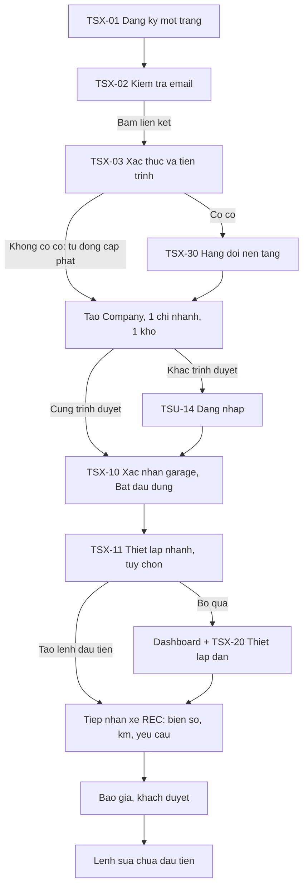

# GMEP – Đăng ký tenant và onboarding bản tối giản (garage một chi nhánh, một kho)

- **Phiên bản:** 0.1 (BA, 05/11/2026) · **Người lập:** BA · **Người nhận:** designer, dev, chủ dự án · **Trạng thái:** đề xuất, **chưa được khách hàng xác nhận**. BA tự quyết theo ủy quyền của người dùng; mọi điểm cần khách, luật sư hay kế toán chốt nằm ở mục 7.
- **Thay thế một phần:** `docs/ui-ux/tenant-signup-spec.md` v0.2 (52 màn TSU-01..68, QĐT-01..40). Bản v0.2 **giữ nguyên làm nguồn tham chiếu** cho các màn hoãn; mục 6 liệt kê QĐT nào bị thay thế, sửa hay giữ.
- **Nguồn:** `docs/multi-tenant-analysis.md` (FR-TEN-004, 030, 032, 037, 039..045; RULE-024, 027..032; J7..J10), `docs/ui-ux/tenant-signup-spec.md`, `design/tenant-signup/README.md`, `docs/functional-requirements.md` (FR-REC-001..004), `CLAUDE.md`. Mã `FR-TEN`, `RULE-016..032`, `QĐT`, `C-xx` là mã **đề xuất**, chưa nhập vào FRD/BRD. Mọi con số thời gian, hạn, ngưỡng là **tham số cấu hình hoặc số minh họa**, không phải quyết định kinh doanh.
- **Không đổi:** `design/`, `src/`, FRD, BRD. Danh sách việc phải sửa ở các tài liệu khác nằm ở mục 6.

---

## 1. Nguyên tắc và so sánh trước/sau

### 1.1 Nguyên tắc

1. **Mặc định cho tổ chức nhỏ.** Đăng ký xong, hệ thống tự tạo **1 Company, 1 chi nhánh, 1 kho** mang tên garage. Chủ garage không phải thấy, đặt tên hay hiểu khái niệm chi nhánh, kho, nhóm chi nhánh, vai trò nâng cao.
2. **Chỉ ẩn giao diện, không đổi mô hình dữ liệu.** Company → Branch → Warehouse, `resolveScope`, cô lập chi nhánh (NFR-ISO-01) và cô lập tenant (FR-TEN-009) **giữ nguyên**. Mọi bản ghi vẫn mang `branch_id`. Cờ hiển thị chỉ điều khiển UI (FR-TEN-051 đề xuất).
3. **Hỏi ít nhất có thể lúc đăng ký; hỏi tiếp khi cần dùng.** Trường nào chỉ để cấu hình hoặc có thể suy ra thì bỏ khỏi form đăng ký.
4. **Chỉ chặn đúng thứ luật hoặc rule bắt buộc chặn.** Chấp nhận điều khoản và DPA trước khi có dữ liệu thật (RULE-029); xác thực email; chống lạm dụng; MST một tenant (RULE-032); **không phát hành hóa đơn thật khi chưa xác minh và chưa khai nhà cung cấp (RULE-028, RULE-024)**. Mọi thứ khác (thuế, đánh số, mẫu in, nhập Excel, nhà cung cấp hóa đơn) là mục "Thiết lập dần", không chặn dùng ứng dụng.
5. **Tự duyệt là mặc định, người duyệt là ngoại lệ.** Chỉ ca bị cờ mới vào hàng đợi (FR-TEN-040, 042; QĐT-08, 12 giữ nguyên).
6. **Ít biến thể hơn.** Gộp các màn trạng thái thành một màn nhiều trạng thái; banner từ 10 xuống 3; mã lý do khóa nút từ 7 xuống 5; hai kiểu khóa nút thành một quy tắc có một tùy chọn; bỏ chuỗi gõ xác nhận không cần thiết.
7. **Không hạ tuân thủ.** Phản hồi trung lập khi email/MST đã tồn tại (FR-TEN-039, RULE-032), khóa chống gửi trùng, giới hạn tần suất, che dữ liệu cá nhân, nhật ký nền tảng bất biến đều giữ.
8. **Đo thành công bằng mốc "lệnh sửa chữa đầu tiên"** (mục 3): lệnh được tạo khi khách duyệt báo giá (theo CLAUDE.md, lệnh bắt đầu từ lúc khách duyệt).

### 1.2 So sánh trước/sau

Số liệu "trước" lấy từ spec v0.2 và README prototype; thời gian là **ước tính của BA, chưa đo với người dùng thật**, cần usability test với 3 đến 5 chủ garage (AC-S20).

| Chỉ số | Trước (v0.2) | Sau (bản này) |
| --- | --- | --- |
| Số màn (không tính biến thể) | 52 (TSU-01..68) | **18** (11 giữ mã TSU cũ, 7 mã mới TSX); trong đó 14 màn cần có để mở đăng ký (giai đoạn A), 4 màn làm trước khi có tenant đầu tiên hết dùng thử (giai đoạn B). 6 màn hoãn có điều kiện ghi rõ |
| Màn người đăng ký phải đi qua từ trang đăng ký tới ứng dụng | khoảng 21 (TSU-01..06, 08, 12, 13, 14, 20..30; trong đó 8 bước wizard bắt buộc đi qua, W4..W6 chỉ bỏ qua được bằng nút) | **4** (TSX-01, TSX-02, TSX-03, TSX-10), thêm 1 màn tùy chọn (TSX-11) |
| Bước đăng ký | 3 bước (TSU-02, 03, 04) + màn gửi + màn xác thực | **1 trang** + màn kiểm tra email |
| Wizard onboarding | 9 bước (W1..W9) + chào mừng + hoàn tất + hộp thoại nháp | **1 màn bắt buộc + 1 màn tùy chọn** (TSX-10, TSX-11) |
| Trường nhập ở đăng ký | 16 (6 + 6 + 3 ô chấp nhận + 1 ô tiếp thị), chưa tính kiểm tra người thật | **7** (5 trường + 2 ô chấp nhận), chưa tính kiểm tra người thật |
| Trường phải nhập ở onboarding bắt buộc | Chưa đếm chính xác; W1..W3 mỗi bước nhiều trường (BA ước tính hơn 20 trường chỉ riêng W1..W3) | **3 trường mới** (địa chỉ, tỉnh/thành, SĐT); tên garage và MST điền sẵn |
| Thời gian ước tính từ mở trang tới lệnh sửa chữa đầu tiên, không tính chờ email và chờ duyệt tay | 30 đến 45 phút (BA ước tính) | **dưới 10 phút** (mục tiêu, mục 3.2) |
| Biến thể banner trạng thái tenant | 10 (BAN-01..10) | **3** (BAN-A, B, C; BAN-09 điều khoản mới hoãn cùng TSU-18) |
| Mã lý do khóa nút theo trạng thái tenant | 7 | **5** |
| Chuỗi gõ xác nhận | 4 (`XOA DU LIEU THU`, `GHI LO`, `DA NHAN DU LIEU`, chuỗi chấm dứt) | **1 mới thuộc gói này** (`DA NHAN DU LIEU` ở TSU-55); `GHI LO` thuộc màn nhập Excel sẵn có, ngoài gói này |
| Màn quản trị nền tảng | 9 | **3** (TSU-60, TSX-30, TSU-66) |
| Ca cần người duyệt tay | chỉ ca bị cờ (đã đúng) | giữ; tiêu chí tự duyệt ghi rõ ở TSX-30 và TSU-66 |

---

## 2. Danh sách màn mới và đặc tả

### 2.0 Quy ước chung

- Dùng lại **toàn bộ** bảng validate V-EMAIL, V-PHONE, V-MST, V-PASS, V-NAME, V-ORG, V-CODE, V-REQ, V-FILE ở mục 2.0 của `tenant-signup-spec.md` (câu lỗi tiếng Việt giữ nguyên). Bản này chỉ ghi mã V-xx và phần **khác**.
- Nguyên tắc chung của spec v0.2 mục 0 giữ nguyên: dùng design system và component sẵn có, giọng chữ theo `state-copy.md`, không lộ sự tồn tại (FR-TEN-016, 039), máy chủ quyết số liệu, khóa nút kèm lý do, chống gửi trùng, a11y WCAG 2.2 AA, kiểm tra ở 390 px và 1440 px.
- **Trạng thái chung** cho mọi màn, không nhắc lại từng màn: loading (skeleton), error (nguyên nhân + "Thử lại" + mã `REQ-…`), offline (khóa nút gửi, giữ nháp, trừ mật khẩu), 429 (đếm lùi lấy từ máy chủ). Mục dưới chỉ ghi trạng thái **riêng** của màn.
- **Quy tắc khóa nút (thay QĐT-24, một quy tắc):** nút khóa dùng `aria-disabled="true"`, vẫn focus được, có `aria-describedby` trỏ tới lý do hiện sẵn. Nếu lý do là **trạng thái tenant** (`TENANT_RESTRICTED`, `TRIAL_EXPIRED`...), bấm nút mở hộp thoại TSU-51; nếu không, bấm chỉ đưa focus tới lý do. Không dùng thuộc tính `disabled`. Không gọi máy chủ khi bấm nút khóa.
- **Ký hiệu actor:** NDK (người đăng ký), CH (chủ garage), AD, NV, CNT, QTN, HTN như spec v0.2 mục 0.3.

### 2.1 Nhóm A. Đăng ký công khai (khung P, không shell)

#### TSX-01 Đăng ký một trang (thay TSU-01, 02, 03, 04)

| Mục | Nội dung |
| --- | --- |
| Mục đích | Thu thông tin tối thiểu, chấp nhận điều khoản và DPA, chống bot, gửi yêu cầu |
| Actor | NDK |
| Truy vết | FR-TEN-039, 037, 041; RULE-028, 029, 032; J7; UAT-TEN-13, 14 |
| Route đề xuất | `/signup` |
| Vào | Trang giới thiệu công khai; liên kết từ TSU-14 |
| Ra | Gửi thành công (hoặc trùng, cùng phản hồi) → TSX-02 |

**Nội dung phía trên:** một tiêu đề giá trị ("Quản lý lệnh sửa chữa, kho phụ tùng và hóa đơn điện tử cho garage của bạn"), một dòng điều kiện lấy từ cấu hình: "Dùng thử {N} ngày, không cần thẻ thanh toán" (hoặc "Truy cập sớm, chưa thu phí" nếu cờ `none`, QĐT-04), dòng nhỏ "Dành cho doanh nghiệp và hộ kinh doanh đã có mã số thuế tại Việt Nam". **Không có bước chọn gói** ở B0 (chỉ một gói; thẻ gói đầy đủ hoãn cùng TSU-42..44, xem mục 5).

| Nhãn | Kiểu | Bắt buộc | Validate | Lỗi tiếng Việt | Ghi chú |
| --- | --- | --- | --- | --- | --- |
| Tên garage (đúng như giấy đăng ký) | Văn bản | Có | V-ORG | "Nhập tên doanh nghiệp hoặc hộ kinh doanh đúng như giấy đăng ký." | Dùng làm tên Company, tên chi nhánh và tên kho mặc định |
| Mã số thuế | Văn bản, bàn phím số | Có | V-MST (10 hoặc 12 số; 13 số bị từ chối) | Như V-MST | Tự bỏ khoảng trắng, dấu gạch; gợi ý "Mã số thuế ở đâu?". Không báo MST có thật hay không ngay ở trường |
| Họ và tên chủ garage | Văn bản | Có | V-NAME | "Nhập họ và tên đầy đủ của người sở hữu." | Tên người đại diện (FR-TEN-039) |
| Email đăng nhập | Email | Có | V-EMAIL | Như V-EMAIL | Nhận liên kết xác thực |
| Mật khẩu | Mật khẩu có nút hiện/ẩn | Có | V-PASS | Như V-PASS | **Bỏ ô nhập lại mật khẩu** (có nút hiện/ẩn và luồng quên mật khẩu thay thế). Hiện quy tắc ngay dưới ô |
| Tôi là người đại diện hợp pháp hoặc được ủy quyền của {tên garage} và đồng ý **Điều khoản dịch vụ** (phiên bản {v}, hiệu lực {ngày}) | Checkbox + nút "Đọc" | Có | Phải tích | "Cần đồng ý Điều khoản dịch vụ để tiếp tục." | Không tích sẵn. Hợp nhất câu "người đại diện" vào ô điều khoản: `[Cần xác nhận]` C-S02 |
| Tôi đồng ý **Thỏa thuận xử lý dữ liệu (DPA)** (phiên bản {v}) và đã xem chính sách lưu trữ dữ liệu | Checkbox + nút "Đọc" | Có | Phải tích | "Cần đồng ý Thỏa thuận xử lý dữ liệu để tiếp tục." | **Tách riêng khỏi điều khoản** (RULE-029). Chính sách lưu trữ là liên kết trong ô này, thay thế bước "đã xem chính sách lưu trữ" của wizard (C-S11) |
| Kiểm tra người thật | `BotCheckSlot` + honeypot ẩn | Có | Đạt | "Chưa xác nhận được bạn là người thật. Hãy thử lại hoặc chọn cách khác." | Có phương án thay thế "Tôi cần cách khác" (mã qua email). Không chọn nhà cung cấp |

**Đã bỏ khỏi form:** loại hình (suy ra từ độ dài MST: 10 số là doanh nghiệp, 12 số là hộ kinh doanh hoặc cá nhân có MST; `[Cần xác nhận]` C-S05), tỉnh/thành, địa chỉ trụ sở, số chi nhánh, chức danh, số điện thoại, nhập lại mật khẩu, đồng ý nhận tin tiếp thị (hỏi lại trong Cài đặt thông báo, mặc định không), chọn gói. Địa chỉ, tỉnh/thành, SĐT chuyển sang TSX-10.

**Hành động:** "Tạo tài khoản dùng thử" (chính). Khóa tới khi đủ trường, hai ô đồng ý và bot đạt; lý do khóa hiện sẵn: "Chưa thể gửi: còn thiếu {tên trường}" hoặc "Chưa thể gửi: cần đồng ý Điều khoản dịch vụ và DPA". Bấm một lần là khóa, gửi kèm `Idempotency-Key`.

**Nháp:** giữ trong trình duyệt (không lưu mật khẩu); đóng tab rồi mở lại hỏi "Tiếp tục bản nháp lúc HH:mm?".

**Phản hồi trung lập:** thành công, trùng email hoặc trùng MST đều dẫn tới TSX-02 cùng chữ, cùng mã trạng thái (RULE-032).

**Trạng thái riêng:** đang gửi; `đóng đăng ký` (empty): "Hiện chưa mở đăng ký mới. Vui lòng quay lại sau." (không thu email, QĐT-33); `phiên bản điều khoản đổi khi đang điền`: "Điều khoản vừa được cập nhật. Vui lòng đọc lại và đồng ý."; lỗi bot; 429.

#### TSX-02 Kiểm tra email (thay TSU-05, 07)

| Mục | Nội dung |
| --- | --- |
| Mục đích | Hướng dẫn xác thực email và gửi lại liên kết **ngay trên cùng màn** |
| Truy vết | FR-TEN-039, 041; RULE-032; J7 |
| Route đề xuất | `/signup/sent` |
| Ra | Mở liên kết trong email → TSX-03 |

- **Nội dung:** "Chúng tôi đã gửi email đến {t***@congty.vn}. Mở email và bấm liên kết để tiếp tục. Liên kết có hiệu lực {72 giờ (minh họa)}." Dòng cố định trung lập: "Nếu thông tin hợp lệ, bạn sẽ nhận được email trong vài phút."
- **Hành động:** "Gửi lại email" (đếm lùi giữa hai lần gửi, `Retry-After` từ máy chủ; thay màn TSU-07, không cần nhập lại email, **bỏ BotCheck ở lần gửi lại đầu tiên**, chỉ yêu cầu khi máy chủ báo nghi ngờ); "Dùng email khác" (về TSX-01, giữ nháp).
- **Trạng thái riêng:** `bình thường`; `đang đếm lùi`; `đã gửi lại` (toast); `gửi lại quá nhiều` ("Bạn đã gửi lại nhiều lần. Hãy liên hệ hỗ trợ nếu vẫn chưa nhận được email."); `xếp hàng` (vượt trần đăng ký trong ngày, FR-TEN-041: "Đăng ký của bạn đã được ghi nhận và đang xếp hàng xử lý. Chúng tôi sẽ email khi đến lượt.").

#### TSX-03 Xác thực và tiến trình (thay TSU-06, 08, 09, 10, 12, 13)

| Mục | Nội dung |
| --- | --- |
| Mục đích | Một màn duy nhất cho mọi kết quả sau khi bấm liên kết trong email: xác thực, kiểm tra tự động, bổ sung, từ chối, cấp phát, sẵn sàng |
| Truy vết | FR-TEN-039, 040, 042; RULE-028, 032; QĐT-34 (token theo dõi); NFR-TEN-05 |
| Route đề xuất | `/signup/verify?token=…` (cùng route dùng cho theo dõi bằng token) |
| Vào | Liên kết email E-01; liên kết theo dõi trong email |
| Ra | Sẵn sàng và **có phiên** → TSX-10; sẵn sàng nhưng **khác trình duyệt** → TSU-14 |

Dải `StatusTracker` rút gọn còn **3 chặng**: Xác thực email → Kiểm tra doanh nghiệp → Tạo tài khoản. Các biến thể:

| Biến thể | Nội dung chính | Hành động |
| --- | --- | --- |
| `đang kiểm tra` (mặc định, 95% ca) | "Email đã được xác thực. Chúng tôi đang kiểm tra thông tin và tạo tài khoản, thường mất vài giây." Tự cập nhật; **không bắt người dùng đóng trang** | Không có; trang tự chuyển |
| `sẵn sàng` | "Tài khoản đã sẵn sàng." Tự chuyển sau 2 giây | "Vào ứng dụng" (nếu tự chuyển bị chặn) |
| `chờ duyệt` (ca bị cờ: MST trùng, đối chiếu không khớp, nghi lạm dụng) | "Chúng tôi cần kiểm tra thêm thông tin doanh nghiệp. Bạn sẽ nhận email khi có kết quả." Không nêu lý do cờ (RULE-032); câu giống nhau cho mọi ca | "Gửi lại liên kết theo dõi" |
| `cần bổ sung` | Nêu mục cần bổ sung do nhân sự nhập (lý do từ danh mục) và hạn (`supplement_days`, QĐT-35); **form tải tệp ngay trên màn** (`FileUpload`, V-FILE) kèm ô ghi chú | "Gửi bổ sung" (chính) |
| `không đạt` | Lý do từ danh mục (ví dụ "Mã số thuế không khớp thông tin đăng ký"); nếu cho phép: "Bạn có thể đăng ký lại hoặc liên hệ hỗ trợ để được xem xét lại." | "Đăng ký lại"; liên kết hỗ trợ (email/kênh theo C-11). **Khiếu nại qua hỗ trợ, không có form riêng** (C-S07) |
| `liên kết hết hạn` | "Vì an toàn, liên kết chỉ có hiệu lực {72 giờ}. Bạn có thể nhận liên kết mới." | "Gửi liên kết mới" (mở TSX-02) |
| `liên kết không hợp lệ hoặc đã dùng` (**gộp** hai biến thể cũ thành một câu trung lập) | "Liên kết không còn dùng được. Nếu đã có tài khoản, hãy đăng nhập; nếu chưa, hãy nhận liên kết mới." | "Đăng nhập", "Gửi liên kết mới" |
| `yêu cầu quá hạn` | "Yêu cầu đăng ký này đã hết hạn vì chưa được xác thực. Bạn có thể đăng ký lại, không mất gì." | "Đăng ký lại" |
| `đang tạo chậm` (quá thời gian dự kiến, hoặc `provision_failed`) | "Việc tạo tài khoản đang mất nhiều thời gian hơn dự kiến. Bạn có thể đóng trang, chúng tôi sẽ email khi xong." Không hiện lỗi kỹ thuật | – |

**Phiên sau xác thực (QĐT mới, FR-TEN-053 đề xuất):** nếu liên kết được mở **trong cùng trình duyệt đã gửi đăng ký** (khớp cookie phiên đăng ký, một lần dùng, `HttpOnly`), hệ thống tạo phiên đăng nhập cho chủ garage ngay khi cấp phát xong, không bắt đăng nhập lại. Khác trình duyệt: về TSU-14, mã công ty có trong email chào mừng. `[Cần xác nhận]` C-S03 (bảo mật). Token theo dõi giữ quy tắc QĐT-34.

**Email chào mừng** (một email thay E-0x riêng lẻ): chứa mã công ty, liên kết đăng nhập, liên kết hỗ trợ. Mã công ty tự sinh như QĐT-07 và có lại ở Cài đặt (TSX-20).

#### TSU-14 Đăng nhập có mã công ty (giữ, chỉnh nhẹ)

Giữ nguyên spec v0.2 TSU-14, QĐT-01 (đăng nhập U1 + mã công ty), QĐT-17 (lỗi trung lập trước khi xác thực đúng). Chỉnh:
- Trình duyệt đã đăng nhập thành công một lần thì **nhớ mã công ty** (ô điền sẵn, có "Đổi công ty"); người dùng chỉ nhập email và mật khẩu.
- Rẽ nhánh sau đăng nhập đúng: `onboarding` chưa xác nhận → TSX-10; `active` → dashboard; `suspended` → TSU-53; `terminating` → TSU-56 (trạng thái đang chấm dứt).
- Liên kết "Quên mật khẩu hoặc mã công ty?" → TSU-15 (đã gộp TSU-17).
- Bỏ rẽ nhánh tới TSU-18 cho tới khi có phiên bản điều khoản thứ hai (mục 5).

#### TSU-15 Quên mật khẩu hoặc mã công ty (giữ, gộp TSU-17)

Một biểu mẫu hai tab: "Quên mật khẩu" (email + mã công ty) và "Quên mã công ty" (chỉ email). Phản hồi trung lập giống nhau cho mọi kết quả (FR-TEN-016, 039). Trạng thái riêng: `đã gửi` (trung lập), lỗi bot, 429. V-EMAIL, V-CODE.

#### TSU-16 Đặt lại mật khẩu (giữ nguyên)

Theo spec v0.2: liên kết hợp lệ, mật khẩu yếu, thành công, hết hạn, đã dùng.

### 2.2 Nhóm B. Onboarding tối thiểu (trong ứng dụng, khung W rút gọn)

Khung: biến thể W (stepper) chỉ có **2 chấm** (Garage, Thiết lập nhanh); trên điện thoại hiện "Bước 1/2". Không sidebar nghiệp vụ trong lúc chưa xác nhận TSX-10.

#### TSX-10 Xác nhận garage và bắt đầu dùng (thay TSU-20, 21, 22, 23, 29, 30, 31)

| Mục | Nội dung |
| --- | --- |
| Mục đích | Xác nhận thông tin đã điền sẵn từ đăng ký, bổ sung ba trường còn thiếu, tạo mặc định (1 chi nhánh, 1 kho) và **kích hoạt** tenant |
| Actor | CH (chỉ CH kích hoạt, QĐT-15 giữ) |
| Truy vết | FR-TEN-004, 043, 051, 052; RULE-024, 028, 029; J8; UAT-TEN-15 |
| Route đề xuất | `/onboarding` |
| Vào | TSX-03 sẵn sàng; TSU-14 khi tenant còn `onboarding` |
| Ra | "Bắt đầu dùng" → TSX-11 |

| Nhãn | Kiểu | Bắt buộc | Validate | Lỗi tiếng Việt | Ghi chú |
| --- | --- | --- | --- | --- | --- |
| Tên garage | Văn bản | Có (điền sẵn) | V-ORG | Như V-ORG | Sửa được; đổi tên Company, tên chi nhánh, tên kho mặc định cùng lúc nếu người dùng chưa sửa riêng |
| Mã số thuế | Chỉ đọc | – | – | – | Đổi MST qua hỗ trợ (liên quan RULE-032) |
| Tỉnh/thành phố | Chọn | Có | V-REQ | "Vui lòng chọn tỉnh/thành phố." | Danh mục hành chính là cấu hình |
| Địa chỉ | Văn bản | Có | V-REQ, 5 đến 250 ký tự | "Vui lòng nhập địa chỉ." | Dùng cho chi nhánh mặc định và địa chỉ in |
| Số điện thoại garage | Văn bản | Có | V-PHONE | Như V-PHONE | Chưa xác thực OTP (QĐT-13, C-13 giữ nguyên) |

- **Dòng thông tin dưới form:** "GMEP đã tạo sẵn một chi nhánh và một kho cho garage của bạn. Bạn có thể thêm chi nhánh trong Cài đặt khi cần." và "{N} ngày dùng thử bắt đầu khi bạn bấm Bắt đầu dùng." Hóa đơn điện tử chạy thử cho tới khi bạn khai nhà cung cấp (xem checklist).
- **Hành động:** "Bắt đầu dùng" (chính): tạo/cập nhật chi nhánh và kho mặc định, đặt tenant `active` (kích hoạt = chính hành động này của CH, thỏa FR-TEN-004 "chủ garage tự chạy"), bắt đầu đồng hồ dùng thử (QĐT-22). Không có nút "Lưu nháp" vì chỉ 3 trường; mọi thay đổi lưu khi bấm. Idempotent: bấm lại không tạo chi nhánh/kho thứ hai (FR-TEN-002, 042).
- **Điều kiện FR-TEN-004 được thỏa như sau:** chủ đã đăng nhập (có phiên); Company, chi nhánh, kho tự tạo; đơn vị phát hành hóa đơn **mặc định `fake`** (không cần xác nhận riêng, chỉ báo bằng dòng chữ); chính sách lưu trữ đã xem (liên kết ở TSX-01, C-S11); điều khoản đã chấp nhận (TSX-01); **muốn phát hành hóa đơn thật thì cần đạt xác minh và khai nhà cung cấp (không chặn kích hoạt, chỉ chặn phát hành thật)**.
- **Người không phải CH** (AD, KT được CH mời sau này nhưng tenant chưa `active` thì chưa có ai khác; trường hợp hiếm) thấy ReasonDisabled `NO_PERMISSION`: "Chỉ chủ garage bắt đầu dùng được."
- **Trạng thái riêng:** `đang lưu`; lỗi trường; `đã xác nhận ở thiết bị khác` (tự chuyển tiếp TSX-11); `đang tạo chậm` (nếu cấp phát chưa xong, như TSX-03).

#### TSX-11 Thiết lập nhanh, tùy chọn (thay TSU-24, 25; TSU-28 chuyển thành checklist)

| Mục | Nội dung |
| --- | --- |
| Mục đích | Cho dịch vụ và phụ tùng mẫu để tạo ngay lệnh đầu tiên; mời nhân viên nếu muốn. **Cả hai đều bỏ qua được** |
| Actor | CH |
| Truy vết | FR-TEN-043; FR-SYS-012, 019 (vai trò); FR-REC-004 (dòng công, phụ tùng); J8 |
| Route đề xuất | `/onboarding/quick` |
| Ra | "Tạo lệnh sửa chữa đầu tiên" hoặc "Bỏ qua, vào ứng dụng" → dashboard; cả hai ghi trạng thái tương ứng trong TSX-20 |

**Khối 1. Dịch vụ và phụ tùng mẫu**

| Nhãn | Kiểu | Bắt buộc | Ghi chú |
| --- | --- | --- | --- |
| Garage bạn làm gì? | Nhiều lựa chọn dạng thẻ: Sửa chữa chung; Bảo dưỡng; Lốp và mâm; Đồng sơn | Không (chọn sẵn "Sửa chữa chung" và "Bảo dưỡng") | Mỗi lựa chọn tải một **gói danh mục mẫu** (dịch vụ, vài dòng công thông dụng, phụ tùng tiêu hao thông dụng); danh sách gói là cấu hình. Đồng sơn chỉ nhận lựa chọn và gắn nhãn "Quy trình đồng sơn đang được hoàn thiện" (body-paint chưa khảo sát, CLAUDE.md) |
| Dùng danh mục mẫu | Công tắc (bật sẵn) | Không | Mô tả: "Bạn có thể sửa hoặc ngừng dùng từng mục sau. Giá mẫu chỉ để minh họa, hãy chỉnh theo bảng giá của garage." |

- **Giá trong gói mẫu:** `[Cần xác nhận]` C-S09 (khách soạn nội dung gói và quyết định có giá minh họa hay để trống). Mặc định BA: có giá minh họa gắn nhãn "mẫu" và **bắt buộc xem lại giá trước khi in báo giá đầu tiên** (nhắc ở TSX-20, không chặn).
- Dữ liệu mẫu gắn cờ `sample` để ngừng dùng hàng loạt ở Cài đặt, không xóa vật lý khi đã được tham chiếu (RULE-010, 009).

**Khối 2. Mời nhân viên (tùy chọn)**

| Nhãn | Kiểu | Bắt buộc | Validate | Lỗi tiếng Việt |
| --- | --- | --- | --- | --- |
| Email nhân viên | Email | Không | V-EMAIL | Như V-EMAIL |
| Vai trò | Chọn | Có nếu nhập email | V-REQ | "Vui lòng chọn vai trò cho {email}." |

- Tối đa 3 dòng, có "Thêm dòng". **Vai trò hiển thị đơn giản:** bốn vai trò thường gặp ở garage một chi nhánh nằm trên cùng (cố vấn dịch vụ, thợ/tổ trưởng, thu ngân, thủ kho; tên chuẩn lấy từ FRD §2) và "Xem thêm vai trò" cho phần còn lại. **Ẩn:** QV (Quản lý vùng/nhóm chi nhánh), vai trò MH, NS khi gói chưa bật module (QĐT-21 giữ), và CH (không mời CH thứ hai, C-24). Nhân viên được **gán tự động vào chi nhánh duy nhất**, không có bước chọn chi nhánh.
- Gửi lời mời không bị chặn bởi hạn mức; cảnh báo "Còn {x} chỗ" theo QĐT-28.
- **Trạng thái riêng (cả màn):** `đã áp dụng danh mục mẫu` (toast "Đã thêm {n} dịch vụ và {m} phụ tùng mẫu"); lỗi một dòng mời (không chặn dòng khác); `bỏ qua`.

### 2.3 Nhóm C. Trong ứng dụng

#### TSX-20 Thiết lập dần (thay TSU-40 và checklist TSU-29)

| Mục | Nội dung |
| --- | --- |
| Mục đích | Một danh sách duy nhất cho mọi việc nên làm sau khi đã vào ứng dụng; chỉ ghi rõ mục nào **chặn phát hành hóa đơn thật** |
| Actor | CH, AD (KT thấy mục hóa đơn và thuế) |
| Truy vết | FR-TEN-052 (đề xuất), FR-TEN-004, 043; RULE-024, 028; QĐT-09 (thay) |
| Route đề xuất | Thẻ trên dashboard CH (`/`) và trang đầy đủ `/settings/setup` |

Component `OnboardingChecklist` giữ nguyên, trạng thái mỗi mục rút gọn còn **Chưa làm / Xong / Bỏ qua** (bỏ "Đang làm" và "Lỗi"; lỗi hiện ở màn cấu hình của mục). Chi tiết các mục ở mục 4. Mục "Mã công ty và thông tin tài khoản" hiện ở đầu trang. Thẻ dùng thử (BAN-A) nằm cùng dashboard.

- **Hành động:** mỗi mục có nút dẫn thẳng vào màn Cài đặt **đã có** (không tạo màn mới); "Bỏ qua mục này" (mục không chặn); "Ẩn checklist" khi tất cả mục không chặn đã xong hoặc bỏ qua (có thể mở lại ở Cài đặt).
- **Trạng thái riêng:** `mới vào` (nhấn mạnh mục "Tạo lệnh sửa chữa đầu tiên"); `đã xong hết` (thẻ tự thu gọn); `đã bỏ qua nhiều mục` (nhắc một lần mỗi tuần, tham số).

#### TSU-41 Gói của tôi (giữ, rút gọn; gộp TSU-52 hết dùng thử)

Theo spec v0.2 TSU-41 ở B0: tên gói, trạng thái thuê bao (`none` Truy cập sớm, `trial` Còn N ngày, `expired` Hết hạn), ngày hết hạn, mức dùng chi nhánh/người dùng, khối "Thanh toán: chưa mở". **Bỏ** biến thể "Đang thiết lập, chưa bắt đầu tính ngày" (không còn xảy ra vì dùng thử bắt đầu ở TSX-10). **Biến thể `hết hạn` thay màn TSU-52:** nêu ngày sang chế độ chỉ đọc (QĐT-25, C-23), nút "Xuất dữ liệu" (TSU-55), "Liên hệ chọn gói". Mức dùng chi nhánh hiện "1/{giới hạn}" nhưng **ẩn dòng chi nhánh** khi chỉ có 1 chi nhánh và gói không giới hạn dưới 2 (giảm nhiễu).

#### TSU-50 Thư viện banner (giữ, giảm còn 3 loại)

| Mã | Điều kiện | Gộp từ | Ghi chú |
| --- | --- | --- | --- |
| BAN-A Dùng thử | `trial` còn ≤ mốc ngày (cảnh báo) hoặc đã hết (N2) | BAN-02, 03 | Hai mức độ nghiêm trọng, hai biến thể câu chữ theo vai trò (CH, AD, NV) như BAN-02, 03 cũ |
| BAN-B Hạn chế, tạm ngưng, chấm dứt | `restricted`, `suspended`, `terminating` | BAN-05, 07, 08 | Câu chữ theo chế độ và mã lý do (QĐT-29); NV chỉ thấy câu chung |
| BAN-C Chờ xác minh để phát hành hóa đơn thật | Tenant `active` nhưng chưa đạt xác minh hoặc chưa khai nhà cung cấp | BAN-10, BAN-01 | **Chỉ hiện ở các màn hóa đơn và checklist**, không hiện toàn ứng dụng |

Hoãn: BAN-04 (past_due, B2), BAN-06 (hạn mức, B1), BAN-09 (điều khoản mới, cùng TSU-18). BAN-01 (đang thiết lập) bỏ vì không còn trạng thái thiết lập kéo dài. **Mã lý do khóa nút còn 5:** `TENANT_RESTRICTED`, `TENANT_SUSPENDED_READONLY`, `TRIAL_EXPIRED`, `TENANT_TERMINATING`, `VERIFICATION_REQUIRED` (câu chữ giữ như bảng "Rà câu chữ" của QĐT-40). Hoãn `QUOTA_LIMIT_REACHED` (B1) và `TERMS_NOT_ACCEPTED` (cùng TSU-18).

#### TSU-51 Hộp thoại chặn tạo mới (giữ, giai đoạn B)

Theo spec v0.2: hai biến thể CH và NV. Mở khi bấm nút khóa vì trạng thái tenant (quy tắc khóa nút mục 2.0). Cần trước khi tenant đầu tiên hết dùng thử.

#### TSU-53 Tạm ngưng (giữ, gộp TSU-54; giai đoạn B)

Một màn hai biến thể: `chỉ đọc và tải dữ liệu` (có nút "Xuất dữ liệu" cho CH) và `an toàn` (không lý do hiển thị, chỉ câu cố định kèm mã tham chiếu, QĐT-29). Câu chữ và hành vi giữ như TSU-53, 54 cũ.

#### TSU-55 Trung tâm xuất dữ liệu (giữ, giai đoạn B)

Giữ QĐT-26: chỉ CH tạo, tải và xác nhận; AD xem danh sách. Giữ **một** chuỗi gõ xác nhận `DA NHAN DU LIEU` (hành động xác nhận không hoàn tác được và ảnh hưởng quyền rút yêu cầu chấm dứt, QĐT-27) với quy ước so khớp của QĐT-26. Cần có trước khi có tenant đầu tiên hết dùng thử (FR-TEN-006, RULE-021).

#### TSU-56 Chấm dứt dịch vụ (giữ, gộp TSU-57; giai đoạn B)

Một màn nhiều trạng thái: `chưa yêu cầu` (form lý do tùy chọn + xác nhận qua email), `chờ CH xác nhận`, `chờ nền tảng`, `đang chấm dứt` (hiện hạn tải dữ liệu), `đã rút`. Giữ QĐT-27 (xác nhận qua email E-14, có thể rút tới khi "đã nhận dữ liệu"). **Bỏ** chuỗi gõ xác nhận riêng ở bước gửi: xác nhận bằng email đã đủ lớp bảo vệ (mức Thường, đúng như QĐT-27), và yêu cầu điện tử vẫn chờ luật sư (C-10, C-27). Đã chấm dứt: đăng nhập trả lỗi trung lập (TSU-14); cổng lưu trữ theo Q7 chưa quyết, không dựng ở gói này.

### 2.4 Nhóm D. Quản trị nền tảng (khung PlatformShell, vận hành tối thiểu)

#### TSU-60 Đăng nhập quản trị nền tảng (giữ nguyên)

Theo spec v0.2; khe MFA nền tảng theo C-14 (không đổi).

#### TSX-30 Hàng đợi và hồ sơ (thay TSU-61, 62, 63, 64, 65)

| Mục | Nội dung |
| --- | --- |
| Mục đích | Một màn master-detail: xử lý **chỉ ca bị cờ**, lỗi cấp phát và các yêu cầu xem xét lại |
| Actor | CNT (duyệt, từ chối, xem xét lại), QTN (yêu cầu bổ sung, xử lý lỗi cấp phát), HTN (xem) |
| Truy vết | FR-TEN-040, 041, 042, 013; RULE-027 (duyệt nằm ngoài danh sách hai người, QĐT-38), RULE-028, 032; QĐT-12, 35, 38; UAT-TEN-13..15 |
| Route đề xuất | `/platform/signups` (danh sách) và `/platform/signups/{id}` (chi tiết trong cùng khung) |

**Tiêu chí tự duyệt (cấu hình hiệu lực theo ngày ở TSU-66, không viết cứng; RULE-019).** Một yêu cầu đi thẳng tới cấp phát, không vào hàng đợi, khi **đồng thời**: email đã xác thực; MST đúng định dạng theo cấu hình; MST **chưa gắn tenant đang hoạt động** (RULE-032); không trong danh sách chặn; không có cờ lạm dụng (FR-TEN-041); đối chiếu nguồn tra MST không báo lệch (nếu nguồn đã cấu hình, C-S01). Thiếu một điều kiện thì vào hàng đợi với lý do cờ.

**Danh sách (tab):** `Cần xử lý` (mặc định; mỗi dòng: mã `SGN-xxxxxx`, tên, MST che, lý do cờ, giờ chờ, nhãn "quá hạn xử lý" theo tham số NFR-TEN-07); `Lỗi cấp phát` (tự thử lại / cần nhân sự); `Đã xử lý 7 ngày`. Cảnh báo đầu trang khi gần trần đăng ký trong ngày (FR-TEN-041). Tìm theo **toàn bộ email**, so khớp tuyệt đối, có ghi nhật ký tra cứu (QĐT-32).

**Chi tiết:** thông tin đã che theo vai trò, trạng thái `StatusTracker`, lý do cờ, lịch sử. Nút: "Duyệt" (CNT; với MST trùng bắt buộc chọn lý do ngoại lệ từ danh mục), "Yêu cầu bổ sung" (QTN, CNT; chọn mục và hạn), "Từ chối" (CNT; lý do từ danh mục, nội dung hiển thị cho NDK lấy từ danh mục), "Chuyển lại xem xét" (CNT; dùng khi NDK khiếu nại qua hỗ trợ, thay màn khiếu nại TSU-64). Quyết định mở hộp thoại xác nhận (mức Thường), ghi nhật ký nền tảng bất biến (FR-TEN-013), xử lý 409 khi người khác vừa quyết định.

**Trạng thái riêng:** `trống` ("Không có ca nào cần xử lý"); `chỉ xem` (HTN); `409`; `lọc không có kết quả`; `đã đạt trần ngày`. Biến thể không còn: hộp thoại TSU-63 riêng (nay là dialog trong màn).

#### TSU-66 Cấu hình đăng ký (giữ, tối giản nhóm)

Giữ QĐT-36 (hiệu lực theo nhóm tham số, mở/đóng đăng ký có hiệu lực ngay, mức Nguy hiểm). Chỉ các nhóm cần để vận hành giai đoạn A: **Mở/đóng đăng ký và trần ngày**, **Xác thực email** (hạn liên kết, token theo dõi), **MST và tiêu chí tự duyệt** (độ dài, chữ số kiểm tra, danh sách chặn, nguồn tra), **Chống lạm dụng** (tần suất, danh sách chặn email dùng một lần), **Dùng thử** (số ngày, mốc cảnh báo, thang N2/N3, `onboarding_max_days`), **Danh mục lý do** (từ chối, bổ sung, hạn chế, tạm ngưng), **Danh mục dịch vụ mẫu** (gói mẫu của TSX-11, bật/tắt). Hai thao tác cần xác nhận mức Nguy hiểm: đổi thang trial (hai người, RULE-027, QĐT-25) và mở/đóng đăng ký. Không đổi quy tắc còn lại.

---

## 3. Luồng chính: đường ngắn nhất tới lệnh sửa chữa đầu tiên

### 3.1 Sơ đồ

**Đường ngắn nhất (4 màn bắt buộc):** TSX-01 → TSX-02 → TSX-03 → TSX-10 → (TSX-11 bấm "Tạo lệnh sửa chữa đầu tiên" với danh mục mẫu chọn sẵn) → tiếp nhận xe (FR-REC-001: biển số mới mở form tạo xe và khách ngay trong tiếp nhận; FR-REC-002 bắt buộc số km và yêu cầu khách) → báo giá (FR-REC-004, chọn dịch vụ mẫu) → khách duyệt → lệnh sửa chữa.

Phần tiếp nhận, báo giá, duyệt dùng **màn REC đã có**, không thiết kế lại ở gói này. Việc cần làm cho designer/dev: ở lần đầu, thẻ "Tạo lệnh sửa chữa đầu tiên" trên dashboard trỏ thẳng vào tiếp nhận, kèm hướng dẫn ba bước (coach mark dùng lại component có sẵn nếu có; nếu chưa có, chỉ là ba dòng chữ trên thẻ) và **điền sẵn dịch vụ mẫu**. Cần kiểm tra khả năng tạo khách mới và xe mới ngay trong tiếp nhận không thêm màn (đã thỏa theo FR-REC-001).

### 3.2 Ngân sách thời gian mục tiêu (ước tính, đo ở AC-S20)

| Chặng | Mục tiêu |
| --- | --- |
| TSX-01 điền và gửi | ≤ 2 phút |
| Chờ email, bấm liên kết | ≤ 2 phút (phụ thuộc nhà cung cấp email, không tính vào mục tiêu) |
| TSX-03 tự duyệt và cấp phát | ≤ thời gian NFR-TEN-05 (tham số; mục tiêu cảm nhận vài giây) |
| TSX-10 | ≤ 1 phút |
| TSX-11 (giữ mặc định) | ≤ 30 giây |
| Tiếp nhận, báo giá, duyệt lệnh đầu tiên | ≤ 5 phút |
| **Tổng, không tính chờ email, chờ duyệt tay** | **< 10 phút** |

### 3.3 Mapping vòng đời tenant (giữ nguyên mô hình, đổi cách hiển thị)

| Trạng thái tenant | Màn thấy (mới) |
| --- | --- |
| `signup_pending` / `email_unverified` | TSX-02 |
| `signup_pending` / `verifying`, `manual_review`, `needs_info` | TSX-03 (biến thể tương ứng); nền tảng: TSX-30 |
| `rejected` | TSX-03 `không đạt` |
| `provisioning`, `provision_failed` | TSX-03 `đang kiểm tra`/`đang tạo chậm`; nền tảng: TSX-30 tab Lỗi cấp phát |
| `onboarding` (chuyển tiếp ngắn) | TSX-10 |
| `active` | Ứng dụng + TSX-20; TSU-41; BAN-A |
| `restricted` | BAN-B, TSU-51 |
| `suspended` | TSU-53, BAN-B |
| `terminating`, `terminated` | TSU-56; TSU-14 lỗi trung lập |

`onboarding` thành trạng thái **chuyển tiếp vài phút** thay vì giai đoạn dài; bảng hành động theo trạng thái (spec v0.2 mục 3.4) giữ nguyên, cột `onboarding` hầu như không dùng.

---

## 4. Checklist "Thiết lập dần"

Quy ước: **Chặn** = chặn đúng một hành động nêu trong cột; không mục nào chặn tạo lệnh sửa chữa, thu tiền, kho hay báo cáo. Mọi giá trị mặc định lấy từ cấu hình hiệu lực theo ngày của SYS, **không viết cứng trong giao diện** (NFR-MNT-01).

| # | Mục | Mặc định khi chưa làm | Điều kiện chặn | Màn đích (đã có, không tạo mới) | Nhắc | Truy vết |
| --- | --- | --- | --- | --- | --- | --- |
| 1 | **Tạo lệnh sửa chữa đầu tiên** | – | Không chặn | Tiếp nhận REC | Nổi bật ở đầu | BR-REC-01, FR-REC-001 |
| 2 | Xem lại giá dịch vụ mẫu | Giá mẫu dùng được | Không chặn (nhắc trước khi **in** báo giá đầu tiên) | Danh mục dịch vụ/giá | Một lần | FR-REC-004 |
| 3 | Mời nhân viên và gán vai trò | Chỉ chủ garage dùng | Không chặn | Quản lý người dùng SYS | Hàng tuần nếu 0 nhân viên | FR-SYS-012, 019 |
| 4 | **Xác minh doanh nghiệp (MST)** | Nếu đã tự đạt: mục hiện "Xong" | **Chặn phát hành hóa đơn thật** (RULE-028, `VERIFICATION_REQUIRED`) | Trạng thái xác minh (TSX-03 biến thể trong ứng dụng, hoặc khối trong checklist; không tạo màn mới, QĐT-30 `/settings/verification` rút gọn thành khối ở TSX-20) | Khi mở màn hóa đơn | FR-TEN-040 |
| 5 | **Nhà cung cấp hóa đơn điện tử** (nhà cung cấp, MST đơn vị phát hành, mẫu số, ký hiệu, kiểm tra kết nối) | Hóa đơn chạy `fake` | **Chặn phát hành hóa đơn thật** cho tới khi đủ trường bắt buộc, kiểm tra kết nối đạt **và** mục 4 xong (QĐT-31, RULE-024, RULE-028); hook cấu hình nhà cung cấp giữ nguyên, **không ép chọn** | Cấu hình EIN | Khi bấm "Phát hành" lần đầu: ReasonDisabled kèm đường dẫn | FR-EIN-003, 004; FR-TEN-021 |
| 6 | Thuế, đánh số chứng từ, kỳ kế toán | Dùng giá trị mặc định cấu hình hiệu lực theo ngày của SYS (thuế suất, tiền tố, tháng bắt đầu kỳ) | Không chặn. **Riêng thuế suất trước khi phát hành hóa đơn thật**: phải xác nhận một lần (hiện ở bước phát hành), vì thuế sai gây hậu quả pháp lý | Cài đặt thuế/đánh số SYS | Khi in chứng từ đầu tiên | FR-SYS (đánh số, cấu hình hiệu lực); NFR-MNT-01 |
| 7 | Mẫu in, logo | Mẫu in mặc định có tên, địa chỉ, SĐT, MST từ TSX-10 | Không chặn | Mẫu in SYS | Khi in lần đầu | FR-TEN-022 |
| 8 | Nhập danh mục/khách/xe từ Excel | Không nhập | Không chặn | Nhập Excel SYS-007 (giữ chuỗi `GHI LO` của màn đó) | Một lần sau 7 ngày nếu chưa tạo dữ liệu | FR-SYS-007 |
| 9 | Khảo sát nhanh về garage (thay bộ câu hỏi W1) | Bỏ qua | Không chặn | Khối trong TSX-20 (5 câu hoặc ít hơn, tùy chọn) | Không nhắc | FR-TEN-032 (Could) |
| 10 | Thêm chi nhánh hoặc kho | Không có | Không chặn | **Cài đặt > Thêm chi nhánh** (mục 4.1) | Không nhắc | FR-TEN-051 |

Quy tắc hiển thị: mục 4, 5 hiện đầu danh sách dưới nhãn "Cần để phát hành hóa đơn thật"; mục còn lại dưới "Nên làm" và "Tùy chọn". Mục 10 không nằm trong checklist; nó là đường dẫn trong Cài đặt (cột phải của bảng chỉ để truy vết).

### 4.1 Mở nhiều chi nhánh hoặc kho (UI)

- **Mặc định:** UI chi nhánh bị ẩn: bộ chọn chi nhánh, cột/bộ lọc chi nhánh, chuyển kho liên chi nhánh, nhóm chi nhánh, vai trò QV, báo cáo hợp nhất, chọn kho trong phiếu kho. `resolveScope` tự chọn chi nhánh và kho duy nhất; người dùng mới được gán vào đó.
- **Bật:** Cài đặt > "Thêm chi nhánh" (CH, AD) mở dialog giải thích tác động ("Bộ chọn chi nhánh, báo cáo từng chi nhánh và chuyển kho giữa chi nhánh sẽ xuất hiện"), nhập tên và địa chỉ chi nhánh thứ hai, tạo kho mặc định cho chi nhánh đó. Từ lúc có từ 2 chi nhánh hoạt động trở lên, UI nhiều chi nhánh **tự hiện** (suy ra từ số lượng, không phải công tắc riêng, để không có trạng thái "đã có 2 chi nhánh nhưng giao diện ẩn"; C-S10). Tương tự "Thêm kho" cho nhiều kho trong một chi nhánh.
- **Tắt lại:** không có; ngừng chi nhánh theo luồng sẵn có (RULE-010: không xóa dữ liệu đã ghi). Khi quay về 1 chi nhánh hoạt động, UI ẩn lại theo cùng quy tắc suy ra.
- **Hạn mức gói:** việc thêm chi nhánh tuân theo hạn mức (BAN-06, `QUOTA_LIMIT_REACHED`, hoãn tới B1; B0 nêu hạn mức "sẽ công bố").

---

## 5. Ánh xạ màn cũ → mới, bỏ, hoãn

Chú giải: **Giữ** = giữ mã và đặc tả (có thể chỉnh nhẹ); **Gộp** = nội dung nằm ở màn mới; **Bỏ** = không còn; **Hoãn** = chưa dựng, ghi điều kiện quay lại.

| Màn cũ | Quyết định | Màn mới | Lý do |
| --- | --- | --- | --- |
| TSU-01 Giới thiệu, chọn gói | Gộp | TSX-01 | Một gói ở B0; chọn gói không có nội dung để chọn. Thẻ gói đầy đủ quay lại cùng TSU-42 |
| TSU-02 Bước 1 doanh nghiệp, MST | Gộp | TSX-01 | Còn 2 trường (tên, MST) |
| TSU-03 Bước 2 người sở hữu | Gộp | TSX-01 | Còn họ tên, email, mật khẩu; bỏ chức danh, SĐT (sang TSX-10), nhập lại mật khẩu |
| TSU-04 Bước 3 điều khoản, bot, gửi | Gộp | TSX-01 | Bỏ màn tóm tắt chỉ đọc (người dùng vừa nhập trên cùng trang) |
| TSU-05 Đã gửi, kiểm tra email | Gộp | TSX-02 | |
| TSU-06 Kết quả xác thực email | Gộp | TSX-03 | Một màn nhiều biến thể |
| TSU-07 Gửi lại liên kết | Gộp | TSX-02 | Gửi lại ngay trên màn kiểm tra email |
| TSU-08 Theo dõi đăng ký (cả biến thể trong ứng dụng) | Gộp | TSX-03; khối xác minh ở TSX-20 | Biến thể `trong ứng dụng` thành khối trong checklist (mục 4 dòng 4) |
| TSU-09 Cần bổ sung | Gộp | TSX-03 | Form tải tệp nằm trong biến thể `cần bổ sung` |
| TSU-10 Bị từ chối | Gộp | TSX-03 | |
| TSU-11 Khiếu nại | **Hoãn** | (qua hỗ trợ; TSX-30 "Chuyển lại xem xét") | Ít ca; form riêng và hàng đợi khiếu nại chưa đáng. Quay lại khi số ca bị từ chối vượt ngưỡng vận hành hoặc luật sư yêu cầu quy trình chính thức (C-S07) |
| TSU-12 Đang cấp phát | Gộp | TSX-03 | |
| TSU-13 Sẵn sàng, mã công ty | Bỏ | Email chào mừng, TSX-20 | Người dùng vào thẳng ứng dụng; mã công ty gửi qua email và xem ở Cài đặt |
| TSU-14 Đăng nhập | **Giữ** | TSU-14 | Chỉnh: nhớ mã công ty, rẽ nhánh mới |
| TSU-15 Quên mật khẩu | **Giữ** | TSU-15 | Gộp TSU-17 |
| TSU-16 Đặt lại mật khẩu | **Giữ** | TSU-16 | |
| TSU-17 Quên mã công ty | Gộp | TSU-15 | Một biểu mẫu hai tab |
| TSU-18 Chấp nhận điều khoản mới | **Hoãn** | – | Chưa có phiên bản điều khoản thứ hai. **Điều kiện quay lại: phải có trước khi công bố bất kỳ phiên bản điều khoản/DPA mới** (FR-TEN-037, RULE-029). Trong lúc chờ, phiên bản 1 nạp bằng migration có nhật ký |
| TSU-20 Chào mừng, lộ trình | Bỏ | – | Không còn lộ trình 9 bước |
| TSU-21 W1 Công ty | Gộp | TSX-10 | Thông tin điền sẵn; khảo sát sang checklist mục 9 |
| TSU-22 W2 Chi nhánh | Bỏ | TSX-10 tự tạo | Mặc định 1 chi nhánh; thêm chi nhánh trong Cài đặt |
| TSU-23 W3 Kho | Bỏ | TSX-10 tự tạo | Mặc định 1 kho |
| TSU-24 W4 Vai trò, mời | Gộp | TSX-11 khối 2 | Tùy chọn, tối đa 3 dòng |
| TSU-25 W5 Dịch vụ, bảng giá mẫu | Gộp | TSX-11 khối 1 | Chọn gói mẫu một cú bấm |
| TSU-26 W6 Thuế, đánh số, mẫu in | **Hoãn** | Checklist mục 6, 7; màn SYS có sẵn | Có mặc định cấu hình; không chặn dùng |
| TSU-27 W7 Nhà cung cấp hóa đơn | **Hoãn** | Checklist mục 5; màn EIN có sẵn | Chỉ chặn phát hành thật; giữ hook |
| TSU-28 W8 Nhập Excel | **Hoãn** | Checklist mục 8; SYS-007 | Tùy chọn |
| TSU-29 W9 Kiểm tra trước kích hoạt | Gộp | TSX-10, TSX-20 | Điều kiện FR-TEN-004 xử lý tự động (mục 2.2); không còn màn kiểm tra |
| TSU-30 Hoàn tất | Bỏ | – | "Bắt đầu dùng" chuyển thẳng vào TSX-11 |
| TSU-31 Hộp thoại bỏ qua, nháp | Bỏ | – | Mỗi màn rất ngắn; không cần nháp wizard |
| TSU-40 Trang chủ giai đoạn đầu | Gộp | TSX-20 | |
| TSU-41 Gói của tôi | **Giữ** | TSU-41 | Rút gọn; gộp TSU-52 |
| TSU-42 So sánh, nâng gói | **Hoãn** | – | B1; B0 một gói, thu tiền ngoài hệ thống (QĐT-11) |
| TSU-43 Hạ gói | **Hoãn** | – | B1 (FR-TEN-045 Should) |
| TSU-44 Lịch sử gói | **Hoãn** | – | MT-2 |
| TSU-50 Thư viện banner | **Giữ** | TSU-50 | 10 → 3 biến thể |
| TSU-51 Hộp thoại chặn tạo mới | **Giữ** | TSU-51 | Giai đoạn B |
| TSU-52 Hết dùng thử | Gộp | TSU-41 biến thể `hết hạn` | |
| TSU-53 Tạm ngưng chỉ đọc | **Giữ** | TSU-53 | Gộp TSU-54; giai đoạn B |
| TSU-54 Tạm ngưng an ninh | Gộp | TSU-53 | |
| TSU-55 Xuất dữ liệu | **Giữ** | TSU-55 | Giai đoạn B |
| TSU-56 Yêu cầu chấm dứt | **Giữ** | TSU-56 | Gộp TSU-57; giai đoạn B |
| TSU-57 Đang chấm dứt | Gộp | TSU-56 | |
| TSU-60 Đăng nhập nền tảng | **Giữ** | TSU-60 | |
| TSU-61 Hàng đợi đăng ký | Gộp | TSX-30 | |
| TSU-62 Chi tiết hồ sơ | Gộp | TSX-30 | |
| TSU-63 Hộp thoại quyết định | Gộp | TSX-30 | Dialog trong màn |
| TSU-64 Hàng đợi khiếu nại | Gộp/Hoãn | TSX-30 "Chuyển lại xem xét" | Cùng lý do TSU-11 |
| TSU-65 Lỗi cấp phát | Gộp | TSX-30 tab | |
| TSU-66 Cấu hình đăng ký | **Giữ** | TSU-66 | Rút các nhóm (mục 2.4) |
| TSU-67 Điều khoản và DPA (quản trị) | **Hoãn** | – | Cùng điều kiện TSU-18: bản 1 nạp bằng migration; cần màn này khi có bản 2 |
| TSU-68 Danh mục gói | **Hoãn** | – | B0 một gói nạp qua cấu hình có nhật ký; B1 có nhiều gói |

**Kiểm đếm:** giữ 11 (TSU-14, 15, 16, 41, 50, 51, 53, 55, 56, 60, 66) + mới 7 (TSX-01, 02, 03, 10, 11, 20, 30) = **18**. Hoãn hẳn 6 (TSU-18, 42, 43, 44, 67, 68); TSU-11 và TSU-64 chuyển thành đường hỗ trợ + một nút ở TSX-30; TSU-26, 27, 28 chuyển thành mục checklist trỏ tới màn SYS/EIN đã có. Còn lại (35 màn: 52 - 11 giữ - 6 hoãn) được gộp vào màn mới hoặc bỏ. Bảng trên là nguồn đối chiếu từng mã.

**Giai đoạn:** A (cần trước khi mở đăng ký, 14 màn): TSX-01, 02, 03, 10, 11, 20, 30; TSU-14, 15, 16, 41, 50, 60, 66. B (cần trước khi tenant đầu tiên hết dùng thử hoặc bị tạm ngưng, 4 màn): TSU-51, 53, 55, 56.

---

## 6. FR, RULE, QĐT bị ảnh hưởng và điều chỉnh đề xuất

Các mã dưới đây là mã đề xuất trong `multi-tenant-analysis.md`, chưa vào FRD/BRD. **Không đổi số của id hiện có**; id mới thêm cuối nhóm. BA chưa sửa tài liệu nào ngoài hai tệp ghi ở đầu; danh sách dưới là việc phải làm khi chủ dự án chấp nhận.

### 6.1 FR-TEN

| FR | Điều chỉnh đề xuất | Ghi chú truy vết |
| --- | --- | --- |
| **FR-TEN-043** (wizard onboarding, Should) | Viết lại: "Onboarding gồm **tối đa hai màn**: xác nhận garage (kích hoạt) và thiết lập nhanh tùy chọn (dịch vụ mẫu, mời nhân viên); phần còn lại là checklist Thiết lập dần (FR-TEN-052). Tiêu chí: người đăng ký hoàn tất kích hoạt trong ≤ {n} phút (tham số, mục tiêu BA 3 phút); không bước nào cần nhân sự nền tảng; dịch vụ mẫu ngừng dùng được." Bỏ các bước pháp nhân/chi nhánh/kho riêng, bỏ khảo sát bắt buộc | BR-TEN-07, 09; J8; UAT-TEN-15 (sửa) |
| **FR-TEN-004** (kiểm tra trước kích hoạt, Must) | Giữ các điều kiện nhưng **tự động hóa**: Company, chi nhánh, kho do hệ thống tạo (không phải bước người dùng); đơn vị phát hành mặc định `fake` (không cần xác nhận); chính sách lưu trữ "đã xem" thỏa bằng liên kết trong ô DPA ở đăng ký (C-S11); điều khoản đã chấp nhận ở đăng ký; kích hoạt = CH bấm "Bắt đầu dùng". **Giữ nguyên ràng buộc phát hành hóa đơn thật**: cần đạt xác minh (FR-TEN-040) và đã khai nhà cung cấp, kiểm tra kết nối đạt. Tiêu chí kiểm thử: chưa khai/xác minh thì nút phát hành thật bị khóa `VERIFICATION_REQUIRED` | RULE-024, 028, 029; UAT-TEN-01, 15 (sửa) |
| FR-TEN-039 (đăng ký, Must) | Đổi danh sách trường: tên, MST, họ tên người đại diện, email, mật khẩu, hai ô chấp nhận; **SĐT chuyển sang onboarding** ("SĐT nếu cấu hình" thỏa ở TSX-10); loại hình suy ra từ MST (C-S05); một trang | RULE-028, 029, 032; UAT-TEN-13 |
| FR-TEN-040 (xác minh) | Thêm tiêu chí tự duyệt như ở TSX-30 (cấu hình hiệu lực theo ngày); **xác minh không chặn dùng ứng dụng, chỉ chặn phát hành hóa đơn thật** khi nguồn tra MST chưa cấu hình hoặc chưa trả kết quả | RULE-028, 032 |
| FR-TEN-042 (cấp phát tự động) | Bổ sung bước: tạo **1 chi nhánh và 1 kho mặc định** từ tên/địa chỉ garage, đặt cờ hiển thị đơn chi nhánh (FR-TEN-051), gán chủ garage vào chi nhánh; idempotent như cũ | RULE-018, 028; UAT-TEN-15 |
| FR-TEN-030 (môi trường thử, Should) | **Đề xuất thay đổi:** không còn trạng thái `onboarding` kéo dài với dữ liệu thử tách riêng cho đường tự đăng ký; dữ liệu tạo ra là dữ liệu thật, hóa đơn `fake` cho tới khi qua cổng RULE-028; dữ liệu mẫu có cờ `sample` ngừng dùng hàng loạt. Giữ FR-TEN-030 cho kênh bán hàng có triển khai (J1). `[Cần xác nhận]` C-S04 | RULE-024 |
| FR-TEN-032 (khảo sát chuẩn, Could) | Chuyển thành mục tùy chọn của checklist (mục 9) | – |
| FR-TEN-044 (hết hạn dùng thử) | Đồng hồ dùng thử bắt đầu ở "Bắt đầu dùng"; ánh xạ nấc QĐT-25 giữ; `onboarding_max_days` giữ làm van an toàn | RULE-030 |
| FR-TEN-037 (điều khoản, DPA) | Không đổi yêu cầu; **màn chấp nhận lại (TSU-18) và quản trị phiên bản (TSU-67) hoãn** tới trước khi có phiên bản thứ hai | RULE-029 |
| FR-TEN-045 (hạ gói) | Hoãn cùng TSU-43 | – |
| **FR-TEN-051 (mới, Must)** | **Tổ chức mặc định một chi nhánh một kho và hiển thị theo số lượng.** Tenant tự đăng ký có đúng 1 chi nhánh và 1 kho; UI nhiều chi nhánh/kho (bộ chọn chi nhánh, nhóm chi nhánh, QV, chuyển kho liên chi nhánh, báo cáo hợp nhất) chỉ hiện khi có từ 2 chi nhánh (hoặc 2 kho) hoạt động; thêm chi nhánh/kho ở Cài đặt. **AC:** tenant mới không thấy bộ chọn chi nhánh; mọi bản ghi vẫn có `branch_id` và `resolveScope` vẫn chạy; thêm chi nhánh thứ hai làm UI nhiều chi nhánh hiện ngay và dữ liệu cũ gán đúng chi nhánh đầu; kiểm thử cô lập NFR-ISO-01 vẫn đạt với tenant một chi nhánh. Truy vết: BR-TEN-07, 09; CLAUDE.md (multi-branch); NFR-ISO-01; UAT-TEN-15 (sửa) | mới |
| **FR-TEN-052 (mới, Should)** | **Thiết lập dần.** Checklist mục 4: danh sách, trạng thái Chưa làm/Xong/Bỏ qua, mục chặn chỉ gồm phát hành hóa đơn thật; mặc định lấy từ cấu hình hiệu lực theo ngày. **AC:** không mục nào ngoài mục 4 và 5 chặn thao tác; bỏ qua mục không chặn không mất dữ liệu; phát hành thật bị khóa tới khi mục 4, 5 đạt | mới |
| **FR-TEN-053 (mới, Should)** | **Phiên sau xác thực email cùng trình duyệt.** Mở liên kết xác thực ở trình duyệt đã gửi đăng ký thì tạo phiên khi cấp phát xong; khác trình duyệt thì yêu cầu đăng nhập. **AC:** liên kết dùng một lần; liên kết bị chuyển tiếp sang máy khác không tạo phiên. `[Cần xác nhận]` C-S03 | mới |

### 6.2 RULE

| RULE | Tác động |
| --- | --- |
| RULE-028 | **Giữ nguyên.** Làm rõ cho UI: "mức xác minh" chỉ chặn phát hành hóa đơn thật, gửi tin hàng loạt và API ngoài có ghi dữ liệu, **không chặn dùng ứng dụng**. Ca bị cờ chặn cả cấp phát (theo FR-TEN-042) hoặc cho chạy sandbox tùy cấu hình |
| RULE-029 | Giữ. Chấp nhận ở TSX-01 (trước khi có tenant, trước mọi dữ liệu thật) |
| RULE-032 | Giữ; tiêu chí tự duyệt gồm "MST chưa gắn tenant đang hoạt động" |
| RULE-024, 030, 027 | Giữ; RULE-027 vẫn không bao gồm duyệt đăng ký (QĐT-38); thang trial vẫn hai người |
| RULE-033 (đề xuất mới) | "Ẩn giao diện chi nhánh/kho không làm thay đổi mô hình dữ liệu, Scope hay cô lập; cờ hiển thị chỉ điều khiển UI." Gắn FR-TEN-051, NFR-ISO-01 |

### 6.3 QĐT cũ bị thay thế, sửa hoặc giữ

| QĐT | Quyết định |
| --- | --- |
| **QĐT-05** (form 3 bước) | **Thay thế:** một trang; vẫn không tạo yêu cầu phía máy chủ trước khi gửi, nháp ở trình duyệt, không lưu mật khẩu |
| **QĐT-09** (bước wizard bắt buộc) | **Thay thế** bằng mục 4 và FR-TEN-004 sửa |
| **QĐT-15** (ai chạy wizard) | **Sửa:** chỉ CH ở TSX-10 (kích hoạt); mời người dùng không phải điều kiện kích hoạt |
| **QĐT-21** (vai trò) | **Sửa:** giữ nguồn là danh mục máy chủ; mặc định hiện thứ tự vai trò thường gặp và "Xem thêm"; QV, MH, NS ẩn như cũ |
| **QĐT-22** (đồng hồ dùng thử) | **Sửa:** bắt đầu ở "Bắt đầu dùng"; bỏ biến thể chữ "Chưa bắt đầu tính ngày"; giữ `onboarding_max_days` làm van an toàn |
| **QĐT-23** ("Xem lại từ bước 1", xóa dữ liệu thử) | **Thay thế/bỏ:** không còn wizard nhiều bước nên không có nút này; không có "XOA DU LIEU THU" |
| **QĐT-24** (hai kiểu khóa nút) | **Sửa:** một quy tắc, một tùy chọn mở TSU-51 (mục 2.0) |
| QĐT-26 (chuỗi gõ xác nhận) | **Sửa:** chỉ giữ `DA NHAN DU LIEU`; bỏ `XOA DU LIEU THU`; `GHI LO` thuộc màn Excel sẵn có |
| QĐT-27 (chấm dứt) | **Sửa nhẹ:** bỏ chuỗi gõ riêng ở bước gửi; giữ xác nhận qua email, quyền rút |
| QĐT-30 (liên kết, BAN-09/10) | **Sửa:** BAN-10 thành BAN-C và khối ở TSX-20; BAN-09 hoãn |
| QĐT-31 (bí mật hóa đơn) | **Giữ** nội dung; áp ở màn EIN, không ở wizard |
| QĐT-35 (khiếu nại) | **Sửa:** khiếu nại qua hỗ trợ + "Chuyển lại xem xét" ở TSX-30; không form riêng |
| QĐT-40 (7 mã lý do khóa nút) | **Sửa:** còn 5 mã |
| QĐT-02 (đối tượng, loại hình) | **Sửa:** loại hình suy ra từ MST (C-S05) |
| QĐT-13 (SĐT) | **Sửa:** SĐT thu ở TSX-10, vẫn không OTP |
| QĐT-10, 11, 18, 28, 29, 36 | **Giữ** phần liên quan tới các màn còn lại; phần cho TSU-42..44 hoãn |
| QĐT-01, 03, 04, 06, 07, 08, 12, 14, 16, 17, 19, 20, 25, 32..34, 38, 39 | **Giữ nguyên** |
| QĐT-37 (khung TSU-18) | **Hoãn** cùng TSU-18 |

### 6.4 Tài liệu khác cần cập nhật khi được chấp nhận (không làm lượt này)

1. `docs/multi-tenant-analysis.md`: FR-TEN-004, 030, 032, 039..044 sửa như trên; thêm FR-TEN-051..053, RULE-033; sửa J7 (bỏ wizard 9 bước), J8 (hai màn + checklist); sửa UAT-TEN-13, 15; ma trận truy vết.
2. `docs/ui-ux/tenant-signup-spec.md`: thêm tiêu đề ghi chú "Một phần bị thay thế bởi `tenant-signup-simplified.md`" khi chủ dự án chấp nhận; không xóa nội dung để giữ nguồn cho màn hoãn.
3. `design/tenant-signup/` (README, prototype): **designer dựng lại** TSX-01, 02, 03, 10, 11, 20, 30, sửa TSU-14, 15, 41, 50, 53, 56; 34 màn còn lại ghi nhãn "hoãn" hoặc "đã gộp". Chưa làm lượt này.
4. `docs/ui-ux/ui-ux-flow.md`, `state-copy.md` (mã lý do khóa nút còn 5), `component-catalog.md` (BotCheckSlot, TenantStateBanner 3 biến thể, OnboardingChecklist 3 trạng thái).
5. `docs/functional-requirements.md` §2 (danh mục vai trò, cờ hiển thị đơn chi nhánh) và phần FR-SYS liên quan cô lập, scope picker: chỉ khi FR-TEN được nhập vào FRD.
6. `CLAUDE.md` và ADR multi-tenant: ghi nhận cờ hiển thị đơn chi nhánh là quyết định UI, không phải thay đổi mô hình.

---

## 7. [Cần xác nhận] mới

Mỗi mục ghi: ai chốt; phương án; khuyến nghị; hệ quả.

| Mã | Ai chốt | Câu hỏi và phương án | Khuyến nghị | Hệ quả nếu chọn khác |
| --- | --- | --- | --- | --- |
| C-S01 | Chủ dự án, Dev | Nguồn tra MST và tiêu chí tự duyệt: (a) chỉ kiểm tra định dạng và trùng; (b) thêm tra cứu nguồn tin cậy; (c) luôn duyệt tay 100% | (b); nếu chưa có nguồn: (a) cho dùng ứng dụng, **khóa phát hành hóa đơn thật** cho tới khi xác minh (RULE-028) | (c) làm hàng đợi quá tải và phá mục tiêu < 10 phút; (a) tăng nguy cơ đăng ký giả nhưng chặn hóa đơn thật |
| C-S02 | Luật sư | Gộp câu "người đại diện hợp pháp hoặc được ủy quyền" vào ô Điều khoản (một ô) hay tách ô riêng | Gộp | Tách: thêm một ô ở TSX-01 (8 trường) |
| C-S03 | Chủ dự án, Dev | Tạo phiên tự động sau xác thực email cùng trình duyệt | Có, liên kết dùng một lần, gắn cookie phiên đăng ký | Không: thêm một lần đăng nhập, thêm khoảng 30 giây và nguy cơ bỏ cuộc |
| C-S04 | Chủ dự án, Dev | Tenant `active` ngay sau TSX-10, không có môi trường thử tách dữ liệu (đổi FR-TEN-030 cho đường tự đăng ký) | Có; hóa đơn `fake`, dữ liệu mẫu gắn cờ | Giữ môi trường thử: cần màn kích hoạt riêng và xóa dữ liệu thử (trở lại gần v0.2) |
| C-S05 | Kế toán, Luật sư | Suy ra loại hình từ độ dài MST (10 số doanh nghiệp, 12 số hộ kinh doanh/cá nhân); QĐT-02 vẫn loại cá nhân không đăng ký kinh doanh nhưng MST 12 số của cá nhân không phân biệt được | Suy ra, rà bằng bước tra MST; hạn chế rủi ro bằng ô "người đại diện" | Quay lại ô "Loại hình" (thêm 1 trường) |
| C-S06 | Chủ dự án | SĐT bắt buộc ở TSX-10, không OTP | Bắt buộc, không OTP | Bỏ SĐT: mất kênh liên hệ khi email lỗi; OTP: thêm chi phí SMS (R-TEN-07) |
| C-S07 | Chủ dự án, Luật sư | Khiếu nại kết quả từ chối qua hỗ trợ (không form), nhân sự "Chuyển lại xem xét" | Qua hỗ trợ trong giai đoạn đầu | Cần dựng lại TSU-11, TSU-64 nếu luật hoặc chính sách yêu cầu quy trình chính thức (Q28) |
| C-S08 | Luật sư | Hoãn TSU-18, TSU-67: cơ chế chấp nhận lại khi đổi điều khoản; bản 1 nạp bằng migration có nhật ký | Hoãn, nhưng **không công bố bản 2 trước khi dựng** | Dựng ngay: thêm 2 màn vào giai đoạn A |
| C-S09 | Khách hàng (garage mẫu), Chủ dự án | Nội dung gói dịch vụ/phụ tùng mẫu và giá minh họa; ai soạn; có giá mẫu không | Có giá mẫu gắn nhãn, nhắc xem lại trước khi in báo giá đầu tiên; gói đồng sơn chỉ gắn nhãn tới khi khảo sát | Không có giá: lệnh đầu tiên chậm hơn vì phải nhập giá; có giá sai mà không nhắc: rủi ro in báo giá sai |
| C-S10 | Chủ dự án | UI nhiều chi nhánh/kho hiện **tự động theo số lượng** (≥ 2) hay bằng công tắc riêng | Tự động theo số lượng | Công tắc: thêm một trạng thái cần đồng bộ với dữ liệu |
| C-S11 | Luật sư | Chính sách lưu trữ dữ liệu "đã xem" thỏa bằng liên kết trong ô DPA ở đăng ký (thay bước xem ở wizard) | Chấp nhận | Cần màn hoặc dialog riêng trước kích hoạt |
| C-S12 | Chủ dự án, FRD §2 | CH có đủ quyền của vai trò quản lý chi nhánh trong tổ chức một chi nhánh (để không cần mời thêm người quản lý để duyệt chiết khấu, chi vượt hạn mức RULE-011) | Có, theo ma trận FRD §2; kiểm lại | Chủ phải mời một QL chỉ để duyệt: làm chậm lệnh đầu tiên |
| C-S13 | Kế toán của tenant mẫu, Dev | Thuế suất, đánh số, tháng bắt đầu kỳ mặc định lấy từ cấu hình hiệu lực theo ngày của SYS; kế toán ký duyệt giá trị mặc định (NFR-MNT-01) | Có; **riêng thuế suất xác nhận một lần trước hóa đơn thật** | Xác nhận ở onboarding: thêm một bước, không khuyến nghị |

Các `[Cần xác nhận]` cũ vẫn mở và không bị giải quyết bởi bản này: C-01 (đăng nhập có mã công ty), C-02 (nội dung điều khoản), C-04 đến C-12, C-14, C-17, C-23, C-25 (mốc dùng thử đã sửa theo QĐT-22 sửa), C-26, C-27, C-28.

---

## 8. Tiêu chí chấp nhận

Thay mục 6 của spec v0.2 cho các màn trong gói này; AC cũ của màn hoãn giữ nguyên ở spec v0.2. Định dạng Given/When/Then; mã truy vết ở cuối.

| Mã | Tiêu chí | Truy vết |
| --- | --- | --- |
| AC-S01 | **Given** trang TSX-01 trống **When** mở **Then** chỉ có 5 trường nhập, 2 ô chấp nhận và kiểm tra người thật; không có chọn loại hình, tỉnh, địa chỉ, SĐT, nhập lại mật khẩu, chọn gói | FR-TEN-039 |
| AC-S02 | **Given** thiếu một trường hoặc một ô chấp nhận **When** nhìn nút "Tạo tài khoản dùng thử" **Then** nút `aria-disabled`, lý do khóa hiện sẵn và nêu đúng trường còn thiếu | ui-ux-flow §5.6 |
| AC-S03 | **Given** hai ô điều khoản và DPA chưa tích **Then** không gửi được; hai ô tách riêng, không tích sẵn; phiên bản và ngày hiệu lực lấy từ máy chủ | RULE-029, FR-TEN-037 |
| AC-S04 | **Given** email hoặc MST đã tồn tại **When** gửi **Then** hiển thị TSX-02 cùng chữ và cùng mã trạng thái như ca chưa tồn tại; chi tiết chỉ qua email chủ email | RULE-032, FR-TEN-039 |
| AC-S05 | **Given** bấm "Tạo tài khoản dùng thử" hai lần liên tiếp **Then** chỉ một yêu cầu được tạo (idempotent) | FR-TEN-039 |
| AC-S06 | **Given** đăng ký dồn dập từ một nguồn hoặc email dùng một lần **Then** bị chặn/giới hạn theo cấu hình (429 có đếm lùi, V-EMAIL); trần ngày vượt thì TSX-02 `xếp hàng` | FR-TEN-041, UAT-TEN-14 |
| AC-S07 | **Given** email đã xác thực, MST hợp lệ, không trùng, không cờ **When** mở liên kết **Then** không có người nào phải duyệt; tenant được cấp phát với đúng 1 Company, 1 chi nhánh, 1 kho; chạy lại không tạo bản thứ hai | FR-TEN-042, FR-TEN-051, UAT-TEN-15 |
| AC-S08 | **Given** ca có cờ (MST trùng hoặc đối chiếu lệch hoặc cờ lạm dụng) **Then** vào TSX-30 tab Cần xử lý và NDK thấy câu trung lập `chờ duyệt`, không biết lý do cờ | RULE-032, QĐT-12 |
| AC-S09 | **Given** liên kết xác thực mở ở cùng trình duyệt gửi đăng ký **When** cấp phát xong **Then** vào thẳng TSX-10 có phiên; **Given** khác trình duyệt hoặc liên kết bị dùng lại **Then** không có phiên, về TSU-14 | FR-TEN-053 (đề xuất) |
| AC-S10 | **Given** TSX-10 **When** mở **Then** tên garage và MST điền sẵn, chỉ phải nhập 3 trường (tỉnh, địa chỉ, SĐT); bấm "Bắt đầu dùng" đặt tenant `active`, bắt đầu đồng hồ dùng thử, tạo đúng 1 chi nhánh và 1 kho, bấm lại không tạo thêm | FR-TEN-004, 043 |
| AC-S11 | **Given** tenant mới `active` **Then** không thấy bộ chọn chi nhánh, nhóm chi nhánh, vai trò QV, chuyển kho liên chi nhánh; mọi bản ghi có `branch_id`; `resolveScope` vẫn chạy; kiểm thử cô lập (NFR-ISO-01) đạt | FR-TEN-051, RULE-033 |
| AC-S12 | **Given** tạo chi nhánh thứ hai ở Cài đặt **Then** UI nhiều chi nhánh hiện, dữ liệu cũ thuộc chi nhánh đầu, người dùng cũ chưa tự thấy chi nhánh mới nếu chưa được gán | FR-TEN-051, NFR-ISO-01 |
| AC-S13 | **Given** TSX-11 **When** bấm "Bỏ qua" **Then** vào ứng dụng không mất gì; **When** giữ mặc định **Then** dịch vụ/phụ tùng mẫu được thêm, có cờ `sample`, ngừng dùng được, không xóa vật lý khi đã được tham chiếu | FR-TEN-043, RULE-009, 010 |
| AC-S14 | **Given** mời nhân viên **Then** không có CH trong danh sách vai trò, QV và MH/NS ẩn khi chưa bật, nhân viên tự gán vào chi nhánh duy nhất, gửi lời mời không bị chặn bởi hạn mức | QĐT-21, 28 |
| AC-S15 | **Given** chưa xác minh hoặc chưa khai nhà cung cấp hoặc kết nối chưa đạt **When** bấm "Phát hành hóa đơn thật" **Then** nút `aria-disabled` kèm `VERIFICATION_REQUIRED` hoặc lý do cấu hình nhà cung cấp; không gọi nhà cung cấp; **trong khi** tạo lệnh, thu tiền, kho, báo cáo vẫn dùng bình thường | RULE-028, 024; FR-TEN-004 |
| AC-S16 | **Given** bí mật nhà cung cấp hóa đơn đã lưu **Then** không hiển thị lại qua API hay giao diện | QĐT-31, RULE-024 |
| AC-S17 | **Given** checklist TSX-20 **Then** chỉ mục 4 và 5 có nhãn chặn phát hành hóa đơn thật; mọi mục khác có thể bỏ qua; mặc định thuế, đánh số lấy từ cấu hình hiệu lực theo ngày, không có giá trị viết cứng trong giao diện | FR-TEN-052, NFR-MNT-01 |
| AC-S18 | **Given** bấm nút khóa vì trạng thái tenant **Then** mở TSU-51 và không gọi API tạo; **Given** khóa vì lý do khác **Then** chỉ đưa focus tới lý do; cả hai đều không dùng thuộc tính `disabled` | QĐT-24 (sửa) |
| AC-S19 | **Given** tenant ở bất kỳ nấc hết dùng thử/hạn chế/tạm ngưng **Then** chỉ có 3 biến thể banner (A, B, C); xem/tải hóa đơn và xuất dữ liệu còn hoạt động; dữ liệu không bị xóa | RULE-021, 023, 030 |
| AC-S20 | **Given** 3 đến 5 chủ garage thật hoặc đại diện (usability test) **When** làm từ TSX-01 tới lệnh sửa chữa đầu tiên **Then** thời gian trung vị, không tính chờ email và chờ duyệt tay, < 10 phút; ghi lại điểm bỏ cuộc | mục 3.2 |
| AC-S21 | **Given** mọi màn gói này ở 390 px và 1440 px **Then** không tràn ngang, không lỗi JS, axe không lỗi nghiêm trọng, lỗi theo trường có `aria-invalid` và `aria-describedby`, vùng bấm ≥ 44 px | ui-ux-flow §8 |
| AC-S22 | **Given** nhân sự nền tảng quyết định một ca **Then** có nhật ký nền tảng bất biến (ai, khi nào, lý do từ danh mục); HTN không bấm được nút quyết định; hai người cùng quyết một ca thì người sau nhận 409 | FR-TEN-013, QĐT-38 |
| AC-S23 | **Given** quản trị nền tảng **Then** không màn nào hiển thị dữ liệu nghiệp vụ garage; email tìm kiếm cần nhập đủ và có nhật ký tra cứu | FR-TEN-011, QĐT-32 |

**Việc không đổi, phải còn đạt sau khi tối giản:** UAT-TEN-13 (đăng ký trung lập), UAT-TEN-14 (chống lạm dụng), UAT-TEN-15 (cấp phát idempotent, cô lập tenant mới) sửa theo AC-S04..S10 nhưng giữ ý đồ kiểm thử.
