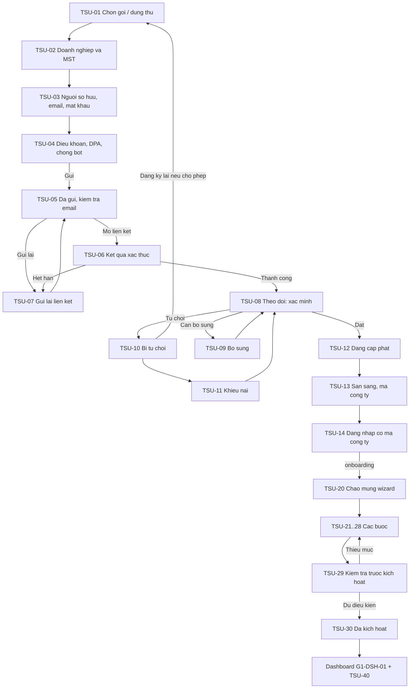
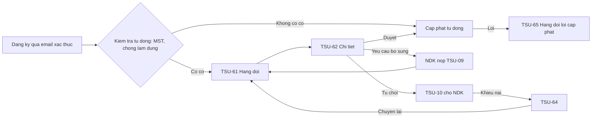

# GMEP – Đặc tả yêu cầu cho Designer: Đăng ký tenant mới và onboarding (self-service)

- **Phiên bản:** 0.1 (BA, 05/11/2026) · **Người lập:** BA · **Người nhận:** designer (dựng prototype HTML/CSS) · **Trạng thái:** đề xuất, chưa được khách hàng xác nhận.
- **Nguồn:** `docs/multi-tenant-analysis.md` (mục 0, 4.1, 5, 8, 9.4, 10, 14.2 RULE-028..032, 14.3 FR-TEN-001..050, journey J7..J10, UAT-TEN-13..19, Phụ lục A, B); `CLAUDE.md`; `docs/ui-ux/ui-ux-flow.md`; `docs/ui-ux/STATUS.md`; `docs/ui-ux/state-copy.md`; `docs/design-system.md`. Các mã FR-TEN, RULE-016..032, UAT-TEN là mã **đề xuất**, chưa nhập vào FRD/BRD.
- **Phạm vi:** luồng đăng ký tenant mới, xác thực email, xác minh, đăng nhập có xác định tenant, wizard onboarding, dashboard trial/gói, nâng/hạ gói (chỉ UI cho B0/B1), các trạng thái hạn chế/tạm ngưng/hết trial/chấm dứt, và màn quản trị nền tảng cho phần duyệt đăng ký. **Ngoài phạm vi:** thanh toán trong hệ thống, hóa đơn của nền tảng, dunning (FR-TEN-047..049, B2 trở đi) chỉ chừa chỗ giữ chỗ; quản trị vòng đời tenant phía nền tảng (ngưng, chấm dứt, xóa, phiên hỗ trợ) là gói thiết kế sau; không chọn công nghệ.
- **Quyền tự quyết:** người dùng đã giao BA tự quyết các câu hỏi mở liên quan UI. Mục 4 ghi **quyết định tạm** kèm lý do; mục 5 ghi các điểm `[Cần xác nhận]` mà khách hàng, luật sư hoặc kế toán phải chốt. Mọi giá trị số (thời hạn, trần, ngưỡng) trong tài liệu này là **tham số cấu hình hoặc số minh họa**, không phải quyết định kinh doanh.

## Mục lục

0. Nguyên tắc chung cho designer
1. Danh sách màn hình và route (52 màn)
2. Đặc tả từng màn hình (kèm bảng validate dùng chung ở 2.0)
3. Sơ đồ luồng và state machine UI map vào vòng đời tenant
4. Quyết định tạm
5. `[Cần xác nhận]`
6. Tiêu chí chấp nhận UI
7. Nội dung thông báo và email mẫu
8. Lệch tài liệu và việc cần cập nhật ở tài liệu khác

---

## 0. Nguyên tắc chung cho designer

1. **Dùng đúng design system** (`docs/design-system.md`, token không đổi) và bộ component đã có (`docs/ui-ux/component-catalog.md`, `design/assets`). Mẫu giao diện: trang công khai theo biến thể **P** (không shell, mobile-first) cho TSU-01..18; wizard theo biến thể **W** của template E (stepper, sticky footer) cho TSU-20..30; màn trong ứng dụng theo template A/B/D; màn quản trị nền tảng dùng shell riêng (mục 0.4). Trang dùng lại khung thẻ, `Field`, `PasswordField`, `OtpInput`, `ReasonDisabled`, `ConfirmDialog` của gói G5 khi có.
2. **Giọng chữ** theo `state-copy.md`: điều gì xảy ra, vì sao, cách khắc phục; xưng "bạn"; không chấm than; nút bằng động từ cụ thể; chỉ tiếng Việt, VND, `vi-VN`; chừa chỗ cho chuỗi dài.
3. **Không lộ sự tồn tại** (FR-TEN-016, FR-TEN-039): mọi phản hồi ở đăng ký, đăng nhập, quên mật khẩu, quên mã công ty, gửi lại liên kết **cùng câu chữ, cùng mã trạng thái** cho trường hợp email hoặc MST đã tồn tại và chưa tồn tại. Chi tiết khác nhau chỉ gửi qua email tới chủ email.
4. **Máy chủ quyết, UI chỉ hiển thị**: số lần thử, thời gian chờ, thời hạn liên kết, thời lượng dùng thử, hạn mức, tên gói, tên phiên bản điều khoản đều là dữ liệu từ máy chủ (cấu hình), **không viết cứng trong chữ**. Prototype dùng số minh họa ghi chú "(minh họa)".
5. **Khóa nút kèm lý do** (`ui-ux-flow` §5.6), **chống gửi trùng** (§5.7: bấm hai lần không tạo hai yêu cầu), mất mạng khóa nút và giữ nháp (trừ mật khẩu: chỉ giữ trong bộ nhớ trang, không lưu bền vững).
6. **Trạng thái bắt buộc cho mỗi màn**: loading (skeleton đúng hình khối), empty, error (nêu nguyên nhân + "Thử lại" + mã `REQ-…`), success, 429 (đếm lùi lấy từ máy chủ), offline. Mục 2 chỉ nêu trạng thái **riêng** của màn; các trạng thái chung lấy ở `state-copy.md`.
7. **Accessibility** WCAG 2.2 AA như `ui-ux-flow` §8: lỗi theo trường có `aria-invalid` + `aria-describedby`, tóm tắt lỗi đầu form `role="alert"`, focus vào lỗi đầu; ô chống bot phải có phương án thay thế không dùng hình ảnh; mục tiêu bấm ≥ 44px trên cảm ứng.
8. **Responsive:** trang công khai và đăng nhập kiểm tra ở 390px (điện thoại) và 1440px; wizard dùng được trên tablet; chủ garage nhiều khi làm trên điện thoại. Không bảng 12 cột trên điện thoại (chuyển card list). Màn quản trị nền tảng ưu tiên desktop, vẫn không tràn ngang ở 390px.
9. **Không dựng thật** phần máy chủ: che dữ liệu, kiểm tra MST, chống bot, đếm hạn mức chỉ mô phỏng trong prototype; ghi rõ trên thanh "Xem thử trạng thái" như gói G5.

### 0.1 Bộ mã trạng thái cần có thanh "Xem thử trạng thái" (prototype)

Mỗi màn có thanh chọn trạng thái như G5: tên trạng thái trong mục 2 ("T:" bên dưới mỗi màn) là một lựa chọn trên thanh, để test Playwright + axe theo từng trạng thái.

### 0.2 Component mới đề xuất (tên tạm; không có trong catalog hiện tại)

| Component | Dùng ở | Mô tả |
| --- | --- | --- |
| `PlanCard` | TSU-01, 42 | Thẻ gói: tên, mô tả, hạn mức, "Dùng thử {N} ngày, không cần thẻ", nút chọn; nhãn "Đang dùng" |
| `SignupStepper` | TSU-02..04 | Stepper 3 bước dạng rút gọn trên điện thoại ("Bước 2/3") |
| `TermsAcceptance` | TSU-04, 18 | Hai checkbox riêng (Điều khoản dịch vụ, DPA) mỗi cái kèm nút "Đọc" mở dialog hiển thị phiên bản, ngày hiệu lực; không tích sẵn |
| `BotCheckSlot` | TSU-04, 07, 15, 17 | Vùng giữ chỗ cho kiểm tra người thật (không chọn nhà cung cấp); có trạng thái chờ, đạt, lỗi, phương án thay thế; kèm trường honeypot ẩn khỏi người dùng và trình đọc màn hình |
| `StatusTracker` | TSU-08..13 | Dải tiến trình: Đã gửi → Xác thực email → Xác minh → Cấp phát → Sẵn sàng |
| `FileUpload` | TSU-09, 11 | Tải tệp qua máy chủ; loại, dung lượng, số lượng là tham số; trạng thái đang tải/xong/lỗi/xóa |
| `OnboardingChecklist` | TSU-29, 40 | Danh sách bước: Bắt buộc / Nên làm / Tùy chọn; trạng thái Chưa làm / Đang làm / Xong / Bỏ qua / Lỗi; liên kết vào đúng bước |
| `TenantStateBanner` | TSU-50 | Banner đầu trang theo trạng thái tenant và thuê bao (biến thể ở TSU-50), `role="status"` hoặc `alert` |
| `UsageMeter` | TSU-41, 43 | Thanh mức dùng so với hạn mức, có chữ "7/10 chi nhánh · 70%", ngưỡng cảnh báo, không chỉ dựa vào màu |
| `DraftSavedIndicator` | TSU-21..28 | "Đã lưu nháp lúc HH:mm" / "Đang lưu…" / "Chưa lưu được, thử lại" |
| `PlatformShell` | TSU-60..68 | Khung quản trị nền tảng khác khung tenant (mục 0.4) |

### 0.3 Vai trò (actor) dùng trong tài liệu

| Ký hiệu | Actor | Nguồn |
| --- | --- | --- |
| NDK | Người đăng ký (chưa có tài khoản tenant), sau trở thành CH | J7 |
| CH | Chủ garage của tenant | `multi-tenant-analysis` 4.2 |
| AD | Quản trị hệ thống của tenant (quản trị tenant) | 4.2 |
| NV | Người dùng khác trong tenant | – |
| CNT | Chủ nền tảng (Platform owner): duyệt ca bị cờ | 4.1 |
| QTN | Quản trị nền tảng (Platform super admin) | 4.1 |
| HTN | Hỗ trợ nền tảng | 4.1 |

### 0.4 Khung quản trị nền tảng (PlatformShell)

Khác khung tenant để không nhầm: nền thanh trên màu trung tính tối (dùng token `neutral`, không tím), nhãn cố định "Quản trị nền tảng" cạnh logo, **không có bộ chọn chi nhánh**, không có menu nghiệp vụ garage. Menu: Hàng đợi đăng ký, Khiếu nại, Lỗi cấp phát, Cấu hình đăng ký, Điều khoản và DPA, Danh mục gói. Dải cố định: "Màn này không hiển thị dữ liệu nghiệp vụ của garage" (FR-TEN-011, RULE-017). Tài khoản nền tảng tách khỏi tài khoản tenant (FR-TEN-011): có trang đăng nhập riêng TSU-60.

---

## 1. Danh sách màn hình và route

Route là **đề xuất** (dev chốt). Mã `TSU-nn` (Tenant SignUp và onboarding). "Biến thể" là các trạng thái chính cùng một route.

### 1.1 Nhóm A. Đăng ký công khai (biến thể P, không shell)

| Mã | Màn hình | Route đề xuất | Actor | Ưu tiên |
| --- | --- | --- | --- | --- |
| TSU-01 | Giới thiệu và chọn gói / dùng thử | `/signup` | NDK | MT-1 |
| TSU-02 | Đăng ký bước 1: doanh nghiệp và MST | `/signup/business` | NDK | MT-1 |
| TSU-03 | Đăng ký bước 2: người sở hữu, email, mật khẩu | `/signup/owner` | NDK | MT-1 |
| TSU-04 | Đăng ký bước 3: điều khoản, DPA, kiểm tra người thật, gửi | `/signup/confirm` | NDK | MT-1 |
| TSU-05 | Đã gửi, kiểm tra email | `/signup/sent` | NDK | MT-1 |
| TSU-06 | Kết quả xác thực email (thành công, hết hạn, đã dùng, không hợp lệ, bị giới hạn) | `/signup/verify?token=…` | NDK | MT-1 |
| TSU-07 | Gửi lại liên kết xác thực | `/signup/resend` | NDK | MT-1 |

### 1.2 Nhóm B. Theo dõi đăng ký, xác minh, cấp phát (P)

| Mã | Màn hình | Route đề xuất | Actor | Ưu tiên |
| --- | --- | --- | --- | --- |
| TSU-08 | Theo dõi đăng ký: đang xác minh tự động / chờ duyệt | `/signup/status` | NDK | MT-1 |
| TSU-09 | Cần bổ sung thông tin | `/signup/status/supplement` | NDK | MT-1 |
| TSU-10 | Bị từ chối | `/signup/status` (biến thể) | NDK | MT-1 |
| TSU-11 | Khiếu nại kết quả | `/signup/status/appeal` | NDK | MT-1 |
| TSU-12 | Đang cấp phát tài khoản | `/signup/status` (biến thể) | NDK | MT-1 |
| TSU-13 | Sẵn sàng: mã công ty và đăng nhập lần đầu | `/signup/ready` | NDK | MT-1 |

### 1.3 Nhóm C. Đăng nhập có xác định tenant (P; kế thừa G5-AUT)

| Mã | Màn hình | Route đề xuất | Actor | Ưu tiên |
| --- | --- | --- | --- | --- |
| TSU-14 | Đăng nhập có mã công ty (mở rộng G5-AUT-01, G5-AUT-04) | `/login` | CH, AD, NV | MT-1 |
| TSU-15 | Quên mật khẩu có mã công ty (mở rộng G5-AUT-01) | `/login/forgot` | mọi người dùng tenant | MT-1 |
| TSU-16 | Đặt lại mật khẩu (dùng G5-AUT-02, thêm mã công ty) | `/login/reset?token=…` | mọi người dùng tenant | MT-1 |
| TSU-17 | Quên mã công ty | `/login/company-code` | mọi người dùng tenant | MT-1 |
| TSU-18 | Chấp nhận phiên bản điều khoản/DPA mới | `/terms/accept` | CH (hoặc người có quyền) | MT-1 |

### 1.4 Nhóm D. Wizard onboarding (W, trong ứng dụng tenant ở trạng thái `onboarding`)

| Mã | Màn hình | Route đề xuất | Bắt buộc để kích hoạt | Actor |
| --- | --- | --- | --- | --- |
| TSU-20 | Chào mừng và lộ trình thiết lập | `/onboarding` | – | CH |
| TSU-21 | W1 Công ty (pháp nhân, khảo sát nhanh) | `/onboarding/company` | Bắt buộc | CH, AD |
| TSU-22 | W2 Chi nhánh đầu tiên | `/onboarding/branch` | Bắt buộc | CH, AD |
| TSU-23 | W3 Kho | `/onboarding/warehouse` | Bắt buộc | CH, AD |
| TSU-24 | W4 Vai trò và mời người dùng | `/onboarding/users` | Nên làm | CH, AD |
| TSU-25 | W5 Dịch vụ và bảng giá mẫu | `/onboarding/catalog` | Nên làm | CH, AD |
| TSU-26 | W6 Thuế, đánh số, mẫu in | `/onboarding/numbering` | Nên làm (có mặc định) | CH, AD |
| TSU-27 | W7 Nhà cung cấp hóa đơn điện tử | `/onboarding/einvoice` | Bắt buộc chọn: khai hoặc chạy thử | CH, KT |
| TSU-28 | W8 Nhập Excel | `/onboarding/import` | Tùy chọn | CH, AD |
| TSU-29 | W9 Kiểm tra trước kích hoạt (checklist) | `/onboarding/review` | Bắt buộc | CH |
| TSU-30 | Hoàn tất: đã kích hoạt | `/onboarding/done` | – | CH |
| TSU-31 | Hộp thoại: bỏ qua bước / thoát và lưu nháp / tiếp tục từ nháp | (dialog) | – | CH, AD |

### 1.5 Nhóm E. Dashboard trial, gói, checklist (template A/B/D, trong ứng dụng)

| Mã | Màn hình | Route đề xuất | Actor | Ưu tiên |
| --- | --- | --- | --- | --- |
| TSU-40 | Trang chủ giai đoạn đầu: checklist còn lại và thẻ dùng thử (trên dashboard CH) | `/` (khối trên G1-DSH-01) | CH, AD | MT-1 |
| TSU-41 | Gói của tôi: thuê bao, ngày hết hạn, mức dùng | `/settings/plan` | CH (xem: AD) | MT-1 (B0); MT-2 |
| TSU-42 | So sánh gói và yêu cầu đổi gói (nâng) | `/settings/plan/change` | CH | MT-2 (B1) |
| TSU-43 | Xác nhận hạ gói (kiểm tra mức dùng) | `/settings/plan/downgrade` | CH | MT-2 (B1) |
| TSU-44 | Lịch sử gói và các mốc thông báo | `/settings/plan/history` | CH | MT-2 |

### 1.6 Nhóm F. Hạn chế, tạm ngưng, hết trial, chấm dứt

| Mã | Màn hình | Route đề xuất | Actor | Ưu tiên |
| --- | --- | --- | --- | --- |
| TSU-50 | Thư viện banner trạng thái tenant (`TenantStateBanner`) | (component, mọi trang) | mọi người dùng tenant | MT-1 |
| TSU-51 | Hộp thoại chặn tạo mới (hạn chế, vượt hạn mức) | (dialog) | mọi người dùng tenant | MT-2 |
| TSU-52 | Hết dùng thử: hướng dẫn chọn gói, đọc/xuất dữ liệu | `/plan/expired` | CH, AD (NV: thông báo liên hệ CH) | MT-2 |
| TSU-53 | Tạm ngưng: chỉ đọc và tải dữ liệu | `/suspended` | mọi người dùng tenant | MT-1 |
| TSU-54 | Tạm ngưng: chặn hoàn toàn (sự cố an ninh) | `/suspended` (biến thể) | mọi người dùng tenant | MT-1 |
| TSU-55 | Trung tâm xuất dữ liệu | `/settings/data-export` | CH | MT-1 |
| TSU-56 | Yêu cầu chấm dứt dịch vụ | `/settings/termination` | CH | MT-1 |
| TSU-57 | Đang chấm dứt / đã chấm dứt (kết quả đăng nhập, cổng tải lưu trữ) | `/terminating`, `/login` | CH, người dùng tenant | MT-1 |

### 1.7 Nhóm G. Quản trị nền tảng (PlatformShell)

| Mã | Màn hình | Route đề xuất | Actor | Ưu tiên |
| --- | --- | --- | --- | --- |
| TSU-60 | Đăng nhập quản trị nền tảng | `/platform/login` | CNT, QTN, HTN | MT-1 |
| TSU-61 | Hàng đợi đăng ký | `/platform/signups` | CNT, QTN (HTN xem) | MT-1 |
| TSU-62 | Chi tiết hồ sơ đăng ký và quyết định | `/platform/signups/{id}` | CNT (duyệt, từ chối), QTN (yêu cầu bổ sung) | MT-1 |
| TSU-63 | Hộp thoại quyết định: duyệt / yêu cầu bổ sung / từ chối kèm lý do | (dialog) | CNT, QTN | MT-1 |
| TSU-64 | Hàng đợi khiếu nại | `/platform/appeals` | CNT | MT-1 |
| TSU-65 | Hàng đợi lỗi cấp phát | `/platform/provisioning` | QTN | MT-1 |
| TSU-66 | Cấu hình đăng ký (trường, trần, danh sách chặn, mẫu lý do) | `/platform/signup-config` | QTN | MT-1 |
| TSU-67 | Phiên bản điều khoản dịch vụ và DPA | `/platform/terms` | CNT, QTN | MT-1 |
| TSU-68 | Danh mục gói hiển thị cho người đăng ký | `/platform/plans` | CNT, QTN | MT-1 (B0); MT-2 |

**Tổng: 52 màn** (7 + 6 + 5 + 12 + 5 + 8 + 9). Các biến thể không tính thêm màn.

---

## 2. Đặc tả từng màn hình

### 2.0 Quy tắc validate và câu lỗi dùng chung

Tất cả tham số (độ dài, mẫu, danh sách chặn) là **cấu hình** lấy từ máy chủ (TSU-66). Kiểm tra phía trình duyệt chỉ để gợi ý; máy chủ kiểm tra lại và trả 422 theo `state-copy.md` §1. Kiểm tra khi rời trường (blur) và khi gửi; không báo lỗi khi người dùng đang gõ lần đầu.

| Mã | Trường | Quy tắc | Câu lỗi tiếng Việt |
| --- | --- | --- | --- |
| V-EMAIL | Email | Cắt khoảng trắng, chuyển chữ thường, tối đa 254 ký tự, đúng định dạng; tên miền thuộc danh sách chặn email dùng một lần thì từ chối | Trống: "Nhập email để chúng tôi gửi liên kết xác thực." · Sai định dạng: "Email chưa đúng định dạng. Ví dụ: ten@congty.vn." · Dùng một lần: "Email này thuộc dịch vụ email tạm thời. Vui lòng dùng email công việc hoặc email thường dùng của bạn." |
| V-PHONE | Số điện thoại | Số di động Việt Nam: 10 chữ số bắt đầu bằng 0, hoặc `+84` rồi 9 chữ số; cho phép dán có khoảng trắng, chấm, gạch; lưu bản chuẩn hóa. Mẫu là cấu hình (có cho phép số bàn không) | Trống: "Nhập số điện thoại để chúng tôi liên hệ khi cần." · Sai: "Số điện thoại chưa đúng. Nhập 10 số bắt đầu bằng 0, ví dụ 0912 345 678." |
| V-MST | Mã số thuế | Chỉ chữ số (bỏ khoảng trắng và dấu gạch khi dán). **Mặc định nhận 10 số (doanh nghiệp) hoặc 12 số (hộ kinh doanh, cá nhân dùng số định danh cá nhân làm MST)**; 13 số (đơn vị phụ thuộc) bị từ chối ở bước này. Độ dài cho phép và kiểm tra chữ số kiểm tra là cấu hình, `[Cần xác nhận]` Kế toán/Luật sư (mục 5, C-12). Việc MST có thật hay không do máy chủ đối chiếu sau khi gửi, **không** báo ngay ở trường (tránh dò MST) | Trống: "Nhập mã số thuế của doanh nghiệp hoặc hộ kinh doanh." · Sai độ dài/ký tự: "Mã số thuế gồm 10 số (doanh nghiệp) hoặc 12 số (hộ kinh doanh). Chỉ nhập chữ số." · 13 số: "Đây là mã số thuế của đơn vị phụ thuộc. Hãy nhập mã số thuế 10 số của pháp nhân." |
| V-PASS | Mật khẩu | Tối thiểu {min} ký tự (đề xuất 10, D-03), không nằm trong danh sách mật khẩu thông dụng, không chứa email hay họ tên; cho dán, có nút hiện/ẩn; thanh độ mạnh có chữ ("Yếu", "Trung bình", "Mạnh"), không chỉ màu | "Mật khẩu cần ít nhất {min} ký tự." · "Mật khẩu này quá phổ biến. Hãy chọn mật khẩu khác." · "Mật khẩu không nên chứa email hoặc họ tên của bạn." · Nhập lại: "Hai mật khẩu chưa giống nhau." |
| V-NAME | Họ tên người | 2 đến 100 ký tự, có chữ cái | "Nhập họ và tên đầy đủ của người sở hữu." |
| V-ORG | Tên doanh nghiệp / hộ kinh doanh | 2 đến 200 ký tự | "Nhập tên doanh nghiệp hoặc hộ kinh doanh đúng như giấy đăng ký." |
| V-CODE | Mã công ty (khi đăng nhập) | Chữ thường, số, dấu gạch ngang, 3 đến 40 ký tự, không phân biệt hoa thường khi nhập | "Nhập mã công ty. Mã có trong email chào mừng." |
| V-REQ | Trường bắt buộc chung | – | "Vui lòng nhập {tên trường}." (nhãn trường điền vào, không dùng "Trường này") |
| V-FILE | Tệp đính kèm | Loại PDF, JPG, PNG; mỗi tệp tối đa {X} MB; tối đa {n} tệp (tham số) | "Chỉ nhận tệp PDF, JPG hoặc PNG." · "Tệp lớn hơn {X} MB. Hãy chọn tệp nhỏ hơn." · "Tải tệp chưa xong. Thử lại." |

### TSU-01 Giới thiệu và chọn gói / dùng thử

| Mục | Nội dung |
| --- | --- |
| Mục đích | Cho chủ garage hiểu GMEP, thấy gói và điều kiện dùng thử, bắt đầu đăng ký |
| Actor | NDK (công khai) |
| Truy vết | FR-TEN-039, 044, 024; BR-TEN-09; RULE-028; J7 bước 1; UAT-TEN-13 |
| Vào | Đường dẫn công khai, nút "Đăng ký" ở trang giới thiệu, liên kết từ TSU-14 |
| Ra | "Bắt đầu dùng thử" → TSU-02 (gói đã chọn lưu cùng yêu cầu) |

- **Nội dung chính:** tiêu đề giá trị (một câu), ba lợi ích (quản lý lệnh sửa chữa, kho phụ tùng, hóa đơn điện tử) viết bằng ngôn ngữ chủ garage, danh sách gói (`PlanCard`), khối "Dùng thử cần gì": "Không cần thẻ thanh toán", "Bạn tự thiết lập trong khoảng {thời gian ước tính} phút (minh họa)", "Dữ liệu của bạn không bị xóa khi hết dùng thử".
- **Gói:** lấy từ danh mục (TSU-68). Ở B0 chỉ có một thẻ: tên gói, "Dùng thử {N} ngày (minh họa 30)" hoặc "Truy cập sớm, chưa thu phí" (theo cấu hình `trial` / `none`, mục 4 QĐT-04), hạn mức chính (số chi nhánh, số người dùng; nếu chưa có thì nhãn "Hạn mức: sẽ công bố"), giá hiển thị "Chưa công bố giá" (`[Cần xác nhận]` giá, VAT). Từ B1 nhiều thẻ, mỗi thẻ có hạn mức và giá (đã gồm hay chưa gồm VAT theo cấu hình).
- **Hành động:** "Bắt đầu dùng thử" (chính); "Đã có tài khoản? Đăng nhập" → TSU-14; "Đọc điều khoản dịch vụ" (mở xem, chưa chấp nhận).
- **Ghi chú đối tượng:** dòng nhỏ "GMEP dành cho doanh nghiệp và hộ kinh doanh đã có mã số thuế tại Việt Nam" (QĐT-02, Q35).
- **Trạng thái:** loading skeleton thẻ gói; error "Không tải được danh sách gói" + Thử lại (vẫn cho vào TSU-02 với gói mặc định); empty (chưa cấu hình gói nào, khi đăng ký bị đóng): "Hiện chưa mở đăng ký mới. Để lại email để nhận thông báo khi mở" (tùy chọn; không thu thêm dữ liệu nếu chưa có quyết định, `[Cần xác nhận]` C-18). T: `mở đăng ký`, `đóng đăng ký`, `trần ngày đã đạt` (xếp hàng chờ, xem TSU-05 biến thể "xếp hàng").

### TSU-02 Đăng ký bước 1: doanh nghiệp và MST

| Mục | Nội dung |
| --- | --- |
| Mục đích | Thu thông tin tối thiểu về pháp nhân hoặc hộ kinh doanh |
| Actor | NDK |
| Truy vết | FR-TEN-039, 040; RULE-032; J7 bước 1; UAT-TEN-13 |
| Vào | Từ TSU-01 |
| Ra | "Tiếp tục" → TSU-03 khi hợp lệ; "Quay lại" → TSU-01 |

| Nhãn | Kiểu | Bắt buộc | Validate | Ghi chú |
| --- | --- | --- | --- | --- |
| Loại hình | Radio: "Doanh nghiệp (công ty, doanh nghiệp tư nhân)", "Hộ kinh doanh" | Có | V-REQ | Danh sách là cấu hình (Q35). Không có lựa chọn "Cá nhân không đăng ký kinh doanh" (QĐT-02) |
| Tên doanh nghiệp / hộ kinh doanh | Văn bản | Có | V-ORG | Gợi ý: "Đúng như giấy đăng ký kinh doanh" |
| Mã số thuế | Văn bản, bàn phím số | Có | V-MST | Tự bỏ khoảng trắng; tiện ích nhỏ "Mã số thuế ở đâu?" mở gợi ý (giấy đăng ký kinh doanh, thông báo thuế) |
| Tỉnh/thành phố trụ sở | Chọn | Có | V-REQ | Danh mục hành chính là cấu hình |
| Địa chỉ trụ sở | Văn bản nhiều dòng ngắn | Có | V-REQ; 5 đến 250 ký tự | |
| Số chi nhánh hiện có | Chọn: 1; 2 đến 3; 4 đến 10; trên 10 | Không | – | Chỉ để gợi ý gói và chuẩn bị wizard; có thể bỏ trống |

- **Nháp:** nội dung các bước 1 và 2 giữ ở trình duyệt đến khi gửi ở TSU-04 (không có yêu cầu `signup_pending` trước đó, `multi-tenant-analysis` 5.3); không lưu mật khẩu. Đóng tab rồi mở lại: hỏi "Tiếp tục bản nháp lúc HH:mm?" (cùng thiết bị).
- **Hành động:** Tiếp tục (chính), Quay lại. Nút khóa khi thiếu trường bắt buộc, kèm dòng "Còn thiếu: {tên trường}".
- **Trạng thái:** lỗi theo trường; tóm tắt lỗi đầu form; offline: banner + khóa nút Tiếp tục không cần (bước này không gọi máy chủ), chỉ cảnh báo khi gửi ở TSU-04. T: `trống`, `lỗi MST`, `lỗi nhiều trường`, `có bản nháp`.

### TSU-03 Đăng ký bước 2: người sở hữu, email, mật khẩu

| Mục | Nội dung |
| --- | --- |
| Mục đích | Tạo danh tính chủ garage (tài khoản CH đầu tiên) |
| Actor | NDK |
| Truy vết | FR-TEN-039, 002, 016; RULE-029; J7 bước 1 |
| Vào | Từ TSU-02 |
| Ra | "Tiếp tục" → TSU-04 |

| Nhãn | Kiểu | Bắt buộc | Validate | Ghi chú |
| --- | --- | --- | --- | --- |
| Họ và tên người sở hữu/đại diện | Văn bản | Có | V-NAME | |
| Chức danh | Chọn: "Chủ sở hữu", "Giám đốc/Tổng giám đốc", "Người được ủy quyền" | Có | V-REQ | Danh sách là cấu hình |
| Số điện thoại | Văn bản | Có | V-PHONE | Chưa xác thực OTP trong quyết định tạm (QĐT-13); có chỗ cho bước xác thực SĐT nếu cấu hình bật |
| Email đăng nhập | Email | Có | V-EMAIL | Email này nhận liên kết xác thực và là tài khoản đăng nhập của chủ garage |
| Mật khẩu | Mật khẩu | Có | V-PASS | Hiển thị quy tắc đang áp dụng ngay dưới ô (không đợi lỗi) |
| Nhập lại mật khẩu | Mật khẩu | Có | khớp mật khẩu | |

- **Không thu** số căn cước, ngày sinh (tối thiểu hóa dữ liệu, `[Cần xác nhận]` Q28 nếu cần giấy tờ thì yêu cầu ở TSU-09).
- **Dòng riêng tư:** "Chúng tôi dùng thông tin này để tạo tài khoản và liên hệ về dịch vụ. Xem Chính sách quyền riêng tư" (liên kết mở dialog; nội dung do luật sư soạn, `[Cần xác nhận]` Q8).
- **Hành động:** Tiếp tục, Quay lại. T: `trống`, `mật khẩu yếu`, `email dùng một lần`, `mật khẩu không khớp`.

### TSU-04 Đăng ký bước 3: điều khoản, DPA, kiểm tra người thật, gửi

| Mục | Nội dung |
| --- | --- |
| Mục đích | Xem lại thông tin, chấp nhận điều khoản và DPA, chống bot, gửi yêu cầu |
| Actor | NDK |
| Truy vết | FR-TEN-039, 037, 041; RULE-028, 029, 032; UAT-TEN-13, 14 |
| Vào | Từ TSU-03 |
| Ra | Gửi thành công → TSU-05; bị giới hạn tần suất → ở lại với alert có đếm lùi |

- **Tóm tắt thông tin** (chỉ đọc, có liên kết "Sửa" về bước 1 hoặc 2): loại hình, tên, MST, địa chỉ, người sở hữu, SĐT, email (mật khẩu không hiện).
- **Chấp nhận** (`TermsAcceptance`):

| Nhãn | Kiểu | Bắt buộc | Ghi chú |
| --- | --- | --- | --- |
| Tôi là người đại diện theo pháp luật hoặc được ủy quyền hợp lệ của {tên doanh nghiệp} | Checkbox | Có | `[Cần xác nhận]` Luật sư Q30: người có thẩm quyền chấp nhận |
| Tôi đã đọc và đồng ý Điều khoản dịch vụ (phiên bản {v}, hiệu lực {ngày}) | Checkbox + nút "Đọc" | Có | Phiên bản và ngày lấy từ TSU-67; không tích sẵn |
| Tôi đã đọc và đồng ý Thỏa thuận xử lý dữ liệu (DPA) (phiên bản {v}) | Checkbox + nút "Đọc" | Có | Như trên; hai mục chấp nhận **tách riêng** |
| Tôi muốn nhận tin tức và hướng dẫn sử dụng qua email | Checkbox | Không | Đồng ý tiếp thị tách riêng, không tích sẵn (không gộp vào điều khoản) |

- **Dialog "Đọc":** tiêu đề tài liệu, phiên bản, ngày hiệu lực, nội dung cuộn, nút "Đóng" (không bắt buộc cuộn hết, `[Cần xác nhận]` Q30). Có liên kết "Tải bản PDF".
- **Kiểm tra người thật:** `BotCheckSlot`. Có đường thay thế cho người dùng không dùng được bước đó ("Tôi cần cách khác" → gửi mã xác nhận qua email). Honeypot không hiển thị, không focus được, ẩn khỏi trình đọc màn hình.
- **Hành động:** "Gửi đăng ký" (chính) khóa cho đến khi tích đủ ba ô bắt buộc và bot đạt; lý do khóa hiện sẵn: "Chưa thể gửi: cần đồng ý Điều khoản dịch vụ và DPA". Sau khi bấm: loading, khóa chống bấm đúp, gửi kèm khóa chống trùng (gửi lại cùng đăng ký không tạo hai yêu cầu).
- **Phản hồi trung lập:** thành công hay trùng email/MST đều đi tới TSU-05 với cùng chữ (RULE-032, FR-TEN-039).
- **Trạng thái:** đang gửi; 429 ("Bạn đã thử quá nhiều lần. Thử lại sau mm:ss."); lỗi bot ("Chưa xác nhận được bạn là người thật. Hãy thử lại hoặc chọn cách khác."); lỗi máy chủ (nháp giữ nguyên); đã chấp nhận phiên bản cũ (phiên bản vừa đổi khi đang điền): "Điều khoản vừa được cập nhật. Vui lòng đọc lại và đồng ý." T: `chưa tích`, `đang gửi`, `429`, `lỗi bot`, `phiên bản đổi`, `đóng đăng ký`.

### TSU-05 Đã gửi, kiểm tra email

| Mục | Nội dung |
| --- | --- |
| Mục đích | Hướng dẫn xác thực email; không lộ email/MST đã tồn tại |
| Actor | NDK |
| Truy vết | FR-TEN-039, 041; RULE-032; J7 bước 2; UAT-TEN-13 |
| Vào | Từ TSU-04 |
| Ra | Mở liên kết trong email → TSU-06; "Gửi lại" → TSU-07 |

- **Nội dung:** "Chúng tôi đã gửi email đến {email đã che một phần, ví dụ t***@congty.vn}. Mở email và bấm liên kết xác thực để tiếp tục. Liên kết có hiệu lực {72 giờ (minh họa)}." Dòng "Không thấy email? Kiểm tra thư mục spam hoặc gửi lại." Nút "Gửi lại email" (đếm lùi giữa hai lần gửi, `Retry-After` lấy từ máy chủ), "Dùng email khác" (về TSU-03, giữ nháp), liên kết "Theo dõi đăng ký" (TSU-08, cần liên kết trong email).
- **Câu chữ cố định, không đổi theo kết quả bên trong:** "Nếu thông tin hợp lệ, bạn sẽ nhận được email trong vài phút."
- **Biến thể `xếp hàng`:** khi vượt trần đăng ký trong ngày (FR-TEN-041): "Đăng ký của bạn đã được ghi nhận và đang xếp hàng xử lý. Chúng tôi sẽ email khi đến lượt." (không hứa thời gian cụ thể nếu chưa có cam kết, `[Cần xác nhận]` NFR-TEN-07).
- **Trạng thái:** gửi lại thành công (toast + đếm lùi mới); 429 (đếm lùi); đã gửi nhiều lần quá mức ("Bạn đã gửi lại nhiều lần. Hãy liên hệ hỗ trợ nếu vẫn chưa nhận được email." + kênh hỗ trợ). T: `bình thường`, `xếp hàng`, `đang đếm lùi`, `429`.

### TSU-06 Kết quả xác thực email

| Mục | Nội dung |
| --- | --- |
| Mục đích | Hiển thị kết quả khi mở liên kết xác thực |
| Actor | NDK |
| Truy vết | FR-TEN-039, 041; J7 bước 2 |
| Vào | Liên kết trong email E-01 |
| Ra | Thành công → TSU-08; hết hạn → TSU-07; đã dùng → TSU-08 hoặc TSU-14 tùy trạng thái |

| Biến thể | Tiêu đề | Thông báo | Nút |
| --- | --- | --- | --- |
| `thành công` | Email đã được xác thực | "Cảm ơn bạn. Chúng tôi đang kiểm tra thông tin doanh nghiệp. Bạn có thể đóng trang này, chúng tôi sẽ gửi email khi có kết quả." | **Theo dõi đăng ký** |
| `hết hạn` | Liên kết đã hết hạn | "Vì an toàn, liên kết xác thực chỉ có hiệu lực {72 giờ}. Bạn có thể nhận liên kết mới." | **Gửi liên kết mới** (→ TSU-07) |
| `đã dùng` | Liên kết đã được sử dụng | "Email này đã được xác thực. Hãy theo dõi đăng ký hoặc đăng nhập nếu tài khoản đã sẵn sàng." | **Theo dõi đăng ký**, **Đăng nhập** |
| `không hợp lệ` | Liên kết không hợp lệ | "Liên kết có thể đã bị cắt bớt khi sao chép. Hãy mở lại từ email hoặc nhận liên kết mới." | **Gửi liên kết mới** |
| `bị giới hạn` | Thử lại sau | "Có quá nhiều yêu cầu từ mạng của bạn. Thử lại sau mm:ss." | (khóa, đếm lùi) |
| `quá hạn đăng ký` | Yêu cầu đăng ký đã hết hạn | "Yêu cầu đăng ký này đã hết hạn vì chưa được xác thực. Bạn có thể đăng ký lại, không mất gì." | **Đăng ký lại** (→ TSU-01) |

- Các biến thể `không hợp lệ` và `đã dùng` có thể dùng chung một câu trung lập nếu BA/dev muốn tránh phân biệt; mặc định tách để người dùng biết cách xử lý (token do chính người nhận email giữ, không lộ thông tin bên thứ ba).
- Dùng khuôn trang kết quả của G1-ERR-05 (liên kết hết hạn).

### TSU-07 Gửi lại liên kết xác thực

| Nhãn | Kiểu | Bắt buộc | Validate | Ghi chú |
| --- | --- | --- | --- | --- |
| Email đã đăng ký | Email | Có | V-EMAIL | Điền sẵn nếu đến từ TSU-06 hết hạn |
| Kiểm tra người thật | `BotCheckSlot` | Có | – | |

- **Mục đích/Actor/Truy vết:** cấp lại liên kết cho NDK; FR-TEN-039 (cấp lại được), FR-TEN-041; J7 bước 2.
- **Phản hồi trung lập:** luôn "Nếu email này có đăng ký đang chờ xác thực, chúng tôi đã gửi liên kết mới." Nút "Gửi liên kết" (đếm lùi giữa các lần, trần số lần trong ngày là cấu hình). Ra: về TSU-05.
- **Trạng thái:** đang gửi; 429; lỗi bot. T: `bình thường`, `429`, `lỗi bot`.

### TSU-08 Theo dõi đăng ký: đang xác minh / chờ duyệt

| Mục | Nội dung |
| --- | --- |
| Mục đích | Cho NDK thấy tiến độ xác minh khi chưa có tenant |
| Actor | NDK (truy cập bằng liên kết riêng trong email, không cần mã công ty vì tenant chưa tồn tại) |
| Truy vết | FR-TEN-040, 041, 042; RULE-028, 032; J7 bước 3; UAT-TEN-13, 14 |
| Vào | TSU-06 thành công, liên kết "Theo dõi đăng ký" trong email |
| Ra | Đạt → TSU-12; cần bổ sung → TSU-09; từ chối → TSU-10 |

- **`StatusTracker`:** Đã gửi (xong) → Xác thực email (xong) → **Xác minh doanh nghiệp (đang)** → Cấp phát → Sẵn sàng.
- **Biến thể `tự động`:** "Chúng tôi đang đối chiếu mã số thuế và thông tin doanh nghiệp. Thường chỉ mất vài phút." Tự làm mới (live region `aria-live="polite"`, không đọc từng giây), nút "Làm mới".
- **Biến thể `chờ duyệt`:** "Đăng ký của bạn cần được nhân viên kiểm tra thêm. Chúng tôi sẽ email cho bạn khi có kết quả." Không nêu lý do bị cờ (tránh giúp kẻ gian dò quy tắc). Hiển thị "Thời gian xử lý dự kiến: {n} giờ làm việc" **chỉ khi** có cam kết (`[Cần xác nhận]` NFR-TEN-07, thời gian duyệt tay tối đa).
- **Thông tin hiển thị:** tên doanh nghiệp, MST đã che một phần (ví dụ 03******12), mã theo dõi `SGN-xxxxxx`, thời điểm gửi. Không hiển thị MST đầy đủ vì liên kết có thể bị chuyển tiếp.
- **Trạng thái:** loading; error (không tải được trạng thái, Thử lại); liên kết theo dõi không hợp lệ (câu như 404 trung lập); đang cấp phát tự chuyển TSU-12. T: `tự động`, `chờ duyệt`, `lỗi tải`, `liên kết không hợp lệ`.

### TSU-09 Cần bổ sung thông tin

| Mục | Nội dung |
| --- | --- |
| Mục đích | NDK nộp thêm thông tin hoặc giấy tờ theo yêu cầu của nền tảng |
| Actor | NDK |
| Truy vết | FR-TEN-040 (kết quả "cần bổ sung"); RULE-028; J7 bước 3 |
| Vào | TSU-08 khi nền tảng yêu cầu bổ sung; email E-04 |
| Ra | Gửi bổ sung → TSU-08 (`chờ duyệt`) |

| Nhãn | Kiểu | Bắt buộc | Validate | Ghi chú |
| --- | --- | --- | --- | --- |
| Danh sách yêu cầu | Danh sách chỉ đọc | – | – | Mỗi mục do nền tảng chọn từ mẫu (ví dụ "Giấy chứng nhận đăng ký kinh doanh", "Xác nhận người đại diện", "Giải thích MST đã có người đăng ký") |
| Tệp đính kèm theo từng mục | `FileUpload` | Theo yêu cầu | V-FILE | Tải qua máy chủ, có xem tên tệp, xóa tệp trước khi gửi |
| Ghi chú gửi nền tảng | Văn bản nhiều dòng | Không | tối đa 1000 ký tự | Bộ đếm ký tự |
| Hạn bổ sung | Chỉ đọc | – | – | Tham số; quá hạn thì chuyển `rejected` theo mục 4 QĐT-14 `[Cần xác nhận]` |

- **Hành động:** "Gửi bổ sung" (chính), "Lưu nháp". Nút khóa nếu mục bắt buộc chưa có tệp, kèm lý do hiện sẵn.
- **Bảo vệ:** hồ sơ xác minh là dữ liệu cá nhân (FR-TEN-040): tệp tải lên không xem được bằng liên kết công khai; chữ nhắc "Chỉ nhân viên được phân công xem tệp này".
- **Trạng thái:** đang tải tệp, lỗi tệp, quá hạn bổ sung. T: `đủ yêu cầu`, `đang tải`, `lỗi tệp`, `quá hạn`.

### TSU-10 Bị từ chối

| Mục | Nội dung |
| --- | --- |
| Mục đích | Thông báo kết quả từ chối, lý do, đường khiếu nại |
| Actor | NDK |
| Truy vết | FR-TEN-040 (từ chối có lý do và đường khiếu nại); FR-TEN-041; `multi-tenant-analysis` 5.3 (`signup_pending → rejected`); UAT-TEN-13 |
| Vào | TSU-08 khi `rejected`; email E-05 |
| Ra | "Khiếu nại" → TSU-11; "Đăng ký lại" → TSU-01 (chỉ khi lý do cho phép) |

- **Nội dung:** tiêu đề "Đăng ký chưa được chấp nhận". Lý do chọn từ **danh mục lý do** do nền tảng cấu hình (TSU-66), mỗi lý do có câu hiển thị cho NDK, ví dụ:
  - `mst_khong_hop_le`: "Chúng tôi không đối chiếu được mã số thuế bạn cung cấp. Kiểm tra lại mã số thuế và đăng ký lại."
  - `thong_tin_khong_khop`: "Thông tin doanh nghiệp không khớp với dữ liệu đã đăng ký với cơ quan thuế."
  - `khong_thuoc_doi_tuong`: "GMEP hiện phục vụ doanh nghiệp và hộ kinh doanh có mã số thuế tại Việt Nam."
  - `het_han_xac_thuc`: "Yêu cầu đã hết hạn vì chưa xác thực email."
  - `khong_bo_sung_dung_han`: "Chúng tôi chưa nhận được thông tin bổ sung trong thời hạn."
  - `khac` (lý do tự do nhân viên nhập, đã rà soát không chứa dữ liệu nhạy cảm).
- **Lý do chặn lạm dụng không nêu chi tiết:** dùng câu chung "Đăng ký không thể xử lý tự động. Bạn có thể gửi khiếu nại để nhân viên xem xét." (không giải thích quy tắc chống lạm dụng).
- **Hành động:** "Gửi khiếu nại" (chính, nếu còn lượt, mục 4 QĐT-14), "Đăng ký lại" (hiện khi lý do cho phép), "Liên hệ hỗ trợ" (kênh `[Cần xác nhận]`).
- **Trạng thái:** `đã khiếu nại` ("Khiếu nại đã gửi lúc HH:mm. Chúng tôi sẽ phản hồi qua email."); `hết lượt khiếu nại`. T: `lý do MST`, `lý do chung`, `đã khiếu nại`, `hết lượt`.

### TSU-11 Khiếu nại kết quả

| Nhãn | Kiểu | Bắt buộc | Validate | Ghi chú |
| --- | --- | --- | --- | --- |
| Nội dung giải trình | Văn bản nhiều dòng | Có | 20 đến 1000 ký tự; "Vui lòng mô tả ít nhất 20 ký tự để chúng tôi xem xét." | Bộ đếm |
| Email liên hệ | Email | Có | V-EMAIL | Điền sẵn email đăng ký |
| Tệp minh chứng | `FileUpload` | Không | V-FILE | |
| Kiểm tra người thật | `BotCheckSlot` | Có | – | |

- **Mục đích/Actor/Truy vết:** NDK khiếu nại; Q28 (đường khiếu nại); FR-TEN-040; actor NDK; ra: về TSU-10 biến thể `đã khiếu nại`.
- **Trạng thái:** đang gửi, 429, thành công ("Đã nhận khiếu nại. Mã khiếu nại KN-xxxxxx"). T: `trống`, `đang gửi`, `thành công`.

### TSU-12 Đang cấp phát tài khoản

| Mục | Nội dung |
| --- | --- |
| Mục đích | Cho NDK thấy hệ thống đang tạo không gian làm việc |
| Actor | NDK |
| Truy vết | FR-TEN-042, 002; NFR-TEN-05; `signup_pending → provisioning → onboarding`; J7 bước 4; UAT-TEN-15 |
| Vào | Xác minh đạt (tự động hoặc duyệt tay) |
| Ra | Xong → TSU-13 |

- **Tiến trình dễ hiểu (không lộ kỹ thuật):** "Tạo không gian làm việc" → "Thiết lập cấu hình mặc định" → "Tạo tài khoản chủ garage". Thanh tiến trình có chữ phần trăm hoặc bước; hiển thị "Thường mất vài phút" (số cụ thể theo NFR-TEN-05 `[Cần xác nhận]`).
- **Lỗi cấp phát** (`provision_failed`): hệ thống tự thử lại; người dùng **không** thấy chữ "lỗi", chỉ thấy "Việc thiết lập đang mất nhiều thời gian hơn dự kiến. Chúng tôi vẫn đang xử lý và sẽ gửi email ngay khi xong. Bạn không cần đăng ký lại." (J7 bước 4). Khi quá số lần thử, nền tảng thấy ở TSU-65; NDK vẫn thấy câu trên, không mất khóa chống trùng.
- **Trạng thái:** đang chạy; chậm; hoàn thành (tự chuyển TSU-13 sau 1 giây kèm nút). T: `đang chạy`, `chậm`, `xong`.

### TSU-13 Sẵn sàng: mã công ty và đăng nhập lần đầu

| Mục | Nội dung |
| --- | --- |
| Mục đích | Trao mã công ty và đưa chủ garage vào đăng nhập lần đầu |
| Actor | NDK → CH |
| Truy vết | FR-TEN-002, 016, 042; Q4/Q25 (QĐT-01); J7 bước 4 và 5 |
| Vào | TSU-12 hoàn tất; email E-06 |
| Ra | "Đăng nhập và bắt đầu thiết lập" → TSU-14 (điền sẵn mã công ty) → TSU-20 |

- **Nội dung:** "Không gian làm việc của {tên doanh nghiệp} đã sẵn sàng." **Mã công ty:** `minh-phat-7k3q` (chữ lớn, có nút "Sao chép"), giải thích "Bạn và nhân viên cần mã này mỗi lần đăng nhập. Chúng tôi cũng gửi mã vào email của bạn." Dòng trạng thái: "Bạn đang ở giai đoạn thiết lập: hóa đơn điện tử chạy thử, dữ liệu thử có thể xóa" (RULE-028).
- **Hành động:** "Đăng nhập và bắt đầu thiết lập" (chính); "Gửi lại email chào mừng".
- **Không** đăng nhập tự động bằng liên kết (tránh lộ phiên); người dùng nhập mật khẩu đã đặt ở TSU-03.
- T: `bình thường`, `sao chép thành công`.

### TSU-14 Đăng nhập có mã công ty

| Mục | Nội dung |
| --- | --- |
| Mục đích | Đăng nhập với tenant được xác định rõ ràng |
| Actor | CH, AD, NV |
| Truy vết | FR-TEN-016, 010, 009; RULE-026; QĐT-01; G1-AUT-01, G5-AUT-04 (kế thừa); UAT-TEN-07 |
| Vào | `/login`, từ TSU-13, từ liên kết lời mời, từ TSU-01 |
| Ra | `onboarding` → TSU-20; `active` → dashboard theo vai trò; `restricted` → dashboard + banner (TSU-50); `suspended` → TSU-53 / TSU-54; `terminating` → TSU-57; chưa chấp nhận điều khoản mới → TSU-18 |

| Nhãn | Kiểu | Bắt buộc | Validate | Ghi chú |
| --- | --- | --- | --- | --- |
| Mã công ty | Văn bản (tự nhớ trên thiết bị, có thể xóa "Không phải công ty này?") | Có | V-CODE | `autocomplete="organization"` không dùng; dùng thuộc tính riêng; không gợi ý danh sách công ty (tránh lộ tenant) |
| Email hoặc mã nhân viên | Văn bản | Có | V-REQ | Mã nhân viên chỉ duy nhất trong tenant; mơ hồ thì từ chối (FR-TEN-016) |
| Mật khẩu | Mật khẩu | Có | V-REQ | Nút hiện/ẩn |

- **Câu lỗi trung lập, một câu cho mọi nguyên nhân** (mã công ty sai, tài khoản sai, mật khẩu sai, tài khoản bị khóa, tenant đã chấm dứt): "Thông tin đăng nhập chưa đúng. Kiểm tra mã công ty, tài khoản và mật khẩu rồi thử lại." Khóa tạm và 429 dùng câu chữ G5-AUT-04 ("trên thiết bị này", đếm lùi từ máy chủ).
- **Sau khi xác thực thành công** (đúng thông tin) mới rẽ theo trạng thái tenant (mục "Ra"); các màn TSU-53, 54, 57 chỉ hiện cho người đã xác thực đúng.
- **Liên kết phụ:** "Quên mật khẩu?" → TSU-15; "Quên mã công ty?" → TSU-17; "Chưa có tài khoản? Đăng ký dùng thử" → TSU-01 (ghi chú: đây là điều chỉnh so với D-01 của G1-AUT-01, mục 8). Hiện liên kết đăng ký **ngoài thẻ đăng nhập** để người dùng nhân viên không nhầm đây là cách tạo tài khoản nhân viên; kèm chữ "Nhân viên mới nhận lời mời qua email từ quản trị công ty".
- **Trạng thái:** như G5-AUT-04 (sai, khóa tạm, hết phiên, 429, 5xx). T: `mặc định`, `đã nhớ mã công ty`, `sai thông tin`, `khóa tạm`, `429`.

### TSU-15 Quên mật khẩu có mã công ty

| Nhãn | Kiểu | Bắt buộc | Validate |
| --- | --- | --- | --- |
| Mã công ty | Văn bản (điền sẵn) | Có | V-CODE |
| Email hoặc mã nhân viên | Văn bản | Có | V-REQ |
| Kiểm tra người thật | `BotCheckSlot` | Có | – |

- Mở rộng G5-AUT-01; truy vết FR-TEN-016, FR-SYS-001 (ghi trong `state-copy.md`). Phản hồi **cố định** cho mọi trường hợp: "Nếu thông tin khớp một tài khoản, chúng tôi đã gửi hướng dẫn đặt lại mật khẩu đến email của tài khoản đó." Nếu đăng nhập bằng mã nhân viên mà tài khoản không có email: cùng câu, thực tế không gửi. Thời hạn liên kết lấy từ máy chủ.
- T: `bình thường`, `429`, `lỗi bot`.

### TSU-16 Đặt lại mật khẩu

- Dùng G5-AUT-02. **Thêm:** dòng chỉ đọc "Công ty: {tên công ty}" (chỉ hiện sau khi liên kết hợp lệ, không hiện ở trạng thái liên kết lỗi). Trường: Mật khẩu mới, Nhập lại (V-PASS). Kết quả: thành công → TSU-14 với mã công ty điền sẵn; liên kết hết hạn/đã dùng → khuôn G1-ERR-05. Mọi phiên cũ của tài khoản bị thu hồi (câu thông báo: "Các thiết bị khác sẽ phải đăng nhập lại.").
- Truy vết: FR-TEN-016, 010. T: `hợp lệ`, `hết hạn`, `đã dùng`, `mật khẩu yếu`, `thành công`.

### TSU-17 Quên mã công ty

| Nhãn | Kiểu | Bắt buộc | Validate |
| --- | --- | --- | --- |
| Email tài khoản | Email | Có | V-EMAIL |
| Kiểm tra người thật | `BotCheckSlot` | Có | – |

- Phản hồi cố định: "Nếu email này có tài khoản, chúng tôi đã gửi mã công ty đến email đó." Email E-12 chỉ gửi cho chủ email, liệt kê mã công ty và tên công ty của **các tài khoản gắn với email này** (hệ quả của U1: cùng email có thể ở nhiều tenant, mỗi tenant một tài khoản, QĐT-01). Không có kết quả tìm kiếm trên màn hình.
- Truy vết: FR-TEN-016, 010; `[Cần xác nhận]` C-01 (email có duy nhất toàn nền tảng hay không; thiết kế này không giả định duy nhất).
- T: `bình thường`, `429`.

### TSU-18 Chấp nhận phiên bản điều khoản/DPA mới

| Mục | Nội dung |
| --- | --- |
| Mục đích | Chủ garage chấp nhận lại khi nền tảng đổi điều khoản hoặc DPA |
| Actor | CH (hoặc người được CH ủy quyền trong cài đặt) |
| Truy vết | FR-TEN-037; RULE-029; UAT-TEN-13 |
| Vào | Sau đăng nhập khi có phiên bản mới chưa chấp nhận; chặn nhập dữ liệu thật và kích hoạt cho đến khi chấp nhận (RULE-029) |
| Ra | Chấp nhận → nơi đang đi tới |

- **Nội dung:** "Điều khoản dịch vụ (và/hoặc DPA) đã cập nhật lên phiên bản {v}, hiệu lực từ {ngày}." Tóm tắt thay đổi (do nền tảng nhập ở TSU-67), liên kết đọc toàn văn. `TermsAcceptance`. Nút "Đồng ý và tiếp tục", "Để sau" (chỉ hiện khi còn ở thời gian ân hạn do cấu hình; hết ân hạn thì không cho "Để sau"). Người dùng không phải CH thấy: "Chủ garage cần chấp nhận điều khoản mới. Hãy báo cho {tên CH}." kèm ReasonDisabled.
- **Trạng thái:** đang lưu, lỗi, đã chấp nhận ở thiết bị khác. T: `còn ân hạn`, `hết ân hạn`, `không phải CH`.

### TSU-20 Chào mừng và lộ trình thiết lập

| Mục | Nội dung |
| --- | --- |
| Mục đích | Giới thiệu lộ trình wizard, thời gian ước tính, cho chọn đi theo thứ tự hoặc nhảy bước |
| Actor | CH |
| Truy vết | FR-TEN-043, 004; J8; UAT-TEN-15 |
| Vào | Lần đăng nhập đầu khi tenant `onboarding`; menu "Thiết lập" |
| Ra | "Bắt đầu" → TSU-21 (hoặc bước đang dở) |

- **Nội dung:** "Chào {tên}, hãy thiết lập GMEP cho {tên công ty}." Danh sách 9 bước (`OnboardingChecklist`) với nhãn **Bắt buộc / Nên làm / Tùy chọn** và thời gian ước tính từng bước (minh họa). Khối thông tin cố định: "Bạn đang trong giai đoạn thiết lập: hóa đơn điện tử chạy thử và dữ liệu thử có thể xóa. Bạn có thể thoát và quay lại bất kỳ lúc nào, tiến độ được lưu." Nếu đã có nháp: nút "Tiếp tục từ bước {n}" (chính) và "Bắt đầu lại từ đầu" (phụ, xác nhận mức Thường).
- **Hành động:** Bắt đầu / Tiếp tục; "Để sau, xem trang chủ" (→ TSU-40).
- T: `lần đầu`, `có nháp`, `đã xong một phần`.

### Khung chung cho wizard TSU-21..28

- **Bố cục:** template E biến thể W: stepper trái (desktop) hoặc trên cùng (điện thoại, "Bước 3/9"), nội dung giữa, sticky footer: **Quay lại** · **Lưu nháp và thoát** · **Bỏ qua bước này** (chỉ ở bước "Nên làm" và "Tùy chọn") · **Lưu và tiếp tục** (chính).
- **Trạng thái bước trên stepper:** Chưa làm / Đang làm / Xong / Bỏ qua / Có lỗi, mỗi trạng thái có chữ, không chỉ màu. Bước bắt buộc chưa xong có dấu `*`. Chỉ mở bước kế khi bước hiện tại hợp lệ **hoặc** được bỏ qua hợp lệ, nêu lý do bằng chữ; quay lại tự do; nhảy đến bước đã mở.
- **Lưu nháp:** tự lưu khi chuyển bước và sau {n} giây không thao tác; `DraftSavedIndicator`; nháp lưu ở máy chủ (đổi thiết bị vẫn tiếp tục, vì chủ garage làm trên điện thoại rồi sang máy tính). Mất mạng: cảnh báo và giữ nháp trên thiết bị, khóa "Lưu và tiếp tục".
- **Thoát giữa chừng:** "Lưu nháp và thoát" → TSU-40; đóng tab: hộp cảnh báo rời trang chưa lưu (TSU-31 biến thể).
- **Dữ liệu mẫu và dữ liệu thử:** mọi dữ liệu tạo trong wizard thuộc môi trường `onboarding` có nhãn "Dữ liệu thử" nếu là dữ liệu mẫu (FR-TEN-030); có thể xóa trước khi kích hoạt.
- **Quyền:** CH và AD (nếu CH đã mời AD ở TSU-24) làm các bước 1 đến 8; bước 7 có thể do KT; bước 9 (kích hoạt) chỉ CH (QĐT-15). Người dùng không đủ quyền: ReasonDisabled "Chỉ chủ garage mới kích hoạt được".

### TSU-21 W1 Công ty

| Mục | Nội dung |
| --- | --- |
| Mục đích | Hoàn thiện hồ sơ pháp nhân (Company đầu tiên) và khảo sát nhanh |
| Actor | CH, AD |
| Truy vết | FR-TEN-043, 032, 004, 018; FR-SYS-018 (pháp nhân); Phụ lục A mục 1, 4; J8 |
| Bắt buộc | Có |

| Nhãn | Kiểu | Bắt buộc | Validate | Ghi chú |
| --- | --- | --- | --- | --- |
| Tên pháp nhân | Văn bản | Có | V-ORG | Điền sẵn từ đăng ký, sửa được (ghi nhật ký) |
| Mã số thuế | Chỉ đọc | – | – | Từ đăng ký đã xác minh; không sửa ở đây; "Cần đổi? Liên hệ hỗ trợ" |
| Tên hiển thị trên chứng từ | Văn bản | Có | 2 đến 100 ký tự | Dùng cho mẫu in (FR-TEN-022) |
| Logo | `FileUpload` ảnh | Không | PNG/JPG, tối đa {X} MB | Xem trước trên mẫu in |
| Địa chỉ, điện thoại, email liên hệ | Văn bản | Có (địa chỉ, SĐT) | V-REQ, V-PHONE, V-EMAIL | Điền sẵn |
| Tháng bắt đầu kỳ kế toán | Chọn 1 đến 12 | Có | – | Mặc định 1; `[Cần xác nhận]` kế toán của tenant |
| Mô hình pháp lý | Radio: "Một pháp nhân", "Nhiều pháp nhân (thêm sau)" | Có | – | Chọn nhiều: hiện chú thích "Bạn thêm pháp nhân thứ hai ở Cài đặt sau khi kích hoạt" (FR-SYS-018) |
| Múi giờ, tiền tệ | Chỉ đọc | – | – | "Asia/Ho_Chi_Minh", "VND" |
| Khảo sát nhanh (mở rộng, tùy chọn) | Nhóm câu hỏi (Phụ lục A: quy trình theo loại dịch vụ, có đồng sơn không, số năm lịch sử cần chuyển, máy in tại chi nhánh, người phụ trách dữ liệu) | Không | – | Lưu cùng hồ sơ có phiên bản bộ câu hỏi (FR-TEN-032); phần mở/đóng được |

- Hành động: Lưu và tiếp tục. T: `trống`, `điền sẵn`, `lỗi`, `đang lưu`.

### TSU-22 W2 Chi nhánh đầu tiên

| Nhãn | Kiểu | Bắt buộc | Validate | Ghi chú |
| --- | --- | --- | --- | --- |
| Tên chi nhánh | Văn bản | Có | 2 đến 100 ký tự, không trùng trong công ty: "Tên chi nhánh này đã có. Hãy đặt tên khác." | |
| Mã chi nhánh | Văn bản | Có | 2 đến 6 ký tự chữ-số in hoa, duy nhất trong tenant: "Mã chi nhánh này đã dùng. Chọn mã khác." | Dùng trong số chứng từ (ví dụ `Q7` trong `RO-Q7-2610-00128`); tự gợi ý; **không đổi được sau khi có chứng từ** (cảnh báo hiện sẵn) |
| Địa chỉ | Văn bản | Có | V-REQ | |
| Điện thoại | Văn bản | Không | V-PHONE | |
| Giờ làm việc | Chọn ca/giờ | Không | – | Mặc định theo cấu hình |
| Người quản lý chi nhánh | Chọn từ người dùng đã mời hoặc "Tôi tự quản lý" | Không | – | Thêm ở TSU-24 sau cũng được |

- Truy vết: FR-TEN-043, 004, 020; NFR-SCA-01 (thêm chi nhánh là cấu hình); J8. Ghi chú UI: "Bạn thêm chi nhánh khác sau trong Cài đặt." Nếu hạn mức gói chỉ cho {n} chi nhánh: hiện `UsageMeter` nhỏ.
- T: `trống`, `trùng mã`, `đã có chi nhánh (quay lại sửa)`.

### TSU-23 W3 Kho

| Nhãn | Kiểu | Bắt buộc | Validate | Ghi chú |
| --- | --- | --- | --- | --- |
| Tên kho | Văn bản | Có | 2 đến 100 ký tự, không trùng trong chi nhánh | Gợi ý "Kho phụ tùng {tên chi nhánh}" |
| Mã kho | Văn bản | Có | 2 đến 8 ký tự, duy nhất trong tenant | |
| Thuộc chi nhánh | Chọn | Có | – | Điền sẵn chi nhánh vừa tạo |
| Loại kho | Chọn: "Kho phụ tùng chính", "Kho phụ", "Kho quầy" | Không | – | Danh mục là cấu hình |
| Dùng chung cho nhiều chi nhánh | Không có ở wizard | – | – | Chuyển kho liên chi nhánh là cấu hình sau (P2) |

- Truy vết: FR-TEN-043, 004; RULE-008, 009 (hiển thị chú thích "Tồn kho gồm 4 số: thực tế, giữ chỗ, đang vận chuyển, khả dụng"). Hành động: Lưu và tiếp tục.
- T: `trống`, `trùng`, `đã tạo`.

### TSU-24 W4 Vai trò và mời người dùng

| Mục | Nội dung |
| --- | --- |
| Mục đích | Mời nhân sự chủ chốt và gán vai trò |
| Actor | CH, AD |
| Truy vết | FR-TEN-043; FR-SYS-019 (lời mời, thời hạn 72 giờ, đề xuất); FR-SYS-012; J8 |
| Bắt buộc | Nên làm (có thể bỏ qua) |

- **Khối giải thích vai trò:** 10 vai trò (CH, QL, CV, QĐ, TH, TK, TN, KT, MH, NS, AD; QV nếu bật) mỗi vai trò một câu "làm được gì", xem chi tiết ở ma trận quyền (liên kết G4-SYS-04).
- **Bảng mời** (card list trên điện thoại), thêm nhiều dòng:

| Nhãn | Kiểu | Bắt buộc | Validate |
| --- | --- | --- | --- |
| Họ và tên | Văn bản | Có | V-NAME |
| Email | Email | Có | V-EMAIL; "Email này đã được mời." nếu trùng trong danh sách |
| Vai trò | Chọn nhiều vai trò | Có | V-REQ |
| Chi nhánh được gán | Chọn nhiều | Có | V-REQ |

- **Hành động:** "Thêm người", "Gửi lời mời" (gửi E-08; hiển thị trạng thái từng lời mời: Chưa gửi, Đã gửi, Hết hạn), "Gửi lại", "Thu hồi lời mời". Người được mời **không tự đăng ký**; kích hoạt qua G5-AUT-03 (QĐT-15, J7). Gửi lời mời không bắt buộc để sang bước kế.
- Người nhận lời mời thấy mã công ty trong email (E-08), để đăng nhập ở TSU-14.
- T: `trống`, `đã gửi`, `trùng email`, `lỗi gửi`.

### TSU-25 W5 Dịch vụ và bảng giá mẫu

| Nhãn | Kiểu | Bắt buộc | Ghi chú |
| --- | --- | --- | --- |
| Loại dịch vụ garage cung cấp | Checkbox: sửa chữa chung, bảo dưỡng, lốp và mâm, đồng sơn | Không | Chọn "đồng sơn" hiện chú thích "Quy trình đồng sơn riêng chưa có trong giai đoạn đầu" (BRD, `[Cần xác nhận]` quy trình đồng sơn) |
| Nạp bộ dịch vụ và bảng giá mẫu | Công tắc "Dùng dữ liệu mẫu" | Không | Mẫu do nền tảng cung cấp, gắn nhãn "Dữ liệu mẫu, giá minh họa"; xóa được trước kích hoạt (FR-TEN-043) |
| Đơn giá giờ công mặc định | Tiền (VND, căn phải) | Không | `1.250.000 ₫` kiểu định dạng; số minh họa; không hard-code |
| Hạn mức giảm giá mặc định | Phần trăm | Không | Cấu hình theo hiệu lực ngày (FR-TEN-018) |

- Hành động: Lưu và tiếp tục / Bỏ qua. T: `mẫu đã bật`, `mẫu tắt`, `trống`.

### TSU-26 W6 Thuế, đánh số, mẫu in

| Nhãn | Kiểu | Bắt buộc | Ghi chú |
| --- | --- | --- | --- |
| Thuế suất mặc định | Chọn (danh mục pháp lý do nền tảng phát hành, có ngày hiệu lực) | Có (có mặc định) | Chỉ đọc nếu tenant không được ghi đè (Q16 `[Cần xác nhận]`); hiện "Do GMEP cập nhật theo quy định, hiệu lực từ {ngày}" (FR-TEN-019) |
| Định dạng số chứng từ | Hiển thị `LOẠI-MÃCN-YYMM-STT`, STT đặt lại hàng tháng theo chi nhánh | Có (mặc định) | Xem trước ví dụ `RO-Q7-2610-00128` với mã chi nhánh thật; mặc định theo `ui-ux-flow` §8.2; cấu hình theo hiệu lực (FR-TEN-020, RULE-018) |
| Khổ in mặc định | Chọn A4, A5, nhiệt 80 mm | Không | Theo khổ, không theo hãng máy |
| Tên, logo, chân trang trên mẫu in | Văn bản + logo | Không | Xem trước; phần bắt buộc theo luật không gỡ được: khi xóa thì "Mục này bắt buộc theo quy định về hóa đơn" (FR-TEN-022) |
| Xem trước mẫu | Khung xem trước | – | Dùng PRT-01 |

- Hành động: Lưu và tiếp tục / Bỏ qua (dùng mặc định). T: `mặc định`, `đã chỉnh`, `xóa mục bắt buộc (chặn)`.

### TSU-27 W7 Nhà cung cấp hóa đơn điện tử

| Mục | Nội dung |
| --- | --- |
| Mục đích | Khai nhà cung cấp riêng của tenant, hoặc chọn chạy thử |
| Actor | CH, KT |
| Truy vết | FR-TEN-021, 004, 030, 040; RULE-024, 025, 028; FR-EIN-013; J8; UAT-TEN-09 |
| Bắt buộc | Bắt buộc **chọn một**: "Khai nhà cung cấp" hoặc "Chạy thử, chưa phát hành thật" |

- **Lựa chọn (radio card):**
  - A. "Tôi đã có nhà cung cấp hóa đơn điện tử": hiện form: Nhà cung cấp (chọn từ danh sách hỗ trợ, danh sách là cấu hình, `[Cần xác nhận]` Q31), Mã số thuế đơn vị phát hành (điền sẵn, sửa được), Mẫu số, Ký hiệu hóa đơn, Tên đăng nhập/khóa API (ô bí mật, che, không hiển thị lại sau khi lưu), Tải chứng thư số (`FileUpload`, nếu nhà cung cấp yêu cầu), Môi trường: "Thử nghiệm" mặc định; nút "Kiểm tra kết nối" (hiện kết quả Thành công / Không kết nối được: nêu cách khắc phục).
  - B. "Chạy thử trước, khai sau": chạy `fake`, không phát hành hóa đơn thật.
- **Khóa phát hành thật** khi chưa đạt xác minh: dòng cố định ReasonDisabled "Chưa thể chuyển sang phát hành thật: doanh nghiệp chưa hoàn tất xác minh" (RULE-028). Nút "Chuyển sang phát hành thật" không có trong wizard; thực hiện sau ở G4-EIN-08 (xác nhận mức Nguy hiểm).
- **Ghi chú pháp lý (khung chữ nhỏ):** "Hóa đơn do chính doanh nghiệp của bạn phát hành qua nhà cung cấp bạn chọn. GMEP không phát hành hóa đơn thay bạn." (RULE-025).
- **Trạng thái:** đang kiểm tra kết nối, lỗi kết nối, thiếu mẫu số/ký hiệu; không lưu bí mật nếu chưa kiểm tra? (`[Cần xác nhận]` Dev). T: `chạy thử`, `khai nhà cung cấp`, `kết nối lỗi`, `chưa xác minh`.

### TSU-28 W8 Nhập Excel

| Mục | Nội dung |
| --- | --- |
| Mục đích | Nhập khách, xe, phụ tùng, tồn đầu kỳ, nhân viên từ Excel |
| Actor | CH, AD hoặc người được giao |
| Truy vết | FR-TEN-029, 030; FR-SYS-007 (ui đã có SYS-xx nhập Excel); BRD §12; UAT-TEN-11 |
| Bắt buộc | Tùy chọn |

- **Nội dung:** danh sách loại dữ liệu (card), mỗi loại có "Tải mẫu Excel", "Tải lên", trạng thái (Chưa nhập / Đang kiểm tra / Có lỗi / Đã xem trước / Đã ghi / Đã hoàn tác). Tái dùng màn nhập Excel hiện có (mục SYS trong gói 6) đặt trong khung wizard, không dựng lại; chỉ thêm khối đầu "Nên nhập theo thứ tự: nhân viên, phụ tùng, tồn đầu kỳ, khách và xe".
- **Quy tắc hiển thị:** tệp lỗi không ghi một phần ("Có {n} dòng lỗi. Sửa trong tệp rồi tải lại; chưa có dữ liệu nào được ghi."); ghi lô là hành động mức Nguy hiểm, gõ "GHI LO" (đã có trong §5.4); hoàn tác theo lô; lô của tenant mình.
- **Dữ liệu thật hay thử:** nhập trong `onboarding` được gắn "Dữ liệu thử" trừ khi CH chọn "Dữ liệu thật" **sau** khi đã chấp nhận điều khoản (RULE-029); chưa chấp nhận thì nút Ghi khóa, ReasonDisabled "Cần đồng ý Điều khoản dịch vụ trước khi nhập dữ liệu thật" (liên kết TSU-18). Lưu ý `[Cần xác nhận]`: cách phân biệt thử/thật khi nhập (mục 5 C-15).
- T: `chưa nhập`, `có lỗi`, `đã xem trước`, `đã ghi`, `đã hoàn tác`, `chưa chấp nhận điều khoản`.

### TSU-29 W9 Kiểm tra trước kích hoạt (checklist hoàn tất)

| Mục | Nội dung |
| --- | --- |
| Mục đích | Hiển thị checklist kích hoạt, cho kích hoạt khi đủ điều kiện |
| Actor | CH |
| Truy vết | FR-TEN-004, 037, 040, 043; RULE-028, 029; J8; UAT-TEN-01, 15; `onboarding → active` |
| Vào | TSU-28 hoặc từ TSU-40 |
| Ra | "Kích hoạt" → TSU-30 |

- **`OnboardingChecklist` kiểm tra (đúng FR-TEN-004):**

| Mục | Điều kiện | Loại | Nếu thiếu |
| --- | --- | --- | --- |
| Chủ garage đã đăng nhập | Có | Bắt buộc | (luôn đạt ở màn này) |
| Có ít nhất một công ty | TSU-21 xong | Bắt buộc | Liên kết về TSU-21 |
| Có ít nhất một chi nhánh | TSU-22 xong | Bắt buộc | Liên kết về TSU-22 |
| Có ít nhất một kho | TSU-23 xong | Bắt buộc | Liên kết về TSU-23 |
| Đơn vị phát hành hóa đơn đã khai, hoặc xác nhận chạy thử | TSU-27 đã chọn | Bắt buộc | Liên kết về TSU-27 |
| Chính sách lưu trữ dữ liệu đã xem | Đã mở đọc | Bắt buộc | Nút "Đọc chính sách lưu trữ" (nội dung `[Cần xác nhận]` Q20, Luật sư) |
| Điều khoản và DPA phiên bản hiện hành đã chấp nhận | Có | Bắt buộc | Liên kết TSU-18 |
| Phát hành hóa đơn thật | Đã đạt xác minh (FR-TEN-040) | Điều kiện để **bật** phát hành thật, không chặn kích hoạt | Nếu chưa: "Hóa đơn tiếp tục chạy thử đến khi xác minh xong" |
| Mời nhân sự | Đã mời ít nhất một người | Nên làm | Nhắc, không chặn |
| Dữ liệu mẫu | Đã chọn giữ hoặc xóa | Nên làm | Nhắc |

- **Dữ liệu mẫu/thử:** khối "Dữ liệu thử trong hệ thống: {n} bản ghi" kèm hai lựa chọn "Xóa dữ liệu thử trước khi kích hoạt" (mặc định chọn nếu chưa có dữ liệu thật; xác nhận mức Nguy hiểm gõ "XOA DU LIEU THU") hoặc "Giữ lại". Bản ghi thật đã nhập không bị đụng (FR-TEN-030).
- **Hành động:** "Kích hoạt và bắt đầu dùng" (chính); khóa nếu còn mục bắt buộc thiếu, **nêu rõ mục thiếu** (đúng FR-TEN-004: "Thiếu mục thì không chuyển `active` và nêu mục thiếu"): "Chưa thể kích hoạt: còn thiếu {n} mục bắt buộc" kèm danh sách. Xác nhận mức Thường: "Sau khi kích hoạt, hóa đơn {chạy thử / sẵn sàng phát hành thật} ..." (nêu hệ quả).
- **Trạng thái:** đang kiểm tra; thiếu mục; lỗi kích hoạt (409 trạng thái đã đổi); đã kích hoạt ở nơi khác. T: `đủ điều kiện`, `thiếu mục`, `đang kích hoạt`, `lỗi`.

### TSU-30 Hoàn tất: đã kích hoạt

- **Nội dung:** "GMEP của {tên công ty} đã sẵn sàng." Tóm tắt (số chi nhánh, kho, người đã mời, hóa đơn: "chạy thử" hoặc "đã khai"), **việc nên làm tiếp** (3 mục từ checklist còn lại: mời thêm nhân sự, khai hóa đơn thật, nhập Excel), liên kết hướng dẫn nhanh. Thẻ "Dùng thử còn {N} ngày" (nếu `trial`) hoặc "Truy cập sớm, chưa thu phí" (nếu `none`).
- **Hành động:** "Vào trang tổng quan" (→ G1-DSH-01), "Xem hướng dẫn nhanh".
- Truy vết: FR-TEN-004, 043, 044; J8. T: `trial`, `early access`, `chưa khai hóa đơn thật`.

### TSU-31 Hộp thoại: bỏ qua bước / thoát và lưu nháp / tiếp tục từ nháp

| Biến thể | Tiêu đề | Nội dung | Nút |
| --- | --- | --- | --- |
| `bỏ qua bước` (mức Thường) | Bỏ qua bước "{tên bước}"? | "Bạn có thể quay lại làm sau. Bước này sẽ hiện trong danh sách việc cần làm ở trang chủ. Nếu bỏ qua, hệ thống dùng thiết lập mặc định: {mô tả mặc định}." | **Bỏ qua bước** · Ở lại |
| `bước bắt buộc` | Không thể bỏ qua | "Bước này cần có để kích hoạt: {lý do}." | Quay lại bước |
| `thoát và lưu nháp` | Lưu và thoát? | "Tiến độ đã lưu lúc HH:mm. Bạn có thể tiếp tục từ bước {n} khi đăng nhập lại." | **Lưu và thoát** · Ở lại |
| `rời trang chưa lưu` | Có thay đổi chưa lưu | "Bạn vừa sửa thông tin ở bước này. Lưu nháp trước khi rời đi?" | **Lưu nháp và rời** · Rời không lưu · Ở lại |
| `tiếp tục từ nháp` | Tiếp tục thiết lập? | "Bạn đang dở bước {n} ({tên bước}), lưu lúc HH:mm." | **Tiếp tục** · Bắt đầu lại |

- Truy vết: FR-TEN-043 ("lưu tiến độ, tiếp tục sau, bỏ qua có kiểm soát"); `ui-ux-flow` §5.3, §5.4. Focus trap, Esc, trả focus.

### TSU-40 Trang chủ giai đoạn đầu: checklist còn lại và thẻ dùng thử

| Mục | Nội dung |
| --- | --- |
| Mục đích | Trên dashboard CH (G1-DSH-01) và AD (G1-DSH-10), nhắc việc thiết lập còn lại và hiển thị dùng thử |
| Actor | CH, AD |
| Truy vết | FR-TEN-043, 044, 004; J8 (bỏ qua bước được nhắc lại ở màn hình chính); J10 |
| Vào | Sau đăng nhập khi tenant `onboarding` hoặc còn mục "Nên làm" chưa xong |
| Ra | Mỗi mục → bước wizard tương ứng; "Chọn gói" → TSU-42 |

- **Khối 1 "Hoàn tất thiết lập" (`OnboardingChecklist` thu gọn):** x/9 bước, các mục chưa xong với nhãn Bắt buộc/Nên làm/Tùy chọn, nút "Tiếp tục thiết lập". Ẩn khi tất cả xong; có "Ẩn cho tôi" cho mục tùy chọn (không ẩn mục bắt buộc).
- **Khối 2 "Dùng thử":** `trial`: "Còn {N} ngày dùng thử (hết hạn {dd/MM/yyyy})", thanh tiến trình có chữ, nút "Xem gói". `none` (early access): "Bạn đang trong giai đoạn truy cập sớm, chưa thu phí" kèm ngày kết thúc nếu có. Mốc cảnh báo (cấu hình) đổi màu banner theo TSU-50. `expired`: xem TSU-52.
- **Khối 3 (chỉ `onboarding`):** "Môi trường thử: hóa đơn chạy thử, dữ liệu thử có thể xóa".
- **Trạng thái:** loading từng thẻ; empty (đã xong hết: khối biến mất, hiện "Bạn đã hoàn tất thiết lập"); error theo thẻ. T: `onboarding`, `đã kích hoạt, còn việc`, `đã xong`, `trial còn nhiều ngày`, `trial sắp hết`, `early access`.

### TSU-41 Gói của tôi

| Mục | Nội dung |
| --- | --- |
| Mục đích | Cho CH xem gói, thuê bao, ngày hết hạn, mức dùng, hạn mức còn lại |
| Actor | CH (AD xem) |
| Truy vết | FR-TEN-024, 025, 027, 044, 045; `multi-tenant-analysis` 5.5; J9, J10; UAT-TEN-16, 17 |
| Vào | Menu Cài đặt > Gói; banner TSU-50; TSU-40 |
| Ra | "Đổi gói" → TSU-42; "Lịch sử" → TSU-44; "Xuất dữ liệu" → TSU-55 |

- **Thẻ thuê bao:** tên gói, **trạng thái thuê bao** bằng badge có chữ (`none`: "Truy cập sớm"; `trial`: "Dùng thử"; `paid_active`: "Đang dùng"; `past_due`: "Quá hạn thanh toán"; `grace_over`: "Hết ân hạn"; `cancel_scheduled`: "Sẽ ngừng cuối kỳ"; `expired`: "Hết hạn"), ngày bắt đầu, ngày hết hạn, kỳ kế tiếp. **Tách riêng với trạng thái tenant** (tenant hạn chế/tạm ngưng hiện ở banner, `multi-tenant-analysis` 5.5), hai badge riêng.
- **Mức dùng** (`UsageMeter`): số chi nhánh, số người dùng (người được tạo hay đang hoạt động: theo Q13 `[Cần xác nhận]`), dung lượng nếu có; "Cập nhật lúc HH:mm"; ngưỡng cảnh báo (ví dụ 80%, 100%, tham số). Bảng thay thế bằng chữ.
- **Hành động:** "Đổi gói" (CH), "Yêu cầu hủy gói" ở B1 chỉ ghi yêu cầu, hiệu lực cuối kỳ (J9), "Tải bảng kê sử dụng" (khi có B1).
- **Giữ chỗ B2:** khối "Thanh toán và hóa đơn" hiển thị "Chưa áp dụng trong giai đoạn này" (không có nút thanh toán ở B0/B1; FR-TEN-047, 048 là MT-3).
- **Trạng thái:** loading; empty (chưa có gói: "Chưa gán gói. Liên hệ hỗ trợ"); error. T: `none`, `trial`, `paid_active`, `past_due`, `expired`, `cancel_scheduled`, `sát hạn mức`, `vượt hạn mức`.

### TSU-42 So sánh gói và yêu cầu đổi gói (nâng)

| Mục | Nội dung |
| --- | --- |
| Mục đích | So sánh các gói và gửi yêu cầu nâng (hoặc chọn gói khi hết trial) |
| Actor | CH |
| Truy vết | FR-TEN-024, 045; RULE-023, 030; J9, J10; UAT-TEN-17 |
| Phạm vi | **B0:** một gói, màn chỉ giới thiệu và "Liên hệ để biết giá". **B1:** nhiều gói, thu tiền thủ công ngoài hệ thống: "Gửi yêu cầu đổi gói" |

- **Bảng so sánh** (cột là gói, hàng là hạn mức và module; card trên điện thoại): `PlanCard` nhãn "Đang dùng". Hiển thị giá và VAT theo cấu hình (`[Cần xác nhận]` Q12, Q13: giá niêm yết đã gồm VAT hay chưa; mặc định hiện "Giá chưa công bố" khi chưa có).
- **Nâng gói:** "Gói mới có hiệu lực ngay khi nền tảng xác nhận" (B1) hoặc ngay (khi tự động B2). Xác nhận mức Thường: tóm tắt gói mới, hạn mức mới, hiệu lực, phí (nếu có); không thu tiền tại màn này ở B1.
- **Hành động ở B1:** "Gửi yêu cầu đổi gói" (ghi yêu cầu + email cho nền tảng, trạng thái `đang chờ nền tảng xác nhận` hiện ở TSU-41). Yêu cầu có khóa chống trùng.
- T: `B0 một gói`, `B1 nhiều gói`, `đã gửi yêu cầu`, `lỗi`.

### TSU-43 Xác nhận hạ gói

| Mục | Nội dung |
| --- | --- |
| Mục đích | Cho hạ gói an toàn, kiểm tra mức dùng, không xóa dữ liệu |
| Actor | CH |
| Truy vết | FR-TEN-045; RULE-030, 023; J9; UAT-TEN-17 |

- **So sánh mức dùng hiện tại với hạn mức gói mới** (`UsageMeter` từng dòng, chữ "Hiện {x}, gói mới tối đa {y}, vượt {x-y}").
- **Nếu vượt (quyết định tạm: chặn):** nút "Hạ gói" khóa kèm lý do hiện sẵn "Chưa thể hạ gói: đang dùng {x} chi nhánh, gói mới tối đa {y}. Hãy ngừng sử dụng {x-y} chi nhánh trước." Hướng dẫn việc cần làm (liên kết tới danh sách chi nhánh). **Nêu rõ không xóa dữ liệu.** Cấu hình cho phép chọn "cảnh báo thay vì chặn" (FR-TEN-045).
- **Nếu không vượt:** xác nhận mức Thường: "Gói mới có hiệu lực từ {ngày kỳ kế tiếp}. Đến lúc đó bạn vẫn dùng gói hiện tại." Nút "Xác nhận hạ gói".
- T: `không vượt`, `vượt (chặn)`, `vượt (cảnh báo)`, `đã lên lịch hạ`.

### TSU-44 Lịch sử gói và mốc thông báo

- Bảng (card list trên điện thoại): Ngày hiệu lực, Gói trước, Gói sau, Hình thức (nâng, hạ, hết hạn dùng thử, gia hạn), Người thực hiện, Ghi chú. Bên dưới "Mốc thông báo sắp tới": danh sách mốc (ví dụ "Nhắc trước 7 ngày", "Nhắc trước 1 ngày", "Hết hạn") lấy từ cấu hình, đánh dấu đã gửi/chưa gửi.
- Truy vết: FR-TEN-024, 044, 045. Empty: "Chưa có thay đổi gói". T: `có lịch sử`, `trống`.

### TSU-50 Thư viện banner trạng thái tenant (`TenantStateBanner`)

Banner đầu trang (dưới topbar, trên thanh phạm vi), không che nội dung, có nút đóng **chỉ** cho mức thông tin; cảnh báo và chặn không đóng được. Mỗi banner nêu: điều gì, **hậu quả với công việc đang làm**, cách khắc phục, liên kết. Cho phép hiển thị chồng tối đa hai banner (trạng thái tenant ưu tiên cao hơn thuê bao).

| Mã | Điều kiện (trạng thái) | Ai thấy | Mức, `role` | Nội dung mẫu | Nút |
| --- | --- | --- | --- | --- | --- |
| BAN-01 | `onboarding` | CH, AD | Thông tin, `status` | "Bạn đang trong giai đoạn thiết lập. Hóa đơn điện tử chạy thử và dữ liệu thử có thể xóa." | Tiếp tục thiết lập |
| BAN-02 | `trial` còn ≤ {mốc} ngày | CH, AD | Cảnh báo, `status` | "Dùng thử còn {N} ngày (hết hạn {dd/MM/yyyy}). Dữ liệu của bạn không bị xóa khi hết dùng thử." | Xem gói |
| BAN-03 | `trial` hết hạn / `expired` | Mọi người dùng | Cảnh báo, `alert` | CH: "Dùng thử đã hết. Bạn vẫn xem được dữ liệu, tải hóa đơn và hoàn tất các lệnh đang mở. Chọn gói để tiếp tục tạo mới." NV: "Dùng thử của công ty đã hết. Liên hệ chủ garage." | Chọn gói (CH) |
| BAN-04 | `past_due` (B2, giữ chỗ) | CH, AD, KT nếu có quyền xem | Cảnh báo | "Khoản phí kỳ {kỳ} quá hạn từ {dd/MM/yyyy}. Công ty được tiếp tục dùng đến {hạn ân hạn}." | Xem chi tiết |
| BAN-05 | `restricted` | Mọi người dùng | Cảnh báo, `alert` | CH: "Tài khoản đang bị hạn chế: {lý do}. Bạn vẫn thu tiền, giao xe và hoàn tất lệnh đang mở; chưa thể tạo mới {danh sách loại}." NV: "Công ty đang bị hạn chế tạo mới. Việc đang làm vẫn hoàn tất được." | Xem lý do / Liên hệ |
| BAN-06 | Chạm ngưỡng hạn mức | CH, AD | Cảnh báo | "Bạn đã dùng {x}/{y} chi nhánh ({p}%)." | Xem gói |
| BAN-07 | `suspended` (chỉ đọc) | Mọi người dùng | Chặn, `alert` | "Tài khoản đang tạm ngưng. Bạn chỉ xem và tải dữ liệu được." | Xuất dữ liệu (CH) |
| BAN-08 | `terminating` | CH, AD | Chặn, `alert` | "Dịch vụ đang trong giai đoạn chấm dứt. Hãy tải dữ liệu trước {dd/MM/yyyy}." | Xuất dữ liệu |
| BAN-09 | Phiên bản điều khoản mới chưa chấp nhận (còn ân hạn) | CH | Cảnh báo | "Điều khoản dịch vụ phiên bản {v} có hiệu lực từ {ngày}. Hãy đọc và đồng ý." | Đọc và đồng ý |
| BAN-10 | Chưa đạt xác minh nhưng đã `active` | CH, AD, KT | Thông tin | "Hóa đơn thật chưa dùng được vì doanh nghiệp chưa hoàn tất xác minh." | Xem trạng thái |

- **Quy tắc câu chữ:** số ngày, mốc, hạn ân hạn, lý do hiển thị lấy từ dữ liệu; **không viết cứng** (RULE-030: thang cảnh báo, ân hạn, hạn chế, chỉ đọc có thời hạn cấu hình). Không nêu tên người vận hành nền tảng; lý do hạn chế chọn từ danh mục (TSU-66 mở rộng) để không tiết lộ chi tiết an ninh.
- **Mã lý do khóa nút** thêm vào bảng mã của `state-copy.md` §3 (đề xuất, designer cập nhật khi dựng): `tenant_restricted`, `tenant_suspended_readonly`, `trial_expired`, `quota_limit_reached`, `tenant_terminating`, `terms_not_accepted`, `verification_required`.
- Truy vết: FR-TEN-005, 025, 044, 049; RULE-021, 023, 030; J3, J10; UAT-TEN-03, 16. T: từng BAN-01..10, và hai banner chồng nhau.

### TSU-51 Hộp thoại chặn tạo mới (hạn chế, vượt hạn mức)

| Mục | Nội dung |
| --- | --- |
| Mục đích | Khi người dùng bấm hành động tạo mới bị chặn, giải thích rõ và chỉ lối ra, không mất dữ liệu đang soạn |
| Actor | Mọi người dùng tenant |
| Truy vết | FR-TEN-005, 025; RULE-023; J3; UAT-TEN-03, 10 |

- **Nguyên tắc (RULE-023):** chỉ chặn **tạo mới** (lệnh mới, chi nhánh mới, người dùng mới...). **Không** chặn thu tiền, giao xe, phát hành hóa đơn của chứng từ đang mở, tải hóa đơn, xuất dữ liệu (RULE-021). Nút tạo mới không ẩn mà khóa kèm lý do (§5.6).
- **Nội dung:** tiêu đề "Chưa thể tạo mới lúc này". Thông báo theo lý do: hạn chế ("Công ty đang bị hạn chế tạo mới: {lý do}."), hạn mức ("Gói hiện tại cho tối đa {y} chi nhánh."), hết trial. Dòng "Bạn vẫn có thể: thu tiền, giao xe và hoàn tất {n} lệnh đang mở." Nút: **Xem gói** hoặc **Liên hệ chủ garage** (tùy vai trò), **Đóng**. Bản nháp đang soạn được giữ.
- T: `restricted`, `vượt hạn mức`, `hết trial`, `NV (không phải CH)`.

### TSU-52 Hết dùng thử

| Mục | Nội dung |
| --- | --- |
| Mục đích | Màn hướng dẫn CH sau khi hết trial: chọn gói, xem/xuất dữ liệu; không xóa dữ liệu |
| Actor | CH, AD (NV: xem thông báo) |
| Truy vết | FR-TEN-044; RULE-021, 023, 030; J10; UAT-TEN-16 |
| Vào | Đăng nhập khi thuê bao `expired` (một lần mỗi phiên, có thể đóng để vào ứng dụng ở chế độ hạn chế/chỉ đọc) |
| Ra | "Chọn gói" → TSU-42; "Xuất dữ liệu" → TSU-55; "Vào xem dữ liệu" → dashboard (BAN-03) |

- **Nội dung:** "Thời gian dùng thử đã kết thúc ngày {dd/MM/yyyy}." Khối "Dữ liệu của bạn vẫn an toàn": ba gạch đầu dòng "Không bị xóa" / "Bạn xem và tải được hóa đơn, chứng từ" / "Các lệnh đang mở vẫn hoàn tất được". Khối "Tiếp theo": theo thang RULE-030 nêu **ngày** chuyển trạng thái kế tiếp (hạn chế → chỉ đọc), dữ liệu lấy từ cấu hình, kèm chữ "Chọn gói lúc nào cũng mở lại ngay và giữ nguyên dữ liệu."
- **Khối cho NV:** "Dùng thử của công ty đã hết. Liên hệ {tên CH}." không có nút chọn gói.
- Câu cuối `[Cần xác nhận]`: thời hạn giữ dữ liệu khi không chọn gói và tiến tới J4 (mục 5 C-9).
- T: `CH`, `AD`, `NV`, `đã ở chế độ hạn chế`, `đã ở chế độ chỉ đọc`.

### TSU-53 Tạm ngưng: chỉ đọc và tải dữ liệu

| Mục | Nội dung |
| --- | --- |
| Mục đích | Người dùng đã đăng nhập đúng thấy tài khoản tạm ngưng, biết còn làm được gì |
| Actor | Mọi người dùng tenant |
| Truy vết | FR-TEN-005; RULE-020, 021, 026; `active/restricted → suspended`; UAT-TEN-03 |

- **Nội dung:** "Tài khoản của {tên công ty} đang tạm ngưng" (không nêu chi tiết nhạy cảm; lý do chọn từ danh mục hiển thị cho tenant, ví dụ "Theo yêu cầu của chủ garage", "Quá hạn thanh toán", "Vi phạm điều khoản"). "Bạn chỉ xem và tải dữ liệu được. Không thể tạo hoặc sửa chứng từ." Các nút: "Xem dữ liệu" (vào ứng dụng ở chế độ chỉ đọc với BAN-07), "Tải hóa đơn và chứng từ", "Xuất dữ liệu" (CH), "Liên hệ hỗ trợ".
- **Phiên đang mở bị thu hồi** (RULE-027/FR-TEN-005): màn khóa phiên (G1-AUT-09) rồi đăng nhập lại, vào TSU-53.
- T: `CH`, `NV`, `lý do theo yêu cầu`, `lý do thương mại`.

### TSU-54 Tạm ngưng: chặn hoàn toàn (sự cố an ninh)

- **Nội dung:** "Tài khoản đang tạm khóa vì lý do an toàn. Chưa thể truy cập dữ liệu." Nút "Liên hệ hỗ trợ" (kênh, số, giờ làm việc `[Cần xác nhận]`), **mã tham chiếu** `REQ-…`. Không có "Xem dữ liệu"/"Xuất dữ liệu" (ngoại lệ RULE-021: sự cố an ninh). Không nêu chi tiết sự cố.
- **Quyền:** tất cả người dùng của tenant thấy như nhau. Truy vết: FR-TEN-005 (chế độ chặn hoàn toàn); RULE-021 (ngoại lệ); NFR-TEN-08. T: `bình thường`.

### TSU-55 Trung tâm xuất dữ liệu

| Mục | Nội dung |
| --- | --- |
| Mục đích | CH yêu cầu và tải gói xuất dữ liệu; xác nhận đã nhận |
| Actor | CH (AD không có, `[Cần xác nhận]`) |
| Truy vết | FR-TEN-006; RULE-020, 021; J3, J4, J10; UAT-TEN-04 |
| Vào | Banner BAN-03/07/08, TSU-41, 52, 53, 57; menu Cài đặt |
| Ra | Tải xong; "Tôi đã nhận đủ dữ liệu" (nút mức Nguy hiểm khi đang `terminating`) |

- **Khối "Tạo gói xuất":** mô tả nội dung gói ("Dữ liệu nghiệp vụ, XML/PDF hóa đơn, tệp đính kèm, nhật ký, kèm danh mục và mã kiểm tra toàn vẹn"), phạm vi (toàn công ty), định dạng (cấu hình). Nút "Tạo gói xuất" (khóa chống bấm đúp, có khóa chống trùng).
- **Danh sách gói:** (card list trên điện thoại) Mã gói, Ngày tạo, Trạng thái (`Đang tạo`, `Sẵn sàng`, `Hết hạn tải`, `Lỗi`), Dung lượng, Số bản ghi theo loại, Mã kiểm tra toàn vẹn (sao chép được), Hạn tải. Nút "Tải xuống" tạo liên kết ký ngắn hạn qua máy chủ (không dùng đường dẫn cố định); "Tạo lại" khi hết hạn.
- **Xác nhận đã nhận** (chỉ hiện khi `terminating`): mức Nguy hiểm: hậu quả "Sau khi xác nhận, công ty sẽ chuyển sang chấm dứt và không đăng nhập được" (J4), gõ "DA NHAN DU LIEU" `[Cần xác nhận]` có thật sự dùng chuỗi này; ghi ai nhận, khi nào (FR-TEN-006).
- **Trạng thái:** đang tạo (tiến trình, "Chúng tôi sẽ email khi xong"), lỗi tạo gói + Thử lại, hết hạn tải, empty ("Chưa có gói xuất nào"). T: `trống`, `đang tạo`, `sẵn sàng`, `hết hạn`, `lỗi`, `terminating`.

### TSU-56 Yêu cầu chấm dứt dịch vụ

| Mục | Nội dung |
| --- | --- |
| Mục đích | CH gửi yêu cầu chấm dứt; nền tảng xử lý (CNT chuyển `terminating`) |
| Actor | CH |
| Truy vết | FR-TEN-003, 006, 008; RULE-020, 027; J4; UAT-TEN-02, 04 |
| Ra | Gửi xong → TSU-41 hiển thị "Yêu cầu chấm dứt đang chờ" |

| Nhãn | Kiểu | Bắt buộc | Validate |
| --- | --- | --- | --- |
| Lý do chấm dứt | Chọn (danh mục) + ghi chú | Có (chọn) | V-REQ |
| Ngày mong muốn chấm dứt | Ngày | Không | Không trước hôm nay |
| Gõ tên công ty để xác nhận | Văn bản | Có | Phải khớp tên công ty: "Tên chưa khớp. Nhập đúng tên công ty." |
| Mật khẩu của bạn | Mật khẩu | Có | V-REQ |

- **Hậu quả hiển thị trước nút (mức Nguy hiểm):** "Bạn sẽ không tạo được chứng từ mới sau khi dịch vụ chuyển sang chấm dứt. Bạn tải được dữ liệu trong thời gian trả dữ liệu. Dữ liệu được giữ và xóa theo chính sách lưu trữ và quy định pháp luật; không xóa ngay." (câu cuối `[Cần xác nhận]` Q7, Q20, Luật sư).
- **Văn bản yêu cầu:** hợp đồng có thể đòi yêu cầu bằng văn bản (5.3): dòng "Chúng tôi sẽ gửi biên bản yêu cầu đến email {email}. Vui lòng xác nhận để hoàn tất" `[Cần xác nhận]` C-10.
- **Rút yêu cầu:** nếu hợp đồng cho phép (FR-TEN-008), nút "Rút yêu cầu chấm dứt" trong thời hạn.
- T: `trống`, `đã gửi, chờ nền tảng`, `đã rút`, `không được rút`.

### TSU-57 Đang chấm dứt / đã chấm dứt

| Mục | Nội dung |
| --- | --- |
| Mục đích | Kết quả sau đăng nhập khi tenant ở `terminating` hoặc `terminated` |
| Actor | CH, người dùng tenant |
| Truy vết | FR-TEN-006, 007, 008; RULE-020, 021; `multi-tenant-analysis` 5.1; Q7 |

- **`terminating`:** người dùng đã xác thực thấy: "Dịch vụ của {tên công ty} đang trong giai đoạn chấm dứt. Bạn chỉ xem và tải dữ liệu được đến {dd/MM/yyyy}." Nút "Vào xem dữ liệu" (chỉ đọc, BAN-08), "Xuất dữ liệu" (CH) → TSU-55; "Rút yêu cầu" nếu được phép.
- **`terminated`:** **không đăng nhập** (trừ cổng tải lưu trữ nếu Q7 quyết có). Màn đăng nhập TSU-14 trả câu lỗi trung lập như mọi sai thông tin; email E-14 thông báo kết quả cho CH. Nếu có cổng tải lưu trữ: màn riêng "Cổng tải lưu trữ" cho CH (chỉ tải gói xuất đã tạo, hết hạn theo chính sách), `[Cần xác nhận]` Q7. `purged`: không có màn.
- T: `terminating`, `terminated (đăng nhập)`, `cổng tải lưu trữ (nếu có)`.

### TSU-60 Đăng nhập quản trị nền tảng

- Trang riêng, khung PlatformShell rút gọn, **không có mã công ty**, không liên kết tới đăng ký hay quên mã công ty. Trường: Email, Mật khẩu (V-REQ). Câu lỗi trung lập giống TSU-14. Khe `StrongAuthPort` (G5-AUT-05) chừa chỗ; MFA hiện ngoài phạm vi (CLAUDE.md) nên **khe trống**, nhưng ghi rủi ro ở mục 5 C-14.
- Truy vết: FR-TEN-011, 013; RULE-027. T: `mặc định`, `sai thông tin`, `khóa tạm`, `429`.

### TSU-61 Hàng đợi đăng ký

| Mục | Nội dung |
| --- | --- |
| Mục đích | Cho nhân sự nền tảng xem và xử lý các đăng ký cần duyệt tay |
| Actor | CNT (duyệt), QTN (xem, yêu cầu bổ sung), HTN (chỉ xem) |
| Truy vết | FR-TEN-040, 041, 042; RULE-028, 032; NFR-TEN-07; J7; UAT-TEN-13, 14 |
| Vào | Menu "Hàng đợi đăng ký"; thông báo khi có ca mới |
| Ra | Mở dòng → TSU-62 |

- **Template C (danh sách).** Bộ lọc nhanh bằng tab: **Chờ duyệt tay** · **Cần bổ sung (chờ người đăng ký)** · **Đã bổ sung, chờ xem lại** · **Đang xếp hàng (vượt trần)** · **Đã quyết định gần đây**. Tìm theo tên doanh nghiệp, mã theo dõi, MST (chữ số cuối), email (che).
- **Cột:** Mã theo dõi, Tên doanh nghiệp, MST (che giữa), Lý do vào hàng chờ (badge, nhiều lý do: `MST trùng tenant đang hoạt động` (RULE-032), `email dùng một lần`, `vượt tần suất`, `nguồn trong danh sách chặn`, `đối chiếu MST không khớp`, `khác`), Thời điểm gửi, Thời gian chờ (có chữ "Chờ 3 giờ", cảnh báo khi quá thời gian duyệt tay tối đa theo cấu hình), Người phụ trách.
- **Cột an toàn dữ liệu:** email và SĐT che một phần mặc định; nút "Hiện số" có ghi nhật ký (cùng mô hình G4-SYS-04). Không có dữ liệu nghiệp vụ garage nào.
- **Khối đầu trang:** số ca đang chờ, ca quá hạn, số đăng ký hôm nay so với trần ngày (NFR-TEN-07; cảnh báo khi gần trần: "Đã dùng {x}/{y} lượt đăng ký mới hôm nay").
- **Trạng thái:** loading; empty ("Không có đăng ký nào chờ xử lý"); empty do lọc; error. T: `có ca`, `trống`, `quá hạn xử lý`, `gần trần ngày`.

### TSU-62 Chi tiết hồ sơ đăng ký và quyết định

| Mục | Nội dung |
| --- | --- |
| Mục đích | Xem toàn bộ thông tin đăng ký, kết quả đối chiếu, quyết định |
| Actor | CNT (duyệt, từ chối), QTN (yêu cầu bổ sung) |
| Truy vết | FR-TEN-040, 041, 013; RULE-028, 032, 027; UAT-TEN-13, 14 |
| Ra | Quyết định → TSU-63 → về TSU-61 |

- **Bố cục template D:** header (mã theo dõi, tên, badge trạng thái đăng ký, thời gian chờ, nút hành động), tab **Hồ sơ** / **Kết quả kiểm tra** / **Tệp** / **Lịch sử**.
- **Tab Hồ sơ:** loại hình, tên, MST, địa chỉ, người đại diện, chức danh, email, SĐT (che, "Hiện số" có nhật ký), thời điểm chấp nhận điều khoản và DPA (phiên bản, bằng chứng phiên: thời điểm, địa chỉ mạng rút gọn), gói chọn.
- **Tab Kết quả kiểm tra:** (1) Đối chiếu MST: nguồn tra, kết quả (Khớp / Không khớp / Không tìm thấy / Không tra được, nguồn `[Cần xác nhận]` Q28), tên theo nguồn so với tên đã nhập; (2) Chống lạm dụng: các cờ và lý do; (3) Trùng lặp: "MST này đang gắn với một tenant đang hoạt động" (**không** nêu tên tenant, RULE-032, chỉ cờ), hoặc đăng ký đang chờ trùng.
- **Tab Tệp:** tệp NDK đã nộp (xem trong khung an toàn, ghi nhật ký mỗi lần xem).
- **Tab Lịch sử:** dòng thời gian (đã gửi, xác thực email, các lần gửi lại, cờ, yêu cầu bổ sung, trả lời, quyết định) theo nhật ký nền tảng (FR-TEN-013).
- **Hành động (trên header):** **Duyệt** (CNT; → TSU-63 `duyệt`), **Yêu cầu bổ sung** (CNT, QTN; → TSU-63), **Từ chối** (CNT; mức Nguy hiểm, → TSU-63). Nút không đủ quyền khóa kèm lý do. Gán người phụ trách; ghi chú nội bộ (không gửi NDK).
- **Cảnh báo cố định:** "Quyết định này ghi nhật ký nền tảng và không thể sửa." Khi MST trùng: cảnh báo "Duyệt có thể tạo hai tenant cùng MST, chỉ làm khi thuộc ngoại lệ hợp lệ (nhượng quyền, nhiều thương hiệu cùng pháp nhân)" `[Cần xác nhận]` Q28; bắt buộc chọn lý do ngoại lệ từ danh mục.
- **Trạng thái:** loading từng tab; hồ sơ đã được người khác xử lý (409: "Hồ sơ vừa được {tên} xử lý lúc HH:mm") với nút "Tải lại"; lỗi tải tệp. T: `bình thường`, `MST trùng`, `đối chiếu không khớp`, `đã có người xử lý (409)`, `HTN chỉ xem`.

### TSU-63 Hộp thoại quyết định: duyệt / yêu cầu bổ sung / từ chối

| Biến thể | Mức xác nhận | Trường | Nút |
| --- | --- | --- | --- |
| `duyệt` | Thường (và mức Tiền không áp dụng) | Ghi chú nội bộ (không bắt buộc); nếu MST trùng: **Lý do ngoại lệ** (chọn, bắt buộc) | **Duyệt và cấp phát** (khóa chống bấm đúp). Hệ quả hiển thị: "Hệ thống sẽ tạo tài khoản và gửi email chào mừng cho {email che}." |
| `yêu cầu bổ sung` | Thường | Danh sách mục cần bổ sung (chọn từ mẫu, nhiều mục, bắt buộc ít nhất một); Lời nhắn gửi NDK (tối đa 1000 ký tự, có mẫu sẵn); Hạn bổ sung (ngày, mặc định theo cấu hình) | **Gửi yêu cầu bổ sung** |
| `từ chối` | Nguy hiểm | **Lý do** (chọn từ danh mục, bắt buộc) + chi tiết hiển thị cho NDK (có mẫu, tối đa 500 ký tự, nhắc "không ghi dữ liệu cá nhân hay chi tiết quy tắc chống lạm dụng"); Ghi chú nội bộ (bắt buộc ≥ 5 ký tự); Cho phép khiếu nại (checkbox, mặc định bật; bỏ chọn nếu lý do chặn lạm dụng); Cho phép đăng ký lại (checkbox); gõ mã theo dõi để mở nút | **Từ chối đăng ký** (nút `danger`) |

- Câu lỗi: "Chọn lý do từ chối." · "Ghi chú nội bộ cần ít nhất 5 ký tự." · "Mã theo dõi chưa khớp." Mỗi biến thể ghi nhật ký nền tảng (người, thời điểm, lý do) và gửi email tương ứng (E-04, E-05, E-06).
- Truy vết: FR-TEN-040, 013; RULE-027 (đề xuất cần hai người cho thao tác nhạy cảm; **duyệt/từ chối đăng ký chưa nằm trong danh sách nhạy cảm của RULE-027**, quyết định tạm: một người duyệt, ghi nhật ký; mục 4 QĐT-12). T: `duyệt`, `duyệt MST trùng`, `bổ sung`, `từ chối`, `lỗi 409`.

### TSU-64 Hàng đợi khiếu nại

- **Template C.** Cột: Mã khiếu nại, Mã theo dõi, Tên doanh nghiệp, Lý do từ chối gốc, Ngày gửi, Người xử lý, Trạng thái (Mới, Đang xem, Đã trả lời). Chi tiết (drawer): nội dung giải trình, tệp, lịch sử, quyết định ban đầu; hành động: **Giữ nguyên từ chối**, **Chuyển lại xem xét** (→ `signup_pending` hàng chờ duyệt), kèm câu trả lời gửi NDK (bắt buộc). Chỉ CNT quyết định (`[Cần xác nhận]` ai xử lý khiếu nại).
- Truy vết: Q28; FR-TEN-040, 013. Empty: "Chưa có khiếu nại". T: `có khiếu nại`, `trống`, `đã trả lời`.

### TSU-65 Hàng đợi lỗi cấp phát

- **Template C.** Cột: Mã theo dõi, Tên, Bước đang lỗi (chữ dễ hiểu: "Tạo không gian", "Cấu hình mặc định", "Tạo tài khoản"), Số lần tự thử lại, Lần thử cuối, Trạng thái (`Đang tự thử lại`, `Quá số lần, cần nhân sự`, `Đã xử lý`). Hành động: **Thử lại từng bước** (idempotent, xác nhận Thường), **Hủy và dọn** (Nguy hiểm, gõ mã theo dõi; chỉ khi chưa có dữ liệu thật). Không hiển thị dữ liệu nghiệp vụ.
- Truy vết: FR-TEN-002, 042; NFR-TEN-05; `provision_failed`; UAT-TEN-15. T: `đang tự thử lại`, `cần nhân sự`, `trống`.

### TSU-66 Cấu hình đăng ký

Màn cấu hình (biến thể S) cho QTN; mọi giá trị có ngày hiệu lực, hiển thị "Giá trị đang áp dụng, hiệu lực từ {ngày}" (FR-TEN-018). **Tất cả mục sau là cấu hình, không hard-code.**

| Nhóm | Tham số |
| --- | --- |
| Mở/đóng đăng ký | Công tắc mở đăng ký công khai; thông báo khi đóng |
| Trường đăng ký | Trường bắt buộc/không bắt buộc ở TSU-02, 03 (trừ email, MST, tên, người đại diện, điều khoản là cố định); danh sách loại hình; danh sách chức danh; bật/tắt xác thực SĐT |
| Quy tắc validate | Độ dài MST cho phép, kiểm tra chữ số kiểm tra, mẫu SĐT, độ dài tối thiểu mật khẩu, danh sách mật khẩu thông dụng |
| Xác thực email | Thời hạn liên kết (mặc định đề xuất 72 giờ), thời gian chờ giữa hai lần gửi lại, số lần gửi lại tối đa/ngày, thời hạn tối đa của yêu cầu chưa xác thực trước khi chuyển `rejected` |
| Chống lạm dụng | Trần đăng ký mỗi giờ/ngày, ngưỡng tần suất theo nguồn, danh sách chặn/cho phép (tên miền email, mạng), danh sách tên miền email dùng một lần, chỉ nhận đăng ký từ Việt Nam (có/không, Q29) |
| Xác minh | Chế độ: tự động / duyệt tay mọi ca; quy tắc cờ (MST trùng, không khớp, nguồn); thời gian duyệt tay tối đa; thời hạn bổ sung; số lượt khiếu nại tối đa |
| Danh mục lý do | Lý do từ chối (mã, câu hiển thị cho NDK, có cho khiếu nại/đăng ký lại không); lý do ngoại lệ MST trùng; mẫu yêu cầu bổ sung |
| Dùng thử | Thời lượng, hạn mức, mốc cảnh báo, thang sau hết hạn (RULE-030): thời gian hạn chế, thời gian chỉ đọc |
| Hạn mức gói | Xem TSU-68 |
| Văn bản | Câu chữ banner/thông báo (lưu `messages/vi.json`, dev quản lý, không soạn tay trong màn này) |

- T: `xem`, `sửa`, `lỗi giá trị`, `xác nhận đổi (Nguy hiểm khi mở/đóng đăng ký)`.

### TSU-67 Phiên bản điều khoản dịch vụ và DPA

- Danh sách phiên bản (Loại: Điều khoản, DPA; Phiên bản; Ngày hiệu lực; Trạng thái: Nháp, Đang hiệu lực, Hết hiệu lực; Người đăng; Số tenant đã chấp nhận). Tạo phiên bản mới: tải văn bản (PDF + nội dung xem trong dialog), ngày hiệu lực, **Tóm tắt thay đổi** (hiển thị ở TSU-18), **Ân hạn chấp nhận lại** (ngày). Phiên bản đã có tenant chấp nhận **không sửa/xóa**, chỉ tạo bản mới (RULE-029, FR-TEN-037). Xem danh sách tenant đã/chưa chấp nhận (chỉ tên và ngày, không dữ liệu nghiệp vụ).
- Nội dung văn bản do luật sư soạn (Q8, Q30); màn chỉ quản lý phiên bản. T: `danh sách`, `tạo bản mới`, `xác nhận hiệu lực (Nguy hiểm: kéo theo yêu cầu chấp nhận lại)`.

### TSU-68 Danh mục gói hiển thị cho người đăng ký

- Bảng: Tên gói, Mô tả hiển thị, Hạn mức (số chi nhánh, số người dùng, module; chiều theo Q13), Giá và VAT (chỉ B1+), Loại thuê bao khởi đầu (`trial` hoặc `none`), Thời lượng, Trạng thái (hiển thị/ẩn), Ngày hiệu lực. Có lịch sử và ngày hiệu lực (FR-TEN-024). Ở B0: một gói duy nhất. Gói đã gán cho tenant không xóa, chỉ ngừng cung cấp.
- Truy vết: FR-TEN-024, 026, 044; BR-TEN-06. T: `B0`, `B1`, `sửa`, `ngừng cung cấp`.

---

## 3. Sơ đồ luồng và state machine UI map vào vòng đời tenant

### 3.1 Luồng chính (J7, J8)

### 3.2 Luồng duyệt phía nền tảng

### 3.3 State machine UI map vào vòng đời tenant (`multi-tenant-analysis` mục 5)

Vòng đời tenant giữ nguyên. Riêng `signup_pending` UI cần **trạng thái phụ** (đề xuất bổ sung cho FR-TEN-039/040, mục 8) để chọn màn đúng:

| Trạng thái tenant | Trạng thái phụ UI | Màn người đăng ký / người dùng thấy | Màn nền tảng |
| --- | --- | --- | --- |
| (chưa có yêu cầu) | – | TSU-01..04 (nháp trình duyệt) | – |
| `signup_pending` | `email_unverified` | TSU-05, 06, 07 | – (không vào hàng đợi) |
| `signup_pending` | `verifying` (tự động) | TSU-08 `tự động` | – |
| `signup_pending` | `manual_review` | TSU-08 `chờ duyệt` | TSU-61, 62 |
| `signup_pending` | `needs_info` | TSU-09 | TSU-61 (tab bổ sung) |
| `rejected` | `appealable` / `final` | TSU-10; TSU-11 nếu cho khiếu nại | TSU-64 |
| `provisioning` | – | TSU-12 | TSU-65 khi lỗi |
| `provision_failed` | – | TSU-12 (câu "đang xử lý", không hiện lỗi) | TSU-65 |
| `onboarding` | – | TSU-13, 20..31, 40; BAN-01 | – |
| `active` | thuê bao `none`/`trial`/`paid_active`/… | Ứng dụng đầy đủ; TSU-40, 41, 42, BAN-02, 05, 06 | – |
| `restricted` | – | Ứng dụng, banner BAN-05, TSU-51 | – |
| `suspended` | `readonly` / `security` | TSU-53 / TSU-54; BAN-07 | – |
| `terminating` | – | TSU-57, 55; BAN-08 | – |
| `terminated` | – | Đăng nhập trả lỗi trung lập (TSU-14); cổng lưu trữ nếu Q7 | – |
| `purged` | – | Không có | – |
| `cancelled` | – | Không đăng nhập; email thông báo | – |

Thuê bao (đối tượng thứ bảy, `multi-tenant-analysis` 5.5) ánh xạ lên UI **độc lập** với trạng thái tenant:

| Thuê bao | Badge TSU-41 | Banner | Hành vi UI |
| --- | --- | --- | --- |
| `none` | Truy cập sớm | – (BAN-02 biến thể nếu có ngày kết thúc) | Đầy đủ |
| `trial` | Dùng thử | BAN-02 khi gần hết | Đầy đủ theo gói thử |
| `paid_active` | Đang dùng | – | Đầy đủ |
| `past_due` | Quá hạn thanh toán | BAN-04 | Cảnh báo, chưa chặn (B2) |
| `grace_over` | Hết ân hạn | BAN-05 rồi BAN-07 | Theo thang RULE-030 (B2) |
| `cancel_scheduled` | Sẽ ngừng cuối kỳ | Thông tin ở TSU-41 | Đầy đủ đến hết kỳ |
| `expired` | Hết hạn | BAN-03 | TSU-52; hạn chế rồi chỉ đọc theo cấu hình; không xóa |

Thang `trial hết hạn → chỉ đọc` (RULE-030, mọi thời hạn cấu hình): `trial` → cảnh báo (mốc cấu hình) → `expired` + hạn chế tạo mới (BAN-03, TSU-51) → chỉ đọc (BAN-07 biến thể "hết hạn dùng thử") → theo J4 nếu không chọn gói trong thời hạn giữ. **Ở mọi nấc**: tải hóa đơn, xuất dữ liệu (TSU-55), hoàn tất lệnh đang mở (trừ nấc chỉ đọc theo FR-TEN-005 "chỉ đọc và tải dữ liệu") còn hoạt động. **Lưu ý:** FR-TEN-044 nói hết hạn "không tạo mới theo cấu hình nhưng lệnh đang mở vẫn hoàn tất" và FR-TEN-005 chế độ "chỉ đọc" không cho sửa chứng từ; hai chế độ là hai nấc khác nhau trên thang, thiết kế dùng hai biến thể banner (mục 8 L-06).

### 3.4 Bảng hành động theo trạng thái (để UI nhận `can` + `reason` từ máy chủ)

| Hành động | `onboarding` | `active` | `restricted` | `suspended` (đọc) | `suspended` (an ninh) | `terminating` |
| --- | --- | --- | --- | --- | --- | --- |
| Tạo chứng từ mới (lệnh, báo giá…) | Có (dữ liệu thử) | Có | Không theo cấu hình (TSU-51) | Không | Không | Không |
| Thu tiền, giao xe, hoàn tất lệnh đang mở | Có | Có | Có (RULE-023) | Không (chỉ đọc) | Không | Không |
| Phát hành hóa đơn thật | Không (`fake`) | Có nếu đạt xác minh | Có cho chứng từ đang mở | Không | Không | Không |
| Xem, tải hóa đơn, chứng từ | Có | Có | Có | Có (RULE-021) | Không | Có |
| Xuất dữ liệu | Có | Có | Có | Có (CH) | Không | Có |
| Mời người dùng, cấu hình | Có | Có | Theo cấu hình | Không | Không | Không |

Bảng là **đề xuất**; UI không tự suy ra, chỉ hiển thị `can`/`reason` từ máy chủ (STATUS.md, handoff mục 3). `[Cần xác nhận]` Chủ dự án (đồng bộ với `docs/dev/…` bảng hành động bị chặn theo trạng thái chi nhánh).

---

## 4. Quyết định tạm

Mỗi quyết định có thể đảo lại bằng cấu hình hoặc sửa nhỏ. "Hệ quả" là điều designer và dev phải biết. Quyết định liên quan pháp lý, giá, VAT, điều khoản **không** chốt ở đây (xem mục 5).

| Mã | Câu hỏi | Quyết định tạm | Lý do | Hệ quả |
| --- | --- | --- | --- | --- |
| QĐT-01 | Định danh đăng nhập, xác định tenant (Q4, Q25) | **U1 một tài khoản thuộc đúng một tenant; tenant xác định bằng "Mã công ty" nhập khi đăng nhập** (tự nhớ trên thiết bị); email không buộc duy nhất toàn nền tảng; chưa dùng tên miền con (FR-TEN-023 là Could). Đây đúng khuyến nghị BA của Phụ lục B (U1 + mã hoặc tên miền con) | Đơn giản nhất cho UI: một ô thêm ở đăng nhập, không phụ thuộc tên miền, chứng chỉ, cookie; cô lập mạnh; vẫn còn đường lên U2 ở MT-3 | Cùng một người ở hai tenant có hai tài khoản và hai mật khẩu; kế toán thuê ngoài bất tiện; cần màn "Quên mã công ty" (TSU-17, email liệt kê mã); mã công ty là thông tin người dùng phải nhớ, giảm nhẹ bằng nhớ trên thiết bị và email chào mừng; mọi thông báo lỗi trung lập; FR-TEN-016 thỏa vì cùng email ở hai tenant vào đúng tenant qua mã |
| QĐT-02 | Đối tượng đăng ký (Q35, Q28) | Chỉ nhận **doanh nghiệp và hộ kinh doanh có MST** tại Việt Nam; không nhận cá nhân không đăng ký kinh doanh, không tenant nước ngoài | Khớp giả định ở Phụ lục B (Q28); giảm gian lận, phù hợp phát hành hóa đơn | Form có "Loại hình" 2 lựa chọn; câu từ chối `khong_thuoc_doi_tuong`; danh sách loại hình là cấu hình để mở rộng |
| QĐT-03 | Hiệu lực liên kết xác thực email | 72 giờ (tham số); gửi lại sau thời gian chờ (cấu hình); yêu cầu chưa xác thực hết hạn hẳn sau {n} ngày (tham số, đề xuất 7) thì `rejected` lý do `het_han_xac_thuc` và được đăng ký lại | Theo FR-TEN-039 (đề xuất 72 giờ); tách "liên kết hết hạn" (cấp lại được) khỏi "yêu cầu hết hạn" để khớp 5.3 | Có hai mốc hết hạn khác nhau trong UI (TSU-06 `hết hạn` và `quá hạn đăng ký`) |
| QĐT-04 | Dùng thử hay early access (Q21, Q34) | **Dùng thử (`trial`) không cần thẻ**, thời lượng là tham số; UI hỗ trợ cả hai bằng một cờ cấu hình (`trial` hiện "Còn N ngày", `none` hiện "Truy cập sớm, chưa thu phí"); hết hạn không xóa dữ liệu | Chỉ dẫn của người dùng; RULE-030 là sàn; không thu thông tin thẻ nên không dính yêu cầu bảo mật thanh toán (khuyến nghị Q27) | Mọi câu chữ banner có hai biến thể; ToS phải nêu đúng loại; số ngày không viết cứng |
| QĐT-05 | Quy trình đăng ký | Một form 3 bước, **không tạo yêu cầu phía máy chủ trước khi gửi ở bước 3**; nháp ở trình duyệt, mật khẩu không lưu | `multi-tenant-analysis` 5.3: không tạo tenant/yêu cầu sớm; giảm rác và dữ liệu cá nhân thu thừa | Đổi thiết bị giữa chừng phải nhập lại |
| QĐT-06 | Phản hồi khi email/MST đã tồn tại | Cùng một màn và một câu cho mọi trường hợp; chi tiết khác nhau chỉ gửi qua email; MST trùng vào hàng chờ duyệt, NDK chỉ thấy "chờ duyệt" | FR-TEN-039, RULE-032 | NDK hợp lệ có MST trùng chờ lâu hơn không biết vì sao; email E-02 giải thích cho chủ email |
| QĐT-07 | Mã công ty | **Hệ thống tự sinh** từ tên doanh nghiệp + hậu tố ngẫu nhiên ngắn (ví dụ `minh-phat-7k3q`), không cho tự chọn khi đăng ký, không có "kiểm tra còn trống" | Tránh dò tenant qua kiểm tra trùng; tránh chiếm tên thương hiệu; đơn giản hóa form | Mã dài hơn, kém dễ nhớ; việc đổi mã (nếu cần) là chức năng sau, `[Cần xác nhận]` |
| QĐT-08 | Xác minh doanh nghiệp (Q28) | Tự động đối chiếu MST; **duyệt tay ca bị cờ**; không bắt giấy đăng ký kinh doanh mặc định (chỉ khi yêu cầu bổ sung) | Phụ lục B khuyến nghị; BA nhấn mạnh mức xác minh do khách quyết | Nguồn tra MST chưa chọn; UI cho cả ba kết quả (đạt, cần bổ sung, từ chối) |
| QĐT-09 | Bước nào của wizard bắt buộc | Bắt buộc: W1 công ty, W2 chi nhánh, W3 kho, W7 (chọn khai hoặc chạy thử), điều khoản đã chấp nhận, đã xem chính sách lưu trữ. Nên làm: W4, W5, W6. Tùy chọn: W8. | Đúng FR-TEN-004 (ít nhất một Company, chi nhánh, kho; đơn vị phát hành đã khai hoặc xác nhận `fake`; chính sách lưu trữ đã xem; điều khoản) | Bước "Nên làm" bỏ qua thì dùng mặc định và được nhắc ở TSU-40 |
| QĐT-10 | Thang hết trial (RULE-030) | `expired` → hạn chế tạo mới → chỉ đọc; thời hạn mỗi nấc là cấu hình; dữ liệu không xóa; tải và xuất vẫn có | RULE-030, RULE-021, RULE-023 | UI hai biến thể banner; số ngày lấy từ máy chủ |
| QĐT-11 | Nâng/hạ gói ở B0/B1 | B0: một gói, màn chỉ giới thiệu. B1: nâng/hạ là **yêu cầu ghi nhận**, thu tiền ngoài hệ thống, có hiệu lực khi nền tảng xác nhận (nâng) hoặc kỳ kế tiếp (hạ); không có nút thanh toán | D3: thu tiền làm sau (B2 là MT-3) | Có trạng thái "đang chờ nền tảng xác nhận"; giữ chỗ cho thanh toán |
| QĐT-12 | Ai duyệt đăng ký, cần hai người không | CNT duyệt/từ chối ca bị cờ, QTN được yêu cầu bổ sung, HTN chỉ xem; **một người duyệt, ghi nhật ký nền tảng**; hai người chỉ cho thao tác nhạy cảm đã nêu ở RULE-027 | `multi-tenant-analysis` 4.1, RULE-027 không liệt kê duyệt đăng ký; giữ nhanh để đạt 0 bước thủ công cho ca thường | Nếu khách muốn hai người cho ca MST trùng, đổi cấu hình; xem C-14 |
| QĐT-13 | Xác thực SĐT | Mặc định **không** xác thực OTP SĐT (chỉ email); có chỗ giữ trong cấu hình | FR-TEN-039: "SĐT nếu cấu hình"; giảm chi phí SMS cho tenant chưa trả tiền (R-TEN-07), Zalo/SMS provider chưa chọn | Chưa kiểm chứng được SĐT; SĐT chỉ để liên hệ |
| QĐT-14 | Từ chối và khiếu nại | Cho khiếu nại **một lần**, lý do chặn lạm dụng không nêu chi tiết; cho đăng ký lại trừ khi lý do cấm; thời hạn bổ sung quá hạn thì `rejected` (`khong_bo_sung_dung_han`) | Q28 yêu cầu có đường khiếu nại; hạn chế spam; lý do cấu hình | Cần màn TSU-64; số lượt khiếu nại là tham số |
| QĐT-15 | Ai chạy wizard, ai kích hoạt | CH và AD (do CH mời) chạy các bước; KT chạy bước hóa đơn; **chỉ CH kích hoạt**; người được mời **không tự đăng ký** | FR-TEN-004 (chủ garage tự chạy), 10.1 (nhân viên do CH/AD mời) | Người không phải CH thấy ReasonDisabled ở TSU-29 |
| QĐT-16 | Chống bot (FR-TEN-041) | `BotCheckSlot` trung lập + honeypot + giới hạn tần suất + phương án thay thế qua email; không chọn nhà cung cấp | Không chọn công nghệ; WCAG | Dev chọn cơ chế; UI chỉ cần trạng thái chờ/đạt/lỗi |
| QĐT-17 | Màn trạng thái khi tenant bị tạm ngưng, chấm dứt | Hiển thị **sau khi** xác thực đúng; trước đó mọi lỗi đăng nhập trung lập | Không lộ tồn tại tenant (FR-TEN-016) | Người dùng nhập sai mã công ty không biết tenant đã chấm dứt |
| QĐT-18 | Hạ gói khi vượt hạn mức | **Chặn** kèm hướng dẫn cần giảm gì; cấu hình cho phép "cảnh báo" | FR-TEN-045: chặn hoặc cảnh báo theo cấu hình; chặn an toàn hơn | Có thể gây ma sát; hỗ trợ có đường thủ công |
| QĐT-19 | Thu thập dữ liệu người đăng ký | Tối thiểu hóa: không thu căn cước, ngày sinh; đồng ý tiếp thị tách riêng, không tích sẵn; giấy tờ chỉ khi yêu cầu bổ sung | Luật bảo vệ dữ liệu cá nhân (NFR-PRI-01); FR-TEN-040 hồ sơ xác minh được bảo vệ | Không kiểm tra được người đại diện nếu thiếu giấy tờ; Q28 |
| QĐT-20 | Khu vực tên miền / thương hiệu (Q6) | Chưa dùng tên miền con; mọi tenant dùng một địa chỉ đăng nhập; thương hiệu tenant chỉ ở mẫu in (FR-TEN-022) | FR-TEN-023 là Could | Đổi sau không phá luồng vì mã công ty vẫn là khóa |

---

## 5. [Cần xác nhận]

Gom theo người phải chốt. Mỗi mục nêu lựa chọn, khuyến nghị và tác động tới thiết kế.

| Mã | Người chốt | Nội dung | Phương án / khuyến nghị | Tác động UI nếu đổi |
| --- | --- | --- | --- | --- |
| C-01 | Chủ dự án, Dev | Q4/Q25 xác nhận QĐT-01 (U1 + mã công ty); email có duy nhất toàn nền tảng không | Giữ U1 + mã công ty; **không** buộc email duy nhất để còn đường lên U2 | Đổi sang U2 thêm màn chọn tenant sau đăng nhập; đổi sang tên miền con bỏ ô "Mã công ty" |
| C-02 | Luật sư | Nội dung Điều khoản dịch vụ và DPA; hiệu lực click-wrap; ai đủ thẩm quyền chấp nhận (checkbox "tôi là người đại diện"); bằng chứng lưu; đổi điều khoản một phía; luật áp dụng; giới hạn trách nhiệm (Q8, Q30) | Luật sư soạn bản chuẩn có phiên bản | Chữ trên `TermsAcceptance`, TSU-18, có thể thêm bước bắt buộc cuộn hết hoặc chữ ký |
| C-03 | Luật sư | Vai trò bên kiểm soát/bên xử lý dữ liệu, chuyển dữ liệu ra nước ngoài (Singapore) cần công bố gì ở form; thông báo sự cố (Q8) | Văn bản trước khi mở đăng ký | Đoạn thông báo riêng tư ở TSU-03, 04 |
| C-04 | Chủ dự án | Giá gói, hạn mức (chiều tính), giá đã gồm VAT chưa, giá hiển thị cho người đăng ký (Q12, Q13) | Khuyến nghị bắt đầu một đến hai chiều (số chi nhánh, số người dùng) | Nội dung `PlanCard`, TSU-41, 42 |
| C-05 | Kế toán và Luật sư của chủ nền tảng | VAT cho dịch vụ phần mềm trực tuyến; pháp nhân phát hành hóa đơn nền tảng; hộ kinh doanh; dùng thử có hóa đơn không (Q12, Q32) | Thuế suất là cấu hình hiệu lực theo ngày, không hard-code | Chỉ ảnh hưởng MT-3; TSU-41 khối thanh toán đang giữ chỗ |
| C-06 | Chủ dự án | Thời lượng dùng thử và giới hạn; `trial` hay `none` (Q21, Q34) | Trial không thẻ (QĐT-04) | Câu chữ BAN-02, TSU-30, 40, 41 |
| C-07 | Chủ dự án, Luật sư | Mức xác minh: nguồn tra MST; có cần giấy đăng ký kinh doanh; xác thực người đại diện; ngoại lệ RULE-032 (nhượng quyền, nhiều thương hiệu cùng pháp nhân); đường khiếu nại; có nhận hộ kinh doanh/cá nhân (Q28, Q35) | Tự động MST + duyệt tay ca cờ | TSU-02, 09, 62; danh mục lý do TSU-66 |
| C-08 | Chủ dự án | Chính sách chống lạm dụng: trần đăng ký, chi phí tối đa tenant chưa trả tiền, danh sách chặn, chỉ nhận từ Việt Nam, thời gian duyệt tay tối đa (Q29, NFR-TEN-07) | Trần thấp lúc đầu, tăng dần | Nội dung TSU-05 `xếp hàng`, TSU-08, TSU-61 |
| C-09 | Chủ dự án, Luật sư | Thời hạn giữ dữ liệu và xử lý khi không chọn gói sau trial; chấm dứt và xóa; cổng tải lưu trữ sau `terminated` (Q7, Q20) | Giữ nguyên dữ liệu theo RULE-030/020; nêu thời hạn khi có | TSU-52, 56, 57 |
| C-10 | Luật sư, Chủ dự án | Yêu cầu chấm dứt cần văn bản/chữ ký hay chỉ yêu cầu điện tử | Điện tử có xác nhận qua email | TSU-56 |
| C-11 | Chủ dự án | Kênh, giờ và SLA hỗ trợ cho tenant chưa trả tiền (Q9, Q23, Q33) | Công bố mức tối thiểu trước khi mở | Nội dung "Liên hệ hỗ trợ" ở TSU-10, 54; FR-TEN-050 chưa có màn trong gói này |
| C-12 | Kế toán, Luật sư | Định dạng MST được nhận (10 số; 12 số cho hộ kinh doanh/cá nhân; có kiểm tra chữ số kiểm tra không); xử lý MST 13 số | Quy tắc là cấu hình (TSU-66); mặc định ở V-MST | Câu lỗi V-MST |
| C-13 | Chủ dự án | Có xác thực SĐT bằng OTP không; chi phí SMS/Zalo (provider chưa chọn) | Không bật lúc đầu | Thêm bước ở TSU-03/05 |
| C-14 | Chủ dự án | MFA cho tài khoản nền tảng: MFA ngoài phạm vi theo quyết định owner (`StrongAuthPort` trống) nhưng tài khoản nền tảng quyền rất cao; duyệt đăng ký một hay hai người | Đề nghị owner cân nhắc cho riêng vai trò nền tảng (ngoài phạm vi tenant) | Bật khe G5-AUT-05 ở TSU-60; thêm bước duyệt hai người ở TSU-63 |
| C-15 | Dev, Chủ dự án | Cách phân biệt dữ liệu thử và thật khi nhập Excel trong `onboarding` (FR-TEN-030) | Nhập trong `onboarding` là thử, chỉ hóa thật khi kích hoạt hoặc khi CH chọn rõ sau chấp nhận điều khoản | TSU-28, 29 |
| C-16 | Chủ dự án | Ma trận quyền nền tảng (FR-TEN-011): ai xem, ai duyệt, ai cấu hình đăng ký, ai xử lý khiếu nại | Như bảng actor mục 0.3 | Nút khóa/ẩn ở TSU-61..68 |
| C-17 | Dev | Cơ chế chống bot, nguồn tra MST, cách cấp phát (Q26) ảnh hưởng thời gian TSU-12 (NFR-TEN-05) | Spike của dev | Hiển thị thời gian dự kiến |
| C-18 | Chủ dự án | Khi đóng đăng ký/trần ngày đạt: cho để lại email nhận thông báo không (thêm thu dữ liệu) | Không thu nếu chưa có quyết định | TSU-01 `đóng đăng ký` |
| C-19 | Chủ dự án | Chính sách giữ hồ sơ đăng ký bị từ chối và thời hạn (FR-TEN-040, trạng thái `rejected` giữ tối thiểu) | Giữ tối thiểu, theo chính sách | Câu trong TSU-10, email E-05 |
| C-20 | Chủ dự án | Tenant được tự đổi mã công ty hay không, và khi đổi thì sao | Không đổi trong giai đoạn đầu | TSU-17, cài đặt tenant |
| C-21 | Kế toán của tenant | Tháng bắt đầu kỳ kế toán mặc định, định dạng xuất kỳ cuối | Mặc định tháng 1 | TSU-21 |
| C-22 | Chủ dự án | Mô hình hạ gói: chặn hay cảnh báo (FR-TEN-045) | Chặn | TSU-43 |

---

## 6. Tiêu chí chấp nhận UI

Đo trên prototype HTML/CSS ở 390px và 1440px, mỗi trạng thái "Xem thử trạng thái" là một test (Playwright + axe) theo cách của gói G5. Mỗi tiêu chí gắn FR/UAT.

| Mã | Tiêu chí | FR / UAT |
| --- | --- | --- |
| AC-01 | Có đủ 52 màn ở mục 1, mỗi màn có đủ các trạng thái ghi ở mục 2 (T:), không lỗi JavaScript, không tràn ngang ở 390px, không trang trống | tất cả |
| AC-02 | Form đăng ký (TSU-02..04): mọi trường có nhãn luôn hiện, đánh dấu bắt buộc, lỗi theo trường nêu cách sửa (câu ở mục 2.0), tóm tắt lỗi đầu form, focus vào lỗi đầu; mật khẩu có nút hiện/ẩn và độ mạnh bằng chữ | FR-TEN-039; UAT-TEN-13 |
| AC-03 | MST: 10 hoặc 12 chữ số được chấp nhận ở trình duyệt, 13 số và chữ cái bị từ chối với đúng câu lỗi; **không có thông báo "MST tồn tại/không tồn tại" ở trường** | FR-TEN-039, 040; UAT-TEN-13 |
| AC-04 | Gửi đăng ký với email hoặc MST đã tồn tại hiển thị **đúng cùng màn và cùng câu chữ** (TSU-05) như đăng ký mới; không có phân biệt trong DOM, tiêu đề hay thông điệp | FR-TEN-039; RULE-032; UAT-TEN-13 |
| AC-05 | Nút "Gửi đăng ký" khóa đến khi tích đủ ba ô bắt buộc và bot đạt, nêu lý do hiện sẵn; hai ô điều khoản tách riêng, không tích sẵn; ô tiếp thị không bắt buộc và tách riêng; bấm hai lần không gửi hai yêu cầu | FR-TEN-039, 037; RULE-029 |
| AC-06 | Kiểm tra người thật có phương án thay thế không dùng hình ảnh, có trạng thái chờ, đạt, lỗi; honeypot không focus được và ẩn khỏi trình đọc màn hình | FR-TEN-041; WCAG 2.2 |
| AC-07 | TSU-06 có đủ 6 biến thể (thành công, hết hạn, đã dùng, không hợp lệ, bị giới hạn, quá hạn đăng ký); hết hạn dẫn tới gửi lại; gửi lại có đếm lùi lấy từ máy chủ, không hard-code số trong câu chữ | FR-TEN-039; J7 |
| AC-08 | TSU-08..13: `StatusTracker` đúng bước; câu "chờ duyệt" **không nêu lý do bị cờ**; lỗi cấp phát không hiện chữ "lỗi", chỉ "đang xử lý"; MST trên trang theo dõi che một phần | FR-TEN-040, 042; RULE-028; UAT-TEN-14, 15 |
| AC-09 | TSU-10 hiện lý do từ danh mục, đường khiếu nại và (nếu cho phép) đăng ký lại; lý do chặn lạm dụng không nêu chi tiết | FR-TEN-040; Q28; UAT-TEN-13 |
| AC-10 | Đăng nhập (TSU-14) có ô Mã công ty, nhớ trên thiết bị; **một câu lỗi duy nhất** cho sai mã, sai tài khoản, sai mật khẩu, tài khoản khóa, tenant đã chấm dứt; không gợi ý danh sách công ty | FR-TEN-016; RULE-026; UAT-TEN-07 |
| AC-11 | Quên mật khẩu và quên mã công ty trả cùng một câu cho mọi đầu vào; email quên mã công ty chỉ liệt kê mã cho chủ email | FR-TEN-016; UAT-TEN-07 |
| AC-12 | Rẽ đúng màn sau đăng nhập theo trạng thái tenant (bảng mục 3.3) và chỉ sau khi xác thực đúng; chưa chấp nhận điều khoản mới thì vào TSU-18 và không nhập được dữ liệu thật | FR-TEN-037, 005; RULE-029 |
| AC-13 | Wizard: stepper hiện 5 trạng thái bằng chữ; chỉ mở bước kế khi hợp lệ hoặc bỏ qua hợp lệ; quay lại tự do; "Lưu nháp và thoát" rồi vào lại đúng bước đang dở; đổi thiết bị vẫn tiếp tục; `DraftSavedIndicator` đúng | FR-TEN-043; J8; UAT-TEN-15 |
| AC-14 | Bước bắt buộc (W1, W2, W3, W7) không có "Bỏ qua"; bước Nên làm/Tùy chọn có "Bỏ qua" kèm hộp thoại nêu giá trị mặc định; bước bỏ qua xuất hiện ở TSU-40 | FR-TEN-043, 004; J8 |
| AC-15 | W7 bắt buộc chọn "Khai nhà cung cấp" hoặc "Chạy thử"; bí mật không hiển thị lại sau khi lưu; không có nút chuyển sang phát hành thật khi chưa đạt xác minh, có lý do hiện sẵn | FR-TEN-021, 004; RULE-024, 028; UAT-TEN-09 |
| AC-16 | TSU-29: checklist đúng các mục FR-TEN-004; thiếu mục thì nút kích hoạt khóa và **nêu đúng mục thiếu** kèm liên kết; đủ mục thì kích hoạt được; xóa dữ liệu thử có xác nhận mức Nguy hiểm; dữ liệu thật không bị xóa | FR-TEN-004, 030; UAT-TEN-01, 15 |
| AC-17 | TSU-40/41: số ngày còn lại, ngày hết hạn, mức dùng lấy từ dữ liệu; badge thuê bao và badge/banner trạng thái tenant **tách riêng**; mọi `UsageMeter` có chữ số và %, không chỉ màu | FR-TEN-044, 027; UAT-TEN-16 |
| AC-18 | Hạ gói (TSU-43): vượt hạn mức thì nút khóa với lý do cụ thể, nêu "không xóa dữ liệu"; không vượt thì nêu ngày hiệu lực kỳ kế tiếp; nâng nêu hiệu lực ngay | FR-TEN-045; UAT-TEN-17 |
| AC-19 | Có đủ 10 biến thể banner; trial hết hạn nêu rõ "xem và tải dữ liệu, hoàn tất lệnh đang mở"; hạn chế và hộp thoại tạo mới (TSU-51) **không** chặn thu tiền, giao xe, hóa đơn của chứng từ đang mở; nút bị khóa có lý do và giữ nháp | FR-TEN-005, 025, 044; RULE-021, 023; UAT-TEN-03, 16 |
| AC-20 | Tạm ngưng chỉ đọc cho xuất dữ liệu và tải hóa đơn; tạm ngưng an ninh không có chúng; phiên bị thu hồi về màn khóa phiên rồi TSU-53/54 | FR-TEN-005; RULE-021, 026; UAT-TEN-03 |
| AC-21 | Trung tâm xuất dữ liệu: tạo gói có khóa chống trùng, danh sách gói có mã kiểm tra toàn vẹn, tải qua liên kết ngắn hạn, "đã nhận dữ liệu" là hành động mức Nguy hiểm khi `terminating` | FR-TEN-006; UAT-TEN-04 |
| AC-22 | Hàng đợi nền tảng không hiển thị bất kỳ dữ liệu nghiệp vụ garage; email và SĐT che mặc định, "Hiện số" ghi nhật ký; PlatformShell khác khung tenant, không có chọn chi nhánh | FR-TEN-011, 033; RULE-017; UAT-TEN-06 |
| AC-23 | Từ chối đăng ký bắt buộc lý do từ danh mục, ghi chú nội bộ ≥ 5 ký tự, gõ mã theo dõi để mở nút; duyệt ca MST trùng bắt buộc lý do ngoại lệ; xung đột hai người xử lý hiện 409 | FR-TEN-040, 013; RULE-032; UAT-TEN-13 |
| AC-24 | Câu chữ banner, email, thông báo không chứa số ngày/hạn cố định: tất cả là tham số hiển thị; số trong prototype có chú thích "minh họa" | NFR-MNT-01; RULE-019, 030 |
| AC-25 | Mọi màn đạt WCAG 2.2 AA như `ui-ux-flow` §8.1: tương phản, focus nhìn thấy, dialog có focus trap và trả focus, badge có chữ, đếm lùi không đọc từng giây | NFR-USA |
| AC-26 | Mọi màn công khai và đăng nhập dùng được ở 390px, chạm ≥ 44px; mất mạng hiện banner nêu việc không làm được và giữ nháp | `ui-ux-flow` §5.5, §7 |
| AC-27 | Mỗi thao tác tài chính/rủi ro dùng đúng mức xác nhận (Thường, Nguy hiểm theo §5.4); không có nút "Xóa" cho nhật ký hay phiên bản điều khoản đã được chấp nhận | RULE-010, 029 |
| AC-28 | Mọi tham số ở TSU-66 có chỗ cấu hình và hiển thị "giá trị đang áp dụng, hiệu lực từ"; không có giá trị cấu hình nào viết cứng trong câu chữ giao diện | FR-TEN-018; RULE-019 |

---

## 7. Nội dung thông báo và email mẫu cần thiết kế

Designer dựng mẫu email (bố cục đơn giản, một cột, nút lớn, chữ ≥ 16px, hoạt động khi tắt hình ảnh) và hộp thông báo trong ứng dụng. Mọi tham số trong `{}` do máy chủ điền. Giọng như `state-copy.md`. Email không chứa mật khẩu, MST đầy đủ, hay dữ liệu nhạy cảm; liên kết hành động có thời hạn (tham số). Chữ ký: "Đội ngũ GMEP" (tên thương hiệu cấu hình). Nội dung pháp lý trong email do luật sư chốt (C-02, C-03).

| Mã | Gửi khi | Người nhận | Tiêu đề | Nội dung chính | Nút / liên kết |
| --- | --- | --- | --- | --- | --- |
| E-01 | Gửi đăng ký xong | NDK | "Xác thực email để tiếp tục đăng ký GMEP" | "Chào {họ tên}, bạn vừa đăng ký dùng thử GMEP cho {tên doanh nghiệp}. Bấm nút bên dưới để xác thực email. Liên kết có hiệu lực {thời hạn}. Nếu bạn không đăng ký, hãy bỏ qua email này." | **Xác thực email** → TSU-06 |
| E-02 | Đăng ký trùng email đã có trong hệ thống | Chủ email | "Có một yêu cầu đăng ký GMEP dùng email của bạn" | Câu trung lập: "Ai đó vừa gửi đăng ký bằng email này. Nếu là bạn và đã có tài khoản, hãy đăng nhập hoặc đặt lại mật khẩu. Nếu không phải bạn, không cần làm gì." (không nêu tên công ty, tenant) | Đăng nhập · Quên mật khẩu |
| E-03 | Nhắc xác thực khi sắp hết hạn (cấu hình) | NDK | "Liên kết xác thực của bạn sắp hết hạn" | "Còn {thời gian} để xác thực email. Sau đó bạn có thể nhận liên kết mới." | Xác thực email |
| E-04 | Nền tảng yêu cầu bổ sung | NDK | "GMEP cần thêm thông tin để xử lý đăng ký" | "Chúng tôi cần bạn bổ sung: {danh sách}. Lời nhắn: {lời nhắn}. Hạn bổ sung: {dd/MM/yyyy}." | **Bổ sung thông tin** → TSU-09 |
| E-05 | Từ chối | NDK | "Đăng ký GMEP chưa được chấp nhận" | "Rất tiếc, chúng tôi chưa thể chấp nhận đăng ký của {tên doanh nghiệp}. Lý do: {lý do hiển thị}. {Nếu cho khiếu nại: Bạn có thể gửi khiếu nại trong {thời hạn}.} {Nếu cho đăng ký lại: ...}" | Gửi khiếu nại (nếu cho) · Liên hệ hỗ trợ |
| E-06 | Cấp phát xong (sẵn sàng) | NDK | "Không gian GMEP của {tên doanh nghiệp} đã sẵn sàng" | "Mã công ty của bạn: {mã công ty}. Dùng mã này, email và mật khẩu đã đặt để đăng nhập. Bạn đang ở giai đoạn thiết lập: hóa đơn điện tử chạy thử, dữ liệu thử có thể xóa. {Dùng thử còn {N} ngày / Truy cập sớm, chưa thu phí}." | **Đăng nhập và thiết lập** → TSU-14 |
| E-07 | Cấp phát chậm quá ngưỡng (cấu hình) | NDK | "Chúng tôi vẫn đang thiết lập tài khoản của bạn" | "Việc thiết lập đang mất nhiều thời gian hơn dự kiến. Chúng tôi sẽ gửi email ngay khi xong. Bạn không cần đăng ký lại. Mã tham chiếu {SGN-xxxxxx}." | Theo dõi đăng ký |
| E-08 | CH/AD mời người dùng (dùng cơ chế lời mời FR-SYS-019) | Người được mời | "{Tên CH} mời bạn dùng GMEP của {tên công ty}" | "Bạn được mời với vai trò {vai trò} tại {chi nhánh}. Mã công ty: {mã}. Liên kết hiệu lực {72 giờ}." | **Kích hoạt tài khoản** → G5-AUT-03 |
| E-09 | Chủ garage bỏ dở wizard (cấu hình, sau {n} ngày) | CH | "Hoàn tất thiết lập GMEP cho {tên công ty}" | "Bạn còn {n} bước. Tiến độ của bạn đã được lưu." | **Tiếp tục thiết lập** |
| E-10 | Kích hoạt thành công | CH | "GMEP của {tên công ty} đã được kích hoạt" | "Bạn có thể bắt đầu tạo lệnh sửa chữa. Việc nên làm tiếp: {3 mục}." | Vào tổng quan |
| E-11 | Mốc trial (T trước hết hạn, hết hạn) | CH, AD | "Dùng thử GMEP còn {N} ngày" / "Dùng thử đã kết thúc" | "Dữ liệu của bạn không bị xóa. Bạn vẫn xem và tải được dữ liệu và hoàn tất các lệnh đang mở. Chọn gói để tiếp tục tạo mới." (biến thể `none`: "Giai đoạn truy cập sớm sẽ kết thúc ngày {…}") | Xem gói |
| E-12 | Quên mã công ty | Chủ email | "Mã công ty GMEP của bạn" | "Các tài khoản gắn với email này: {danh sách tên công ty và mã}. Nếu không phải bạn yêu cầu, hãy bỏ qua." | Đăng nhập |
| E-13 | Quên mật khẩu / đặt lại | Chủ tài khoản | "Đặt lại mật khẩu GMEP" | "Liên kết có hiệu lực {thời hạn} (dùng cơ chế G5-AUT-01/02). Nếu không phải bạn, hãy bỏ qua." | Đặt lại mật khẩu |
| E-14 | Yêu cầu chấm dứt đã nhận / kết quả | CH | "Chúng tôi đã nhận yêu cầu chấm dứt dịch vụ" / "Dịch vụ đã chấm dứt" | "Bạn có thể tải dữ liệu đến {dd/MM/yyyy}. {Chính sách giữ và xóa dữ liệu theo văn bản đã xác nhận}." | Xuất dữ liệu |
| E-15 | Gói xuất dữ liệu sẵn sàng | CH | "Gói xuất dữ liệu của bạn đã sẵn sàng" | "Tải trước {dd/MM/yyyy}. Mã kiểm tra toàn vẹn: {…}." | Tải xuống |
| E-16 | Hạn chế / tạm ngưng / mở lại | CH, AD | "Tài khoản GMEP của {tên công ty} đang bị {hạn chế / tạm ngưng}" / "đã được mở lại" | Nêu việc còn làm được, việc chưa làm được, lý do từ danh mục, cách khắc phục (không nêu chi tiết an ninh) | Xem chi tiết · Liên hệ hỗ trợ |
| E-17 | Đổi gói (yêu cầu nhận, xác nhận, hạ có lịch) | CH | "Yêu cầu đổi gói đã được ghi nhận" / "Gói của bạn đã thay đổi" | Gói cũ, gói mới, ngày hiệu lực | Xem gói |
| E-18 | Kết quả khiếu nại | NDK | "Kết quả khiếu nại đăng ký GMEP" | "{Chuyển lại xem xét / Giữ nguyên quyết định}. {Câu trả lời của nhân viên}." | Theo dõi đăng ký |
| E-19 | Phiên bản điều khoản mới | CH | "Điều khoản GMEP cập nhật phiên bản {v}" | "Hiệu lực từ {ngày}. Tóm tắt thay đổi: {…}. Vui lòng đọc và đồng ý trước {ngày ân hạn}." | Đọc và đồng ý → TSU-18 |
| E-20 | Nền tảng: có ca chờ duyệt / gần trần ngày (nội bộ) | CNT, QTN | "Có {n} đăng ký chờ duyệt" / "Đã dùng {x}/{y} lượt đăng ký hôm nay" | Số ca, ca quá hạn, liên kết hàng đợi; không chứa dữ liệu cá nhân đầy đủ | Mở hàng đợi → TSU-61 |

**Thông báo trong ứng dụng (toast/chuông, theo `ui-ux-flow` NTF):** kích hoạt thành công; lưu nháp lỗi; gói xuất sẵn sàng; thay đổi trạng thái tenant; sắp chạm hạn mức; điều khoản mới; mốc trial. Câu chữ ngắn hơn email, luôn nêu việc cần làm tiếp.

**SMS/Zalo:** chưa dùng cho luồng đăng ký (QĐT-13, Q29 và provider chưa chọn); không thiết kế mẫu.

---

## 8. Lệch tài liệu và việc cần cập nhật ở tài liệu khác

Tài liệu này **không sửa** file nào ngoài chính nó. Danh sách sau để BA/designer cập nhật khi người dùng cho phép.

| Mã | Lệch / khoảng trống | Cần cập nhật |
| --- | --- | --- |
| L-01 | `ui-ux-flow.md` dòng bản đồ G1-AUT-01 ("không có nút Đăng ký, D-01"), mục tài khoản/bảo mật ("Không tự đăng ký, chỉ lời mời 72 giờ", D-01), `01-auth-dashboard.md` mục 3.a, STATUS.md mục 31/10 vẫn nói không tự đăng ký; **mâu thuẫn với D2** (05/11/2026). Đề xuất: giữ "nhân viên không tự đăng ký, chỉ lời mời"; thêm "chủ garage tự đăng ký ở trang công khai" | `ui-ux-flow.md` §1.4, §2.1, §10 Phụ lục A, `01-auth-dashboard.md`, `ba-decisions.md` (D-01), `screen-inventory.md` |
| L-02 | G1-AUT-01 và G5-AUT-04 chưa có ô **Mã công ty**; G5-AUT-01/02 chưa có mã công ty | `component-catalog.md`, `design/g5-scope-auth` (khi dựng TSU-14..16) |
| L-03 | `multi-tenant-analysis` 5.3 đưa "hết hạn xác thực" vào `signup_pending → rejected`, còn FR-TEN-039 nói liên kết hết hạn và cấp lại được: UI đã tách hai mốc (liên kết hết hạn; yêu cầu hết hạn) ở QĐT-03 | FR-TEN-039, mục 5.3 |
| L-04 | Vòng đời tenant không có trạng thái phụ cho `signup_pending` (đang xác minh tự động, chờ duyệt tay, cần bổ sung) và `rejected` (khiếu nại). UI cần các trạng thái phụ ở mục 3.3 | FR-TEN-040 (thêm "cần bổ sung" như kết quả + trạng thái phụ), mục 5.1 |
| L-05 | FR-TEN-043 liệt kê "bảng giá và dịch vụ mẫu" và FR-TEN-032 "bộ câu hỏi khảo sát chuẩn", FR-TEN-004 không có hai mục này làm điều kiện; spec xếp "Nên làm" (không chặn kích hoạt) | FR-TEN-043 (ghi rõ bước bắt buộc, QĐT-09) |
| L-06 | FR-TEN-005 "chỉ đọc" không cho sửa chứng từ, FR-TEN-044 hết trial "lệnh đang mở vẫn hoàn tất": hai chế độ khác nhau trên thang RULE-030, cần ghi rõ nấc nào gắn với `expired` | FR-TEN-044, RULE-030 |
| L-07 | RULE-027 (hai người) không liệt kê duyệt/từ chối đăng ký; ma trận quyền nền tảng chưa có (FR-TEN-011); 4.1 chỉ nói Chủ nền tảng duyệt ca cờ | FR-TEN-011, RULE-027 |
| L-08 | `state-copy.md` §3 (mã lý do khóa nút) cần thêm 7 mã ở TSU-50; §1 cần thêm câu cho trạng thái tenant | `state-copy.md` |
| L-09 | CLAUDE.md và ADR 0002 còn ghi "multi-tenant không build, tự đăng ký/billing ngoài mục tiêu" (đã nêu ở `multi-tenant-analysis` M11, mục 20) | CLAUDE.md, ADR 0002 |
| L-10 | `ba-decisions.md`/proposals: chưa có quyết định cho người dùng thuộc nhiều tenant (QĐT-01 hệ quả) | `multi-tenant-analysis` 10.2 |
| L-11 | Phase/đợt: màn nhóm A, B, C, G thuộc MT-1 (không bắt buộc cho pilot); nhóm D, E, F phần lớn MT-1/MT-2. Designer có thể dựng theo thứ tự: TSU-14..16 (kế thừa G5) → TSU-01..07 → TSU-08..13 → TSU-20..31 → TSU-60..63 → TSU-40..44, 50..57 → TSU-64..68 | `multi-tenant-analysis` mục 17 |
| L-12 | Các FR cần màn nhưng chưa có trong gói này: FR-TEN-012 (phiên hỗ trợ), FR-TEN-050 (hỗ trợ tự phục vụ), quản trị vòng đời tenant phía nền tảng (ngưng, chấm dứt, xóa), FR-TEN-035 (thông báo vận hành) | Gói thiết kế tiếp theo |

### 8.1 Truy vết tóm tắt (FR/RULE → màn)

| FR / RULE | Màn |
| --- | --- |
| FR-TEN-002 | TSU-12, 13, 65 |
| FR-TEN-004 | TSU-27, 29, 30 |
| FR-TEN-005 | TSU-50, 51, 53, 54 |
| FR-TEN-006 | TSU-55, 56, 57 |
| FR-TEN-013 | TSU-62, 63, 64, 67 |
| FR-TEN-016 | TSU-14, 15, 16, 17 |
| FR-TEN-018 | TSU-66 |
| FR-TEN-021 | TSU-27 |
| FR-TEN-024, 025 | TSU-41, 42, 43, 44, 68 |
| FR-TEN-029, 030 | TSU-28, 29 |
| FR-TEN-032 | TSU-21 |
| FR-TEN-037 | TSU-04, 18, 67 |
| FR-TEN-039 | TSU-01..07 |
| FR-TEN-040 | TSU-08..11, 61..64 |
| FR-TEN-041 | TSU-04, 05, 07, 15, 17, 61, 66 |
| FR-TEN-042 | TSU-12, 65 |
| FR-TEN-043 | TSU-20..31, 40 |
| FR-TEN-044 | TSU-40, 41, 50, 52 |
| FR-TEN-045 | TSU-42, 43, 44 |
| FR-TEN-047..049 | Chừa chỗ ở TSU-41 (B2, không dựng) |
| RULE-021 | TSU-52, 53, 55, 57 |
| RULE-023 | TSU-50, 51 |
| RULE-028 | TSU-08, 27, 29, 50 (BAN-10) |
| RULE-029 | TSU-04, 18, 28, 29 |
| RULE-030 | TSU-40, 50, 52 |
| RULE-032 | TSU-05, 08, 61, 62, 63 |
| UAT-TEN-13 | TSU-02..11, 61..63 |
| UAT-TEN-14 | TSU-04, 07, 61 |
| UAT-TEN-15 | TSU-12, 20..31 |
| UAT-TEN-16 | TSU-40, 41, 50, 52 |
| UAT-TEN-17 | TSU-42, 43, 44 |
| UAT-TEN-03 | TSU-50, 51, 53, 54 |
| UAT-TEN-04 | TSU-55, 56 |
| UAT-TEN-07 | TSU-14..17 |
