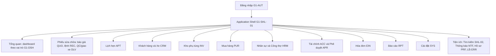
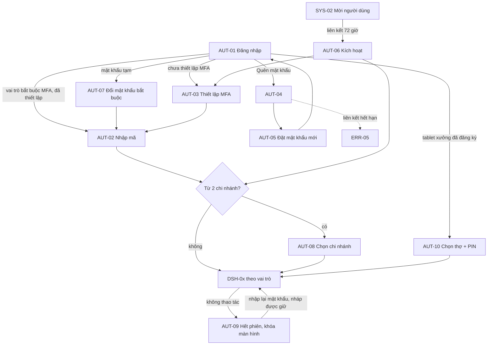
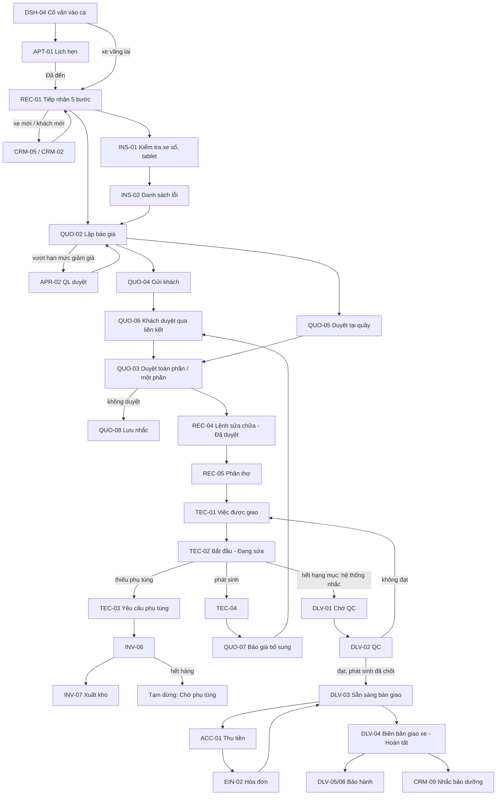
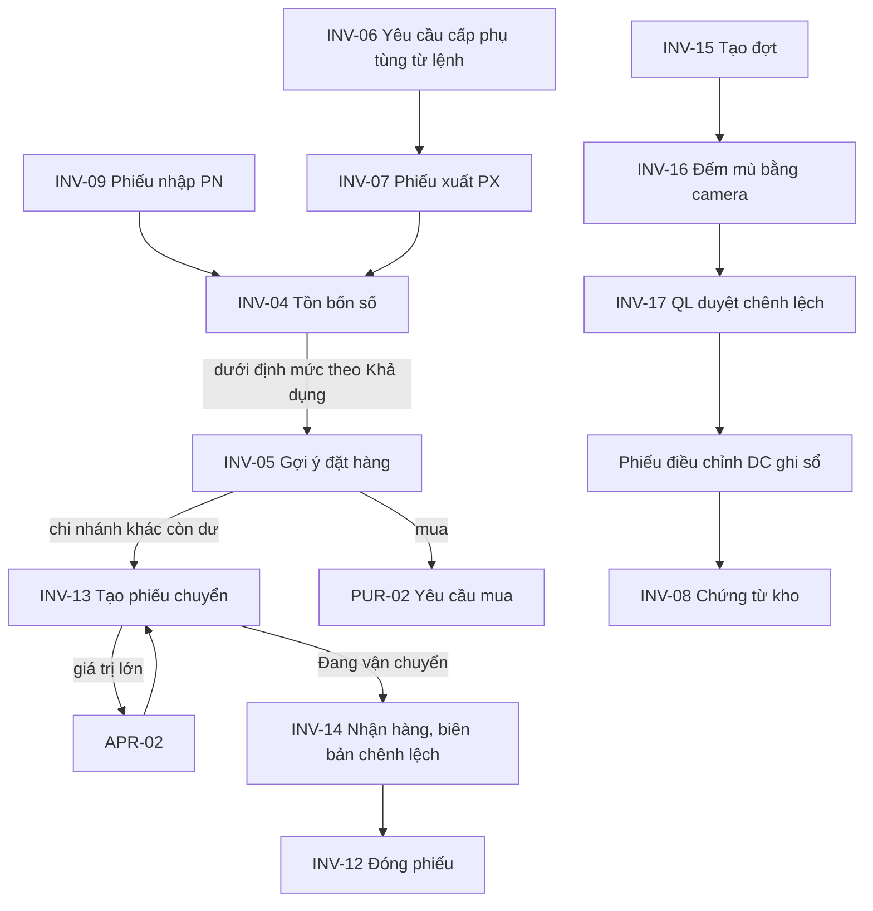
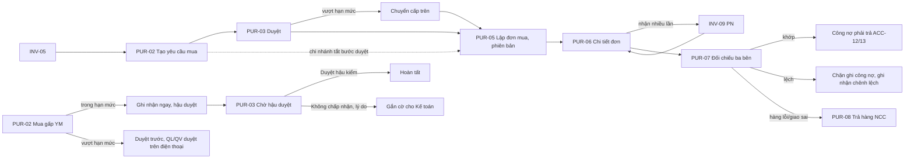
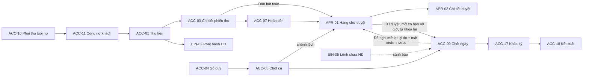
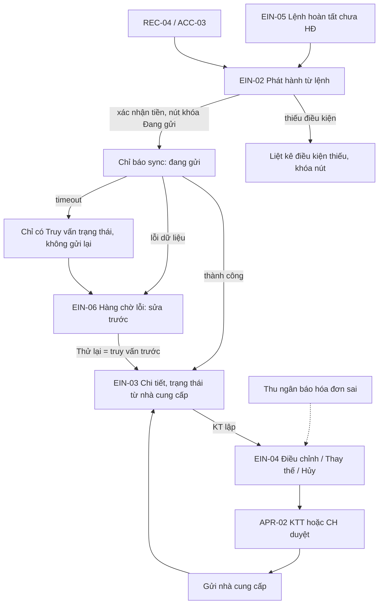
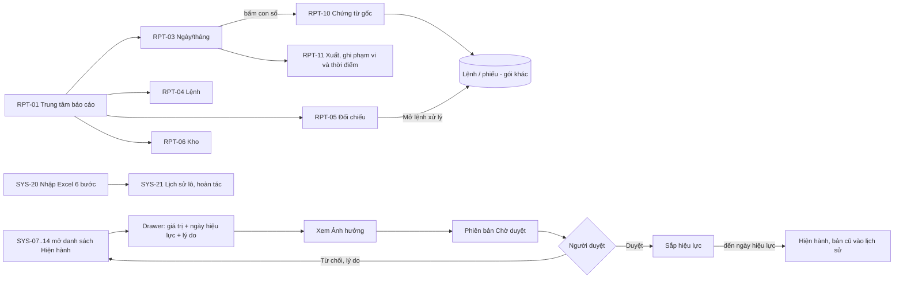

# GMEP – Mô tả UI/UX Flow tổng hợp (Garage ERP web dashboard)

Phiên bản 1.0 · 30/10/2026 · Người lập: designer · Đọc một chỗ để hiểu toàn bộ thiết kế.

Tài liệu này **tổng hợp, không thay thế** các tài liệu gốc. Khi cần chi tiết từng màn hình, mở tài liệu gói tương ứng (§2). Nguyên tắc ưu tiên khi các tài liệu khác nhau: (1) nghiệp vụ trong `docs/business-requirements.md`, `docs/functional-requirements.md`, `docs/user-journey-business-workflow.md` thắng; (2) về hình thức, `docs/design-system.md` thắng (token không đổi); (3) giữa các tài liệu UI/UX, bản của vòng review sau thắng bản trước; (4) mọi mục ghi "BA đề xuất — chờ xác nhận" chưa được khách chốt (xem Phụ lục A).

Nguồn đã tổng hợp: `docs/design-system.md`, `00-foundation.md`, `screen-inventory.md` (§0, §5, §6, §7), `ba-decisions.md`, `01`…`06` (gói), `ba-answers-01…06.md`, `review-0N-roundM-ba.md`, `STATUS.md`. Gói 6 chỉ tóm tắt ở mức nhóm màn hình vì đang được sửa tiếp; chi tiết xem `06-reports-system.md`.

## Mục lục

1. Tổng quan: mục tiêu, nguyên tắc, vai trò, cấu trúc thông tin
2. Bản đồ màn hình
3. Các luồng chính end-to-end (a–g)
4. Mô hình trạng thái UI
5. Mẫu giao diện dùng chung
6. Quy tắc theo vai trò và dữ liệu
7. Responsive và thiết bị
8. Accessibility và localization
9. Handoff cho developer
10. Phụ lục: A. Quyết định còn mở · B. Bảng theo dõi review · C. Mâu thuẫn tài liệu phát hiện khi tổng hợp

---

## 1. Tổng quan

### 1.1 Mục tiêu

GMEP thay quản lý bằng Excel của một chuỗi garage ô tô tại Việt Nam bằng một web dashboard: tiếp nhận và lệnh sửa chữa, công thợ, kho phụ tùng, khách hàng, doanh thu và kế toán quản trị, hóa đơn điện tử. Xem được theo từng chi nhánh và hợp nhất cho chủ. Web responsive: desktop ở quầy, tablet trong xưởng, điện thoại cho quản lý và khách.

Người dùng không phải dân công nghệ. Mỗi màn hình phải trả lời ba câu: Tôi đang ở đâu? Tình trạng hiện tại là gì? Cần làm gì tiếp theo? Câu hỏi của chủ mỗi sáng (doanh thu, xe đang sửa, việc trễ, tồn thấp, việc cần phê duyệt) phải thấy được trong một màn hình.

Phạm vi thiết kế: **184 màn hình** (không tính trang foundation) trong 6 gói prototype HTML/CSS thuần ở `design/`, dựng trên design system "Calm Enterprise · Purple Accent" (`docs/design-system.md`, brand `#635BFF`, font Be Vietnam Pro, base 4px, sidebar 248px, topbar 64px, lưới 12 cột).

### 1.2 Năm nguyên tắc thiết kế (design-system §1, §13)

| # | Nguyên tắc | Cách thể hiện trong sản phẩm |
| --- | --- | --- |
| 1 | **Clarity over Decoration** | Nền trung tính, màu chỉ để truyền trạng thái; badge luôn có chữ; không trang trí bằng đỏ/xanh lá |
| 2 | **Action-oriented** | Mỗi trang có một hành động chính (nút tím); khu "Việc cần xử lý" ở dashboard; khóa nút kèm lý do thay vì ẩn |
| 3 | **Prevent Errors** | Xác nhận 3 mức; nêu hậu quả; lý do bắt buộc; gõ mã để mở nút nguy hiểm; chống gửi trùng; đảo bút toán thay xóa |
| 4 | **Progressive Disclosure** | Form dài chia bước (wizard); chi tiết nâng cao nằm trong tab/drawer; người mới chỉ thấy cái cần |
| 5 | **One System, Multiple Roles** | Một design system, 12 vai trò, mỗi vai trò có menu và dashboard riêng; ẩn/che theo quyền |

Quy tắc UX riêng cho garage (design-system §13): không biến dashboard thành bảng Excel khổng lồ (tạo lệnh, tiếp nhận, xuất kho chia bước); luôn hiện trạng thái nghiệp vụ rõ ràng; phân biệt hành động chính/phụ/nguy hiểm; thao tác nguy hiểm phải xác nhận hoặc cần quyền; empty state hướng dẫn.

### 1.3 Người dùng, vai trò và thiết bị chính

12 vai trò có tài khoản (khóa kỹ thuật không dấu) và khách không tài khoản (KH, chỉ qua liên kết). Một tài khoản có thể nhiều vai trò; quyền cộng theo từng chi nhánh (FR-SYS-012).

| Khóa | Vai trò | Thiết bị chính | Việc chính | Trang đầu |
| --- | --- | --- | --- | --- |
| CH | Chủ garage | Điện thoại, desktop | Xem toàn chuỗi, duyệt, giám sát | G1-DSH-01 |
| QV | Quản lý vùng (`[Cần xác nhận]` có hay không) | Điện thoại, desktop | Xem và duyệt theo nhóm chi nhánh được giao | G1-DSH-02 |
| QL | Quản lý chi nhánh | Desktop, tablet, điện thoại | Điều hành ngày, duyệt, chốt ngày | G1-DSH-03 |
| CV | Cố vấn dịch vụ | Desktop quầy, tablet | Tiếp nhận, báo giá, giao xe | G1-DSH-04 |
| QĐ | Quản đốc (gồm nhân viên QC) | Tablet, desktop | Phân thợ, QC | G1-DSH-09 |
| TH | Kỹ thuật viên (thợ) | **Tablet xưởng** (nút lớn, bắt đầu/kết thúc ≤ 2 chạm) | Làm việc được giao | G1-DSH-07 |
| TK | Thủ kho | Desktop, điện thoại (quét mã bằng camera) | Nhập, xuất, kiểm kê, chuyển kho | G1-DSH-05 |
| TN | Thu ngân | Desktop quầy | Thu tiền, chốt ca, xuất hóa đơn | G1-DSH-08 |
| KT | Kế toán (KTT là cờ quyền của KT) | Desktop, bảng dày | Công nợ, hóa đơn, đối soát, khóa kỳ | G1-DSH-06 |
| MH | Nhân viên mua hàng | Desktop | Yêu cầu mua, đơn mua | Mua hàng (G3-PUR-01), không có dashboard |
| NS | Nhân sự | Desktop | Hồ sơ, ca, bảng công | Nhân sự (G3-HRM-01), không có dashboard |
| AD | Quản trị hệ thống (không xem dữ liệu nghiệp vụ nhạy cảm của khách) | Desktop | Người dùng, cấu hình, tích hợp, sao lưu | G1-DSH-10 |
| KH | Khách (không tài khoản) | **Điện thoại**, chữ ≥ 16px | Duyệt báo giá, theo dõi tiến độ, đặt lịch qua liên kết | G2-QUO-06 / 09 / APT-04 |

Người nhiều vai trò vào trang của vai trò cao nhất và đổi "Góc nhìn vai trò" ở menu tài khoản (D-09), không cộng dồn thẻ.

### 1.4 Cấu trúc thông tin và điều hướng

**Application Shell (template A, G1-SHL-01)**: sidebar trái (248px, thu gọn 72px) + topbar 64px (chọn phạm vi chi nhánh, tìm toàn cục Ctrl+K, chuông thông báo, menu tài khoản) + breadcrumb + page header (tiêu đề, mô tả, nút chính) + **thanh phạm vi** (chi nhánh, khoảng thời gian, "Cập nhật lúc", nút làm mới) dưới tiêu đề. Màn thợ dùng shell rút gọn (menu chỉ "Việc của tôi", "Công của tôi"). Trang công khai (đăng nhập, trang khách) không có shell.

Menu cấp 1 (11 mục) và quyền theo vai trò: xem §6.1. Mục "Cài đặt" nằm ở chân sidebar. Mỗi mục hiện **chế độ quyền** thành dòng phụ 12px dưới tên ("Chỉ xem", "Của tôi", "Danh mục", "Hệ thống"); khi sidebar thu gọn, chế độ nằm trong `aria-label` và `title`.

**Phạm vi chi nhánh (RULE-015)**: bộ chọn "Phạm vi dữ liệu" ở topbar; banner phạm vi luôn hiện; chuyển một chi nhánh ↔ hợp nhất là hành động chủ động (nền tím nhạt khi hợp nhất, toast bằng chữ); đổi phạm vi khi đang soạn chứng từ thì hỏi lưu nháp trước (D-06). Chi tiết §6.3.

---

## 2. Bản đồ màn hình

Quy ước mã: `G<gói>-<nhóm>-<số>`. Nhóm: SHL khung, AUT xác thực, ERR lỗi, DSH dashboard, NTF thông báo, PRF hồ sơ, CRM, APT lịch hẹn, REC tiếp nhận/lệnh, INS kiểm tra xe số, QUO báo giá, TEC thợ, DLV QC/giao xe/bảo hành, PRT in, INV kho, PUR mua hàng, HRM nhân sự, ACC tài chính, APR phê duyệt, EIN hóa đơn, RPT báo cáo, SYS hệ thống. Ưu tiên: P1 pilot một chi nhánh, P1? nếu khách xác nhận cần (INS), P1 (BA) BA đề xuất đưa vào P1, P2/P3/P4 theo giai đoạn, P2+ sau pilot.

Tổng: 31 + 26 + 21 + 39 + 32 + 35 = **184** màn hình. Prototype mở bằng `index.html` của từng thư mục (cần bật JavaScript); gói 6 và gói 5 xem thư mục tương ứng.

| Gói | Thư mục `design/` | Tài liệu gói | Số màn |
| --- | --- | --- | --- |
| Nền tảng | `assets/` (token, base, components, icons, app.js), `foundation/` (showcase, components, shell) | `docs/design-system.md`, `00-foundation.md` | – |
| 1 Xác thực và Dashboard | `g1-auth-dashboard/` | `01-auth-dashboard.md` | 31 |
| 2 CRM, lịch hẹn, tiếp nhận, lệnh, kiểm tra xe số | `g2-workshop/` | `02-workshop-intake.md` | 26 |
| 3 Báo giá, thợ tablet, giao xe, in ấn | `g2-quote-delivery/` | `03-quote-technician-delivery.md` | 21 |
| 4 Kho, mua hàng, nhân sự | `g3-inventory-hr/` | `04-inventory-purchasing-hr.md` | 39 |
| 5 Tài chính, phê duyệt, hóa đơn | `g4-finance/` | `05-finance-invoice.md` | 32 |
| 6 Báo cáo và Hệ thống | `g4-reports-system/` | `06-reports-system.md` | 35 |
| 7 Bộ chọn phạm vi và xác thực bổ sung (31/10/2026, cho slice 1.1/1.2) | `g5-scope-auth/` | `component-catalog.md`, `state-copy.md`, `STATUS.md` | 7 (không tính vào 184) |

### 2.1 Gói 1 – Xác thực và Dashboard (`design/g1-auth-dashboard/`)

| Nhóm | Mã | Màn hình | Vai trò | Ưu tiên |
| --- | --- | --- | --- | --- |
| Khung | G1-SHL-01 | Khung ứng dụng theo vai trò (template A) | Mọi vai trò | P1 |
| | G1-SHL-02 | Kết quả tìm kiếm toàn cục (lọc theo quyền và chi nhánh) | Mọi vai trò | P1 |
| Xác thực | G1-AUT-01 | Đăng nhập (không có nút "Đăng ký", D-01) | Công khai | P1 |
| | G1-AUT-02 / 03 | MFA nhập mã / thiết lập lần đầu (wizard 4 bước) | CH, QV, QL, KT, AD bắt buộc | P1 |
| | G1-AUT-04 / 05 | Quên mật khẩu / đặt lại qua liên kết | Công khai | P1 |
| | G1-AUT-06 | Kích hoạt tài khoản qua lời mời (wizard 4 bước) | Người được mời | P1 |
| | G1-AUT-07 | Đổi mật khẩu bắt buộc | Mật khẩu tạm | P1 |
| | G1-AUT-08 | Chọn chi nhánh làm việc | Từ 2 chi nhánh | P1 |
| | G1-AUT-09 | Hết phiên và khóa màn hình | Mọi vai trò | P1 |
| | G1-AUT-10 | Thiết bị xưởng: chọn thợ và nhập PIN | TH, QĐ (tablet) | P1 |
| Lỗi | G1-ERR-01…05 | 403, 404, 5xx, mất kết nối/bảo trì, liên kết hết hạn | Mọi/Công khai | P1 |
| Dashboard | G1-DSH-01 … 10 | CH, QV, QL, CV, TK, KT, TH (Việc của tôi), TN, QĐ/QC, AD | Theo vai trò | P1 (QV P2; KT công nợ P2) |
| Thông báo, hồ sơ | G1-NTF-01 / 02 | Trung tâm thông báo / cài đặt thông báo | Mọi vai trò | P1 / P2 |
| | G1-PRF-01 / 02 | Hồ sơ cá nhân / bảo mật tài khoản | Mọi vai trò | P1 |

### 2.2 Gói 2 – Vận hành xưởng (`design/g2-workshop/`)

| Nhóm | Mã | Màn hình | Vai trò | Ưu tiên |
| --- | --- | --- | --- | --- |
| CRM | G2-CRM-01…07 | Danh sách/tạo/chi tiết khách; danh sách/tạo xe; hồ sơ xe và lịch sử; chuyển chủ/đổi biển số | QL, CV (S); CH, QV, QĐ, TN, KT (X); TH (Xn) | P1 |
| | G2-CRM-08 | Phát hiện trùng và hợp nhất | QL | P2+ |
| | G2-CRM-09 / 10 | Nhắc bảo dưỡng-đăng kiểm / gửi tin và chiến dịch | CV, QL | P2 |
| | G2-CRM-11 / 12 | Yêu cầu của chủ dữ liệu / xuất danh sách khách | QL, CH / có quyền xuất | P1 |
| Lịch hẹn | G2-APT-01 / 02 | Lịch ngày-tuần / tạo-sửa lịch | CV, QL | P2 (lối tắt vãng lai P1) |
| | G2-APT-03 / 04 | Lịch đặt trực tuyến chờ xác nhận / trang đặt lịch cho khách | CV, QL / KH | P2+ |
| Tiếp nhận, lệnh | G2-REC-01 | Tiếp nhận xe (wizard 5 bước) | CV, QL | P1 |
| | G2-REC-02 / 03 | Danh sách lệnh / bảng điều phối (kanban) | CV, QL, QĐ, CH, QV | P1 |
| | **G2-REC-04** | **Chi tiết lệnh sửa chữa (màn hình chuẩn số 1)** | Theo FRD §2 | P1 |
| | G2-REC-05 / 06 | Phân thợ và tải việc / hủy lệnh và hoàn kho | QĐ, QL / CV đề xuất, QL duyệt | P1 |
| | G2-REC-07 | Bảng đồng sơn theo công đoạn | QĐ, CV | P2+ |
| Kiểm tra xe số | G2-INS-01 / 02 / 03 | Thực hiện (tablet) / kết quả và danh sách lỗi / quản lý mẫu | TH, QĐ / CV / AD | P1? |

### 2.3 Gói 3 – Báo giá, thợ, giao xe, in (`design/g2-quote-delivery/`)

| Nhóm | Mã | Màn hình | Vai trò | Ưu tiên |
| --- | --- | --- | --- | --- |
| Báo giá | G2-QUO-01…05 | Danh sách; lập/sửa; chi tiết và phiên bản; gửi cho khách; ghi nhận duyệt tại quầy | CV (S), QL (D) | P1 (Zalo/SMS P2) |
| | G2-QUO-06 | Trang khách duyệt qua liên kết (mobile) | KH | P1 |
| | G2-QUO-07 | Phát sinh: đề xuất và báo giá bổ sung | TH, QĐ đề xuất; CV lập | P1 |
| | G2-QUO-08 / 09 | Hạng mục khách từ chối-chưa làm / trang khách theo dõi tiến độ | CV, QL / KH | P2 / P2+ |
| Thợ | G2-TEC-01…04 | Việc được giao; bắt đầu-tạm dừng-kết thúc; yêu cầu phụ tùng; báo hư hỏng phát sinh | TH (Xn), QĐ | P1 |
| | G2-TEC-05 | Công của tôi | TH | P2 |
| QC, giao xe | G2-DLV-01…04 | Hàng chờ QC; thực hiện QC; chuẩn bị bàn giao; biên bản giao xe | QĐ, CV | P1 |
| | G2-DLV-05 / 06 | Danh sách bảo hành / tạo lệnh bảo hành | CV, QL | P2 |
| In | G2-PRT-01 | Xem trước và in chứng từ (A4, A5, nhiệt 80 mm) | Theo quyền xem chứng từ | P1 |

### 2.4 Gói 4 – Kho, mua hàng, nhân sự (`design/g3-inventory-hr/`)

| Nhóm | Mã | Màn hình | Vai trò | Ưu tiên |
| --- | --- | --- | --- | --- |
| Kho: danh mục, tồn, giá | G3-INV-01…04, 19 | Danh mục phụ tùng; tạo/sửa; chi tiết và thẻ kho; tồn kho bốn con số; bảng giá | TK (S); CH, QV, QL, KT (X); CV chỉ đọc INV-01/19 | P1 |
| | G3-INV-05 | Hàng dưới định mức và gợi ý đặt hàng | TK, QL, CH, QV, MH | P1 / P2 |
| Kho: chứng từ | G3-INV-06…09 | Yêu cầu cấp phụ tùng; phiếu xuất PX; danh sách chứng từ; phiếu nhập PN | TK; QL duyệt | P1 |
| | G3-INV-10 | Hoàn kho / khách trả phụ tùng | TK; QL duyệt | P1 / P2+ |
| | G3-INV-11, 18 | Xuất dùng nội bộ / bán lẻ tại quầy | TK, QL, CV, TN | P2+ |
| Chuyển kho, kiểm kê | G3-INV-12…14 | Danh sách phiếu chuyển; tạo-gửi; nhận hàng và biên bản chênh lệch | TK, QL; CH, QV duyệt | P2 |
| | G3-INV-15…17 | Danh sách đợt kiểm kê; thực hiện (quét mã); duyệt chênh lệch (ADJ) | TK, QL; CH, QV khi vượt ngưỡng | P2 |
| Mua hàng | G3-PUR-01…03 | Danh sách yêu cầu mua; tạo; chi tiết và phê duyệt | MH, TK, QL; CH, QV | P2 |
| | G3-PUR-04…06 | Danh sách đơn mua; lập/điều chỉnh; chi tiết | MH, TK, QL | P2 |
| | G3-PUR-07, 08 | Hóa đơn NCC và đối chiếu ba bên; trả hàng NCC | KT; TK, QL duyệt | P2 |
| | G3-PUR-09, 10 | Danh sách và chi tiết nhà cung cấp | MH, TK, QL | P2 |
| Nhân sự, công | G3-HRM-01…05 | Danh sách; hồ sơ; điều chuyển; ca và chấm công; lịch và tải việc | NS, QL; QĐ | P2 |
| | G3-HRM-06…10 | Quy tắc tính công và hoa hồng; công thợ theo lệnh; bảng công theo kỳ; hoa hồng; năng suất | CH, QL, NS, KT | P2 |

### 2.5 Gói 5 – Tài chính, phê duyệt, hóa đơn (`design/g4-finance/`)

| Nhóm | Mã | Màn hình | Vai trò | Ưu tiên |
| --- | --- | --- | --- | --- |
| Thu tiền | G4-ACC-01…03, 07 | Thu tiền theo lệnh; danh sách phiếu thu; chi tiết thanh toán và phân bổ; hoàn tiền | TN (S); QL (D); KT, CH, QV (X) | P1 (BA đề xuất, D-14); phân bổ lại nhiều-nhiều P2 |
| Quỹ, chi, chốt | G4-ACC-04…06, 08, 09 | Sổ quỹ; đề xuất chi/phiếu chi; danh sách; **chốt ca** (wizard 4 bước); **chốt ngày** | TN, QL, KT | P1 (04, 08, 09); P2 (05, 06) |
| Công nợ | G4-ACC-10…13, 21 | Phải thu theo tuổi nợ; chi tiết công nợ khách; phải trả; chi tiết NCC; khoản nhận trước | KT | P2 |
| Giá vốn, cuối kỳ | G4-ACC-14…20 | Giá vốn và lãi gộp; lãi lỗ theo chi nhánh; đối soát ngân hàng; khóa kỳ; kết xuất; phân bổ chi phí chung; sơ đồ tài khoản | KT; CH duyệt | P3 / P4 |
| Phê duyệt | G4-APR-01…03 | Hàng chờ phê duyệt; chi tiết yêu cầu; cấu hình hạn mức và ma trận | CH, QV, QL, KT (D); CH ban hành | P1 (mức tối thiểu) |
| Hóa đơn điện tử | G4-EIN-01…03 | Danh sách; phát hành từ lệnh (idempotent); chi tiết | TN, KT (S) | P1 |
| | G4-EIN-04…06 | Điều chỉnh/thay thế/hủy; lệnh hoàn tất chưa có hóa đơn; hàng chờ lỗi và thử lại | KT lập; KTT/CH duyệt | P1 (mức tối thiểu) |
| | G4-EIN-07, 08 | Tình trạng kết nối nhà cung cấp; cấu hình đơn vị phát hành | AD, KT | P1 |

### 2.6 Gói 6 – Báo cáo và Hệ thống (`design/g4-reports-system/`) – chỉ tóm tắt nhóm

Đang được designer khác sửa tiếp; chi tiết từng màn hình, trạng thái và vai trò xem `06-reports-system.md`.

| Nhóm | Mã | Nội dung | Ưu tiên |
| --- | --- | --- | --- |
| Báo cáo | G4-RPT-01…11 | Trung tâm báo cáo; so sánh chi nhánh; báo cáo ngày/tháng; báo cáo lệnh; đối chiếu lệnh-xuất kho-hóa đơn-thu tiền; kho; khách hàng; chỉ số bổ sung; cảnh báo ngoại lệ; danh sách chứng từ gốc (đi sâu); xuất báo cáo | P1 (01, 03, 04, 05, 10); P2 (06, 09, 11); P3 (02); P2+ (07, 08) |
| Người dùng, quyền | G4-SYS-01…04, 24 | Người dùng, mời/sửa, chi tiết và phiên, vai trò và quyền (gồm quyền che dữ liệu cá nhân), bảo mật và phiên | P1 |
| Tổ chức | G4-SYS-05, 06, 15 | Cơ cấu tổ chức (Company, pháp nhân ẩn khi có một pháp nhân), cấu hình chi nhánh, danh mục dùng chung và phát hành | P1 / P2 |
| Danh mục có ngày hiệu lực | G4-SYS-07…14 | Dịch vụ-giờ chuẩn-đơn giá, gói bảo dưỡng, hạn mức giảm giá, thuế suất, chu kỳ nhắc, mẫu chứng từ, quy trình theo loại dịch vụ, checklist QC | P1 (trừ 08, 11: P2) |
| Tích hợp | G4-SYS-16…18 | Hóa đơn điện tử (provider-agnostic), SMS/Zalo/email, API và khóa | P1 / P2 |
| Dữ liệu và an toàn | G4-SYS-19…23 | Nhật ký thao tác, nhập Excel (wizard 6 bước), lịch sử lô và hoàn tác, sao lưu-khôi phục, chính sách lưu trữ-ẩn danh | P1 (19…22); P2 (23) |

---

## 3. Các luồng chính end-to-end

Ký hiệu: `→` bước kế tiếp; `[điều kiện]` là nhánh; mã màn hình dùng đầy đủ tiền tố gói ở nơi dễ nhầm. Ba sơ đồ gốc bị mất khi xuất tài liệu nghiệp vụ (quy trình sửa chữa, chuyển kho liên chi nhánh, vòng đời lệnh) nên các luồng dưới đây dựng lại từ văn bản Journey/FRD; đối chiếu lại khi có sơ đồ gốc (G-09).

### 3.a Đăng nhập, quên mật khẩu, kích hoạt theo lời mời, MFA, chọn chi nhánh

Đăng nhập: (1) AUT-01 nhập email/mã nhân viên và mật khẩu, **không có nút "Đăng ký"** (D-01). (2) Tablet xưởng đã đăng ký: AUT-10 (chạm tên thợ, nhập PIN 6 số) thay bước 1, vào DSH-07. (3) Mật khẩu tạm hoặc bị đặt lại: AUT-07. (4) Vai trò bắt buộc MFA (CH, QV, QL, KT, AD): đã thiết lập thì AUT-02, chưa thì AUT-03 rồi AUT-02; dự phòng bằng mã khôi phục hoặc mã email; "tin cậy thiết bị" 14 ngày (không áp dụng cho KT, AD trong prototype). (5) Từ 2 chi nhánh: AUT-08 (nhớ lựa chọn gần nhất; CH/QV có "Tất cả/Nhóm chi nhánh"; chi nhánh bị khóa hiện nhãn "Chỉ xem"); 1 chi nhánh thì bỏ qua. (6) Vào dashboard: CH 01, QV 02, QL 03, CV 04, TK 05, KT 06, TH 07, TN 08, QĐ 09, AD 10; MH và NS vào Mua hàng / Nhân sự. (7) Trong phiên: cảnh báo 60 giây trước khi khóa → AUT-09 → nhập lại mật khẩu → quay về đúng màn đang làm; nháp luôn được giữ. (8) Lỗi: sai mật khẩu (thông báo trung lập, ở lại AUT-01), khóa tạm 15 phút sau 5 lần sai (thông báo thời gian mở), ERR-01 không quyền, ERR-04 mất mạng.

Quên mật khẩu: AUT-01 → AUT-04 (thông báo luôn giống nhau dù tài khoản có tồn tại hay không, có đếm lùi gửi lại) → email → liên kết hiệu lực 30 phút, dùng một lần → AUT-05 (≥ 10 ký tự, không dùng lại 5 mật khẩu gần nhất, thu hồi mọi phiên cũ) → AUT-01. Liên kết hết hạn: ERR-05. Nhân sự không có email (ví dụ thợ): quản lý cấp mã tạm ở SYS-03 → AUT-01 → AUT-07.

Kích hoạt (thay cho "đăng ký"): QL/CH/AD tạo người dùng ở SYS-02 (gán vai trò × chi nhánh) → gửi lời mời → AUT-06 (bước 1 xác nhận thông tin chỉ đọc, 2 đặt mật khẩu, 3 MFA nếu bắt buộc qua AUT-03, 4 đồng ý quy định bảo mật) → AUT-08 hoặc dashboard. Lời mời hết hạn hoặc đã dùng: ERR-05, nhờ QL gửi lại ở SYS-03.

### 3.b Tiếp nhận → giao xe → bảo hành (luồng chính)

Các bước (có mã màn hình):

1. **Vào ca**: AUT-01 → AUT-08 → DSH-04 (lịch hẹn hôm nay, xe chờ, báo giá chờ khách duyệt).
2. **Lịch hẹn** (tùy chọn): APT-01 → APT-02; khách đến → "Đã đến" → REC-01 điền sẵn. Xe vãng lai: banner "Tiếp nhận xe vãng lai" (P1) → REC-01.
3. **Tiếp nhận (REC-01, wizard 5 bước)**: biển số (xe có sẵn tự điền; xe mới nhúng CRM-05; khách mới CRM-02) → km, yêu cầu theo lời khách (bắt buộc), hiện trạng, ảnh → tài sản để lại, nhắc hạng mục từng bị từ chối → dịch vụ, cố vấn, hẹn giao → xem lại; in phiếu tiếp nhận A5 (PRT-01). Nháp lưu giữa chừng.
4. **Kiểm tra xe số** (nếu bật INS): INS-01 (thợ trên tablet, xanh/vàng/đỏ + ảnh/video; mất mạng giữ nháp) → INS-02 (cố vấn chọn dòng lỗi → "Đưa vào báo giá"). Không dùng INS: kiểm tra sơ bộ bằng lời, đi thẳng bước 5.
5. **Báo giá**: QUO-02 (hạng mục gồm công + phụ tùng; nhãn Bắt buộc/Tùy chọn; tồn khả dụng; giá vốn chỉ CH, QV, QL, KT) → [giảm giá vượt hạn mức hoặc bán dưới giá vốn: khóa gửi, xin duyệt APR-02] → QUO-04 gửi (kênh chưa kích hoạt bị khóa, không hiện tên nhà cung cấp).
6. **Khách duyệt (một phần, qua liên kết)**: khách mở QUO-06 trên điện thoại (liên kết riêng cho từng phiên bản, hạn mặc định 7 ngày; OTP là tùy chọn theo cấu hình) hoặc cố vấn ghi nhận ở QUO-05. Duyệt **theo hạng mục**; "Bắt buộc" chỉ là nhãn tư vấn, bỏ tick mở cảnh báo an toàn + lý do. "Từ chối toàn bộ báo giá" là hành động riêng. QUO-03 hiện tổng báo giá / tổng được duyệt, bằng chứng kèm mã băm. Hạng mục không duyệt vào QUO-08 (lưu nhắc). **Phiên bản mới chỉ tạo khi chưa có hạng mục nào được duyệt**; đã duyệt thì dùng báo giá bổ sung (QUO-07).
7. **Mở lệnh**: từ QUO-03 → REC-04 (chỉ dòng được duyệt; trạng thái Đã duyệt; phụ tùng giữ chỗ → số "Giữ chỗ" ở INV-04 tăng, Khả dụng giảm). Lệnh hiện ở REC-02 và REC-03.
8. **Phân thợ**: QĐ ở REC-05 (mỗi hạng mục một thợ chính; đổi thợ khi đang làm là hành động nguy hiểm).
9. **Lấy phụ tùng**: thợ TEC-03 → thủ kho INV-06 → [đủ] INV-07 xác nhận xuất (giữ chỗ thành xuất, ghi giá vốn) → thợ nhận. [Thiếu] "Báo thiếu hàng" → lệnh **Tạm dừng, lý do Chờ phụ tùng** → INV-13 chuyển kho hoặc PUR-02 mua → INV-14 / INV-09 nhập → tiếp tục.
10. **Sửa**: TEC-01 → "Bắt đầu" (1 chạm từ danh sách, có Hoàn tác 10 giây) → "Kết thúc" (2 chạm) → lệnh **tự chuyển Đang sửa** khi hạng mục đầu tiên Đang làm. Tạm dừng 2 chạm chọn lý do.
11. **Phát sinh**: TEC-04 → QUO-07 (thuộc tính duyệt Chờ / Đã duyệt / Từ chối / Hết hạn, hạn mặc định 24 giờ, không quá giờ hẹn giao) → khách duyệt QUO-06 (hoặc xác nhận bằng lời qua điện thoại như ngoại lệ có rà soát) → mới bắt đầu được hạng mục đó (nút Bắt đầu khóa kèm lý do). Từ chối/hết hạn: dòng vào nhóm "Không thực hiện" và QUO-08.
12. **QC**: hết hạng mục → hệ thống **nhắc** (lệnh không tự chuyển) → CV/QĐ/QL bấm "Chuyển sang Chờ QC" → DLV-01 → DLV-02. [Không đạt] hạng mục sang **Trả lại**, quay TEC-01. [Đạt] → **Sẵn sàng bàn giao**, chỉ khi mọi phát sinh đã có quyết định cuối; công thợ phát sinh (HRM-07).
13. **Thanh toán**: DLV-03 kiểm điều kiện → **chỉ Thu ngân** thu tiền ở ACC-01 (cọc trừ vào; khách doanh nghiệp ghi công nợ trong hạn mức qua ACC-11; vượt hạn mức cần duyệt).
14. **Hóa đơn**: EIN-02 (chi tiết §3.f).
15. **Giao xe**: DLV-03 đủ điều kiện (QC đạt, thu đủ hoặc công nợ hợp lệ, hóa đơn hợp lệ hoặc "khách không lấy hóa đơn" theo cấu hình, phát sinh đã chốt) → DLV-04 biên bản (người nhận; ủy quyền cần họ tên, SĐT, quan hệ, ảnh giấy tờ) → lệnh **Hoàn tất** → in PRT-01. Có thể còn Thanh toán = Chưa thanh toán (công nợ).
16. **Sau giao**: CRM-09 nhắc bảo dưỡng/đăng kiểm (chỉ kênh khách đồng ý) → CRM-10; QUO-08 nhắc hạng mục từng bị từ chối; bảo hành DLV-05 → DLV-06 (chọn lệnh gốc, kể cả chi nhánh khác; trường "chi nhánh chịu chi phí" cấu hình); khách theo dõi QUO-09.
17. **Cuối ngày**: §3.e.

Luồng phụ: **hủy lệnh sau khi xuất phụ tùng** REC-04 → REC-06 (lý do, phiếu hoàn kho INV-10 cho từng dòng, xử lý tiền đã thu; lệnh đã có hóa đơn hiệu lực thì phải điều chỉnh hóa đơn trước) → cờ "Chờ duyệt hủy" khóa lệnh → QL duyệt (APR-02; người đề xuất không tự duyệt) → Đã hủy, đảo công; không hủy được từ Chờ QC trở đi.

### 3.c Kho: nhập, xuất theo lệnh, điều chuyển liên chi nhánh, kiểm kê, đặt hàng bổ sung

- **Bốn con số tồn** (RULE-008) hiển thị ở INV-03/04/06: Thực tế, Giữ chỗ, Đang vận chuyển (nhãn đã đổi từ "Đang về"), Khả dụng = Thực tế − Giữ chỗ; "Đã đặt N" là tag phụ ngoài bốn số. Cảnh báo và chặn xuất so với Khả dụng. Không có nút "Sửa tồn": tồn chỉ đổi bằng chứng từ (RULE-007, RULE-009).
- **Nhập**: INV-09 chọn chứng từ gốc là đơn mua hoặc yêu cầu **Mua gấp (YM)**; quét mã bằng camera; nhận một phần giữ đơn mở; lệch giá/số lượng vượt ngưỡng chờ QL; "Nhập không có đơn mua" hiếm và luôn cần QL duyệt.
- **Xuất theo lệnh**: INV-06 → INV-07; xuất vượt Khả dụng bị chặn (ngoại lệ cần cấu hình + duyệt); xác nhận xuất là hành động nguy hiểm (nêu hậu quả, sau ghi sổ không sửa); hoàn kho INV-10.
- **Điều chuyển liên chi nhánh (P2)**: INV-13 (người dùng chi nhánh A chỉ thấy Khả dụng và "số có thể cho" của chi nhánh B) → hàng "Đang vận chuyển", chưa tính Khả dụng cả hai bên → INV-14 so số gửi/số nhận; **có chênh lệch thì nút "Xác nhận nhận đủ" khóa**, thay bằng biên bản chênh lệch (ghi chú + ảnh bắt buộc) → QL xử lý → đóng phiếu (INV-12).
- **Kiểm kê (P2)**: INV-15 (chụp tồn sổ sách) → INV-16 (đếm mù, số sổ ẩn; camera hoặc nhập tay; nháp trên thiết bị; chốt đếm không sửa lại) → INV-17 (người đếm ≠ người duyệt; vượt ngưỡng chuyển CH/QV) → phiếu DC.
- **Đặt hàng bổ sung**: INV-05 xem chi nhánh dư trước → INV-13 hoặc PUR-02 (§3.d).

### 3.d Mua hàng: yêu cầu → duyệt → đơn → nhận nhiều lần → đối chiếu → trả hàng; Mua gấp hậu duyệt

Điểm nhấn UX: stepper quy trình; người lập ≠ người duyệt cùng cấp; hạn mức lấy từ cấu hình (UI không chứa số thật, chỉ "Giá trị so với hạn mức cùng cấp"); đơn đã gửi sửa thì tạo **phiên bản mới**; đơn nhận một phần vẫn mở và hiện "Còn lại"; đối chiếu ba bên (hóa đơn NCC ↔ tập các PN của một đơn ↔ đơn mua) đặt ba cột cạnh nhau, tô giá trị lệch và chặn ghi công nợ tới khi xử lý; trả hàng đã xuất bị chặn kèm giải thích; PUR-03 dùng được trên mobile cho QL/CH.

**Mua gấp hậu duyệt**: YM có cờ "Mua gấp", bắt buộc lý do, NCC/cửa hàng, lệnh liên quan; trong hạn mức người lập thì ghi nhận ngay, **hậu duyệt trong N giờ** (mẫu 24 giờ làm việc, cấu hình) với badge "Chờ hậu duyệt" (Warning) và hạn còn lại ở PUR-01; PN lấy YM làm chứng từ gốc kèm ảnh hóa đơn; ở PUR-03 người duyệt chọn "Duyệt hậu kiểm" hoặc "Không chấp nhận…" (lý do bắt buộc, hậu quả gắn cờ cho Kế toán); người đề xuất không tự duyệt; chi tiền qua phiếu chi có phê duyệt (RULE-011).

### 3.e Tài chính: thu tiền, chốt ca/ngày, công nợ, phê duyệt, mở lại ngày/kỳ

1. **Thu tiền (ACC-01)**: Thu ngân mở lệnh Sẵn sàng bàn giao (lệnh còn Chờ QC thì chặn kèm lý do). Chia nhiều hình thức, tính còn nợ/dư tức thì; thu vượt phải tích "ghi thành khoản nhận trước" (ACC-21 sau đó bù vào lệnh còn nợ cùng khách hoặc hoàn qua ACC-07). "Ghi nhận" luôn qua màn **xác nhận tiền** (tóm tắt, tích đã đối chiếu); sau xác nhận nút khóa, bấm hai lần không tạo phiếu thứ hai; mất mạng khóa nút ghi tiền và giữ nháp. Badge lệnh chỉ đổi sau khi ghi; trạng thái dự kiến là tag ở khối tóm tắt.
2. **Sau khi có phiếu PT**: ACC-03 in phiếu (A5 hoặc nhiệt 80 mm) hoặc sang EIN-02. Sai tiền: **Đảo bút toán** (nguy hiểm, QL duyệt) — không có nút Xóa.
3. **Chốt ca (ACC-08, wizard 4 bước)**: rà lệnh → đếm quỹ theo mệnh giá (không điền sẵn theo sổ) → giải trình (bắt buộc khi lệch) → xác nhận. Chênh lệch vào APR-01 cho QL duyệt. Mỗi quầy một ca mở.
4. **Chốt ngày (ACC-09)**: danh sách điều kiện Đạt/Chặn/Cảnh báo (cấu hình theo chi nhánh). Mặc định **chặn**: chênh lệch quỹ chưa giải trình hoặc vượt ngưỡng chưa duyệt, ca chưa chốt, thanh toán/phiếu chi dở. Mặc định **cảnh báo**: lệnh còn mở, lệnh hoàn tất chưa thu hoặc chưa hóa đơn, phiếu thiếu chứng từ gốc, yêu cầu duyệt đang chờ. Khóa ngày là hành động nguy hiểm (gõ ngày); số tạm thành chính thức.
5. **Công nợ**: ACC-10 (tuổi nợ, bảng thay thế; nhắc nợ hàng loạt qua email, Zalo/SMS "Chưa kích hoạt") → ACC-11 (thanh dư nợ/hạn mức, chính sách theo khách cảnh báo / cần duyệt / chặn cứng; nới hạn mức tạm thời có hạn và cần duyệt; thu nợ mặc định phân bổ vào lệnh nợ lâu nhất). **Cố vấn không vào ACC-11**, chỉ thấy số dư/hạn mức/cảnh báo trên lệnh và hồ sơ khách. Phải trả: ACC-12/13 (mỗi lần chi gắn phiếu nhập; chênh lệch ba bên chặn chi thường; "Chi kèm ngoại lệ" luôn qua đề xuất chi và duyệt).
6. **Phê duyệt (APR-01/02/03)**: tab "Cần tôi duyệt / Tôi đã đề xuất / Đã xử lý"; quyền duyệt theo cặp (loại yêu cầu × vai trò) và **người lập ≠ người duyệt**; duyệt hàng loạt chỉ cho mục trong hạn mức, **cùng một loại**, đủ điều kiện (hoàn tiền, hóa đơn, chi vượt hạn mức, hủy lệnh, mở lại, đổi cấu hình luôn duyệt riêng); từ chối bắt buộc lý do; quá hạn thì chuyển cấp. Hạn mức và người duyệt là **cấu hình** (APR-03), mọi số trong prototype là minh họa.
7. **Mở lại ngày/kỳ (ACC-09, ACC-17)**: không ai bấm mở trực tiếp. KT hoặc QL "Đề nghị mở lại" (lý do + mật khẩu + MFA) → yêu cầu `YC-…` vào APR-01 → **CH duyệt** (QV chỉ khi CH ủy quyền theo nhóm chi nhánh, mặc định tắt) → ngày/kỳ mở có hạn (mặc định 48 giờ, đếm ngược) → "Hoàn tất điều chỉnh" hoặc hết hạn thì tự kiểm điều kiện và khóa lại. Hoàn tiền (ACC-07): số hoàn ≤ đã thu, vượt hạn mức thêm cấp duyệt, đã có hóa đơn thì nhắc điều chỉnh hóa đơn; hoàn một phần giữ trạng thái Thanh toán theo thu ròng kèm tag "Đã hoàn một phần".
8. **Cuối kỳ**: ACC-09 các ngày → ACC-17 khóa kỳ → ACC-18 kết xuất (định dạng chưa chốt, cảnh báo kết xuất trùng) → ACC-14/15 lãi lỗ chính thức (luôn ghi phương pháp giá vốn đang dùng và "chưa chốt"). Hệ thống là kế toán quản trị, kết xuất cho phần mềm kế toán hiện có của khách.

### 3.f Hóa đơn điện tử: phát hành idempotent, điều chỉnh, thay thế, hủy

- **Điều kiện phát hành** (danh sách kiểm Đạt/Thiếu, cấu hình có ngày hiệu lực): lệnh Sẵn sàng bàn giao hoặc Hoàn tất; không còn phát sinh chờ duyệt hay cờ chờ duyệt hủy; thông tin người mua đủ; thuế suất theo ngày lập; chưa có hóa đơn hiệu lực cho lệnh/phiên bản; người xuất là TN hoặc KT. Thanh toán một phần vẫn xuất được; "yêu cầu thu đủ trước khi xuất" là cấu hình mặc định tắt.
- **Idempotent**: yêu cầu mang mã chống trùng; sau xác nhận nút khóa, bấm nhiều lần chỉ ra một hóa đơn; **timeout hiện rõ "không gửi lại"**, chỉ có "Truy vấn trạng thái"; hủy yêu cầu vẫn truy vấn lần cuối; đã có hóa đơn hợp lệ thì khóa. Lỗi vào EIN-06 (mã yêu cầu `YH-…`), thông báo cho kế toán.
- **Điều chỉnh/thay thế/hủy (EIN-04)**: chọn loại, lý do bắt buộc, bảng giá trị cũ → mới, gõ số hóa đơn gốc để mở nút (mức nguy hiểm), **KTT hoặc CH duyệt** (người lập ≠ người duyệt; với một kế toán duy nhất, chuyển Chủ garage). Hóa đơn gốc không bao giờ bị sửa: giữ "Đã xuất" kèm tag "Đã được điều chỉnh bởi…" / "Bị thay thế bởi…" (gạch ngang); hóa đơn mới mang badge Điều chỉnh/Thay thế. "Hủy" chỉ khi thao tác Hủy. Trạng thái hóa đơn lấy từ nhà cung cấp; đồng bộ là chỉ báo `sync`, không phải trạng thái thứ sáu.
- **Kích hoạt**: EIN-07 mặc định "Chưa kích hoạt" (không tên/logo nhà cung cấp, provider-agnostic) → AD chọn bộ chuyển đổi, nhập kết nối thử (SYS-16) → EIN-08 → chuyển môi trường thật (nguy hiểm). AD không xem EIN-06 vì có dữ liệu người mua.

### 3.g Báo cáo và cấu hình hệ thống

- **Báo cáo** (RULE-015): mở Báo cáo → RPT-01 (chỉ thấy báo cáo trong quyền; thẻ ẩn theo vai trò) → đổi kỳ/lọc → biểu đồ (line xu hướng, thanh ngang so sánh chi nhánh, thanh xếp chồng trạng thái; trục từ 0; tooltip cả bàn phím; nút "Bảng số liệu" thay thế) → bấm con số → **RPT-10** (chứng từ cấu thành, tổng khớp) → mở chứng từ → xuất qua RPT-11 (che dữ liệu cá nhân mặc định; chọn cột cá nhân cần cảnh báo + lý do; tệp lớn xử lý nền; tệp ghi phạm vi và thời điểm ở dòng đầu). Số tạm / chính thức có tag riêng (FR-RPT-010).
- **Cấu hình có ngày hiệu lực** (thuế, giờ chuẩn, giá, hạn mức, chu kỳ nhắc, mẫu, quy trình, checklist): drawer có Ngày hiệu lực (không quá khứ, không trùng ngày phiên bản khác), lý do, khối "Ảnh hưởng khi lưu" (không đổi chứng từ đã tạo) → gửi duyệt → Chờ duyệt → duyệt hoặc từ chối (lý do ≥ 5 ký tự) → Sắp hiệu lực → Hiện hành. Người đề xuất không tự duyệt. Nhóm duyệt: Chủ garage (thuế, hạn mức, giờ chuẩn, đơn giá, quyền, bảo mật…), cấp chi nhánh (QL duyệt quy trình-checklist QC; KT duyệt mẫu kế toán), không cần duyệt (thông tin chung, nội dung mẫu tin). Bước quy trình gắn RULE-005/006, QC trước thu tiền, thu tiền/hóa đơn không tắt được cờ Bắt buộc.
- **Nhập Excel (SYS-20, wizard 6 bước)**: loại dữ liệu theo vai trò (TK tồn đầu kỳ, KT công nợ đầu kỳ), chi nhánh, môi trường → tải mẫu → tải tệp + ánh xạ cột → kiểm tra (lỗi theo dòng, **không ghi một phần**, tải tệp lỗi) → xem trước (mới/cập nhật/cảnh báo) → tích đối chiếu và gõ "GHI LO" → SYS-21 xem/hoàn tác (AD đề xuất, CH duyệt; chặn nếu đã phát sinh giao dịch).
- **Người dùng và quyền**: SYS-01 → SYS-02 (gán vai trò × chi nhánh, xác nhận có lý do với vai trò quản lý/kế toán) → SYS-03 (khóa, thu hồi, đăng xuất mọi phiên, buộc đặt lại MFA, cần nhập lại mật khẩu) → SYS-04 (ma trận quyền, quyền che dữ liệu cá nhân, xem trước ảnh hưởng, CH duyệt) → SYS-24 (chính sách mật khẩu/MFA/phiên; hạ mức bảo mật gửi CH duyệt).
- **Khóa chi nhánh hai bước (SYS-05)**: "Ngừng nhận lệnh mới" rồi "Khóa hoàn toàn" khi không còn lệnh mở, phiếu thu chưa chốt ca, hàng đang đi đường, hóa đơn lỗi (BA đề xuất — chờ xác nhận).

---

## 4. Mô hình trạng thái UI

### 4.1 Nguyên tắc

**Năm đối tượng, năm bộ trạng thái riêng, không gộp** (FR-REC-028): báo giá, lệnh sửa chữa, hạng mục sửa chữa, thanh toán, hóa đơn. Chi tiết lệnh (REC-04) hiện song song hàng "Lệnh – Thanh toán – Hóa đơn". Badge **luôn có chữ**, nền nhạt + chữ đậm (`--color-*-text`), có thể thêm icon 14px. Class đặt theo **màu** (`badge--success`, `tag--warning`), ánh xạ trạng thái → màu ở bảng dưới. Xanh lá chỉ cho thành công; vàng/cam cảnh báo; đỏ lỗi/rủi ro; xanh dương đang xử lý/đang vận chuyển; xám trung tính; **tím chỉ cho "Chờ QC" và hành động chính**.

Phân biệt trạng thái / cờ / thuộc tính: "Chờ phụ tùng" là **tag lý do** của trạng thái Tạm dừng; "Chờ khách duyệt (phát sinh)" là **thuộc tính duyệt** của hạng mục (không phải trạng thái thứ 6); "Quá hạn" là **cờ** công nợ; "Đang gửi / Lỗi phát hành / Chờ truy vấn lại" của hóa đơn là **chỉ báo `sync`** (spinner + chữ); "Chờ duyệt hủy" là cờ khóa lệnh.

### 4.2 Bảng trạng thái → màu → badge (từ `ba-decisions.md` A.2 và các bổ sung BA)

| Đối tượng | Trạng thái | Màu | Chữ trên badge |
| --- | --- | --- | --- |
| **Lịch hẹn / Tiếp nhận (trước lệnh)** | Chờ xác nhận (khách tự đặt) | Warning | Chờ xác nhận |
| | Đã hẹn | Info | Đã hẹn |
| | Chờ tiếp nhận | Neutral | Chờ tiếp nhận |
| | Đã tiếp nhận | Success | Đã tiếp nhận |
| | Không đến / Đã hủy | Neutral / Danger | Không đến / Đã hủy |
| **Báo giá** | Nháp | Neutral | Nháp |
| | Đã gửi | **Warning** | **Chờ khách duyệt** |
| | Duyệt toàn phần | Success | Duyệt toàn phần |
| | Duyệt một phần | Warning | Duyệt một phần |
| | Từ chối | Danger | Từ chối |
| | Hết hạn | Neutral | Hết hạn |
| | (đề xuất, chờ xác nhận) báo giá bổ sung bị cố vấn hủy | Danger | Đã hủy (trạng thái thứ 7, xem Phụ lục A) |
| **Lệnh sửa chữa (7)** | Đã duyệt | **Neutral** | Đã duyệt |
| | Đang sửa | Info | Đang sửa chữa |
| | Tạm dừng | Warning | Tạm dừng + tag lý do (Chờ phụ tùng, Chờ khách duyệt phát sinh, Nghỉ, Khác) |
| | Chờ kiểm tra | Purple | Chờ QC (tên đầy đủ: Chờ kiểm tra chất lượng) |
| | Sẵn sàng giao | Success | Sẵn sàng bàn giao |
| | Hoàn tất | Success | Hoàn tất |
| | Đã hủy | Danger | Đã hủy |
| **Hạng mục (5)** | Chưa làm / Đang làm / Tạm dừng / Hoàn thành / Trả lại | Neutral / Info / Warning / Success / Danger | cùng tên |
| (thuộc tính duyệt) | Chờ khách duyệt (phát sinh); Đã duyệt; Từ chối; Hết hạn | Warning (tag) | Chờ khách duyệt (phát sinh) cạnh "Chưa làm", khóa Bắt đầu kèm lý do |
| **Thanh toán** | Chưa thanh toán / Thanh toán một phần / Đã thanh toán / Hoàn tiền | Warning / Info / Success / Neutral | cùng tên |
| | Cờ Quá hạn (công nợ) | Danger (tag) | Quá hạn |
| **Hóa đơn** | Chưa xuất / Đã xuất / Điều chỉnh / Thay thế / Hủy | Neutral / Success / Info / Info / Danger | cùng tên |
| | Đồng bộ nhà cung cấp | `.sync` | Đang gửi / Lỗi phát hành / Chờ truy vấn lại |
| **Kho** | Đủ hàng / Sắp hết / Hết hàng | Success / Warning / Danger | cùng tên (so với định mức tối thiểu theo Khả dụng) |
| | Chưa đặt định mức | Neutral | Chưa đặt định mức |
| | Đang vận chuyển N / Đã đặt N | Info / Neutral (tag phụ) | Đang vận chuyển N / Đã đặt N |

### 4.3 Bổ sung của BA cho kho, mua hàng, nhân sự (`ba-answers-04.md` Phụ lục A, đã áp dụng ở gói 4)

Mỗi đối tượng một bộ riêng; không cần class mới. Quy tắc chung: "Chờ duyệt" luôn Warning; "Từ chối" luôn Danger; "Đã ghi sổ / Đã duyệt / Nhận đủ" Success; "Nháp / Đã hủy / Đã đóng" Neutral; loại chứng từ và loại biến động là **tag Neutral kèm icon**, không là badge.

| Đối tượng | Trạng thái → màu |
| --- | --- |
| Chứng từ kho (PN, PX, DC, TR) | Nháp neutral · Chờ duyệt warning (+ tag lý do: Lệch giá, Có chênh lệch) · Đã ghi sổ success · Từ chối danger |
| Yêu cầu cấp phụ tùng | Chờ xuất / Đã gửi (info) · Thiếu hàng (danger/warning theo A.2 gói 4) · Đã xuất success (xem `ba-answers-04.md` Phụ lục A) |
| Yêu cầu mua | Nháp neutral · Chờ duyệt warning · **Chờ hậu duyệt (Mua gấp) warning** · Đã duyệt success · Từ chối danger · Đã lập đơn info |
| Đơn mua | Nháp neutral · Đã gửi info · NCC xác nhận info · Nhận một phần warning · Nhận đủ success · Đã đóng neutral |
| Phiếu chuyển kho CK | Nháp neutral · Chờ duyệt warning · Đang vận chuyển info · Có chênh lệch danger · Đã nhận success (+ tag Đã đóng) |
| Đợt kiểm kê | Đang đếm info · Đã đếm info · Chờ duyệt warning · Đã ghi sổ success · Từ chối danger |
| Đối chiếu ba bên | Khớp success · Lệch giá / Lệch số lượng danger · Chờ hóa đơn warning |
| Công thợ (dòng công) | Đã ghi success · Chờ QC purple · QC trả lại danger · Đã đảo neutral |
| Hoa hồng | Chưa ghi nhận neutral · Chờ duyệt warning · Đã duyệt success |
| Kỳ công | Đang mở → Đã duyệt → Đã khóa (stepper, icon khóa) |
| Nhân sự / Chấm công | Đang làm success · Nghỉ phép warning · Đã nghỉ neutral · Đang trong ca success · Chưa vào ca neutral · Đi muộn N phút warning |
| Nhà cung cấp | Đang hợp tác success · Tạm ngừng neutral |

Ghi chú: "Chờ hậu duyệt" được gói 4 thêm sau vòng 3 và **đề nghị BA đưa vào Phụ lục A** (chưa được BA xác nhận). Bảng yêu cầu cấp phụ tùng ở trên tóm tắt; nếu cần giá trị chính xác, tra Phụ lục A của `ba-answers-04.md`.

### 4.4 Điều kiện chuyển trạng thái lệnh (tóm tắt, `ba-answers-02.md` A.1)

| Chuyển | Ai/cách | Điều kiện chính |
| --- | --- | --- |
| (báo giá được duyệt) → Đã duyệt | Hệ thống | Chỉ dòng được duyệt vào lệnh |
| Đã duyệt → Đang sửa | **Tự động** khi hạng mục đầu tiên Đang làm | Hạng mục có thợ chính; không ở thuộc tính chờ khách duyệt; không có cờ chờ duyệt hủy |
| Đang sửa ↔ Tạm dừng | Thợ/CV/QĐ/QL hoặc hệ thống khi thiếu phụ tùng | Bắt buộc chọn lý do; không kéo thả |
| Đang sửa → Chờ QC | CV/QĐ/QL bấm; hệ thống chỉ **nhắc** | Mọi hạng mục Hoàn thành; mọi dòng phụ tùng đã xuất; phát sinh chờ duyệt không chặn bước này |
| Chờ QC → Sẵn sàng bàn giao | QĐ/QC chấm checklist đạt (DLV-02) | Mọi phát sinh đã có quyết định cuối |
| Chờ QC → Đang sửa | QĐ/QC không đạt | Chọn hạng mục Trả lại, ghi lỗi gắn thợ |
| Sẵn sàng bàn giao → Hoàn tất | CV tại DLV-03/04 | Biên bản khách xác nhận; thanh toán đủ hoặc công nợ hợp lệ; hóa đơn xuất hoặc "không lấy hóa đơn" theo cấu hình |
| Đã duyệt / Đang sửa / Tạm dừng → Đã hủy | CV/QL đề xuất, người khác duyệt | Hoàn kho từng dòng; lệnh có hóa đơn hiệu lực phải điều chỉnh hóa đơn trước; không hủy từ Chờ QC |

---

## 5. Mẫu giao diện dùng chung

### 5.1 Năm template A–E (design-system §7)

| Template | Dùng cho | Thành phần chính | Ví dụ |
| --- | --- | --- | --- |
| **A. Application Shell** | Mọi trang sau đăng nhập | Sidebar, topbar, breadcrumb, page header, thanh phạm vi | G1-SHL-01 |
| **B. Dashboard** | Tổng quan theo vai trò, báo cáo tổng hợp | Bộ lọc kỳ + chi nhánh; hàng KPI; biểu đồ xu hướng chính; phân rã/so sánh; "Việc cần xử lý"; bảng chi tiết. Tối đa ~5–6 khối ở màn đầu | G1-DSH-01…10, G4-RPT-02 |
| **C. List Page** | Danh sách có tìm/lọc | Tiêu đề + nút chính; tìm kiếm + lọc + chip đang áp dụng; bảng; phân trang; thanh chọn nhiều | G2-CRM-01, G2-REC-02 |
| **D. Detail Page** | Chi tiết chứng từ | Header (mã, biển số, badge song song, hành động); nội dung nghiệp vụ theo tab; sidebar liên quan/lịch sử/ghi chú; timeline | **G2-REC-04** (chuẩn số 1) |
| **E. Create/Edit Form** | Tạo/sửa | Nhóm thông tin; stepper khi quy trình dài; sticky footer (Lưu nháp / Tiếp tục / Hủy) | G2-CRM-02, G2-QUO-02 |

Biến thể: **W** wizard (E có stepper: REC-01, ACC-08, AUT-03/06, SYS-20), **K** kanban/lịch (REC-03, APT-01), **P** trang công khai cho khách (QUO-06, QUO-09, APT-04; không shell, mobile-first), **S** màn cấu hình (SYS-xx, APR-03), **Dlg** hộp thoại/drawer, **Err** trang lỗi.

### 5.2 Mẫu bảng dữ liệu và bộ lọc (template C)

- Hàng đầu: tìm kiếm không phân biệt dấu (mã, tên, biển số chuẩn hóa, mã vạch) + bộ lọc (chi nhánh, trạng thái, thời gian) + nút cột hiển thị. **Chip bộ lọc đang áp dụng** luôn hiện kèm "Xóa tất cả".
- Bảng: sticky header; cao 52–56px (compact 44px); chữ 14px; **chữ căn trái, số/tiền căn phải, tabular-nums**; sort mặc định có ý nghĩa (ví dụ INV-04 Khả dụng tăng dần); chọn dòng → thanh bulk action; chân bảng có tổng số bản ghi và tổng tiền khi phù hợp (tổng ròng đã trừ bút toán đảo); phân trang (hoặc ảo hóa khi lớn).
- Mỗi dòng nhiều đối tượng hiện **các badge tách nhau** (Lệnh / Thanh toán / Hóa đơn) thay vì một cột trạng thái.
- Mobile (< 640px): bảng → **card list**; mỗi cột khai báo vị trí thẻ (tiêu đề, phụ đề, badge, meta, chân) hoặc không hiện.
- Hành động trên dòng: "Mở", "Đảo bút toán", "Bỏ ghép"…; **không có "Xóa"** cho chứng từ đã ghi sổ.

### 5.3 Form nhiều bước (wizard) và form thường

- Stepper hiện bước (chưa làm / đang / xong / lỗi); chỉ mở bước tiếp khi bước hiện tại hợp lệ, lý do nêu bằng chữ; quay lại được; lưu nháp giữa chừng; sticky footer.
- Field: label luôn hiện, `*` cho bắt buộc kèm giải thích; lỗi theo trường **nêu cách sửa** (`aria-invalid`, `aria-describedby`); trạng thái default/focus/error/disabled/read-only; ô tiền căn phải; combobox gợi ý chuẩn hóa biển số; date picker (tuần bắt đầu Thứ 2, ngày khóa sổ không chọn được, nhập tay luôn được); số lượng stepper (vượt tồn cảnh báo); tải ảnh/chụp ảnh; OTP 6 ô.
- Rời trang khi chưa lưu: cảnh báo; đổi phạm vi chi nhánh khi đang soạn: hỏi lưu nháp.

### 5.4 Xác nhận ba mức

| Mức | Dùng cho | Thành phần |
| --- | --- | --- |
| 1. Thường | Gửi duyệt, chuyển cấp, gửi nhắc nợ | Dialog nêu việc sắp làm |
| 2. Tiền | Ghi nhận thanh toán, thu nợ, chi tiền, chốt ca, duyệt, ghép ngân hàng, phát hành hóa đơn, duyệt hàng loạt | Tóm tắt đối tượng và **số tiền**, tích "đã đối chiếu", nút ghi số tiền, khóa chống bấm đúp, trạng thái đang xử lý / đã xử lý |
| 3. Nguy hiểm | Đảo bút toán, hoàn tiền, khóa ngày/kỳ, mở lại ngày/kỳ (thêm mật khẩu + MFA), đổi giá vốn, đổi sơ đồ tài khoản, hủy yêu cầu phát hành, điều chỉnh/thay thế/hủy hóa đơn, đổi môi trường hóa đơn thật, hủy lệnh, chuyển chủ xe, hợp nhất hồ sơ, xuất danh sách khách, đổi thợ khi đang làm, ghi lô Excel | Danh sách **hậu quả**, lý do bắt buộc (≥ 5 ký tự, giả định), **gõ mã/cụm từ** (mã lệnh, biển số, số hóa đơn, "KHOA", "GHI LO", "HOÀN TIỀN"…) để mở nút, nút `danger`, ghi nhật ký |

Hành động ít rủi ro (bắt đầu việc của thợ) dùng **Hoàn tác 10 giây** thay vì hộp thoại.

### 5.5 Các trạng thái chuẩn

| Trạng thái | Quy tắc |
| --- | --- |
| **Loading** | Skeleton đúng hình khối (không spinner toàn trang, không nhảy bố cục); loading và lỗi **theo từng thẻ**, không sập cả trang |
| **Empty lần đầu** | Hướng dẫn + nút hành động ("Chưa có phiếu sửa chữa nào. Tạo phiếu mới để bắt đầu tiếp nhận xe.") |
| **Empty do lọc** | Nêu bộ lọc đang áp dụng + nút "Xóa lọc" |
| **Error** | Nêu nguyên nhân dễ hiểu + "Thử lại"; mã tham chiếu lỗi ở ERR-03; không hiện lỗi như "không có dữ liệu" |
| **No-permission** | Nêu vai trò hiện tại, vai trò được xem và nút "Yêu cầu cấp quyền"; bản ghi ngoài phạm vi trả 404 (không lộ sự tồn tại) |
| **Offline / mất kết nối** | Banner `role="alert"` nói rõ **việc gì không làm được** (xuất kho, thu tiền, chốt, phát hành hóa đơn, gửi yêu cầu phụ tùng) và **nháp lưu lúc mấy giờ** trên thiết bị; xem dữ liệu cũ vẫn được kèm "Cập nhật lúc …"; chỉ cảnh báo và lưu nháp, **không** offline đầy đủ |
| **Dữ liệu cũ / số tạm** | "Cập nhật lúc …"; tag "Tạm" so "Chính thức" (FR-RPT-010) |
| **Read-only** | Chi nhánh bị khóa, ngày/kỳ đã khóa sổ, theo trạng thái chứng từ: chỉ đọc kèm lý do |
| **Xung đột phiên bản** | Thông báo và cho tải lại/so sánh |
| **Partial approval** | Báo giá duyệt một phần: tổng báo giá / tổng được duyệt; chỉ dòng được duyệt vào lệnh |

### 5.6 Nút khóa kèm lý do

Nút không đủ quyền hoặc chưa đủ điều kiện nghiệp vụ **không bị ẩn trong mục người dùng có quyền xem**: hiển thị khóa + `title`/`aria-describedby` + (nút quan trọng) dòng giải thích hiện sẵn cạnh nút ("Chưa thể gửi: thiếu phiếu hoàn kho cho 2 dòng phụ tùng"). Kỹ thuật: `aria-disabled` + chặn click + toast lý do (để nút vẫn nhận focus). Ví dụ: Thu tiền khi lệnh còn Chờ QC; Bắt đầu khi hạng mục chờ khách duyệt; Gửi báo giá khi giảm giá vượt hạn mức; Khóa ngày khi còn mục chặn; Nạp quỹ (đến giai đoạn 2); Thử lại khi lỗi dữ liệu chưa sửa.

### 5.7 Chống gửi trùng (idempotent) và hành động tài chính

- Mọi nút ghi tiền / phát hành hóa đơn / duyệt: sau xác nhận chuyển **loading, khóa**, một hàm trạng thái duy nhất (`setEnabled`) hợp nhất các cờ khóa để không script nào bật lại nhầm; bấm hai lần không tạo bản ghi thứ hai; mất mạng khóa nút và giữ nháp.
- Hóa đơn: mã chống trùng; timeout thì **truy vấn trước, không phát hành lại**.
- Sửa sai bằng chứng từ mới: **Đảo bút toán, Điều chỉnh, Thay thế, Hủy yêu cầu, Bỏ ghép**; không có "Xóa" cho dữ liệu đã ghi sổ hay nhật ký (RULE-010). Kỳ công, ngày, kỳ kế toán: Khóa / Mở lại có duyệt.

### 5.8 Mẫu in

A4, A5, nhiệt 80 mm (58 mm cấu hình) theo **khổ, không theo hãng máy**. Mặc định: báo giá A4, lệnh xưởng A5 (không đơn giá, không SĐT), phiếu giao nhận/biên bản A5, phiếu thu A5 hoặc nhiệt, hóa đơn bản thể hiện A4, PX A5, PN A4. PRT-01: xem trước trong dialog, nhật ký in mỗi lần; in lại có lý do bắt buộc với biên bản và chứng từ tài chính; thiếu thông tin bắt buộc cho in nháp "NHÁP – THIẾU THÔNG TIN"; CSS `@media print` ẩn khung ứng dụng. Giá hạng mục trên báo giá cho khách cá nhân là đã gồm thuế + "Trong đó thuế".

---

## 6. Quy tắc theo vai trò và dữ liệu

### 6.1 Ma trận menu theo vai trò (từ `ROLE_MENU` trong `design/assets/app.js`, `00-foundation.md` §7)

"✓" tạo/sửa (S) · Xem và duyệt (D) · Xem (X) · Của tôi (Xn) · Danh mục (xem các màn cài đặt dùng chung được mở) · Hệ thống · "–" không có mục. Mục gộp nhiều hàng FRD lấy mức cao nhất S > D > X > Xn.

| Menu | CH | QV | QL | CV | QĐ | TH | TK | TN | KT | MH | NS | AD |
| --- | --- | --- | --- | --- | --- | --- | --- | --- | --- | --- | --- | --- |
| Tổng quan | ✓ | ✓ | ✓ | ✓ | ✓ | Của tôi | ✓ | ✓ | ✓ | – | – | Hệ thống |
| Phiếu sửa chữa (báo giá, lệnh) | Xem | Xem | Xem và duyệt | ✓ | ✓ | Của tôi | Xem | Xem | Xem | – | – | – |
| Lịch hẹn | Xem | Xem | ✓ | ✓ | – | – | – | – | – | – | – | – |
| Khách hàng & Xe | Xem | Xem | ✓ | ✓ | Xem | Của tôi | – | Xem | Xem | – | – | – |
| Kho phụ tùng | Xem và duyệt | Xem và duyệt | ✓ | Xem | – | – | ✓ | – | Xem | Xem | – | – |
| Mua hàng | Xem | Xem | Xem và duyệt | – | – | – | ✓ | – | Xem | ✓ | – | – |
| Nhân sự & Công thợ | Xem | Xem | Xem và duyệt | Của tôi | Xem | Của tôi | – | – | Xem | – | ✓ | – |
| Tài chính | Xem | Xem | Xem và duyệt | Xem | – | – | – | ✓ | ✓ | – | – | – |
| Hóa đơn | Xem | Xem | Xem | – | – | – | – | ✓ | ✓ | – | – | – |
| Báo cáo | Xem | Xem | Xem | Của tôi | Của tôi | Của tôi | Của tôi | Của tôi | Xem | Của tôi | Của tôi | – |
| Cài đặt | Xem và duyệt | Danh mục | ✓ (chi nhánh mình) | Danh mục | Danh mục | – | Danh mục | – | Danh mục | – | – | ✓ |

Ghi chú: CV có Kho phụ tùng **chỉ xem** (INV-01, 19; chỉ Khả dụng, không giá vốn; tra tồn khi lập báo giá qua bộ chọn phụ tùng, không mở INV-04). MH xem INV-01, 04, 05, 19 (INV-04/05 chỉ Khả dụng và Đang vận chuyển, không giá vốn, không nhận hàng). NS xem dữ liệu nhân sự theo ma trận che (`ba-answers-04.md` Phụ lục D). TH, TN, MH, NS không có mục Cài đặt. Chế độ "Danh mục" của QV, CV, QĐ, TK, KT là **BA đề xuất — chờ xác nhận** (ghi chú vào FRD §2).

**Quyền chi tiết nằm ở màn hình**, ví dụ: giá vốn chỉ CH, QV, QL, KT (còn lại hiện `•••••` có tooltip lý do); công nợ khách chỉ KT (CV không vào ACC-11); TN không thấy công nợ, giá vốn, lãi lỗ; QĐ chấm QC và gửi QC nhưng không tạo/sửa lệnh, không thu tiền; TK báo thiếu hàng là sự kiện hệ thống (lệnh Tạm dừng, ghi nhật ký dưới tên TK); thợ chỉ thấy tên rút gọn khách + biển số, không SĐT, không địa chỉ, không giá.

### 6.2 Che dữ liệu cá nhân (NFR-SEC-03, Luật BVDLCN 2025; `ba-decisions` câu 8, 10)

| Vai trò | SĐT | Địa chỉ | Nút "Hiện" |
| --- | --- | --- | --- |
| CV, QL, TN, QĐ (chi nhánh mình) | Đầy đủ | Đầy đủ | Không cần (ghi nhật ký khi mở hồ sơ) |
| CH, QV | Che | Che số nhà/đường | Có, ghi nhật ký, không cần lý do |
| KT | Che | Che | Có, **bắt buộc chọn lý do** (Đối chiếu hóa đơn / Thu hồi công nợ / Lý do khác) |
| TK | Che | Không hiển thị | Không |
| TH, AD | Không hiển thị | Không hiển thị | Không |

Định dạng che: SĐT `09•• ••• 123`, email `a•••@gmail.com`, địa chỉ chỉ quận/huyện, tỉnh/thành. Component `.pii`: giá trị đầy đủ **không có trong HTML** trước khi Hiện (tải qua API khi bấm), tự che lại sau 30 giây, mỗi lần Hiện ghi nhật ký truy cập. Trong danh sách chỉ che (không có nút Hiện). Bảng quyền che sửa được ở SYS-04 (không hard-code). Xuất dữ liệu cá nhân cần quyền riêng + lý do + ghi nhật ký (CRM-12, RPT-11). Nhân sự: ma trận che riêng (SĐT, căn cước, địa chỉ). Thao tác nhạy cảm (mở lại kỳ, hủy hóa đơn, đổi vai trò, xuất danh sách khách) yêu cầu xác nhận lại mật khẩu (step-up).

### 6.3 Phạm vi chi nhánh và RULE-015

| Vai trò | Bộ chọn phạm vi |
| --- | --- |
| CH | 3 cấp: "Tất cả chi nhánh" (toàn chuỗi) · Nhóm chi nhánh · Từng chi nhánh |
| QV | "Tất cả nhóm được giao" · các nhóm được giao · chi nhánh trong nhóm |
| QL, KT, MH, NS | Chọn trong các chi nhánh được gán; không hợp nhất; chi nhánh chưa cấp quyền hiện khóa kèm lý do |
| CV, QĐ, TH, TK, TN (pilot) | Không có bộ chọn: hiện tên chi nhánh tĩnh "Chi nhánh của bạn" |
| AD | Không gắn chi nhánh |

Pháp nhân là bộ lọc phụ, **ẩn khi chỉ có một pháp nhân**; khi hiện, báo cáo chính thức ghi pháp nhân và không cộng gộp giữa các pháp nhân. **RULE-015**: mọi KPI, bảng, báo cáo, tệp xuất ghi **chi nhánh + khoảng thời gian + thời điểm cập nhật** (`Quận 7 · 01–30/10/2026 · 09:15`); thẻ KPI có dòng `kpi__scope`. Cách ly dữ liệu chi nhánh phải đúng ở danh sách, tìm kiếm, báo cáo, xuất và API (NFR-ISO-01); bản ghi ngoài phạm vi trả 404. Khi một chi nhánh (pilot), ẩn thẻ so sánh chi nhánh nhưng thiết kế sẵn.

---

## 7. Responsive và thiết bị

| Dải | Shell | Nội dung |
| --- | --- | --- |
| ≥ 1536 | Như wide, nội dung giới hạn 1600px | |
| 1280–1535 | Sidebar 248px (thu gọn 72px, ghi nhớ) | Dashboard tiêu chuẩn, 12 cột, gutter 24 |
| 1024–1279 | Sidebar compact | Lưới 2–3 cột |
| 640–1023 (tablet) | Sidebar tự thu gọn 72px (icon + chấm báo; chế độ trong `aria-label`/`title`) | Lưới 2 cột; control ≥ 44px |
| 0–639 (mobile) | Sidebar thành drawer; **bottom nav** (mục theo quyền) + "Thêm"; search thu thành icon | 1 cột; bảng → card list; dialog thành bottom sheet; padding 16 |

| Thiết bị | Người dùng | Ưu tiên thiết kế |
| --- | --- | --- |
| **Desktop quầy** | CV, TN, TK, KT, MH, NS, AD | Thao tác nhanh bằng bàn phím; bảng dày; chốt ngày/ca; phím tắt Ctrl+K; in A4/A5/nhiệt |
| **Tablet xưởng** | TH, QĐ, thủ kho kiểm kê | Nút xl **52px**, touch ≥ 44px; **bắt đầu/kết thúc ≤ 2 chạm** (NFR-USA-01); shell rút gọn; tự khóa sau 3 phút không dùng (quay lưới thợ, giữ nháp); PIN thay mật khẩu; mất mạng: ghi giờ cục bộ hoặc chặn (xem Phụ lục C), chặn gửi yêu cầu phụ tùng/phát sinh và hiện "CHƯA gửi" |
| **Điện thoại quản lý** | CH, QV, QL | Dashboard KPI + hàng chờ duyệt (APR-01/02 ưu tiên mobile), ACC-15, ACC-10, danh sách card; PUR-03 nút lớn |
| **Điện thoại khách** | KH | Trang P không shell, chữ ≥ 16px, ngôn ngữ đơn giản, bottom sheet xác nhận, `autocomplete="one-time-code"` cho OTP |

Quy tắc: không cuộn ngang toàn trang; bảng rộng và kanban/lịch tuần cuộn ngang **trong khung**; sidebar liên quan của REC-04 xuống dưới < 1280px; touch target 40px (nút md) / 32px (nút sm) / 40px (icon) **chỉ** khi `pointer: fine` và ≥ 1024px, còn lại mọi control ≥ 44px; INV-16 (kiểm kê quét camera) ưu tiên điện thoại/tablet; biểu đồ SVG chữ trục ≥ 12px (có thể cuộn ngang tối thiểu 640px trên điện thoại).

---

## 8. Accessibility và localization

### 8.1 WCAG 2.2 AA

- Chữ ≥ 4,5:1; chữ lớn và thành phần đồ họa ≥ 3:1. Viền control nhập liệu `--input-border` = `#868D9A` (3,34:1 trên trắng). Chữ badge dùng bản đậm `--color-*-text`; link/chữ tím trên nền sáng dùng `--color-text-link` (brand-600). Không dùng màu gốc Success/Warning/Danger/Info làm chữ trên nền trắng. `text.tertiary` không dùng trên `surface.subtle` (≈ 4,3:1).
- **Không chỉ dựa vào màu**: badge luôn có chữ; delta KPI có mũi tên + chữ; trễ hẹn có chữ "Trễ"; tuổi nợ có nhãn + số; heat-map tải việc là chữ ("113% · Quá tải").
- Focus: `:focus-visible` = outline 2px tím + `--shadow-focus`; **không đặt `border-radius` trong `:focus-visible`**. Skip link; landmark; Tab đủ; `prefers-reduced-motion` tắt hoạt ảnh.
- Bàn phím: dialog/drawer (focus trap, `inert` nền, Esc, trả focus), menu (↓ ↑ Home End Esc), tabs (← → Home End), combobox, date picker, OTP (dán chia ô); biểu đồ một điểm dừng Tab, ← → xem mốc; **mọi biểu đồ có bảng số liệu thay thế**.
- ARIA: `aria-sort`, `aria-current`, `aria-live` cho toast, `role="alert"` cho banner mất mạng, `progressbar`, `dialog`/`alertdialog`, `combobox/listbox/option`. Nút khóa dùng `aria-disabled` để còn focus được.
- Tên truy cập đặt trên `<input>`; lỗi nêu cách sửa; mục tiêu bấm ≥ 24×24 (WCAG 2.2) và 44px khi cảm ứng.

### 8.2 Định dạng và tiếng Việt

| Loại | Quy ước | Ví dụ |
| --- | --- | --- |
| Tiền VND | Dấu chấm nghìn, không số lẻ, ` ₫` sau số, căn phải, tabular-nums; bảng và chứng từ luôn đầy đủ | `1.250.000 ₫` |
| Tiền rút gọn | Chỉ ở KPI, kèm đơn vị | `128,5 tr ₫` |
| Ngày | `dd/MM/yyyy`; giờ 24h `HH:mm dd/MM/yyyy`; tuần bắt đầu Thứ 2 | `30/10/2026 09:15`; "Thứ Sáu, 30/10/2026" |
| Mã chứng từ | `LOẠI-MÃCN-YYMM-STT` (STT 5 chữ số, đánh lại mỗi tháng theo chi nhánh và loại; cấu hình được). RO lệnh · BG báo giá (`-v2`) · PT/PC phiếu thu/chi · PN/PX nhập/xuất · CK chuyển kho · KK kiểm kê · DM đơn mua · BL bán lẻ · BB biên bản giao · YM yêu cầu mua · YK yêu cầu chuyển · HK, XN, CP, DC, TR. Tabular-nums, không ngắt dòng; tìm chấp nhận thiếu dấu gạch hoặc chỉ STT. Số hóa đơn điện tử do nhà cung cấp cấp | `RO-Q7-2610-00128`, `BG-Q7-2610-00231-v2` |
| Biển số | Lưu bản chuẩn hóa (in hoa, bỏ khoảng trắng/chấm/gạch); hiển thị ô tô `51H-123.45`, cũ `51H-1234`; xe máy `59-X1 123.45`; biển ngoại giao/quân đội/tạm/nước ngoài nhập tự do kèm "Loại biển", chỉ cảnh báo | `51H-123.45` |
| Tìm kiếm | Không phân biệt dấu; biển số bỏ dấu chấm/gạch | |
| Ngôn ngữ | Chỉ tiếng Việt, VND, `vi-VN`; chuỗi dài không vỡ layout (tên mục xuống dòng, không cắt); dữ liệu mẫu thật (không Lorem ipsum) | |
| Tồn kho | Khả dụng = Thực tế − Giữ chỗ; Đang vận chuyển không cộng; badge so với định mức từng mặt hàng/chi nhánh | Thực tế 5 · Giữ 2 · Vận chuyển 10 · Khả dụng 3 |

Phông Be Vietnam Pro tự host (WOFF2 chưa có file, hiện rơi về font hệ thống đủ dấu). Công thức thuế, giá, công, giá vốn, tuổi nợ cần test đơn vị với ví dụ kế toán ký (NFR-MNT-01).

---

## 9. Handoff cho developer

### 9.1 Token, class, thành phần

- **Token 3 lớp** trong `design/assets/tokens.css`: Primitive (`--color-brand-500`, `--palette-*`, `--space-*`) → Semantic (`--color-primary`, `--color-text-link`, `--color-success-text`, `--color-purple-bg`, `--chart-series-1`, `--z-modal`, `--dur-*`) → Component (`--btn-height-md`, `--input-border`, `--table-row-height`, `--sidebar-item-active-bg`). Component chỉ tham chiếu lớp 2 và 3, không hex. Giá trị chuẩn `docs/design-system.md` **không đổi**; bốn hiệu chỉnh đã chấp nhận: badge text đậm, link brand-600, focus outline, `--input-border`. Dark mode: cấu trúc có sẵn, **không phát hành** (chưa kiểm tương phản).
- **Quy ước class** (BEM, không tiền tố, trong `components.css`): `.btn--primary`, `.field__error`, `.kpi__value`, `.table--compact`, `.badge--warning`, `.tag--*`, `.combobox__option`; trạng thái `.is-loading/.is-open/.is-error`; ưu tiên ARIA; utility `.stack .row .num .money .plate .code .sr-only .pii .sync`. Mỗi gói thêm tiền tố riêng trong `pack.css`: `g1-`, `g2w-`, `g2q-`, `g3-`, `g4f-`, `g4r-`, chỉ dùng token.
- Component: Button (primary/secondary/ghost/danger; sm 32, md 40, lg 44, xl 52), form (input, select, date picker, combobox, số lượng, tải ảnh, OTP, switch), badge/tag/count/plate/avatar/KPI card/tooltip, bảng + card list + pagination + filter chip, sidebar/topbar/breadcrumb/tabs/bottom nav/branch selector, stepper/timeline/progress/kanban, dialog (thường/nguy hiểm/đảo bút toán/lý do xem/lưu nháp đổi phạm vi)/drawer/toast/alert/banner/skeleton/empty/error/permission, thành phần garage (Vehicle Card, Repair Order Card, Technician Card, Parts Item bốn số, Inspection Checklist, Approval Panel).

### 9.2 JS prototype và việc phải làm phía máy chủ

JS trong prototype (`design/assets/app.js`, `pack.js`, `g1-*.js`) chỉ để minh họa: dựng shell bằng `document.write`, menu theo vai trò (`ROLE_MENU`), phạm vi chi nhánh, che PII, thanh "Xem thử trạng thái" (`?state=`, `?role=`, `?v=`), thẻ mobile sinh từ `<th data-card>`, `data-*` quyền. **Không mang các kỹ thuật này vào sản phẩm.** Phía máy chủ phải làm:

1. **Phân quyền, phạm vi chi nhánh, menu, kết quả tìm kiếm, che dữ liệu cá nhân** do máy chủ quyết định và lọc trước khi gửi (NFR-ISO-01, FR-SYS-002); giá trị PII đầy đủ không có trong trang trước khi Hiện; ghi nhật ký truy cập.
2. **Phiên**: đếm lùi 60 giây, khóa màn hình, khóa PIN, hết phiên 12 giờ do máy chủ cấp và kiểm tra; MFA/TOTP, mã khôi phục, giới hạn thử, thu hồi phiên.
3. **Khung điều hướng dựng phía máy chủ (SSR hoặc HTML sẵn)** để tắt JS không làm trắng trang; màn thợ cần điều hướng tối thiểu khi biểu đồ lỗi. Thay `document.write` bằng component của framework, bám DOM/class của `design/foundation/shell.html`.
4. **Chống XSS**: dựng bằng DOM API/`textContent` hoặc thư viện tự thoát, không ghép `innerHTML`; kiểm thử bảo mật NFR-SEC-02; tương thích CSP chặt (bỏ script nội tuyến).
5. **Idempotency và đồng thời**: khóa chống trùng khi ghi tiền, phát hành hóa đơn, duyệt; phát hiện xung đột phiên bản; truy vấn trạng thái trước khi gửi lại hóa đơn.
6. **Nghiệp vụ**: công thức thuế/giá/công/giá vốn/tuổi nợ có test đơn vị; hạn mức duyệt và ngưỡng đọc từ cấu hình (G4-APR-03); cấu hình có ngày hiệu lực không đổi chứng từ đã tạo; mã băm bằng chứng duyệt; token liên kết khách ≥ 128 bit; sinh PDF phía máy chủ cho báo giá nhiều trang; xuất tệp lớn xử lý nền; định dạng `vi-VN`.
7. **Hiệu năng** (NFR-PERF): thao tác thường < 2 giây trên 4G; dashboard toàn chuỗi < 5 giây; lọc/sort/phân trang phía máy chủ khi dữ liệu lớn; skeleton cùng kích thước.

### 9.3 Hạn chế đã biết

- **Chưa kiểm trên thiết bị/trình duyệt thật**: chưa agent nào mở được trình duyệt; toàn bộ prototype chưa xem trực quan, chưa chạy thử JS, chưa đo tương phản thực tế, chưa thử screen reader, chưa thử cảm ứng thật. Nên mở thử `design/*/index.html` ở 1440, 1024, 768 và 390px.
- **Phông**: thiếu 4 file WOFF2 Be Vietnam Pro (400/500/600/700) trong `design/assets/fonts/` (xem `README.md`; kiểm giấy phép OFL, hiển thị dấu).
- **Icon**: sprite vẽ lại kiểu Lucide; thay bằng gói **Lucide chính thức** khi chọn stack, giữ nguyên tên icon.
- **In thật**: `@page` nhiệt `80mm 297mm`, A4 296mm, A5 209mm, "Trang 1/1" cố định; chưa thử máy nhiệt thật, Chrome/Edge/Safari; báo giá nhiều trang cần paged media hoặc PDF phía máy chủ.
- Dữ liệu mẫu tĩnh theo Quận 7, có thể lệch số nhỏ giữa trang; liên kết liên gói nhiều chỗ còn `href="#"`/`data-target`; nhãn phạm vi đổi nhưng số không đổi khi đổi chi nhánh.
- Chưa có roving tabindex đầy đủ cho menu, ma trận quyền SYS-04, lưới thẻ; focus trap cho drawer menu mobile; tooltip chưa đóng bằng Esc.
- Dark mode chưa phát hành. Skeleton theo đúng hình từng khối chưa đủ ở gói 6.

### 9.4 Danh sách "Chuyển cho dev"

1. Dựng shell/menu/branch selector thành component và **lọc quyền phía máy chủ**; thay `ROLE_MENU` mô phỏng bằng dữ liệu từ API.
2. PII: API trả giá trị đầy đủ chỉ khi Hiện (ghi log, lý do với KT, tự che 30 giây).
3. Biểu đồ: dùng thư viện hoặc giữ SVG nhưng nhãn, số, bảng thay thế sinh cùng một nguồn; một điểm dừng Tab; chuyển lưới thẻ sang roving tabindex.
4. Thẻ KPI: dùng `article` + liên kết phủ hoặc `div` ở trạng thái lỗi; không lồng `<button>` trong `<a>`.
5. Gỡ ~128 thuộc tính `style=` trong prototype gói 1 khi hiện thực; bộ lọc nối truy vấn thật.
6. Thẻ mobile: một component dữ liệu, hai bố cục; lint cột thiếu khai báo vị trí thẻ; kiểm tay ở 375px (INV-01, 04, 05, PUR-03).
7. Cờ prototype `data-g3-*`, `data-g2w-*`, `data-g4f-*`, `data-g1-state` và thanh "Xem thử…" **không thuộc sản phẩm**.
8. Idempotency hóa đơn/thu tiền; lớp tích hợp provider-agnostic (ánh xạ trạng thái nhà cung cấp → 5 trạng thái là bảng cấu hình); lưu XML/PDF cục bộ.
9. Đồng hồ/phiên/PIN tablet; đồng bộ "nhập bù" có giờ máy và giờ máy chủ, cờ nếu lệch > 5 phút (cấu hình).
10. PDF báo giá nhiều trang; nhật ký in; thử in trên máy thật; hỗ trợ khổ nhiệt 58 mm cấu hình.
11. Test đơn vị định dạng `vi-VN`, làm tròn thuế (theo dòng hay theo hóa đơn: kế toán chốt), tồn khả dụng, tuổi nợ, công thợ/hoa hồng.
12. Chuẩn hóa mã phụ tùng mẫu (`PT-xxxx`, `LD-0001`) khi khách chốt quy ước mã; cảnh báo "mã đang trong đợt kiểm kê" ở INV-07/09 và tùy chọn đóng băng nhóm hàng.
13. Một số màn so sánh nháp/phiên bản chưa đủ: HRM-06 (so nháp với bản hiện hành, phiên bản hoa hồng cố vấn riêng).

---

## 10. Phụ lục

### A. Quyết định "BA đề xuất — chờ xác nhận" còn mở

Mọi quyết định trong `ba-decisions.md` và `ba-answers-01…06.md` là đề xuất của BA theo ủy quyền, **chưa được khách xác nhận**. Gom theo nhóm:

**A.1 Nằm trong thiết kế, chờ chủ dự án/khách chốt**

| Nhóm | Quyết định |
| --- | --- |
| Tài khoản, bảo mật | Không tự đăng ký, chỉ lời mời 72 giờ (D-01); MFA bắt buộc CH, QV, QL, **KT**, AD, QĐ không (D-02, G-02); mật khẩu ≥ 10 ký tự, khóa 15 phút sau 5 lần sai (D-03); PIN thiết bị xưởng 6 số, tự khóa 3 phút, đăng ký lại thiết bị 90 ngày, 20 lần sai PIN/15 phút khóa thiết bị (D-04); khóa màn hình 30 phút (KT, AD, CH 15 phút), tuyệt đối 12 giờ (D-05) |
| Phạm vi, vai trò | Vai trò QV có tồn tại không; dashboard QĐ, AD, QV (D-09); MH, NS là vai trò riêng không dashboard; chế độ "Danh mục" của Cài đặt cho QV, CV, QĐ, TK, KT; nhóm chi nhánh mẫu của QV; KT mặc định gán Quận 7 và Thủ Đức |
| Dữ liệu cá nhân | Ma trận che SĐT/địa chỉ (D-10, `ba-decisions` câu 8); lý do xem của KT; tự che 30 giây; quyền xuất riêng (QV ngoài nhóm, QL xuất hàng loạt cột cá nhân) |
| Phạm vi Phase 1 | Đưa thu tiền, sổ quỹ, chốt ca/ngày, hóa đơn vào P1 (D-14, G-01); EIN-04 mức tối thiểu ở P1; cập nhật FRD §13 |
| Trạng thái | Bộ trạng thái Lịch hẹn/Tiếp nhận; "Đã gửi" hiển thị "Chờ khách duyệt" (Warning); "Đã duyệt" lệnh = Neutral; lý do tạm dừng; thuộc tính duyệt hạng mục; chỉ báo `sync` hóa đơn; **"Đã hủy" là trạng thái thứ 7 của báo giá** (câu hỏi gói 3 còn mở); "Chờ hậu duyệt" (Mua gấp) |
| Báo giá, khách | Duyệt theo hạng mục, "Bắt buộc" chỉ là nhãn tư vấn (có tùy chọn khóa); phiên bản mới chỉ khi chưa có hạng mục duyệt; OTP ba mức (mặc định tắt ở pilot); xác nhận bằng lời là ngoại lệ có rà soát; hạn duyệt phát sinh 24 giờ; liên kết khách 7 ngày; giá hiển thị đã gồm thuế cho khách cá nhân (kế toán chốt làm tròn); công thợ hiển thị giờ hay tiền |
| Lệnh, hủy, giao | Lệnh không tự chuyển Chờ QC, chỉ nhắc; hủy lệnh có cờ chờ duyệt hủy, tính phí khách (chưa có trong FRD, mặc định tắt); "khách không lấy hóa đơn" khóa chờ kế toán; hóa đơn xuất khi thanh toán một phần (cho phép) |
| Kho, mua hàng, nhân sự | "Đang vận chuyển" thay "Đang về"; ai xem giá vốn; Mua gấp: YM + hậu duyệt N giờ (mẫu 24 giờ làm việc); xuất vượt Khả dụng bị chặn; hiển thị Khả dụng liên chi nhánh (mặc định bật cùng công ty/nhóm); kiểm kê đếm mù; phân tách nhiệm vụ (người đếm ≠ duyệt, lập ≠ duyệt); đơn giá giờ công; chu kỳ kỳ công; hoa hồng chỉ ghi nhận khi lệnh thu đủ; ba chỉ số năng suất; hoàn kho cần duyệt khi lệnh đã hủy/có hóa đơn/vượt ngưỡng |
| Tài chính | Điều kiện chặn khóa ngày/kỳ; mở lại ngày/kỳ qua đề nghị + CH duyệt + hạn 48 giờ; ủy quyền QV mở lại (theo nhóm chi nhánh, mặc định tắt); khoản nhận trước (bù lệnh nợ cùng khách hoặc hoàn); chi kèm ngoại lệ; duyệt hàng loạt cùng loại; KT được lập đề xuất hoàn tiền chuyển khoản/bù khoản nhận trước nhưng không ghi tiền mặt, không duyệt; "người lập ≠ người duyệt"; một kế toán duy nhất thì chuyển Chủ garage; hạn mức nợ khách DN (cảnh báo/cần duyệt/chặn cứng) |
| Cấu hình, báo cáo | Ba nhóm duyệt cấu hình; khóa chi nhánh hai bước; QL không sửa hạn mức giảm giá, QV đề xuất/CH duyệt; TK chỉ thấy số lượng ở RPT-06; số chưa thuế hiển thị cho doanh thu; công thức chỉ số RPT (Câu 4 `ba-answers-06`); số tạm/chính thức; palette biểu đồ 5 màu |
| Thông báo | Phase 1 chỉ trong hệ thống; hai mức "Cần xử lý"/"Thông tin" (D-07); kênh chưa cấu hình hiện "Chưa kích hoạt" |
| Foundation | Bốn bổ sung token (badge text, link, focus outline, `--input-border` #868D9A) và sửa `design-system.md` §5 (radius input 8px); dark mode không phát hành; lý do bắt buộc ≥ 5 ký tự (giả định); hết hạn OTP 5 phút (cấu hình) |

**A.2 Giữ `[Cần xác nhận]` với khách, BA không quyết thay**

Nhà cung cấp hóa đơn điện tử; nhà cung cấp Zalo/SMS (D-13); phương pháp giá vốn (nghiêng bình quân gia quyền) và cách phân bổ chi phí chung; công thức công thợ/hoa hồng; quy trình đồng sơn; chính sách bảo hành chéo chi nhánh (chi nhánh chịu chi phí); mức hạn mức duyệt và giảm giá cụ thể; ngưỡng chênh lệch quỹ/đối soát/kho; thời hạn lưu từng loại dữ liệu; RPO/RTO sao lưu; số pháp nhân (một hay nhiều); số năm lịch sử cần chuyển; model máy in và khổ; thời điểm lập hóa đơn, tiền cọc, cách xử lý hóa đơn sai theo Thông tư 91/2026; thuế suất qua mốc 01/01/2027; định dạng kết xuất kế toán và sao kê ngân hàng; ngưỡng OTP/xác nhận bằng lời và giá trị pháp lý chữ ký trên màn hình; doanh thu quản trị chưa thuế hay gồm thuế; số tổng đài hiển thị cho khách; văn bản quy định sử dụng/bảo mật (luật sư của khách); mức tương tác của khách (G-05).

**A.3 Việc cập nhật tài liệu chờ xác nhận** (chưa thực hiện): `user-journey-business-workflow.md` §4/§5/§7/§8 (bộ trạng thái mới, lý do tạm dừng, mua gấp, khóa chi nhánh hai bước), `functional-requirements.md` §2 (ghi chú Danh mục, tách hàng cấu hình nghiệp vụ, quyền KT) và §13 (ACC vào P1), FR mới (lời mời và đặt lại mật khẩu, phiên làm việc, trung tâm thông báo, nhật ký in, mua gấp, kỳ công…), FR-ACC-009 (giá trị gợi ý ở Nháp), FR-RPT-010/012/016, FR-SYS-010, `design-system.md` (radius input, thứ tự palette biểu đồ, token bổ sung).

### B. Bảng theo dõi review (gói → vòng đạt)

Trạng thái lấy từ các file `review-0N-roundM-ba.md` (mới nhất) — **khác với `STATUS.md`** (xem C-1).

| Gói | Vòng 1 | Vòng 2 | Vòng 3 | Kết luận hiện tại |
| --- | --- | --- | --- | --- |
| Foundation | 17 finding, đã sửa | – | – | Đã xử lý |
| 1 Xác thực và Dashboard | 29 (2 Blocker, 12 Major, 15 Minor) | CHƯA ĐẠT: 2 Major (F1R2-01 chip chế độ menu ở `app.js`, F1R2-02 báo quản đốc khi mất mạng) | **ĐẠT** (Blocker 0, Major 0; 2 Minor ở `ROLE_MENU`; 7 mục chuyển dev) | **Đạt vòng 3** |
| 2 Workshop (CRM, APT, REC, INS) | 27 (0/10/17) | CHƯA ĐẠT: 17 (0/4/13) | **ĐẠT** (3 Minor F2R3-01..03, đã ghi xử lý ở `02` §13.3; F-FND-01 riêng) | **Đạt vòng 3** |
| 3 Báo giá, thợ, giao xe, in | 36 (0/13/23) | CHƯA ĐẠT nhẹ: 1 Major (F3R2-01) + 8 Minor | **ĐẠT** (3 Minor) | **Đạt vòng 3** |
| 4 Kho, mua hàng, nhân sự | 31 (2/13/16) | CHƯA ĐẠT (sửa nhỏ) | CHƯA ĐẠT: 1 Major nhỏ (F4R3-01 hậu duyệt Mua gấp); designer đã sửa (`04` §13c: PUR-01, PUR-03) | **Chờ BA xác nhận đóng F4R3-01** |
| 5 Tài chính, phê duyệt, hóa đơn | 22 (0/10/12) | CHƯA ĐẠT: 17 (0/7/10) | **ĐẠT** (3 Minor F5R3-01..03, đã xử lý ở `05` §10d) | **Đạt vòng 3** |
| 6 Báo cáo và Hệ thống | 35 (0/18/17) | CHƯA ĐẠT: 2 Major, 8 Minor | **Chưa làm** (designer khác đang sửa tiếp) | **Chưa đạt** |

### C. Mâu thuẫn và điểm lệch tài liệu phát hiện khi tổng hợp

| # | Mâu thuẫn | Bản được áp dụng trong tài liệu này | Việc cần làm |
| --- | --- | --- | --- |
| C-1 | `STATUS.md` (cập nhật 2026-10-30) ghi gói 1, 3, 4, 6 "chưa làm vòng 2", gói 2 "vòng 3 chưa hoàn thành", gói 5 "vòng 2 dở dang". Các file `review-0N-roundM-ba.md` và tài liệu gói cho thấy các vòng đó **đã thực hiện** (gói 1, 2, 3, 5 đạt vòng 3; gói 4 còn 1 Major đã sửa; gói 6 mới tới vòng 2) | Bảng B (theo review mới nhất) | Cập nhật `STATUS.md` (không sửa trong lượt này) |
| C-2 | Tổng số màn: `STATUS.md` 183 và `screen-inventory.md` §1 ghi 183 (G4 = 66); sau khi thêm G4-ACC-21 (gói 5 có 32 màn) tổng thực là **184** | 184 | Sửa số trong `screen-inventory.md` và `STATUS.md` |
| C-3 | **Mất kết nối của thợ**: `ba-answers-01.md` / `review-01-round2-ba.md` (G1-DSH-07) chọn Phase 1 **chặn ghi giờ**, dùng phiếu giấy và QĐ nhập bù; `ba-answers-03.md` (Câu 8) và `03` §4.3 (TEC-01/02) cho **mốc giờ vẫn ghi theo giờ máy, đồng bộ sau (nhãn "nhập bù"), cờ nếu lệch > 5 phút**, chỉ chặn gửi yêu cầu phụ tùng và báo phát sinh | Chưa thống nhất; hai bản cùng đạt review của gói mình | BA/chủ dự án chọn một và đồng bộ G1-DSH-07 với G2-TEC-01/02 |
| C-4 | `screen-inventory.md` §7.4 bước 6 viết "[Cần sửa] → phiên bản mới G2-QUO-02" cho mọi trường hợp; gói 3 và `ba-answers-03.md`: phiên bản mới **chỉ khi chưa có hạng mục được duyệt**, đã duyệt thì báo giá bổ sung | Gói 3 | Cập nhật `screen-inventory.md` §7.4 |
| C-5 | `screen-inventory.md` §7.4 bước 12 viết lệnh vào Chờ QC sau khi hết hạng mục như một bước liền; `ba-answers-02.md` A.1: hệ thống chỉ **nhắc**, người dùng bấm chuyển; lệnh **tự** vào Đang sửa khi hạng mục đầu tiên Đang làm | `ba-answers-02.md` A.1 | Cập nhật Journey §7 |
| C-6 | Số thứ tư của bốn số tồn: `design-system.md`/`CLAUDE.md` gọi "in-transit"; `ba-decisions.md` câu 4 dùng "Đang về"; `ba-answers-04.md` câu 1 đổi thành **"Đang vận chuyển"** (kèm "Đã đặt N"). Bảng 4 ở `04` §4 còn bản 0.1 | "Đang vận chuyển" | Cập nhật `ba-decisions.md` theo Phụ lục G của `ba-answers-04.md` |
| C-7 | Bảng màn hình §3 của `04-inventory-purchasing-hr.md` còn bản 0.1 (CV trong HRM-07, INV-04…); bản 0.2 ghi đè ngay dưới bảng. `screen-inventory.md` §4.1 INV-04 còn có CV. Bảng ở `01-auth-dashboard.md` §2 chưa phản ánh hết thay đổi (STATUS bước 4) | Phần "Cập nhật bản 0.2" của gói 4 và `00-foundation.md` §7 | Làm sạch bảng gói 1, 4 |
| C-8 | Mã chứng từ: dữ liệu mẫu ở foundation dùng `RO-2026-001284`, các gói 2…6 dùng `RO-Q7-2610-00128`; `00-foundation.md` §4 đã ghi chú đây chỉ là chuỗi mẫu khác nhau | Định dạng `LOẠI-MÃCN-YYMM-STT` | Đổi dữ liệu mẫu foundation khi làm màn thật |
| C-9 | "Chờ tiếp nhận", "Chờ duyệt báo giá", "Sẵn sàng bàn giao" trong `design-system.md` §2 là nhãn của "Repair Order"; Journey §7 tách đối tượng (G-03) | `ba-decisions.md` A.1/A.2; nghiệp vụ thắng | Ghi chú đối tượng vào `design-system.md` §2 (không đổi giá trị) |
| C-10 | `design-system.md` §8 chỉ có 5 dashboard (+ thợ, thu ngân); thêm QĐ, QV, AD (D-09); MH, NS không có dashboard | `screen-inventory.md` G1-DSH-01…10 | Bổ sung design-system nếu chủ dự án xác nhận |
| C-11 | FRD §13 không xếp ACC vào P1 nhưng UAT-01, UAT-07, Journey bước 11–13 cần thu tiền và chốt ngày (G-01) | D-14: ACC-01…04, 08, 09 + EIN vào P1 | Cập nhật FRD §13 |
| C-12 | `design-system.md` §11 nói touch target tối thiểu 44×44; foundation cho phép 40px (md) / 32px (sm) chỉ với con trỏ chuột và ≥ 1024px (WCAG 2.2 yêu cầu 24px) | Foundation §1 (v) | Chủ dự án duyệt hiệu chỉnh |
| C-13 | FR-ACC-009 "mặc định theo chính sách hiện hành" mâu thuẫn SYS-10 không có mặc định; FRD §2 gộp quản trị người dùng và danh mục nghiệp vụ trong một hàng nên KT, QV bị "–" trong khi màn SYS giao quyền cho họ (`ba-answers-06` Phụ lục B) | Đề xuất của BA (giá trị gợi ý ở Nháp; tách hàng) | Cập nhật FRD |
| C-14 | Ba sơ đồ trong tài liệu nghiệp vụ bị mất khi xuất (G-09) nên các luồng §3 là bản dựng lại | Văn bản Journey/FRD | Đối chiếu khi có sơ đồ gốc |
| C-15 | Bảng "Yêu cầu cấp phụ tùng" ở §4.3 tóm tắt từ thiết kế, chưa đối chiếu từng dòng với Phụ lục A của `ba-answers-04.md` | – | Tra Phụ lục A của `ba-answers-04.md` trước khi chốt badge |
